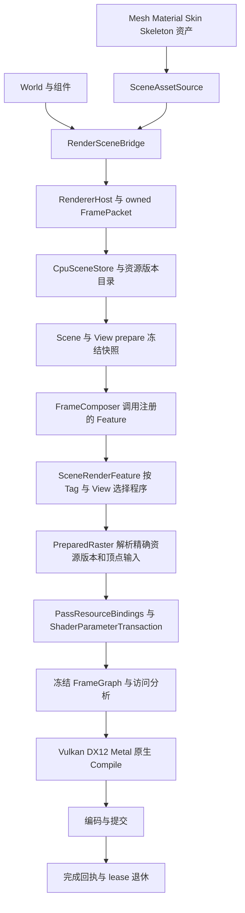

# Aurora 渲染设计与一致性审计

> 2026-10-26 后续：本文记录审计当日状态。旧 RenderGraph、RDGBackend 与 PipelinePass 模板现已确认无生产消费者并删除，见 [退役设计](../../openspec/changes/remove-unused-legacy-rendergraph/design.md)。本文旧 API 缺口不再是待迁移任务；RenderScene/LightSystem 等独立 CPU 数据设施不在本次删除范围。

日期：2026-10-25。基线：本地工作树，包含暂存、未暂存及相关新增文件；HEAD 为 `69e33334`。正文保留本次修复前的审计快照；用户授权修复后的代码与验证状态见文末“同日修复记录”。历史失败和行号不代表修复后仍然存在的问题。

**修复状态：R1–R12 已完成代码修复和本机适用回归；Metal 的本轮原生验证仍待 Apple 宿主。详见文末记录。**

**修复前结论：架构状态 Risk。四层资源归属已经进入生产代码，但事件交付、参数事务、材质接口、Metal、三域变体产品化之间仍有断点。当前 PollEvents 丢弃绝大多数事件，应先修复。文档和测试同时保留了多个阶段的契约，不能用旧测试总数证明本轮重构完整。**

## 当前设计

### 生产渲染链路

| 边界 | 当前责任和约束 | 主要实现 |
|---|---|---|
| 宿主 | RendererHost 驱动唯一 producer；编辑器主窗、工具窗、预览通过同一 Renderer/Device 提交 | `adaptor/src/renderer/RendererHost.cpp`、`sandbox/render/src/EditorRenderer.cpp` |
| World → Renderer | 组件交出身份、配置与拥有型快照；render 侧不借用可变组件内存 | `adaptor/src/renderer/RenderSceneBridge.cpp` |
| 资产 → CPU 资源 | Mesh 几何、Material techniques、纹理精确版本、Skin/rig 绑定；shader 解析目前也在此发生 | `adaptor/src/renderer/SceneAssetSource.cpp` |
| Prepare | Scene/Entity/View/Viewport 有代际；场景派生数据与逐 View 裁剪、LOD、draw/palette 冻结；CPU worker 不创建 GPU 资源 | `core/src/renderer/prepare` |
| Feature 建图 | 宿主显式注册 Scene/UI 等 feature；没有隐式 scene raster fallback；View/Pass 决定 queue Tag 和 Pipeline 输入 | `pipeline/src/SceneRenderFeature.cpp`、`core/src/renderer/graph/FrameComposer.cpp` |
| Draw 解析 | 按 mesh/material 版本、Tag、skinned、Pipeline values 找到已准备程序；按语义匹配 shader 顶点输入 | `core/src/renderer/graph/PreparedRaster.cpp` |
| 参数 | 类型和名字解析、CPU schema → target ABI 编码、资源 token 冻结、失败不替换旧绑定 | `PassResourceBindings.cpp`、RHI `ShaderParameterTransaction` |
| 原生执行 | 后端 Compile 构造 descriptor/PSO/同步计划，worker 消费冻结结果；提交与 GPU 完成分离 | `rhi/{vulkan,dx12,metal}/src/rdg` |
| 生命周期 | exact version pins、frame lease、模块 lease 保活；上传提交不等于 Resident；完成或安全 teardown 后退休 | `core/src/renderer/resource`、`frame`、`rhi/common` |

`PipelinePass` / `ScenePass` / `OpaquePass` / `SceneRasterPassTemplate` 和旧 `RenderGraph::ExecutePasses` 仍存在并有测试。它们是保留的旧模板/API，不能拿其 DrawItem 流程解释上述生产 FrameGraph。共享声明头被两条路径共同消费，因此仍须明确旧路径是否继续兼容。

### Shader 从声明到产品

1. **声明**：C++ `.h` 是共享字段和资源的权威源；`SharedShader.h` 生成 CPU 类型、typed slots 和语义 schema。`python/shader_headers.py` 导出持久化 `.slangh`，Slang 消费导出，C++ 不依赖 Slang 生成头。
2. **资源注册**：模块 `resources.json` / plugin resource description 描述 owner、roots、dependencies、includeRoots、exports 和 programs；统一 inventory 负责命名空间、依赖闭包、冲突检查及 staging。
3. **程序和选项**：`ShaderTechnique` 显式引用 VS/FS 或 CS 的路径与 entry；Scene technique 使用 Tag。当前仍使用 `.slang.json` companion、`GlobalVariantLayout` 和 P/V/S assembler；`SkyTechnique` / `SkyVariant` 新 DSL 尚未实施。
4. **选择**：Vertex、Material、Pipeline 分别提供选项。当前 SceneAssetSource 为 technique 枚举 Pipeline 组合，并为当前 skinned 值组装、编译；SceneRenderFeature 从冻结 View 计算 SHADOWS/IBL，PreparedRaster 逐 draw 选已准备的组合。
5. **解析和编译**：`ShaderResolver` 将 schema、有效选项、target environment 等转成 canonical request。DEVELOPMENT 要求源码和 compiler producer identity；PRODUCTS 按发布索引读取 artifact，不能靠安装的编译器隐式兜底。
6. **产物**：一个 stage artifact 封装目标代码、native entry、逻辑声明、目标反射、producer/environment/identity。Shader 链接合并 stage artifact，派生 native binding plan；不会把任意手写 reflection 作为目标 ABI。
7. **离线**：requirements/material/programs/runtime usage → ShaderCookTool → 每 target 的 index/blob → source-free resolver 验证。直接 replay 已给定 usage values 的成功，不等于无源 Scene/Feature 能重新建立三域选择。

当前代码格式：**shader index/blob v8、usage v2、Material v3、MaterialInstance v2**。`cmake/thirdparty.json` 的 Slang baseline 为 **v2026.19**；Slang 静态库归 ShaderCompiler 模块/受允许的工具和测试消费。不能继续把 v4/v6 cache 或 v2 Material 写作当前格式。

### 三类变体输入与四层资源

两者是不同维度：三类输入决定程序组合；四层 set 划分资源所有权。某个选项属于 Material 域，不代表它必须通过 Batch set 传输。

| 变体域 | 所有者 | 需要传入的内容 | 本地实现状态 |
|---|---|---|---|
| Vertex | 几何/draw | 顶点能力、是否蒙皮、instance 等选择信息 | assembler 支持 semantic mask；生产只构造 skinned 对应的 JOINTS/WEIGHTS |
| Material | 材质定义/实例 | 材质 schema 允许的值与默认值 | 已参与组装，并拒绝覆盖已知 Vertex/Pipeline key |
| Pipeline | 消费 draw 的 Pass/View | SHADOWS、IBL 等冻结配置 | 有源 SHADOWS/IBL 已接逐 View 选择；无源布局还不完整 |

| 资源层 | Logical set | 当前内置示例 | 生命周期/使用约束 |
|---|---:|---|---|
| Global | 0 | `gGlobal.frameTime` | 跨 View 的帧语义，相机不放这里 |
| Pass | 1 | 相机、光照、阴影、环境、后处理输入 | 由具体 Pass 声明，可省略 View 数据 |
| Material | 2 | `gMaterial` binding 0 的 tint/surface，以及材质自己的资源 | Material 接口应跨 P/V 组合稳定；并非只准一个内置 UBO |
| Batch | 3 | world binding 0、palette binding 3；surface flags 应迁入，但当前还在 set 2/binding 1 | 每 draw/实例数据；palette 为只读 structured buffer |

四层不要求每个 shader 都创建四个非空 ResourceGroup，也不等于只能有四个 block。ResourceGroup 仍按 `Shader + logical set` 创建；native layout 从已链接 artifact 派生。FrameGraph 路径和直接 ResourceGroup 更新复用事务校验，分别负责 graph/native materialization。

当前还存在两处边界差异：`SceneSurfaceBatch.h:7` 将逐 draw 的 receive-shadow 数据留在 Material set 2；`UiRenderFeature.cpp:284` 明确要求逐 draw image/sampler 使用 set 0。前者是 Scene 四层迁移遗漏；后者是已有 UI 专用接口与统一层级规则之间的范围冲突，应决定是否迁移或明确其适用例外，不能把它描述成已经遵循四层所有权。

### Skin 与实例

Mesh 持几何和有序输入槽；独立 Skin 持 inverse bind 与命名/索引绑定；Skeleton 持 rig。实例选择 Mesh/Skin/Skeleton 元组并解析 slot→joint，palette 属于实例的冻结姿态。Skin 不保存多个角色共享的可变 boneMatrices，Mesh 不通过 SetSkin 绑定唯一 rig。`SkinBindingKey` 包含各资产身份、revision/generation，旧帧保留自己的绑定和姿态。

### Aurora 全链路代码设计评估

本节以代码调用链为依据，覆盖 Aurora 的现有设计边界；不是“每行实现均已证明正确”。架构为 Risk，当前宿主事件与三域/四层集成存在 Regression；CPU/GPU 性能没有实测基线，不作性能通过结论。

| 设计面 | 代码中的实际机制 | 评估 |
|---|---|---|
| foundation 与 target | `Renderer.Interface → RHI.Interface → Core`；实现留 core；pipeline 依赖 core/RHI；adaptor 接 Framework；runtime 是模块入口；editor 通过 EditorCore/Ui/Widgets 接入 | 主方向成立，无需把 Aurora 搬到 plugin；Cook → Adaptor 是已登记的历史分层债务，应单独处理 |
| 模块、设备和身份 | `Instance::Acquire` 独占 device session；epoch 区分重建；FrameFeatureRegistry 校验 ID/generation/name/module lease，退休等最后 borrower 释放 | 保留。Compiler 的异步借用没有同等保活保障，见 R12；不能把跨 DLL 单例等同于跨 DLL 生命周期已安全 |
| 宿主和组件 | RendererHost 公开唯一 IRenderer；RenderSceneBridge 将组件变化转成 owned FramePacket，组件不直接创建 GPU 对象 | 边界成立；R9 破坏返回通道，组件移除、窗口退休和 readback 因此不能完成正常通知 |
| CPU Scene | CpuSceneStore 做命令验证、generation/revision 与退休；FrozenCpuFrame/ReadView 约束冻结期结构变更 | 本轮未发现需要推翻的结构；现有 state/write-view 测试支持该边界，但不替代实际宿主通知验收 |
| 并行 prepare | ScenePrepareScheduler 编译显式依赖、分块，按任务/输出/scratch 预算分配；过并行预算走串行；失败/取消仍等任务与 context 收齐 | 保留；不是让 worker 任意读写 World，也不是在 worker 创建 native GPU 对象。场景数据缓存与逐 View 提取分开，蒙皮使用精确快照 |
| 资源目录与上传 | ResourceCatalog 固定 exact version；ResourceUploader 分块、校验 recorded graph receipt，只有对应 GPU completion 才 AdoptResident；不确定提交保留隔离资源 | 核心状态机成立。R11 使新变体字节漏算，资源预算还未覆盖完整 payload |
| Shader 编译与产品 | shared C++ schema、target artifact、native binding plan、DEVELOPMENT/PRODUCTS 分离；schema/producer/environment 参与身份 | 方向成立；R4/R6/R7 是三域选择到 stage/cook 的断点；R12 是现有异步接口的生命周期债务 |
| Material 与实例 | properties/typed aliases/texture exact version/sampler；technique Tag 与 P/V 组合分离；参数保持材质所有权 | R2/R8/R10/R11 说明结构已扩展而消费者未全部迁移。不能只新增 variants/set 常量就认为协议已经收口 |
| Mesh、Skin、姿态 | Mesh 几何与 slot、Skin inverse bind、Skeleton rig、实例 palette 分开；bounds 随姿态冻结 | 资产模型符合当前约定；R1 阻断生产 palette；R5 表明通用 Vertex/instance 选择仍未接通 |
| Feature 与 Pass/View | IFrameGraphFeature 显式注册；SceneRenderFeature 选择 opaque/shadow Tag、灯光/环境、后处理/selection；UI 使用独立扩展 payload | 比旧隐式 scene fallback 清楚；当前支持的是明确子集，不代表已有通用透明队列、完整 instancing 或所有 raster 状态。UI set0 例外仍须明确 |
| FrameGraph | graph identity 限定 handle；Freeze 后不可变；Analysis 检查资源范围、初始化内容、读写依赖、live passes；编译派生 barrier/native plan | 保留；不能拿旧 RenderGraph::ExecutePasses 代表此链路。R1 位于参数进入图的适配层，而非 GPU storage 能力本身 |
| 临时资源与缓存 | FrameTransientPool 按不重叠 lifetime/兼容 descriptor 复用 backing，borrower 未退休不复用；native object cache 保留借用者 | 有明确所有权和预算，不建议为了目录统一另建并行缓存体系；未完成全部原生回归，因此没有全后端正确性背书 |
| 原生编码与提交 | Compile → Dispatch → TryCollect → Submit；common 层跟踪 accepted/completed 状态；Vulkan/DX12/Metal 各自编码；拒绝与不确定提交分开 | Vulkan/DX12 有本轮原生证据；Metal 四层/structured raster 不完整（R3）。共同类型扩大后，三份后端实现必须一起审查 |
| 多窗口、退出、失败 | FrameScheduler 区分 acquire/submit/present/retire；resize/close 等 borrower 和 GPU 完成；shutdown 收齐 pending/encoding/submission 后释放 session | 机制应保留。R9 丢失上层所依赖的回执；不能通过吞错误或直接释放 native window 修复 |
| Cook 与编辑器 | Cook 生成 Mesh/Skin/Material 等产品；Aurora editor 通过 Sandbox 编辑器接口集成；shader compiler 是可选模块 | Cook 52 项通过。已有 `aurora-cook-schema-layering` 明确未实施，不能称已经满足 builder 不依赖 adaptor 的规则；本轮不擅自拆 target |
| 旧 API | RenderScene/LightSystem/PipelinePass/旧 RDG backend adapter 仍构建；当前生产走 RendererHost/FrameComposer | 需要标明支持范围；共享 SceneBatch 已到 set3，但旧 Execute 仍绑 set2，是具体兼容缺口。不能一边保留公共 API 一边默认旧入口无需维护 |

CPU 热点需另行测量：SceneAssetSource 的首次 MaterialPayload 在 bridge 解析路径同步枚举 Pipeline 组合并调用 CompileShaderTechnique（最多 64 组合/technique），且每个 View 建图又复制 draw 列表、查找资源。当前没有真实场景 profile，不能据此宣称已造成多少毫秒回归；扩大变体、材质数和 View 数前，应记录冷加载、缓存命中和稳定帧成本。异步化之前先解决 R12，不直接把裸指针任务丢进线程池。

## 实现与设计的断点

| ID | 优先级 | 触发与结果 | 证据及最小纠正 |
|---|---|---|---|
| R9 | P1，先修 | PollEvents 只有 FrameCompleted 才写入 destination，却对所有事件执行 pop_front；readback、RendererFailure、ViewportDestroyed、RendererStopped 等静默丢失，宿主收不到像素、失败和生命周期通知 | `core/src/renderer/RendererRuntime.cpp:1191` 多出的条件；恢复完整事件交付，并从 IRenderer 入口覆盖异构事件顺序与批次容量。当前宿主/GPU 回归已大量出现对应失败 |
| R1 | P1 | 生产 Scene 的 palette 写进 `group.storage`，但带 context 的 ApplyTransaction 不处理它；事务 Complete 因 required storage 缺失失败，颜色/阴影都受影响 | `core/src/renderer/graph/PassResourceBindings.cpp:300` 后续循环没有写入 storage，materializer 也把 buffer token 全部放入 uniforms；补 storage 事务写入及类型分流，并通过生产入口验证 |
| R2 | P1 | MaterialSchema 只保留 set 2/binding 0；材质纹理、sampler、多 UBO 即使 alias 有效也从 provider schema 丢失，后续 Apply 拒绝缺少声明/归属 | `pipeline/src/SceneRenderFeature.cpp:98`；先完成 R8 的 Feature 迁出，再提取整个实际 Material set，不能把 Material 层等同于内置 gMaterial block；`SceneAssetSource.cpp:727` 的同类前置限制也需修正 |
| R3 | P1 | Metal compute 只遍历 set 0–2；Metal raster 只写 uniforms/images/samplers，未消费 `source.storage` | `rhi/metal/src/rdg/MetalDeviceFrameContext.mm:470`、`:242`；统一四 set 范围并补 raster palette；没有本轮 Metal 原生设备结果 |
| R4 | P1 | 无源码时 PipelineLayout 加载失败被吞掉并变为空 schema；已发布 combined schema 未保留域及 vertexDefs，Scene/Feature 退回默认组合，SHADOWS/IBL 选择和 owner 校验丢失 | `SceneAssetSource.cpp:607`、`:665`、`SceneRenderFeature.cpp:642`；发布/加载运行时选择所需元数据，缺失时返回显式错误，补无源非默认 View 测试 |
| R5 | P2 | 生产 vertex mask 只由 bool skinned 构造；带 COLOR 等语义的 Mesh 仍会把对应 vertex switch 判为 false，instance 输入也未进入契约 | `SceneAssetSource.cpp:670`、`PreparedRaster.cpp:94`；传真实几何/draw capabilities，并用完整 Vertex 选择键区分程序 |
| R6 | P2 | assembled specialization 值仅留在 `spec`，CompileStage 给 resolver 的却只有 macros；DXIL canonicalization 对缺失 spec key 使用默认值，选中的非默认值不进入编译产物 | `pipeline/src/ShaderVariantAssembler.cpp:152`、`core/src/aurora/shader/ShaderTechnique.cpp:94`；保留命名的有效 spec 值到目标 lowering/cook，不靠原生 specialization 补救 DXIL |
| R7 | P2 | 组装 schema 只来自 VS，CompileStage 对 FS 也覆盖成该 schema；不同 stage 源中的独立默认声明可能被漏掉 | `SceneAssetSource.cpp:660`、`ShaderTechnique.cpp:110`；逐 stage 规范化或明确合并并校验 program schema，增加跨文件 stage 默认值测试 |
| R8 | P1 | Feature 的逐 draw `gSceneSurface` 留在 set 2/binding 1，与 Material 独占 set 2 的设计不符；自定义材质复用该槽会冲突，也阻碍整个 Material set 的共享与独立更新 | `pipeline/shaders/SceneSurfaceBatch.h:7` 与持久导出；迁入 Batch set 3，并用行为/归属测试验证所有 Batch 声明，而不只比较两份同源布局 |
| R10 | P2 | 收包只验证 technique.program，真正执行却优先遍历 variants；其他变体的 backend/stages/参数语义及重复选择键没有同等入口校验，alias 在各变体中仅验证能找到，未验证类型/数组形状一致 | `core/src/renderer/RendererRuntime.cpp:203` 对比 `:687`；`SceneAssetSource.cpp:915`。例如非默认 P 组合将同名字段从 float4 改成 float2，可越过资产端检查，在选择该组合时才失败。对所有执行变体校验 typed parameters 和唯一选择键 |
| R11 | P1 | RenderResourceCpuBytes 只统计旧 program，完全漏掉 variants 的 artifact、反射和组合数据，资源包与 ResourceCatalog 预算因此可被新正常路径绕过 | `core/include/aurora/renderer/RenderResourceTypes.h:123`；遍历实际执行变体，处理共享 artifact 去重/保守计数及溢出。独立探针加入 1 MiB variant artifact，计数增加 0 |
| R12 | P2，既有接口债务 | ResolveShaderAsync 保存裸 compiler、local FS、writer；compiler module Shutdown 直接 reset，无 task lease 或收齐。准备 future 后卸载模块/销毁输出设施，再执行或完成任务会访问失效对象 | `core/src/aurora/shader/ShaderResolver.cpp:390`、`core/include/aurora/shader/ShaderCompileTask.h:121`、`shader/module/AuroraShaderCompilerModule.cpp:34`；future 持能力/模块及输出所有者，关闭时拒绝新任务并收齐。当前生产材质主要同步，现有异步调用点集中在测试；不要夸称当前每帧必然触发 |

R1 已用隔离验证确认：复制现有骨骼回读用例，仅把 `Apply(draw, groups)` 改为生产使用的 `Apply(composer, draw, groups)`，Vulkan 两种模式及 DX12 **3/3 失败**，错误为 `Required parameter resource is missing or has an incompatible type`。源测试和实现未改动；临时项目在构建目录。

R6 也已通过隔离验证确认：同一 `NUM_LIGHTS` 选择为 4，assembler 的 `spec` 中是 4，经生产使用的 macros → DXIL canonicalization 后为 0。现有 `SpecFoldedIntoHash` 仅检查 hash 不同，不能证明有效值进入 DXIL。

R9 来自本地未暂存修改。原始 GPU 全量启动 954 项，但在宿主/Runtime 用例连续失败后提前结束，没有正常 gtest 汇总；不能报告为“954 项已完成”。日志中的缺失 readback、destroyed、stopped 通知与该条件直接吻合；提前结束本身的原因尚未单独定位，不据此推断其他后端缺陷。

R11 的独立纯 CPU 探针也失败：仅向 `technique.variants[0].program.vertex` 加入 1048576 字节，`RenderResourceCpuBytes` 增量为 0。这不依赖 GPU、shader 编译器或设备时序。

## 测试盘点与覆盖判定

按文件全量扫描 Aurora 测试/夹具、相关 Sandbox/UI 和 Python shader/package 测试，登记 **139 个文件、110 个包含用例的文件、1149 个静态测试定义**。参数化展开、平台条件与 GTEST_SKIP 会改变实际执行数；这些数字不是“1149 项全部运行通过”。完整逐文件/逐用例目录在本地 `cmake-build-debug/render-audit-inventory.json`。

| 测试组 | 当前价值 | 过期或覆盖缺口 |
|---|---|---|
| RHI ResourceGroup/Shader/NamedParameter/UniformUploadPlan | artifact、native slots、数据类型、事务失败、快照保活 | 需要 Material set 2 + Batch set 3 同时活跃的直接 RG 与图路径覆盖；Metal set 3 compute/palette raster 缺失 |
| Pipeline SharedPassHeaders | C++/SPIR-V/DXIL/MSL 声明对照，包含 SkinningBatch | 证明编译和反射，不能证明生产 palette 事务或 native Metal；同源比较也发现不了 SceneSurfaceBatch 仍归 set 2 |
| PassResourceBindingsTest | typed/named transactions、provider 归属、错误原子性 | 没有 context + storage + material 的组合用例，R1 因而漏检 |
| IndexedRaster skeletal readback | 整数 JOINTS、buffer range、normal/tangent、双在途 palette | 当前调用不带 context 的 Apply，绕开生产事务；需保留底层测试并增加生产入口测试 |
| SceneMaterialSource | 材质和纹理资产版本、alias 验证 | `SceneImageConversionTest.cpp:113` 夹具 resource/blocks/native binding 的 set/binding 不一致；实际 1 项失败，未走到纹理生命周期断言 |
| ShaderVariantAssembler / MaterialVariantSelection | 8 组合、owner 拒绝、选择键、revision | 手工填 semantic mask/variants；不能证明 SceneAssetSource 的真实顶点输入、source-free owner 或跨 stage schema |
| ShaderVariantTest | 直接 compiler 的 SPIR-V/DXIL spec 行为 | 未覆盖 assembler → CompileShaderTechnique → resolver → cook 组合链，无法发现 R6 |
| ShaderCompileTask / ShaderBundle | 异步 compile、cache hit、resolver/source 生命周期 | 现有 fake compiler 在整个测试期间存活；没有 compiler 模块先关闭或输出 writer 提前释放的测试，无法证明 R12 的生命周期安全 |
| Renderer payload/resource budget | 旧 program、bytes、typed parameters 的入口校验 | variants 新增后未覆盖所有程序校验和字节计量，遗漏 R10/R11 |
| ShaderDistribution / relocation | 已发布 request 直接命中、无 compiler resolve | 需要无源 SceneFeature 的非默认 SHADOWS/IBL、多 Vertex capability；不能只 replay requirements |
| Renderer prepare/state/resource/coordinator | 冻结、代际、版本 pin、失败与退休 | 与四层绑定正交，继续保留；通过不能替代生产材质/蒙皮像素验证 |
| 旧 RDG/ResourceTiers/PipelineTemplate/SceneCollect | 验证仍存在的旧 API | 明确标记 legacy；`BatchDynamicOffsetPassThrough` 只看 CPU payload，不执行 batch bind，不能覆盖旧 Execute 仍绑 set 2 的冲突 |
| Python shader_headers | 持久导出、无操作时间戳、错误原子性 | `test_shader_headers.py:36` 硬编码 13，实际 14，新增 SkinningBatch 后过期；应断言所需接口/布局而非固定数量 |
| Python module_resources/native_package | inventory、平台 staging、产物拷贝 | Windows 默认编码、默认 VS generator 与 POSIX 路径/权限假设使部分用例无法正确验证；应拆平台适用性与纯路径单元测试 |
| RendererRuntime / EditorHostNative / RendererHostNative | 真实宿主的事件、像素、销毁与退休 | 已揭示 R9，不能因底层图测试通过而跳过；当前全量运行未正常结束，尚无完整 GPU 验收 |
| RendererModule | 动态/静态注册、卸载、module lease | 静态 `DuplicateRegistrationDoesNotReplaceOrUnregisterOwner` 直接工厂创建并 Init，未提供新的 skeleton source 所需 ModuleManager lease，已失败；夹具应通过受管模块建立 owner，再验证重复注册，不绕过保活约束 |
| Cook/Editor/UI | 资产兼容、宿主加载、UI shader、预览接入 | Cook 52 项通过；Editor/UI 已纳入静态盘点，未以 shader 单测代替所有宿主/编辑器/平台验收 |

建议新增的验收必须从真实入口出发：SceneAssetSource → 冻结 View/Draw → SceneRenderFeature → 参数事务 → 原生像素回读；包括静态/蒙皮同材质、多 View 不同 P、set 2 材质纹理/sampler、旧新 revision 在途，以及 products-only 非默认组合。

## 文档与规范审计

全文扫描候选范围 **690 份、62417 行**：规则/技能 11、docs 24、主 spec 47、未归档 change 文档 119、archive 文档 489。目录和主题匹配用于全量盘点，候选命中再按代码及条款上下文判定；不是把所有提及 Aurora 的文件判为过期。游戏玩法/PCG 等独立规划只做关联筛查。

### 当前文档和规则的确定过期项

| 文件 | 过期内容 | 建议处理 |
|---|---|---|
| `engine/aurora/AGENTS.md:95`、`:303` | 同一文件上文已四层，Dynamic UBO 段仍写 Batch set 2；末尾仍写 Material v2/uniform mappings；旧 encoder 的 End no-op/直接写入说明与新事务混杂 | 统一四层、Material v3 typed aliases；区分公开事务和 native descriptor primitive、生产与旧协议 |
| `engine/aurora/rhi/AGENTS.md:8` | B07 只列 set 0/1/2，作为当前能力概述容易被误读 | 标为历史检查点并给出当前四层与后端未完成项 |
| `.opencode/skills/skyengine-aurora-shader/SKILL.md:18`、`:34` | 三层、Batch set 2、cache 6；末尾仍混称 material-owned/feature-owned Batch | 更新四层和格式；保留正确的 named transaction/ABI/无源原则 |
| `.opencode/skills/skyengine-aurora-reference/SKILL.md:49`、`:70` | 三层表、Material v2/cache v4；最后仍把材质纹理自动传输整体列为未实现 | 依据当前模块/API重写能力边界，并列出本次已发现的生产缺口 |
| `.opencode/skills/skyengine-pc-gpu-review/SKILL.md:22` | shader/material/technique 仍指旧全局 assets 目录；把旧 terrain 的 ForwardColor/depth prepass 描述为通用现状 | 指向模块资源根；区分迁移目标与已实现 SceneFeature |
| `.opencode/skills/skyengine-architecture-review/SKILL.md` | plugin 编辑器只能依赖 Launcher、通过 RenderScene feature processor 接入的旧示例，与根规则允许 Sandbox editor framework 及当前 IFrameGraphFeature 不一致 | 根 AGENTS 优先；更新示例，不能据旧技能否决现有合法依赖 |
| `docs/features/shader-system.md:26`、`:135`、`:187`、`:250` | storage declarations 全部拒绝、cache 6、tint/surface 仍在 Material-owned Batch binding 2、deformation 整体 unsupported | 更新 supported structured subset、cache8、Material set2/binding0；保留未通过验收边界 |
| `docs/aurora/shader-design-and-migration.md:5`、`:22`、`:45`、`:102`、`:157` | 标题下已四层，正文仍三层；引用已删 MaterialBatch/gMaterialBatch、cache6 | 同文件统一；清理不可运行的 alias 示例 |
| `docs/editor/material-editor-design.md:17` | 把材质 v2/uniform mapping 作为现行格式 | 改成 v3 properties/aliases，独立说明 UI 实际可编辑字段，不扩大 UI 能力 |

Slang 2026.9.2 的问题描述可作为历史缺陷证据保留，但需注明当前 SDK 为 v2026.19，不能将旧版本探针作为当前行为保证。

### 主 spec 的冲突

主 spec 尚未吸收若干已实施但未归档 change，这解释了部分滞后；它们仍会误导新开发者，需在对应 change 合并时统一，不能自动 archive。

| 主 spec | 与当前设计不一致的要求 |
|---|---|
| `aurora-shader:165`、`aurora-resource-binding:318`、`aurora-rhi-core:671`、`ui-render:62` | 仍规范三层 / Batch set2；须加入 Material set2、Batch set3，并说明可缺省层 |
| `aurora-shader` | Shader::Descriptor 传外部 reflection、Metal argument-buffer 布局、C++ offsetof 必须等于目标 ABI 等旧条款；当前为 sealed stage artifact 链接、目标 ABI upload plan 和 direct arguments |
| `aurora-resource-binding` | 错误类型可 Debug assert/Release UB、End 覆写原 group 等旧契约；当前要求显式失败和不可变版本 |
| `aurora-shader-cache:24` | 只凭 variantHash、不需 schema；offline→source→local 的固定混合顺序；旧 toolchain/hash 去重模型 |
| `aurora-rhi-metal:22`、`:26`、`:73` | 以类别序号/最高 binding 推 native slot，数组展开、缺 dynamic offset 回退等旧契约；不能恢复这些 fallback |
| `aurora-material:8`、`:40`、`:74` | 单 ShaderRef technique、只按 sizeof 判断类型、实例整块复制等旧要求；当前显式 stages、语义类型、typed overrides/samplers |
| `aurora-mesh:53` 与 `aurora-skinning:21` | 一个要求 Mesh 挂 Skeleton，另一个要求 Mesh 挂 Skin 且 Skin 自持 boneMatrices；与独立不可变 Skin + 实例元组均不一致 |
| `aurora-rdg:272`、`aurora-pipeline` | 仍描述旧 Execute/DrawItem/SceneRasterPassTemplate；旧 API 存在，需明确适用范围，不应将整个 spec 删除或机械替换为 FrameGraph |

旧 `rhi/interface/src/rdg/Execute.cpp:73` 仍将 `batchResourceGroup` 绑定到 set 2，但共享 `SceneBatch.h` 已变成 set 3。当前旧模板测试没有执行这一绑定，只验证 payload 中的 dynamic offset；需要在保留旧 API 的前提下迁移或明确拒绝，不属于纯注释清理。

### 活跃 change 与历史记录

| Change | 审计结论 |
|---|---|
| `add-skeletal-animation-workflow` | D6a 三域要求正确；4.6/4.11/4.12 的完成说明过强，未覆盖 R1/R4/R5/R6；9.2 的旧全绿结果不能代表本次四层重构。4.5/4.8、原生角色/阴影与 Metal 等未勾选项继续保留 |
| `refactor-aurora-target-shader-artifacts` | 实现/ABI/事务路线继续成立；shader delta 仍要求 sets0/1/2，cache v6 为旧检查点。应追加四层/v8 接续，不改写 2026-10-23 的历史测试事实 |
| `refactor-aurora-pipeline-resource-ownership` | 43/43 是旧阶段记录；design 和 shader delta 仍三层。新的四层契约需要明确承接，不能凭旧 native acceptance 关闭新 Metal 缺口 |
| `refactor-aurora-shared-pass-headers`、`fix-aurora-pass-resource-contract` | 保留迁移和历史证据，补被后续契约替代的范围；避免三份 delta 同时宣称各自为最终规范 |
| `refactor-aurora-shader-source-techniques` | 0/53，仍是方案。Context 称 assembler 仅测试调用、built-in companion 全空、session.detach 仍在、Metal 无 specialization 均已过期；migration 的 Material v3/cache v5 也与当前冲突；不能用此草案解释现有实现或删除 companion |
| `refactor-aurora-slang-usage` | v2026.19/static module 已进入代码；1.2 仍写除 iOS 外 shared，与 2.10 的全平台静态 Slang 相冲突。后续线程池/session cache任务仍未完成，不因本轮测试自动勾选 |
| `aurora-renderer-platform-parity` | 待验收 gate 有价值；关于三层共享声明的清单要更新；编译/MSL 生成不能当新四层 Metal 实机结果 |
| `aurora-scene-lighting` | 当前格式4的表述已旧；有日期的旧像素验证保留，能力现状需指向 cache8/四层 |
| `aurora-renderer-extensions`、terrain/vegetation Aurora 迁移 | 未实施目标不视为代码缺陷；旧 pipeline 类方案实施前应重新对齐 IFrameGraphFeature/FrameComposer |
| archive | 保留历史原文和当时验收。只修现行文档把历史条款当最新规则的引用；不批量替换历史 set 数字、版本或测试数量 |

### 不应作为过期项删除的内容

- shader 中 set0/set2 的稀疏绑定、无 Batch、无相机用例仍是有效底层场景；四层语义不要求每个合成 shader 用满四层。
- `MaterialBatch` 的历史迁移记录，以及“禁止独立 Skinned* 源路径”的文字是背景/约束，不是遗留实现。
- 旧 RDG 模板尚有代码消费者；保留其单测，但单列 legacy 范围和共享头迁移兼容性。
- 平台设备未验收的空勾选不等于遗漏文档；不应为了状态一致而直接勾选。
- 扫描到的 `aurora-rdg` 两个所谓坏链接实际是代码 lambda 被正则误识别，已排除，未作为文档问题。

## 本轮验证与建议处理顺序

审计阶段只新增本文和构建目录中的验证材料；随后获用户授权的实现修复单独记录在下节。

验证日志在 `cmake-build-debug/render-audit-*` 和 `review-*`。普通构建的 DXC DLL 拷贝失败；随后通过 `/p:BuildProjectReferences=false` 定向重建相关 Core/Pipeline/Adaptor/RHI/FrameBackend、Vulkan/DX12、EditorRender 和测试目标。此结果不表述为全工程干净构建通过。

| 验证 | 本轮结果 |
|---|---|
| ShaderHeaders.Check | 通过 |
| Aurora.PipelineTest | 53/53 通过 |
| Aurora.ShaderTest | 57/57 通过 |
| Aurora.CoreTest | 完整 99/99 通过；此前相关筛选 50/50 也通过 |
| Aurora.AdaptorTest | 61 项，60 通过、1 失败，反射夹具未迁移完整 |
| RHI + Renderer CTest | 11 个目标中 10 通过，GpuSubmissionTest 失败；954 项全量启动后未正常跑完，宿主/Runtime 出现 R9 对应的通知缺失 |
| 独立 GPU 筛选 | 排除 3 个 host/runtime suites 后，日志记录 479 通过、10 跳过；在 BufferUploads continuation 的 DX12 项提前结束，退出码 1、无完整汇总。未定位终止原因，不将未完成部分列为通过 |
| Aurora.CookTest | 重建 AuroraCook.Static 后完整 52/52 通过；之前仅重链测试的旧库断言不作为当前代码缺陷 |
| Aurora.Renderer.ModuleTest | 注册、参数、lease 筛选 3/3 通过，动态库已重建 |
| Aurora.Renderer.StaticModuleTest | 同类筛选 4 项：3 通过、1 失败；重复注册夹具缺受管模块 lease |
| 隔离 palette 生产入口验证 | Vulkan RenderPass / Dynamic Rendering / DX12 共 3 项全部失败，确认 R1 |
| 隔离 DXIL specialization 验证 | 1 项失败，实际值 0、选择值 4，确认 R6 |
| 隔离变体资源预算验证 | 1 项失败，加入 1 MiB artifact 后统计增量为 0，确认 R11 |
| Python 4 组 | 43 项，3 failures、7 errors、1 skipped；包含确定的 14≠13 断言和 Windows 路径/权限/编码问题 |
| Python module staging 编码复核 | UTF-8 下不再出现 decode error，但默认 VS generator 的 Release 场景仍失败；测试未显式建立 single-config 前提 |
| Metal | 本轮仅代码/编译反射审阅，无原生执行结果 |
| OpenSpec 全仓严格校验 | `openspec validate --all --strict --no-interactive`：210 项，198 通过、12 失败。语法通过不等于语义未过期；失败包含旧 debt record 和与 Aurora 无关的 spec，详见日志 |

处理顺序：先修 R9 的事件交付，再修 R1/R2/R3/R8 以及 R10/R11 的完整变体入口契约；随后补三域元数据、真实 Vertex 输入、DXIL lowering 和无源非默认组合；异步产品化前处理 R12。接着统一当前 docs/skills 与 active change 的承接关系；最后在用户确认的 spec 收口/归档步骤同步主 spec。测试数量、检查点和平台结果应带基线与日期，不继续把某次全绿描述为当前设计已全部完成。

## 同日修复记录（2026-10-25）

用户随后授权修复。沿用当前工作树和既有 target/模块入口，未移动目录，未 commit/archive。下表替代上文 R1–R12 的当前状态；上文的审计证据和历史测试结果保持原样。

| 问题 | 修复后的契约与证据 |
|---|---|
| R9 | PollEvents 交付全部事件，保留原队列顺序与容量边界。宿主/Runtime 回归检查应用、像素、失败、销毁、停止及退出通知。 |
| R1 | 带 context 的事务写入 storage token，materializer 按真实 buffer 类型分流；非法 range 锁存失败，原 draw 不被部分覆盖。新增混合 uniform/image/sampler/palette 事务测试，骨骼用例改走生产入口。 |
| R2 | Material provider 提取完整 set 2，不再强制内置 gMaterial/binding 0。自定义无 UBO、只有 set 2 纹理/sampler 的材质参与生产队列并验证蓝色像素。 |
| R3 | Metal compute 遍历 MAX_SHADER_SETS，raster 消费 storage。代码已修复；本 Windows 环境没有 Metal 原生构建或执行结果。 |
| R4 | index/blob v9 发布域、Vertex 条件和 Pipeline 预留位；无源模式从已发布索引恢复选择布局，缺失/冲突显式要求 recook。真实 SceneAssetSource 无源码/无 compiler 测试恢复 SHADOWS/IBL 四种组合。 |
| R5 | 从 mesh 的实际属性及 PER_INSTANCE 流推导完整 Vertex mask；mask 进入材质兼容族、prepared 数据和选择键。INSTANCE 不由同名假属性启用。 |
| R6 | assembler 保留 specialization 的命名有效值；DXIL lowering 取得选择值而非默认值。回归覆盖 NUM_LIGHTS=4 的实际 canonical 值。 |
| R7 | 验证 VS/FS 选择 schema 的兼容并集，逐 stage 保留自身声明/默认值；跨文件 stage 测试覆盖 FS 独有默认值与 VS 宏隔离，SPIR-V/DXIL/MSL 均运行。 |
| R8 | SceneSurface、UI 两个入口和旧 Execute 的 Batch 统一 set 3；Material 独占 set 2。持久导出同步，Python 直接断言各层声明而非固定导出数量。 |
| R10 | packet 应用前校验每个可执行 variant 的 backend、stages、参数类型/数组、Material 声明一致性和唯一选择键；失败不发布 PacketApplied，后续合法帧可恢复。 |
| R11 | 预算覆盖全部 variants、artifact、反射、命名/选项与参数；共享 artifact 按 owner 保守计数，继续使用饱和加法。新增 1 MiB 变体导致预算拒绝的回归。 |
| R12 | 异步 future 保留 compiler/module 和输出 root/writer，重复调度只执行一次；同步借用与异步拥有接口分开。真实 DLL 回归额外发现并修复控制块自卸载：注册表分开持 compiler/module，消费侧创建 lease，先销毁 compiler/deleter 再卸载模块。 |

实际 DLL 回归先以访问违规退出（`aurora-fix-compiler-dll.log`），调整控制块归属后通过（`aurora-fix-compiler-dll2.log`）。fake compiler 测试覆盖销毁 resolver/source/registration/cache 外部所有者后的执行、落盘与最终释放；三目标真实 Slang bundle 测试也覆盖注销后的执行。

验证使用 Windows / VS 2022 Debug / NVIDIA GeForce RTX 3080，Vulkan RenderPass、Dynamic Rendering 和 DX12；Shader 测试包含 SPIR-V、DXIL、MSL。定向构建使用现有 cmake-build-debug 及 `/p:BuildProjectReferences=false`，显式重建接口受影响的静态库、生产 DLL、工具和测试，并执行 ShaderResources.Stage。不是全工程 clean build。中途旧部署的 SceneSurface 资源已通过统一 Stage 更新。

拾取测试的首帧会进行冷启动 M/V/P 编译，10 秒窗口不足；仅该启动等待扩到 60 秒，后续点击和常规交互时限不变。三种后端路径均完整通过。177 项宿主/Runtime/蒙皮回归的首次完整运行有 174 项通过，另外三项仅因旧 Batch set 2 断言失败，代码实际绑定 set 3；修正断言后单独复验，不将中途失败日志改写成一次全绿运行。

当前 docs、Aurora/RHI 规则、shader/reference/architecture/GPU-review 技能及 target-shader-artifacts delta 已同步本轮契约。archive 保留历史原文；尚未归档的其他 change 与主 spec 合并状态，不因本次修复自动标为已归档或全平台验收。

### 修复后最终验证

| 验证 | 结果与日志（cmake-build-debug/） |
|---|---|
| 最终定向构建 | 生产库/DLL、SandboxModule/SandboxEditor、cook 工具与相关测试成功；`aurora-fix-build-final.log`。已有三方 PDB 缺失警告保留，不是编译失败。 |
| Core / Pipeline / Adaptor / Cook / Shader / Resource | 100 / 55 / 62 / 52 / 57 / 39 项通过；合计 365。Core 包含实际 v9 products 消费。`aurora-fix-close-Aurora.CoreTest.log`、`aurora-fix-close-Aurora.ShaderTest.log` 与 `aurora-fix-final-Aurora.{PipelineTest,AdaptorTest,CookTest}`、`aurora-fix-final-Aurora.Renderer.ResourceTest.log`。 |
| RHI / UI Shader | 154 / 9 项通过；`aurora-fix-close-Aurora.RHITest.log`、`aurora-fix-close-UIShaderTest.log`。 |
| Windows host/Runtime/骨骼 GPU | 完整运行 177 项中 174 通过；修正旧 Batch 断言后另 3 项全部通过。`aurora-fix-gpu-final.log` 与 `aurora-fix-close-Aurora.Renderer.GpuSubmissionTest.log`。不是完整 GPU suite 的一次全绿。 |
| 动态 / 静态模块生命周期筛选 | 6 / 7 项通过，无跳过；均包含真实 compiler DLL future 的执行与最终卸载。`aurora-fix-close-Aurora.Renderer.{ModuleTest,StaticModuleTest}.log`。 |
| 发布包 | 实际项目 cook v9，源码/编译器剥离后 Core 1 项、Vulkan 2 项、DX12 2 项通过；`aurora-fix-package-native.log`。Windows fixture 没有运行 Metal 专属材质资产测试，不扩张为所有平台材质验收。 |
| Python / 导出 / OpenSpec | shader_headers 10 项、持久导出 check、当前 change strict、git diff --check 均通过。`aurora-fix-headers-final.log`、`aurora-fix-header-check-final.log`、`aurora-fix-openspec-final.log`。 |
| 未执行的范围 | 本轮原生 Metal、移动设备、Linux 及全工程 clean build；其他 OpenSpec 主规格/历史债务不是本轮自动 archive 的结果。 |

旧 shader index/blob v8 及更早产品必须重新 cook 为 v9，不做静默兼容。修复前暂存/未暂存补丁与本轮 tracked 文件差异保留在本地 `aurora-fix-baseline/`；该目录是验证材料，不加入提交。

### 2026-10-25 cleanup 后的状态补充

上节 v9 和定向构建是历史验证记录。当前 shader source techniques 工作区为 v10，按其 change 的版本迁移重新 cook。本轮完成全项目 Debug 增量构建、唯一 metadata owner 拆分和窗口/测试重复注册清理；没有进行 clean build 或 OpenSpec archive。此前静态模块 fixture 的缺 lease 问题已在受管入口修正，动态/静态生命周期 6/7 项通过；真实无源码/无 compiler 包的 Core 1、Vulkan 2、D3D12 2 项通过。具体 owner、lease 和回归契约见 `openspec/changes/refactor-process-owned-reflection/`；原生 Metal 验收仍开放。

2026-10-26 最终补充：原生 GPU 首轮 174/177 通过；3 个静态拾取用例因最后一次 Tick 已完成但等待辅助函数未复查而误报，修复后 3/3 定向复测通过，保留全部行为断言。证据为 `cleanup-review-2026-10-25/gpu-metadata-final.xml` 与 `gpu-picking-final.xml`，不是单次全 suite 全绿。Reflection Demo、NetworkWorld 和 Bullet 的遗留反射入口也已收敛；最终编辑器 376、NetworkWorld 5、Bullet 8、Animation 模块生命周期 2 项通过。

### 2026-10-26 文档审计纠正

上文“当前 docs、规则和 delta 已同步”的结论不完整：只核对改动文件和 strict 格式校验，漏掉主 spec、跨 change 的旧契约与合并操作冲突。后续补查已修正反射幂等、三组绑定、Mesh 持 Skin、Content Graph owner、材质旧 schema、目标 ABI/缓存和 Metal 猜槽位等内容，并单独执行只读 delta 合并检查。详细证据、全库校验失败项及尚未关闭的代码/平台边界见 [一致性复核](consistency-review-2026-10-26.md)。本段不改写此前测试运行的结果。
