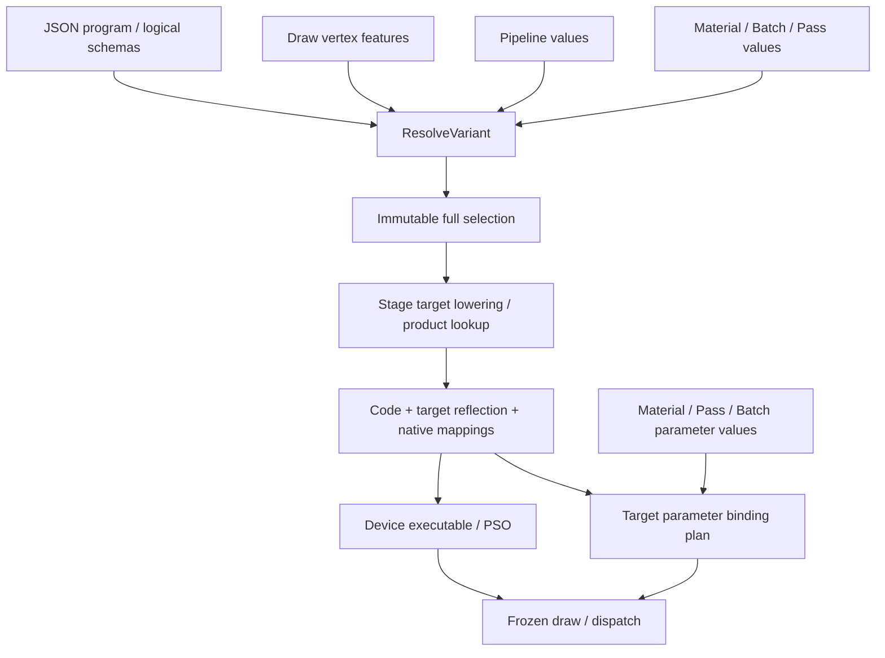

# Aurora Shader 变体与材质参数设计审查

状态：用户已于 2026-10-25 确认。本文保留确认时的审查基线与建议契约；后续实现和实测结果见 [实施记录](../../openspec/changes/refactor-aurora-shader-source-techniques/implementation.md)。下文“当前实现”与第 10 节描述审查时点，不代表实施后的状态。

审查范围：V/P/S 输入、Shader 参数与 Material Group 2、宏/原生特化、逐 stage 编译、缓存与发布、Scene/Batch/Fullscreen/Compute 接入，以及直接相关的测试和设计文档。

## 1. 结论与边界

保留三个输入域：Vertex、Pipeline、Shader 局部配置。Material、自定义 Batch、Fullscreen Pass、Compute Pass 都可以提供第三域；它们不是四个额外的变体域。上层只设置有类型的 Key/Value，Shader 写法与目标编译能力决定如何实现该选择。

该模型成立，但仅把 `materialValues` 重命名还不足以形成完整契约。需要同时明确逻辑选择、目标代码、原生执行对象三种身份，并分离完整参数声明与目标活跃接口。

本轮沿用 JSON 作者方案和现有显式 stage 引用，不恢复已要求回退的 source-techniques 作者格式迁移，不删除 companion，不引入新的 technique attribute DSL。旧草案中可复用的身份、生命周期和验证原则单独保留，不能将整份旧设计视为已批准。

V/P/S 是选值责任；Global 0 / Pass 1 / Material 2 / Batch 3 是资源所有权，两者正交。由 Batch 提供一个选项，不意味着该选项一定对应 Group 3 资源；由 Pass 提供 S，也不意味着它属于 P。

## 2. 审查发现

P1 表示进入实现前必须消除的契约冲突；P2 表示需要一起明确的边界或迁移事项。以下为静态代码与设计审查，没有将推演案例冒充运行验证。

| 编号 | 级别 | 发现与触发场景 | 建议修正 |
|---|---|---|---|
| R1 | P1 | `ShaderVariantInputs.materialValues`、`ShaderVariantDomain::MATERIAL` 将 S 限定为材质；Scene 的组装入口与直接 `CompileShaderTechnique` 路径并存。Fullscreen helper 使用后一路径，不能保证所有调用都经过相同归属/默认值校验。 | 统一选择入口；S 由明确调用方提供；无 Mesh 不需要伪造 Material 或几何对象。 |
| R2 | P1 | 组装器按 `isSpec` 产生 spec 并将部分值排除在位 key 外；Resolver 又按 target 排除原生特化值。这对代码复用可以成立，但不能把这些不同 key 都叫完整变体身份。 | 完整 SelectionKey 包含全部有效值；StageCodeKey 根据目标转换结果取子集；ExecutableKey 包含原生特化值。 |
| R3 | P1 | `MergeSpecialization` 按数字 ID 合并 VS/FS；Vulkan 给两个 stage 传同一份 map；Metal 先按全局 ID 归并类型。VS 的 ID 0 与 FS 的 ID 0 可能是不同常量，当前模型无法独立表达。 | 保存 `(stage, logicalKey, type, nativeId, value)`；跨 stage 共享的是逻辑 key，不是数字 ID。 |
| R4 | P1 | companion 手填 `spec` ID，schema 把 `isSpec/specId` 混在逻辑声明中；跨 stage 合并也要求这两项一致。于是同一逻辑选项在 VS 编译折叠、FS 原生特化的合法实现会被拒绝。 | 逻辑 schema 只表达语义；逐 stage 的 Shader 声明/目标元数据表达实现方式与 ID。保留明确的名称对应关系，不猜测符号。 |
| R5 | P1 | `BuildShaderParameterTable` 来自当前产物的 declarations；声明虽能保留优化未使用资源，但看不到预处理已删除的声明。一次最终反射不能提供所有变体的完整材质 Key 集。 | 构建独立、完整的逻辑参数 schema；最终反射只决定当前目标的活跃资源与 ABI。 |
| R6 | P1 | 资产绑定、其他 Pipeline 变体校验和 `MaterialSchema` 都拒绝 INACTIVE。材质保存了关闭功能的参数时会失败；已有 `AliasesRequireAnActiveMaterialSet` 测试明确锁定了这种旧行为。 | 已知但 inactive 的参数合法保留；未知、类型错误和当前 required 参数缺失仍失败。不能把三种情况统一跳过。 |
| R7 | P2 | `MaterialSchema` 过滤整个 set 2，却没有统计 cbuffer；当前属性表仍需 `properties + aliases` 手工声明和映射。 | Group 2 的同一 program 族允许 0 或 1 个逻辑 cbuffer，完整 Key 表由声明生成；类型与 GPU offset 不由资产重复维护。 |
| R8 | P2 | 旧 source-techniques 草案使用 material/mesh/pass owner、显式 native policy、删除 JSON，并以 v2/v4 为迁移起点；与最新输入模型、回退记录和现有 Material v3/cache v9 不一致。 | 本次确认后重写对应设计与 delta；不得照旧任务表继续实施，不能覆盖历史验证记录。 |
| R9 | P2 | 当前 Scene 准备通过 `PipelineVariants()` 枚举部分小位宽选项，受 64 组合上限约束。引入 Batch/Compute 后继续自动扩展会遗漏大范围值或产生不必要组合。 | 准备实际请求；Cook 读取明确使用集合，所有请求共用选择规则。发布包记录完整选择，不能只因 generic binary 存在就接受未发布请求。 |

主要证据：

- `engine/aurora/pipeline/include/aurora/pipeline/ShaderVariantAssembler.h`：`ShaderVariantInputs` / `ShaderVariantInfo`。
- `engine/aurora/pipeline/src/ShaderVariantAssembler.cpp`：默认值、域校验、`isSpec` 分流与 hash。
- `engine/aurora/core/src/aurora/shader/ShaderVariant.cpp`：`MergeStageVariantSchemas`、`CanonicalShaderVariants`、schema 校验。
- `engine/aurora/core/src/aurora/shader/ShaderTechnique.cpp`：`MergeSpecialization` 与 resolved/直接编译分支。
- `engine/aurora/rhi/vulkan/src/VulkanPipelineState.cpp`、`engine/aurora/rhi/metal/src/MetalShader.mm`：原生特化传递。
- `engine/aurora/shader/src/ShaderCompilerSlang.cpp`：`CollectSlangResources` 的 declarations/resources 分离。
- `engine/aurora/adaptor/src/renderer/SceneAssetSource.cpp`：变体枚举、aliases、inactive 拒绝和跨变体 Material 校验。
- `engine/aurora/pipeline/src/SceneRenderFeature.cpp`：`MaterialSchema`、`CreateSceneShader`。

## 3. 推荐确认的输入与选择契约

| 域 | 唯一责任方 | 典型输入 | 不进入该域的内容 |
|---|---|---|---|
| V / Vertex | 准备阶段从实际 draw 的顶点输入描述生成 | 属性语义、实例输入模式、已启用的骨骼输入模式 | 顶点地址、蒙皮矩阵、每帧动画姿势 |
| P / Pipeline | 本次使用的 Pipeline 配置 | 阴影/全局渲染能力等已声明选项 | 一般的材质选项、任意 Pass 私有选项 |
| S / Shader | 本次调用方提供的局部选项集合 | Material、Batch、Fullscreen、Compute 各自的选项 | GPU 参数值、原生 specialization ID |

### 3.1 统一入口

概念输入为 `ResolveVariant(programSchema, vertexFeatures, pipelineValues, shaderValues)`。返回补齐默认值的不可变完整选择；不在返回值中让业务选择 macro/spec 路线。

纯选择逻辑放在现有 Aurora Core shader 层；Pipeline、Adaptor、Feature 提供普通数据。复用既有 Resolver/CompileTask，不新增 target、loader、registry 或目录体系。现有 Pipeline 组装入口可在迁移期委托它，最终不能留下两套不同选择规则。此职责调整属于本次待确认方案。

Scene 提供 V+P+Material S；自定义 Batch 提供 V+P+Batch S；Fullscreen 通常为空 V+P+Pass S；Compute 为空 V+P+Pass S。程序类型与 entry 身份来自现有 program，不是第四个开关域。

Stage schema 的并集用于校验完整输入，随后按每个 stage 的声明依赖投影。某个 key 只被 FS 声明，不应要求 VS 也声明或获得同样的代码缓存变化。第一版允许保守的声明依赖集，不依据单次优化后的活跃情况猜测全局依赖。

### 3.2 归属、默认值和冲突

- 一个逻辑 key 在 program schema 中只有一个域；跨域同名冲突拒绝，不按 P/V/S 的调用顺序覆盖。
- 同一输入集合重复 key 即使值相同也拒绝；JSON 解析时检测重复成员。
- 跨 stage 同名 key 的逻辑类型、范围、归属、默认值必须一致；原生 ID 和目标实现方式允许不同。
- 省略值与显式默认值归一化为相同选择；键顺序不影响身份。值首期建议限定 bool/int32/uint32，有明确范围，不将浮点、字符串或溢出整数隐式转换。
- 若一个调用同时组合 Material 和自定义 Batch，它们共同构成一次 S 输入；各写自己的已声明 key。重名冲突失败，不建立隐含的“Batch 覆盖 Material”规则。
- 未知 key、错误域、类型/范围错误返回显式错误；不以断言或静默默认值代替。

### 3.3 顶点描述与固定功能布局

V 应从实际使用的输入描述派生，不能只看 Mesh 资产名，也不能用 `instanceCount > 1` 推断是否采用实例输入。JOINTS/WEIGHTS 表示有蒙皮输入能力；是否选择蒙皮路径还应满足当前 draw 的模式和 palette 合同。当前实现要求 skin 输入与组件模式相匹配，本方案不顺带放开新的 Mesh/Skin 组合。

Offset、stride、binding、输入 format 等仍完整参与顶点输入/PSO 兼容性。只在确实影响 Shader 代码时才派生为 V 选项。不能把“相同 Shader 变体”误判为“相同顶点输入 PSO”。

## 4. Shader 写法与后端转换

### 4.1 上层和编译器的责任

Material/Batch/Pass 只设置语义值，例如 `USE_NORMAL_MAP=true`。JSON 可继续承载逻辑 key、域、默认值、范围及必要的符号名称关联；不得让材质实例或 Pass 再指定 `isSpec`、native ID 或后端类别。

编译器识别 Shader 实际声明，并生成逐 stage 的目标转换计划：哪些值需要编译折叠，哪些映射为原生特化，如何编码 native type/ID。声明方式和目标能力属于该计划的输入，不能由上层擅自覆盖。转换策略版本与编译环境进入产物身份。

宏不能靠普通资源反射枚举；当前 `NUM_LIGHTS` 与 `kNumLights` 也不是同名。因此必须保留显式、可验证的 key→Shader 符号关联。推荐由 JSON 记录名称关系、编译器反射核验常量声明，产物保存生成的 native mapping；不再在 JSON 重复填写数字 spec ID。该名称关系不是参数 aliases，也不是让业务挑选宏/特化。

对原生目标，选定值不污染可共享代码的默认定义；实际值在创建目标执行对象时使用。对需要编译折叠的目标，选定值进入目标代码请求。不能机械向所有同名常量注入 `-D`，否则可能替换 Shader 声明本身。

### 4.2 支持的源码契约必须先验证

首个实施门槛是用仓库固定 Slang 版本验证：JSON 名称关联、优化前声明读取、目标条件下的声明识别、DXIL 的等价编译期取值，以及无源码产物读回。沿用当前测试中显式目标分支的可验证写法；不承诺把任意 `vk::constant_id` 源码自动改写成任意后端的常量。

若一种声明没有已支持的等价目标实现，则编译/Cook 明确失败并给出 key/stage/target，而不是降级为 uniform、丢弃值或使用默认值。这里的“自动选择”是已验证的转换计划，不是对未知源代码的启发式改写。

Slang 文档明确区分预处理与链接期常量；预处理控制语法时，选择已经发生在解析前。可链接常量为编译器提供更晚的选择机会，但不要求本轮改造全部作者格式。[Slang 链接期特化](https://docs.shader-slang.org/en/latest/external/slang/docs/user-guide/10-link-time-specialization.html)

### 4.3 原生特化的范围

Vulkan 的特化数据挂在每个 stage 的创建信息上；Slang 的 Metal 输出可以将特化声明转成 function constant。因此必须逐 stage 存储和应用，不能全 program 合并裸 ID。[Vulkan stage 创建信息](https://docs.vulkan.org/refpages/latest/refpages/source/VkPipelineShaderStageCreateInfo.html)、[Slang Metal 特化映射](https://shader-slang.org/slang/user-guide/metal-target-specific#specialization-constants)

本轮推荐的引擎边界：原生路径不允许选择值改变已发布的资源形状、uniform 布局、stage I/O 或 compute thread-group shape；这不是宣称原生 API 永远不支持这些能力，而是当前产物/调度协议还没有完整表达它们。此类变化需要受支持的编译期路径或明确拒绝。

原生路径可以保留比编译期常量折叠更多的资源要求。因此不能要求 native 产物与同值 literal 产物的“活跃资源集合完全相等”。应检查逻辑类型和实际 ABI 相容，并正确满足 native 路径的保守 required 集合。

同一逻辑 key 在不同 stage 可以分别采用编译折叠或原生特化；同一数字 ID 在不同 stage 可代表不同 key。同一 stage 内 ID 冲突、类型不匹配或非法编码失败。业务 bool 与 Vulkan/Metal 原生 bool 的存储转换由后端负责。

## 5. 三种身份与缓存

| 身份 | 必须包含 | 不应因此变化 |
|---|---|---|
| SelectionKey | Program/逻辑 schema 身份、完整规范化 V/P/S 值（包括 native 值） | 调用顺序、显式/省略默认值、具体材质对象地址、GPU 参数内容 |
| StageCodeKey | 源码闭包、stage/entry、target/profile/capabilities、编译器和转换版本、影响该 stage 代码的有效值 | 能原生特化的请求值、无关 stage 的独有选项、GPU device 地址 |
| Executable/PSOKey | 各 stage 代码身份、各 stage native type/ID/value、真实接口；PSO 再加顶点输入、固定状态、附件/采样等；隔离 device/epoch | 与执行无关的资产对象身份 |

例：`MODE=0` 和 `MODE=1` 的完整选择不同。若目标原生特化，则可以共享 StageCodeKey，ExecutableKey 必须不同；若目标编译折叠，则 StageCodeKey 也不同。换纹理 UUID 或 tint 不自动改变以上 Shader 选择，改变的是资源/参数绑定版本。

规范化内容按稳定 key/type/value 编码；默认值补齐、固定字节序，不能序列化 `Name` 进程句柄或 struct padding。Hash 用于索引，命中时仍比较完整身份。128-bit 分区如有实际快速路径用途可作为可选派生表示，不能单独充当持久化完整身份，也不能以“spec 没写入位 key”为理由漏掉选择值。

我上一轮关于“特化值必须写入位 key”的说法应收紧为：必须进入完整逻辑身份；目标代码 key 可以排除原生特化值。现有 Resolver 的部分代码复用思路应该保留，不能为追求统一而让所有 native 值都重新编译代码。

## 6. Material Key 表、Group 2 与绑定

### 6.1 三份数据各有用途

| 数据 | 内容和责任 |
|---|---|
| 逻辑参数 schema | 完整资源/字段名称、种类、类型、数组形状、所属组、跨 technique 的可用性；不把目标字节 offset 固化到资产 |
| Material 值表 | schema key 对应的值、纹理引用、sampler 和 S 选项；资产默认值与覆盖，不重复手写类型/绑定定义 |
| 目标绑定计划 | 当前目标产物要求的资源集合、block size/offset/stride、native slots；按实际 Shader/接口版本生成 |

统一 Key 表可以包含参数和 S 选项，但 Key 必须有类别。Variant key 来源于变体 schema，GPU 参数 key 来源于 Group 2 声明；它们不能都从 Group 2 资源反射得到。字段完整名/声明身份是绑定身份；编辑器显示名称不能成为隐式 alias。

对多个 techniques：取其逻辑参数的可验证并集，保留每个 technique 的使用关系。同名同义且类型一致才共享值；同名异类型/资源形状冲突必须诊断。独立参数使用限定名称，不能仅凭短字段名合并。GPU offset 和 native slot 不参与“是否同一个材质参数”的判断。

### 6.2 完整 schema 的来源

推荐复用现有权威共享声明及声明反射，要求 Material Group 2 的逻辑声明在 program 族内稳定：可以条件使用、被优化裁掉，但不能把公共字段/资源的声明放在无法发现的 `#if` 分支里，或让同一 key 的逻辑类型随变体变化。参数元数据由该声明生成，不增加一份手工 properties 类型表。

这项稳定性要求针对逻辑 schema；不同后端的 offset/stride/native slots 仍由目标反射决定。不同 technique 可以使用公共 schema 的不同子集。

如果未来必须支持条件声明和条件类型，需要额外的 schema-family/完整变体清单机制；一次默认编译、一次选定编译或扫描宏名称都不足以证明完整性。本轮推荐明确拒绝无法提供完整逻辑 schema 的 Material program，不自动枚举所有选项笛卡尔积。

### 6.3 单 cbuffer 与 inactive

同一 linked program 族的 Group 2 合并 stage 后允许 0 或 1 个逻辑 cbuffer。VS/FS 引用同一个 buffer 只计一次；两个不同 buffer 即使某次只活跃一个也违反该稳定 schema 合同。纯纹理或无材质的 program 可以没有 cbuffer。该约束不扩散到 Pass/Batch 组。

同一目标 program 中，VS/FS 对这个 buffer 的目标 ABI 必须兼容；不兼容时拒绝链接，不能悄悄各造一份不同布局的 buffer 绕过合同。不同后端之间不要求字节布局相同。

字段写入按目标 block 反射编码，所有活跃字段归入这一个 buffer。当前 `Shader::PackUniformData` / `ShaderParameterTransaction` / `WriteUniform` 可以继续复用，不复制第二套打包器。

已声明但当前不活跃：保留值，返回 inactive/跳过该次写入，不把它当未知参数。类型错误即使 inactive 也拒绝。当前 required 参数没有值：使用显式声明/资产默认值，若仍缺失则报错；不默默零填、不自动猜纹理。

`USE_TEXTURE=false` 不直接证明纹理已从 native 接口消失。若目标仍要求该纹理，必须提供资源或契约中明确的有效默认纹理。资源加载是否完成也不能偷偷反向改变开关；否则同一材质会随异步时序变换 Shader 选择。

### 6.4 Group 与调用方分离

Material 只填 Group 2；Pass 的屏幕输入/计算输入按资源声明归 Group 1；逐 draw/dispatch 的 Batch 输入归 Group 3；Global 归 Group 0。Fullscreen/Compute 并不因为提供 S 就需要创建 Material 或占用 Group 2。

StructuredBuffer/UAV 等继续走已有 Pass/Batch/RHI 能力；本轮不顺带扩展 Material 资产的任意 buffer 类型。完整 schema 遇到当前绑定层不支持的形状必须明确拒绝，不能“反射到了”就宣称可用。

### 6.5 现有材质的迁移

旧 `properties + aliases` 按每个 technique 的显式映射转换到规范 key，迁移已存值与默认值。多处映射不一致、目标类型变化或无法确定语义时给出具体诊断，不删除属性、不猜短名。旧的无 alias 属性也不能自动认定与某个 Shader 字段同义。

新的材质数据可以保留必要的值类型编码以安全反序列化；这不等于让作者再维护独立的参数 schema。schema 本身在 Cook/定义准备阶段生成并版本化，编辑器与无源码 runtime 读取同一份生成数据。未知旧 key 的迁移需要明确处理，不能把它伪装成正常 inactive。

## 7. 准备、变更、发布与生命周期

选择、源码读取、编译与参数计划构建发生在 preparation；graph Build/record 消费已准备结果。准备状态显式区分 ready/pending/error。不存在“没准备好就默认另一变体”的隐式行为。

代码、接口、选择和资源绑定版本一致后原子发布。uniform/纹理值变化只使相关绑定失效；S、V、P 或源码/schema 变化重新选择并按身份查缓存。旧版本在帧/GPU 借用结束前继续存活，不能先更新开关再绑定旧布局。

同一材质可被不同 Mesh/View/Pipeline 使用，准备缓存必须区分完整选择，不能按 Material UUID 或 technique tag 单独缓存唯一 Shader。Batch 的可合并性也必须包含可执行 program/所需绑定兼容性，不能把 S 不同的 draw 因材质相同就合并。

沿用当前 MaterialInstance 的值/纹理/sampler 覆盖范围，本轮不新增静态开关覆盖。静态选择改变创建新的准备版本；如果后续允许 instance 静态覆盖，必须显式定义相同的重选、Cook 和 batching 行为，不能伪装成普通 SetValue。

Cook 收集明确请求，usage capture 作为补充；V/P/S 归一化与 runtime 共用。发布产品包含逻辑 schema、完整选择记录、stage 代码引用、目标反射和逐 stage native mapping；无源码运行不需要 Slang。缺少选择、错误环境/版本均明确失败。

当前 baseline 为 Material v3、instance v2、shader index/blob v9、usage v2。确认后按实际编码变更统一升级，重新 cook；不得套用旧草案的 v3/v5 目标版本，也不在本次 review 提前修改版本常量。

## 8. 必须覆盖的验收

| 组 | 关键案例与可观察结果 |
|---|---|
| 三域 | 同一 Material + 两种 V + 两种 P + 两种 S，选择与实际 GPU 输出对应；各提供方越域写入失败。 |
| 非场景路径 | Fullscreen 无 Mesh、Compute 无 Vertex、Batch 无 Material，均走同一选择器；默认值与错误策略一致。 |
| 规范化 | 输入顺序、显式默认/省略默认等价；重复 key、类型/范围、跨 stage 逻辑冲突失败；hash 冲突不串产物。 |
| 逐 stage | VS A/id0/value1 与 FS B/id0/value2 独立生效；同一 key 在不同 stage 使用不同 ID 或编译方式；GPU 读回验证。 |
| 后端选择 | 同一语义值在 SPIR-V/MSL 原生路径与 DXIL 编译路径结果相同；native 代码可共享、执行对象不能串值。 |
| 编译契约 | JSON key 与 source symbol 的明确映射；宏名不破坏声明；unsupported 转换失败；native default 与逻辑 default 一致。 |
| 材质 schema | 0/1 cbuffer 成功，2 个失败；跨 stage 同 buffer 合并；同名异类型失败；不同 technique 使用不同参数子集。 |
| 开关与纹理 | inactive 值保留，开关往返不丢值；未知参数仍失败；native required 纹理未因 false 被漏绑；异步加载不改选择。 |
| ABI | 当前目标 offset/stride 打包，不能复用其它目标 bytes；native 不支持的 shape/thread-group 变化拒绝或走已声明编译路径。 |
| 身份与失效 | tint/纹理替换不重编译；S/P/V 改变正确重选；vertex stride 只变时保持正确 PSO；旧帧继续持有旧版本。 |
| 发布 | 非默认 V/P/S 的 scene/fullscreen/compute 请求，剥离源代码和 compiler 后仍成功；未发布选择明确 missing。 |

现有测试应按合同调整，而不是批量删除：

- `ShaderVariantAssemblerTest.SpecFoldedIntoHash`：拆清完整选择与目标代码复用的断言，保留 DXIL 非默认值回归。
- `ShaderResolverTest.SpecializationOnlySplitsD3D12Artifacts`：保留目标代码共享测试，增加逐 stage executable 隔离；当前 fake compiler 测试不能代替原生读回。
- `SceneMaterialSource.AliasesRequireAnActiveMaterialSet`：改为已知 inactive 合法，保留未知/越组/类型错误拒绝。
- `ShaderVariantTest` 的位编码测试如快速表示仍被使用则保留；逻辑选择正确性不能只由位测试证明。
- Material serialization/UI 测试跟随生成 schema 与迁移更新；UI 继续使用通用反射面板，不能逐参数手写控件。

## 9. 确认后的工作边界

1. 先做固定编译器声明/转换验证门槛，确认 JSON 名称关系、native mapping 和 DXIL 路径可落地；不通过则报告具体不支持的写法，不擅自恢复旧 attribute DSL。
2. 收敛 Core 选择/身份协议，接通 Scene、Batch、Fullscreen、Compute，分 stage 特化；沿用原 targets 与源码目录。
3. 生成 Material 逻辑 Key schema，落实 Group 2 单 cbuffer、inactive 语义和目标绑定计划；重用已有事务与 uniform 编码。
4. 同步 Cook、发布格式、相关测试、作者文档和 OpenSpec delta。将旧 source-techniques 草案中冲突的域名、作者方案、版本与测试状态重写；保留被回退的历史说明，不将历史草案当实现依据。
5. 对照 `docs/features/shader-system.md`、`docs/aurora/shader-design-and-migration.md`、相关领域规则和 shader skill 更新当前合同；main specs 在允许的 OpenSpec 流程中同步，历史 archive 不改写。

不纳入本轮：删除/新增 CMake target、目录搬迁、材质图、自动推断“贴图存在即开启”、MaterialInstance 静态覆盖、任意结构化 buffer 材质属性、原生可变 thread-group 协议。commit 与 archive 仍另行展示具体内容并等待用户确认。

## 10. 确认时的静态审查记录

已完成：当前相关代码、直接相关测试断言、三个 shader/resource 设计脉络及主 spec 的静态交叉检查；查阅 Slang 和 Vulkan 官方文档验证声明阶段与逐 stage 特化边界。

未执行：构建、GPU 测试、编译器新声明探针。本文没有修改可执行代码，既有测试通过记录也不能证明本方案已实现。上述源码映射和三后端原生验收是后续实施门槛；用户确认的是本文建议合同与范围。
