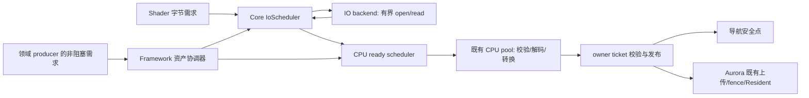

## Context

状态：2026-11-01，详细设计完成，生产实现尚未开始。继续使用当前 Core/Framework/Aurora/plugin 归属与 flat UUID 产品；不改变 target 或模块入口。

评审顺序、已执行的设计校验与待权衡项见 [verification.md](verification.md)。本轮在用户 review 后再进入实施。

- [当前实现 review](review.md)：源码读取链路、风险和现有测试的证明范围。
- [行业主源与采纳决定](industry-references.md)：实际核实 O3DE、Unreal、Unity、Windows 的契约，明确其未保证的内容。
- [请求与调度契约](io-contract.md)：接口、线程、状态转换、线性化、配额、依赖图、取消/收齐与反例。
- [产品 v2 编码](product-format.md)：64-byte prefix、metadata、48-byte block table、依赖与 BlobRef。

现有不足不只是缺少读文件线程：全包 checksum、eager bulk、producer 同步入口、CPU 队列自旋和生命周期状态混用会同时阻止 streaming。设计采用独立字节调度、准备与领域发布三个阶段。

阶段性导航 checkpoint 已单独交付共享读保护下的独立查询 context、异步 filter 快照/实际存量、codec 边界和重试清理；公共 IO 及下述 candidate/TryPublish 尚未实现，不属于该 checkpoint 的提交范围。

## Goals / Non-Goals

**Goals:**

- runtime Try 提交不执行文件系统调用，不等待容量，返回明确 Accepted/Busy/Closed/Invalid/Unsupported/CapacityExceeded。
- 多 consumer 共用字节服务，控制 active IO、依赖展开、实际与预留 bytes、retained handles，并保证已获预算工作能前进。
- metadata 与 independently checked blocks 分离；字节 ready、CPU ready、通知已交付、领域 Resident 分开。
- 明确共享、取消、资源热更新、world/device restart、关闭与真实对象/预算所有权的竞态规则；DLL 代码由 loader 保持进程常驻。
- 按导航、shader/scene assets 顺序接入，复用 Aurora 上传和退休 owner。

**Non-Goals:**

- 不搬目录、不新建 target、不调整 Aurora 归属；不引入 ProductGroup/持久 generation 目录或第二套 uploader。
- 首版不交付 IOCP/io_uring/DirectStorage、零拷贝 GPU IO、HTTP 或硬实时保证。
- 本 change 不交付 Detour 无共享 mutex 查询、GPU 部分 mip/LOD 驻留，也不把 block 寻址当成这些能力。

## Decisions

### 1. 调度器不是线程池，准备器不是上传器

| 层 | 固定职责 |
| --- | --- |
| Core，既有 file/async | stable handle、checked range、IoScheduler/backend、generic scope/work obligation、Completion、数字化资源信用；不含资产或 RHI 类型 |
| Framework，既有 AssetManager/AssetExecutor/application | product snapshot、全局 readiness 图、cache/coalescing、闭包准备计划与协调器、宿主关闭 |
| Recast plugin | domain manifest、tile 需求、native prepare/candidate/发布/query gate；engine/navigation 保持领域接口 |
| Aurora 既有 core/adaptor/cook | shader/scene 纯准备、精确资源键、GPU 上传和退休；Aurora core 直接消费 Core IO，不反向依赖 Framework |

Core 一个 IO 控制线程，首版少量专用 blocking IO workers；Framework 在 AssetExecutor 内一个串行协调线程驱动依赖/ready mailbox。重 CPU 工作仍使用现有 pool，经 TryDispatch，既不在控制线程执行，也不占 worker 等别的 worker。两个控制线程不构成新增 feature CPU 池。

### 2. 明确采纳什么，不从 API 推断内部保证

- O3DE 的 scheduler/backend slots、读/解压阶段和取消终态分离值得采纳；其 pending 无硬上限、整文件解压可无界，不复制到本引擎。
- Unreal 的 chunk/range/backend、batch priority 支持字节接口分离；不能据此推断具体线程池或 batch 原子发布。
- Unity 的 header/bulk 分离、独立 LZ4 物理块和跨帧上传值得采纳；上传 buffer 自动扩容，不是 hard cap 先例。
- SkyEngine 自行选择：hard cap + Busy/CapacityExceeded、完整闭包 escrow、显式 owner publication、已接受 continuation 收齐。原文与 URL 见行业附录。

### 3. 公共 API 和 backend 的边界

锁定 Init、TryCreateScope、TryRegisterWork、TryOpenRead、TryRead、UpdateInterest、RequestCancel、Seal、CloseRoots、Poll/TryGetResult、PollWorkDrained 的语义。签名落地时沿用本仓库 Result/Status 风格，不能再改变这些状态和所有权规则。

backend 暴露 ReadAt、内容稳定性、alignment、transfer、cancel/执行模式和并发能力。首版 Native/Memory 使用 buffered 路径；Windows checked offset read、POSIX checked pread 在 IO worker。package 无相应能力则 Unsupported，不整包预读伪装 range。未来原生异步仅替换 backend。

稳定 handle 只稳定对象身份。ImmutableVersion 还要求 writer 只临时写+原子替换；mutable source 不获得旧内容保证。shader 开发源需经受控 capture/cook 形成有身份的 artifact。CRC 是损坏检测，不是认证；mtime/fileId 不是不可变证明。

### 4. 调度与取消线性化

per-backend active slots、scheduler lookahead、blocking worker 数独立。首版采用 consumer weighted deficit round-robin、priority/deadline donation、aging、有限 transfer quantum；不使用永远优先 Critical 的全局堆饿死后台，也不建立未经测量的 ETA 模型。

最后 interest 取消与新 join 在同一次事务中决定先后；ClosedToJoin 不复活。取消/控制有预留通道，完成记录在 dispatch 前预留。ReadAt 返回前不归还 active slot 或写 buffer。segment 之间可重排，已进入 kernel 的工作不可承诺抢占。

精确算法、DRR 配置不变量、private backend/CPU TryDispatch 和 mailbox 容量见 io-contract，避免实现时重新落回满队列 yield 自旋。

### 5. 先保证闭包进展，再优化利用率

单 unit 预留不足以防跨 root 等待环：A/X 各需一个 20 MiB dependency，再各需 30 MiB；在 64 MiB 下若先准备两 dependency，两父都会卡住。

首版固定为：有界 metadata 发现完整 required closure → 验环/limits → 原子取得保守闭包 escrow → 按拓扑领取 unit credit → 准备/发布。`allocated + unconsumed reservation <= hard limit`。共享只计一次物理 backing，但允许保守多留未兑现 credit；优化不能牺牲进展保证。

root admission 预留声明的有限 control/handle 展开 credit。不能让父 scopes 占满 slots/handles，再让所有子项永久 Busy。超计划或最低闭包根本放不下明确 CapacityExceeded；外部已完成资源长期 pin 住导致等待可观察、可取消，不伪造完成时限。

final backing、GPU 上传保留的 CPU view、native retirement 的 byte leases 到实际释放才归还。H 只覆盖参与协议的内存，不声称控制整个进程 RSS；metadata/control 和 GPU 自有预算另列。

### 6. 产品是逻辑资源到多个物理块的映射

v2 保持一 UUID 一 flat 文件。固定 prefix 与小 metadata 可独立校验；typed header 表达 mip/LOD/tile-layer 的 BlobRef，每个 BlobRef 可引用多个 independently compressed blocks。大 mip 不强制成为大 chunk。

使用已有 CRC32C，prefix/metadata/stored block/decoded block 分别验证；metadata 计数、算术、范围、codec、schema 在分配前检查。writer 起始 block target 256 KiB、reader 支持 decoded block <=1 MiB；这些是初始策略，不是声称的行业最优值。具体 64/48/20 字节编码、4 MiB metadata 上限和 Reference 依赖见 product-format。

runtime 不扫全包 checksum；deep audit 才检查所有块。超过单产品 manifest 上限的大世界拆为区域 UUID 产品，root/index 按需引用。v1 显式 Unsupported，清理并 recook，不引入隐藏 eager fallback。

### 7. 资产协调、共享与 readiness

CurrentLoadKey 按 UUID/target/location epoch/policy/registry reload epoch 查找当前 LoadOperation；每 consumer request serial 只属于 PublicationTicket，不进 lookup key。不同 root 依赖同一资产必须回到相同 selected operation，不能靠新 id 绕过环检测。ProductsOnly 不共享可能触发 cook 的 orchestration。

全局图节点区分 MetadataReady/CpuReady，required edge 插入与验环由协调器串行完成。metadata-only/reference 边不被误当 CPU 环；声明错误、闭包超限与 required failure 向父传播。Typed CpuReady 可含 BlobRef，不代表 bulk/GPU 已驻留。

PreparedBacking 只含 immutable bytes/CPU recipe，key 包括全部 representation 参数和 compound 输入快照闭包。PublicationTicket 则持 owner session、deviceEpoch、依赖 identities 和 serial。现有含精确 resource keys 的 RenderResourcePayload 由 producer 包装，不跨 device epoch 原样缓存。

### 8. 领域接入

| 领域 | 准备 | 发布与验收边界 |
| --- | --- | --- |
| 导航 | 小 manifest、按期望坐标读取 blocks、独立 native candidate | world 发布整坐标，不把 IO ready 当 Resident |
| Image / Mesh | 按 blocks 读取，在 CPU worker 构造完整资源 bytes/recipe，先取得完整 gather 信用 | 继续现有 uploader、GPU completion/pins；首版不声称按需求 mip/LOD 驻留 |
| Material / Instance | parent/overrides、texture metadata、shader index/artifact 快照闭包 | producer 冻结/验证精确依赖与资源键；不要求所有纹理 mip 先 resident |
| Shader | Core 字节服务、index snapshot cache、artifact identity、受限开发 CPU 编译 | 不在 producer 同步 ReadBin/Run；device/PipelineLayout 等修改仍归原 owner |

不能把混有 assets/cache/watches/device 状态的现有 ResolveGeometry 整段搬到 worker。owner 身份检查和 active/cache 修改是同一次串行事务，避免“检查后 reload、随后仍发布旧结果”。

### 9. 导航首版发布策略必须覆盖失败和成本

导航 checkpoint 已修复 decoder、filter 快照、真实取消计数和坏 tile 退避/公平性。这里仍需接入 focus 宿主与新的 IO 准备阶段；届时不再为了读取一个 tile 取消所有 query，只对真实 mesh publication 处理查询门禁。

正确性基线采用每 world 最多一个完整 native candidate：冻结当前驻留描述+合并坐标 delta，后台建立独立 navMesh/navQuery/tileCache bundle；全部 layer 成功才有候选。只读压缩输入可共享，native 链接不可跨 state 共用。单 tile 变更也可能 O(全部 resident) CPU/内存，因此只作为可度量基线，不声称高效增量更新。

预算包括 active + 全 candidate + 必需 input/scratch + 未退休 state；不能只按新增坐标算。例：active=100 MiB，candidate至少100 MiB，H=150 MiB，返回 CapacityExceeded 并保留 active，不永久 Busy。后续局部事务优化必须证明失败可恢复旧整坐标，且回滚不依赖再次分配。

candidate 绑定 world/product/base mesh revision；focus 移动保留交集 interest，合并后续 delta，不每帧作废仍有用的 candidate。base revision 真变化才 stale/rebase。大批旧 state 析构在退休 worker 上，byte-accounting leases 与所需 backend/SDK 实例状态保持到实际退出。

发布使用 backend TryPublish，不在 Tick 等 query mutex。candidate ready 后设置 publication-pending 门禁，覆盖所有 backend query 入口，包括直接 QueryPath；已等待 mutex 的任务拿锁后复查门禁，不能绕过。当前搜索结束，后续请求得到明确 Updating/Busy 供 caller 重试，world 只做一次成功的 try-lock、revision 检查与 bundle/驻留描述交换。stale、失败、取消的每条路径都清除门禁或关闭服务，并终结/重排自己的请求，不能永久拒绝查询。

这仍保留 QueryPath 的共享 mutex，只消除 publication 对 Tick 的锁等待；查询间并行需要独立 context、只读 mesh generation 和读者回收，另行评审。长查询/OS 调度仍影响更新延迟，不提供硬实时保证。

### 10. 关闭与工作完成

scope 的 registration lease、generic work obligation、Cancel/RegisterChild 的线性化见 io-contract。Core 只计 generic 义务，不理解 CPU/GPU/world 类型；实际 owner 负责 Complete(Status)。

停止领域新需求 → CloseRoots → 对已接受 scope 继续或 Cancel → 收齐 native/CPU/owner work 并发布 Completion → pump 已接受 continuation → 既有 GPU/world retirement → 关闭 consumer/backend 会话并释放已无人使用的实际对象。WorkDrained、notifications drained、retained memory 是不同状态；不能让 callback 的执行成为发布驱动该 callback 的 Completion 的前提。

Singleton/Environment 提供跨 DLL 唯一服务；loader 将插件/RHI 代码保持到进程退出，不向请求或结果逐层传递纯代码租约。backend、handler、CPU prepare、Ready 析构及 retirement 仍须持有所需实例、服务和数据的真实 owner，直到实际 work/cleanup 完成；DLL 常驻不表示依赖服务已 Init 成功。旧 session 不进入新会话。驱动不返回时只能报告 Pending/Stalled，不以 timeout 伪造完成、释放内存或销毁仍被使用的对象。

资源热更新继续按 product revision、稳定 snapshot 与实际 CPU/GPU 退休协议进行；插件/RHI 二进制的更新、重载和移除在进程重启后生效，服务会话 restart 不卸载 DLL。

## Risks / Trade-offs

- [保守 closure escrow 降低并发] → 先用确定性反例证明进展，再依据 trace 优化共享/生命周期峰值，不直接放宽 hard cap。
- [完整 nav candidate 成本高] → 一 world 一个候选、delta 合并、完整预算/容量失败、后台退休；用真实 resident 规模测量后评审局部事务。
- [新增控制线程有开销] → 与数据 workers 分离，只承担有界协调，平台测量可决定同类轻量执行器复用，但不搬回 frame 或 CPU worker wait。
- [mutable 来源或 package 不具稳定能力] → 明确能力门禁和错误；不隐藏全量复制、不声称强快照。
- [IO 移走但转换/编译或上传仍卡帧] → 四段时延分测，保留现有 upload owner，实际 producer 路径验收而非只测 helper。

## Migration Plan

1. 修复当前 decoder/query/accounting 错误；加入永久失败、filter 编辑和取消存量测试。
2. Core 实现本契约，先 fake backend 验证 race/capacity/queue，再 Native/Memory、64-bit offset 和替换。
3. Framework 实现 v2、稳定 snapshot、required graph/closure credit、协调器与 application drain，recook/deep audit。
4. 导航接入真实磁盘 blocks、candidate/TryPublish 和门禁，混合并发测试；shader 与 scene image/mesh/material 随后迁移。
5. 在相同数据/需求轨迹上比对实际 bytes、read amplification、metadata/CPU/GPU ready、提交延迟、帧 p95/p99、峰值与 retained handles。报告支持边界，不用后台吞吐掩盖 producer 卡顿。

实现任务见 tasks.md。v1/v2 reader/writer 成套回退并重新 cook；失败候选不替换当前 active。commit/archive 继续按 AGENTS 等用户明确确认。

## Open Questions

剩余问题只允许是测量/平台能力项：worker/queue/配额 profile、block target、package stable handle 能力、完整 candidate 实际成本。取消线性化、依赖身份、闭包 credit、字段编码和发布 owner 已由本文与附录定死，不再留到实现中临时决定。
