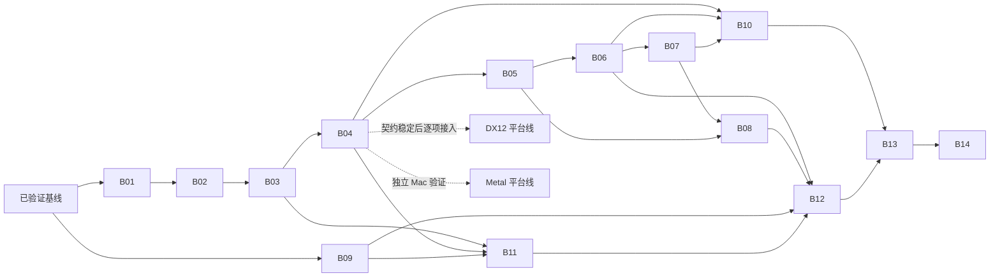

# Aurora Renderer 分批实施计划

本文件是后续实施顺序的唯一入口。`tasks.md` 保留稳定的能力验收编号；批次可以完成其中一个子集，只有整项及适用平台验收完成后才勾选该编号。`specs/` 定义目标行为，`status.md` 记录当前代码，`review.md` 保存实施证据。B/P 编号表示实施批次，不创建重复的 capability 或 spec 副本。

## Change 归属

- `aurora-renderer`：以下 B01–B14、P01/P02，共享同一套 Renderer/RDG/RHI 契约。公共接口变更与全部现有消费者在同一批更新；每批提交包含该批代码、测试及本 change 的相关 spec/design/tasks。
- `aurora-scene-bridge`：World/Actor/组件事件 → owned FramePacket；使用 Renderer 已定义的协议，不另建 ECS 写入或资源就绪协议。可以先用 fake IRenderer 验证，真实宿主接入依赖 B12/B14。
- terrain/vegetation/navigation 等 feature change：消费 B13 的注册、建图和停用/退休接口，不向本 change 合入各领域绘制实现。
- Aurora 属于 foundation，Renderer 实现复用 engine/aurora/core，Framework 对接归 adaptor，模块入口归 runtime；结构纠正见 aurora-renderer-layout，后端保留原 RHI 路径；不再规划迁入 plugin。仅目录命名/CMake/部署/include 整理可后续独立评审，暂记 aurora-backend-layout；不作为功能批次前置。
- 不在此轮创建材质产品链、协程 runtime、异构 CPU/GPU system、async compute 或专用 transfer queue change。

## 批次依赖与退出条件

B01–B09 已完成各自已列明的当前子集；B10 已完成确认的 Windows 三路径固定范围，包括图资源/分块上传/状态账本、RGBA8/D32 MSAA 与 resolve、有界设备缓存、图 arena 和公开 pass kind 边界。B11 已接 Windows 输出组件，B12 已接生产 Renderer 组合；B13 合成、B14 Windows 宿主及 P01 固定范围均已验收，P02 Metal 能力仍待实施。准确代码边界、验收结果和未归因风险见 [status.md](status.md)。表中依赖允许后续调整工作顺序。

| 批次 | 阶段 / 独立交付 | 必要前置 | 本批验收重点 | 对应稳定任务 |
|---|---|---|---|---|
| B01 | 两套 Vulkan native pass/scope 计划 | 当前基线 | 多 subpass/拆 scope 保持内容；两模式 inheritance 正确 | 4.11、4.18 |
| B02 | Vulkan worker command 分区与并行编码 | B01 | 实际并发、稳定组装、串行等价、两帧在途 | 3.18、4.12、4.13、4.16 |
| B03 | 编码失败/取消与收齐 | B02 | 不产出部分 RecordedFrame，drain 前不复用 slot | 7.14、7.15；补 4.12/4.16 |
| B04 | descriptor/UBO/staging 的显式 lease 分区 | B03 | 空帧/跳帧/upload-only 不错用分区，容量不足显式失败 | 3.17、4.2；补 3.18 |
| B05 | 资源请求、精确版本与冻结目录 | B04 | 去重、订阅取消、过期结果、旧版本一致回退 | 8.1、8.2、8.6；3.14 的资源快照 |
| B06 | 上传接纳、InGraph、Resident 与提交账本 | B05 | 首次上传同图消费、预算延后、Rejected/Indeterminate 不误发布 | 8.3–8.5、4.7；4.8 的提交登记 |
| B07 | bindings 与真实 indexed raster | B06 | PSO/RG 顺序、多 stream/U16、depth、实际 draw/readback | 2.2、4.3、5.1、5.2；4.19 的基本 raster |
| B08 | Scene/View prepare 到完整 CPU draw packets | B05、B07 | Bounds/Light/Object、双 View 裁剪/LOD、稳定提取、版本一致 | 3.11、3.14、4.1、5.3、7.8、7.9 |
| B09 | 公共 Completion、取消与消费者 drain | 当前 CPU 基线 | 订阅/完成竞争、指定 executor、取消与借用分别退休 | 3.12、3.13、3.15、7.10；3.19 的 CPU 部分 |
| B10 | 通用图资源与 raster 扩展 | B04、B06、B07 | transient/alias、subresources、MSAA/resolve、缓存与 pass kind 边界 | 4.4、4.6、4.19、4.20；3.19 的图部分 |
| B11 | 输出 acquire/present/关闭生命周期 | B03、B04、B09 | 双输出故障隔离、prepare 后 resize、已 acquire 失败收尾 | 2.3、2.4、3.4、3.5、7.4、7.12 |
| B12 | 生产 IRenderer 贯通 | B06、B08、B09、B11 | provider 真正创建；owned packet → prepare → graph → submit → event | 3.1–3.3、3.16、4.8、7.1；补 2.5/3.19/4.10 |
| B13 | 多 View 合成与 feature 生命周期 | B10、B12 | 双相机/多 Scene、离屏到 UI、无效输出剔除、停用/卸载 | 4.5、4.9、5.4、7.2 |
| B14 | 游戏/编辑器宿主切换 | B13；对应平台后端能力门 | 单一 Renderer/Device，UI owned snapshot，安全 shutdown | 6.1–6.3、6.5 |
| P01 | DX12 对等能力与宿主验收 | 当前基线；分别跟随 B04/B07/B10/B13 | DIRECT lists、资源状态、故障注入、相同 readback 与生命周期 | 4.14；DX12 的 2.5/3.16–3.18/4.10/4.16/7.3/7.13 |
| P02 | Metal 新协议与平台验收 | 接口基线；逐项跟随主线 | Mac 原生线程/drawable probe、slot、compiler、parent/children、退休 | 4.15、6.4；Metal 的 2.5/3.16–3.18/4.10/4.16/7.13 |

7.5/7.6 是每批构建/spec 检查及最终收口门；7.3/7.7/7.11/7.13 等跨批验收由下面的任务归属和平台矩阵收口。单个 Vulkan 批次通过不自动勾选三后端任务；Metal 未验证时仍保留未完成，不以 Unsupported 代替完成。

B14 按平台接入：先通过该平台的 compiler、编码、上传/绘制与输出退休能力门，再迁移宿主；P01/P02 的最终宿主测试与对应 B14 联合收口，不要求平台线先完成宿主测试而形成循环依赖。Vulkan 宿主验证可先进行，三平台的整项任务仍等所有适用平台通过。

## 第一阶段：native scope 与 GPU 并行

### B01 — Vulkan native pass/scope

状态：已完成当前单 color 子集的 scope/映射/inheritance 计划验收；真实 secondary 执行属于 B02。证据见 [review.md](review.md)。

- **范围**：`engine/aurora/rhi/vulkan/src/rdg` 与必要的 FrozenFrameGraph 声明；保留两个完整 compiler 和各自 encoder。先明确 logical → native 映射与 attachment compatibility，再实现可证明合法的 RenderPass 合并/多 subpass；Dynamic Rendering 独立划分 scopes。
- **契约**：`aurora-rdg` 的「后端完整编译与 native pass 构建」「Vulkan 独立 compiler 与对应 encoder」。需要 local read 的语义必须显式声明，能力不足时拆分为有等价声明的合法路径或 Unsupported；不因传统模式存在而放宽设备能力契约。
- **验收**：合并与未合并参考结果一致；不兼容 attachments/非法同步位置不强行合并；中间读、LOAD、STORE_DONT_CARE 处理正确；分别验证 render pass/subpass 和 rendering-info inheritance。仍用串行录制，不在本批同时接 worker pool。

### B02 — Vulkan 并行录制

状态：已完成当前单 color raster 子集的两套 secondary 编码、实际 worker 分区、稳定组装与基本失败/取消收齐；证据见 [review.md](review.md)。

- **范围**：Vulkan 两套 compiler 各自产生 EncodeTaskGraph/SubmissionPlan；backend FrameContext 分配 `(slot, actual worker, recording ordinal)` command 资源和任务结果。Core dispatcher 只负责已有批次机制，不承担 native scope 决策。
- **契约**：`aurora-rdg` 的「CPU EncodeTaskGraph 与 GPU 执行计划分离」；`aurora-rhi-core` 的「后端 FrameContext 编译与 dispatch」「EncodingSession drain 与分配隔离」。
- **验收**：受控同步证明至少两个 worker 重叠；1 worker 与多 worker 像素结果一致；任务数大于 worker 不覆盖已录结果；draw 片段乱序完成仍稳定组装；两帧在途不互相 reset。coordinator-only 节点由 coordinator 执行，GPU 依赖仍由 GPU 同步表达。

B02 引入异步时就必须保留最基本的失败收齐和资源保活；B03 补完整取消、竞争与故障注入矩阵，不能把 drain 正确性推迟到下一批。

B01 验证 inheritance 计划和输入约束，B02 已验证实际 secondary 录制；B03 已补 native reset/分配/Begin/End、primary、提交及退出验证；上传发布/输出退休分别留 B06/B11，平台对等留 P01/P02。4.11 的通用 alias 部分在 B10/各平台收口；7.11 的真实 draw 在 B07 补齐，7.14 的实际 UI 链在 B13 补齐。早期批次的合成输入测试不能提前勾选这些整项任务。

### B03 — 失败与取消

状态：当前 Vulkan 两模式已完成 native 编码故障、错误/过期 ticket、晚到取消、提交拒绝重试、Indeterminate/查询失败保活及 teardown 收齐验证；修复混合错误隐藏 DeviceLost。证据见 [review.md](review.md)。

- **范围**：异步 EncodingSession、ticket/result、plan/module/resource 保活与终止路径；只补 B02 的失败行为，不重造 Completion runtime。
- **契约**：`aurora-rdg` 的「后端编译计划身份与单次消费」及 `aurora-rhi-core` 的 drain/slot lease 契约。
- **验收**：一个 worker 失败/取消而另一个仍运行时，slot/arena 不重置；错误 ticket 不消费结果；重复 Dispatch/Collect/Submit 被拒绝；失败不生成可提交帧，不发布上传成功；已成功 acquire 的输出责任留给 B11。

## 第二阶段：资源、真实绘制和 CPU 提取

### B04 — 统一 GPU 分配分区

**已完成当前 Vulkan/DX12 子集（2026-10-16）**：FrameContext 统一 staging/UBO 与 native descriptor 预算/分区；DX12 RTV 和 footprint scratch 已接入 compiler，失败回滚；GPU 109/109。当前 descriptor 入口已做原生分配/寿命验证，shader binding resolve/实际消费归 B07，projection/camera 数据归 B08，Metal 归 P02，旧宿主迁移归 B14，不提前勾选跨范围任务。

- **范围**：RHI allocator 及 backend FrameContext 的 descriptors、staging、dynamic UBO/batch pack；常量按 View 在同一 lease 内分 slice。设备级 heap/cache 可保留，复用依据统一由 slot lease 提供。
- **契约**：`aurora-rhi-core` 的「FrameContext allocator 分区一致」和 `aurora-pipeline` 的「全局 inflight frame 共享」。
- **验收**：非固定 slot 顺序、空帧、输出跳帧、upload-only、容量耗尽和两帧在途；未完成分区不被偷用。B06/B07 必须消费这套入口，不能另建 staging/descriptor ring。

### B05 — 资源目录和版本选择

状态：已完成 backend-independent ResourceCatalog、共享请求/订阅、显式重试、冻结 CPU metadata 与独立 backing pins；使用模拟 backing 验证就绪及退休，并接入真实 prepare scheduler 做冻结读取测试。真实上传证明、完整 draw packets 和生产 packet 路由分别留 B06/B08/B12。

- **范围**：renderer adaptor 的 ticket/订阅/版本目录，Core 只接收 CPU 数据与逻辑句柄；资产 IO/解码仍由宿主资产服务产生 owned payload。先以模拟 GPU 完成验证状态机。
- **契约**：`aurora-renderer` 的「资源 ticket 版本与订阅」「ECS 增量构建与输入版本一致」；精确 version lease 在 prepare 前固定。
- **验收**：多个 Scene 共用请求，一方取消不影响其它订阅；过期 entity generation/bindingRevision/device epoch 被拒绝；新版本未就绪时选择旧版本的 metadata/bounds/backing，不混用版本。

### B06 — 上传与就绪

状态：当前完整 buffer 子集已实现，使用 B04 staging、不可变 GPU buffer 与本图 copy 消费，三种 native 模式均由成功录制回执及真实完成驱动发布。仅接受完整 4 字节对齐内容；资源边界固定 COMMON，拒绝上传后覆写；B06 交付时未包含 image/分块上传、跨图在途依赖或通用资源状态账本。indexed draw 已由 B07 验证，image 分块已由 B10 接入，其余范围和账本扩展继续随 B10，Metal 随 P02；生产组合仍归 B12。

- **范围**：UploadBatch/预算、slot-owned staging、typed copy、实际编码 receipts、Accepted 后的状态账本与 GPU completion 后的 Resident。首版同 graphics queue。
- **契约**：`aurora-renderer` 的资源可用性/上传预算与发布要求；`aurora-rdg` 的「Typed CopyBlit 实际执行」「编译结果与提交状态发布分离」。
- **验收**：同图上传后 copy/draw 消费、无窗口 upload-only、超预算延后、共享 ticket、图剔除、Compile/Dispatch 失败、Rejected 重试及 Indeterminate 隔离。InGraph 不跨图使用；源 bytes、staging、GPU backing 分阶段退休。

### B07 — 最小真实 raster

状态：已完成当前 Vulkan/DX12 子集（2026-10-16）。多 float stream、U16/U32、D32、set 0/1/2 scalar UBO 与动态偏移，以及 Slang 前置解析、pass/subpass 内 PSO 复用和 upload→indexed draw 已验证。新增 27/27、完整 GPU 172/172；纹理/存储 bindings、stencil、跨帧 device cache 和 MSAA/resolve 留 B10，CPU draw packets 留 B08，生产 packet/宿主和 Metal 分别归 B12/B14/P02。

- **范围**：程序化 indexed mesh、ShaderResolver/最小 PSO cache、vertex streams/index type、depth、set 0/1/2 与 dynamic offsets；绑定在编译/显式前置任务后冻结。先使用合成 draw packets，避免等待完整场景提取。
- **契约**：`aurora-rdg` 的 SceneRaster/Global ResourceGroup/Descriptor resolve；`aurora-pipeline` 的 PipelinePass/OpaquePass；不引入完整材质产品链。
- **验收**：真实 draw/readback、多 stream、U16/U32、PSO 切换后重绑、两个独立 View 常量、首次 upload → draw；并行 Bind 不修改共享 cache/descriptor。MSAA/resolve 和通用 subresource 留在 B10。

### B08 — PreparedFrame 与逐 View 提取

状态：已完成当前基本子集（2026-10-16）。Scene 的 Object/Bounds/point-light 融合为一次增量生产，View 分块只读提取并稳定归并；CPU 15/15、资源总计 31/31，三模式真实 PreparedFrame→draw 3/3，完整 GPU 175/175。以 Resident 精确版本/旧版本回退连接 B07，生产候选 InGraph 接纳留 B12；spot/directional/skin 与完整 pipeline 注册留 B13。4.1 的 HDR/Fullscreen 迁移还依赖 B10/B13，7.9 的 Release/生产阈值门待 B12。下一批 B09。

- **范围**：CPU Bounds/Light/Object prepare、View cull/LOD/tag/稳定排序、owned draw packets 和资源快照；coordinator 将 CPU 结果解析为 B07 DrawItems。
- **契约**：`aurora-renderer` 的每帧场景更新/输入版本/构图边界；`aurora-pipeline` 的 SceneView/pass 收集链路。
- **验收**：同 Scene 准备一次、两相机不同可见集、另一 Scene 独立；串行/并行与乱序 chunk 输出一致，定义浮点容差；增量更新/删除/旧 mesh 回退保持一致。记录代表性场景的任务阈值和同步开销，不以微型测试推断吞吐。

## 第三阶段：生产生命周期

### B09 — Completion 与 CPU drain

状态：已完成当前 CPU 子集（2026-10-16）。Core CompletionSource/ContinuationExecutor、prepare 完成发布/取消、coordinator 指定线程续接与消费者借用已接通。串行回退改为同一 pool 的单任务，保留 chunks/join 语义。B10 已补图 arena/GPU 引用移交；生产模块卸载、逐 Scene 恢复与 FrameBuildContext 组合归 B12/B13，3.12/3.15/3.19 保留完整验收项。

- **范围**：Core 公共 Completion/executor 交付机制、prepare JobGroup 适配、coordinator continuation；不引入协程语法或第二套 job scheduler。
- **契约**：`async-threadpool` 拥有通用 Completion 的发布/订阅/容量语义；`aurora-renderer` 拥有 prepare 的取消、ECS 借用和重建规则。
- **验收**：完成前后订阅、取消/完成竞争、Busy 不消费 callback、Accepted 不丢通知、指定 executor 恢复；kernel drain 与 consumer lease 分别阻止 ECS 修改/arena reset。失败仍用 Result/context.Fail，无 try/catch。

### B10 — 图资源与扩展能力

状态：已完成用户确认的 Windows 三路径固定范围（2026-10-17）；下一批 B11。

本批按可独立 review 的子集推进，仍属于同一 change，不搬迁后端目录：

- **首批（2026-10-16）**：统一 image 物理导入，逐 mip/layer 内容依赖/剔除与完整子资源 copy，覆盖 Vulkan 双 compiler 和 DX12。原生 barrier 暂按整 image 转换；局部矩形/批量 layer 与 raster 子资源 view 不支持。验证见 status/review。
- **第二子批（2026-10-16）**：transient buffer/image 声明、device pool、plan/frame lease 保活与有界淘汰，接通 Vulkan 双 compiler 和 DX12。只分配存活资源；Compiled/Recorded/Submitted/Quarantined 均保留借用，成功完成或安全 teardown 后才复用。验证见 status/review。
- **第三子批（2026-10-16）**：同图完整描述相同、存活区间不重叠的 transient 共用原生对象；Vulkan 两模式/DX12 按物理对象追踪状态并保留同状态写依赖。逻辑内容隔离、导出保活、scope 边界、并行绘制和原有故障退休均已验证。仅整对象 alias，不涉及不同 placed resources 的 heap alias。
- **第四子批（2026-10-16）**：完整 RGBA8 2D image 的 owned layout/bytes、逐 mip/layer 上传、同图消费与成功完成后 Resident；buffer/image 共用预算、回执核验、精确版本与隔离协议。
- **第五子批（2026-10-16）**：scalar Texture2D/sampler bindings 接入 Vulkan 两套 compiler/encoder 与 DX12，采样读取进入内容依赖，支持完整 mip 链；实际 VS/FS 采样、串并行编码、descriptor 回滚与双在途版本保活已验证。
- **第六子批（2026-10-16）**：补齐 texture 维度/数组/MSAA/标量与分量数、sampler 类型和 descriptor 数组反射，cache 升级 v2；RGBA8 2D/2D-array view 显式选择 mip/layer，只要求暴露内容已定义。三模式完成实际采样和串并行验证，Vulkan 计划内共享 view 并随提交退休，DX12 使用 lease SRV。
- **第七子批（2026-10-16）**：initializedRanges 声明导入的有效 mip/layer，重复导入按内容集合比较；Vulkan 两模式和 DX12 按物理 backing 的子资源状态生成 copy/view 同步，帧末汇合到统一边界状态。实际 barrier、跨图保留、alias 内容隔离和重叠 view 串并行采样已验证。
- **第八子批（2026-10-16）**：单 mip/layer RGBA8 局部矩形与显式 buffer 行距；内容分析按实际 texel/byte 覆盖，padding 不读写，矩形并集可定义完整内容。Vulkan 两模式传递 region，DX12 按矩形生成 footprint，并处理 render-target 首次部分写入的原生初始化。跨图已初始化内容保留、alias、串并行采样与真实读回已验证。
- **第九子批（2026-10-16）**：跨图 RGBA8 矩形内容导入；完整 mip/layer 与矩形统一归一化、重复导入按覆盖集合比较，补齐后才能完整采样/LOAD/export。DX12 保留含有效 texel 的子资源 metadata；新增全图初始内容展开预算。
- **第十子批（2026-10-16）**：RGBA8 image 按剩余帧预算、在途预算和 lease staging 容量分块；总量/已提交/已完成分开，每版本一个未决块，跨块复用 backing，只有完整版本才 InGraph/Resident。部分 backing 的数量和逻辑 texel 字节单独设上限，Rejected/Discard/取消与失败隔离沿用原事务。
- **第十一子批（2026-10-16）**：buffer 部分字节导入与分块；规范化覆盖集合用于导入一致性、copy/raster/export 内容校验及回执；buffer/image 共用 pending backing 表、逻辑字节/数量上限和既有进度/退休协议，只有末块可用于整版本 InGraph。
- **第十二子批（2026-10-16）**：FrameContext 显式 Track/Get/UntrackResource，以精确 backing pin 管理有界账本；Compile 为存活的已纳管导入构造候选并检查 initial，Accepted 更新队列状态，完成回执按 serial 单调更新 completed。三模式支持前图未完成时接续提交；取消/失败/Rejected 不误发布，Indeterminate/完成错误使 context 账本失效。
- **第十三子批（2026-10-16）**：TrackOwnedResource 返回可转交的账本租约，uploader 自动纳管自有 backing；完成时随 Resident/冻结版本转交。最后一个 owner 释放后，由 context 在计划/GPU 借用退出的安全入口回收，错误隔离不被绕过。分块导入/回执核验与 PreparedRaster 使用 accepted 状态；账本满额明确延后，同次完成轮询的错误阻止其它成功项误发布。
- **第十四子批（2026-10-17）**：ImageBoundaryState 共用于图 initial/final 和 FrameContext accepted/completed，支持统一 layout 或完整 layer-major/mip-major 表；逐 cell 校验内容/初态，Vulkan 两模式及 DX12 生成各自原生转换。新增真实 image cell 数量预算、满额退休回收，分块 uploader 接续混合 accepted 状态。
- **第十五子批（2026-10-17）**：RGBA8 color/D32 depth 以独立 view 选择单 mip/layer，默认 0/0；内容、LOAD/STORE、scissor 与同步只作用于选中 cell。Vulkan 两模式使用计划持有的显式 view，RenderPass 合并比较 color/depth view；DX12 使用显式 RTV/DSV。读回、并行 indexed/depth、失败回滚与退休已验证。
- **第十六子批（2026-10-17）**：RGBA8 2/4/8× MSAA color 与显式单采样 resolve 目标；设备能力预检先于 transient 分配。Vulkan 两模式各自使用原生附件 resolve，DX12 在全部 raster fragments 后插入 resolve task；带 resolve 的 RenderPass 不合并。池预算计入 samples，copy/resolve 共用 DX12 metadata 初始化，回执识别 resolve 写入。
- **第十七子批（2026-10-17）**：D32 X2/X4/X8 depth，要求所选 extent/sample count 与 color 相同；D32 能力独立预检。Vulkan RenderPass 支持 color/depth/resolve 三附件及无 resolve 的多 subpass 合并，Dynamic Rendering 沿既有 depth attachment/PSO/inheritance；DX12 增加普通/array MSAA DSV。LOAD/STORE、layer 隔离、70 draw 串并行与资源退休已覆盖。
- **第十八子批（B10r，2026-10-17，设计完成）**：明确 D32→D32 显式 MIN/MAX、源 STORE 与目标内容分离、Vulkan mode 检查及各自 scope、DX12 CommandList1/tier 与 depth metadata 初始化。此子批为设计记录，其原生实现已在连续收尾落地；详见 design 的同名节及收尾决策。
- **连续收尾（B10s，2026-10-17）**：depth resolve 三条原生路径、device PSO/RenderPass 缓存、GraphBuildArena/CPU 图退出/GPU 引用移交、Fullscreen 实际绘制与 Compute/Custom 显式 Unsupported 已完成；最终验证和功能 diff 见 status/review。
- **用户确认的连续收尾清单（2026-10-17）**：depth resolve 原生实现、device PSO/适用 native scope 缓存、GraphBuildArena 析构与 GPU 引用移交、公开 pass kind 支持/Unsupported 边界，以及三模式完整回归和文档验收。内部按可 review 的步骤实施，不再要求用户逐子批触发。
- **固定验收范围**：当前 Windows 的 Vulkan RenderPass、Dynamic Rendering 和 DX12；buffer、RGBA8 2D/array 采样与上传、RGBA8/D32 附件及设计中的 MSAA/resolve。新增格式、storage/aspect/layered 能力需列出明确范围，不能以“更多”持续扩张 B10。
- **独立归属**：跨 queue/context 交接须先有明确的调度/ownership 协议，不属于首版单 graphics queue 验收；Metal 归 P02，输出归 B11，生产 provider/宿主组合归 B12–B14。跨平台的稳定总任务不因 Windows 子集完成而勾选。

B10 固定范围验收完成；4.4/4.6/4.19/4.20、3.19 和 8.x 因跨平台/生产条件保留整项未完成；当前 buffer/RGBA8 2D image 可分块完成整个版本；跨队列状态、生产资产/宿主与 Metal 尚未验收。

- **范围**：device transient pool/frame leases、重复物理导入统一、subresource 内容版本/alias/barrier、MSAA/resolve 与 PSO/scope cache；graph/compiled 非平凡对象在 CPU arena reset 前析构。为公开 pass kinds 明确实现或 Unsupported。
- **契约**：`aurora-rdg` 的 Resource declaration、Transient pool、内容依赖、CompiledPass 与编译后状态发布要求。
- **验收**：同帧物理复用含同步、跨帧未完成 backing 不复用；mip/layer/部分写不会错误定义全资源；resolve/不同格式内容正确；缓存不跨错误 device epoch/scope。受支持 compute/fullscreen 路径须实际 dispatch/draw/readback，Custom 当前明确 Unsupported，未来接通时限于获准的 coordinator executor；Unsupported 不成为静默成功。

### B11 — 输出与 presentation 退休

状态：Windows 三路径组件已完成验收（2026-10-17）：既有 GPU 608 项与最终输出专项 51 项、RHI 133 项、13 组 CPU/模块及 Sandbox 构建通过。延迟 acquire 位于 CPU prepare 与 slot 就绪之后、Build/Freeze 之前；后端分别提供可观察 acquire/present/退休，旧直接宿主保持互斥。验证与能力门见 [status.md](status.md)。合成前 acquire 随 B13 评估，生产 provider 留 B12，Metal 留 P02。

- **范围**：scheduler/output 组件与 RHI acquire/present/timeout/retirement 接缝；测试宿主仍可直接驱动这些组件，生产 provider 留到 B12。
- **契约**：`aurora-renderer` 的「输出失败与安全关闭」和 `aurora-rhi-core` 的 swapchain/提交错误协议；Compile 不 acquire。
- **验收**：一个慢/失败窗口不阻断控制消息；零输出、最小化/恢复、prepare 后 resize、已 acquire 后编译失败均能收尾。graphics completion 不等同于 presentation retirement；关闭确认后宿主才销毁窗口。

### B12 — 生产 Renderer 组合

生产组合已接入（2026-10-17），Windows 三路径公共入口专项 52 项通过，最终全量回归记录见 [status.md](status.md)。成功 Create 返回真实服务；已有 legacy device 占用时仍显式 NOT_READY，Metal 新协议保持 Unsupported。

| 子批 | 落地结果 |
|---|---|
| B12.1 创建与所有权 | Provider 启动握手；唯一 coordinator 创建 DeviceSession/context；既有 Aurora.Render 的 provider-only 模式；动态/静态模块关闭重载 |
| B12.2 packet 与持久 stores | 主线程 writer、有界输入/结果背压、owned payload、generation 与延期销毁确认 |
| B12.3 ECS prepare | 复用 ScenePrepareScheduler；冻结资源 metadata、逐 Scene/Object/Bounds/point-light 与 View 提取；失败隔离/恢复 |
| B12.4 FrameBuildContext | CPU 准备先于 slot；owned PreparedFrame、精确资源 pins、输出版本、图 arena 与 GPU 保活分离 |
| B12.5 上传与输出提交 | uploader 独占 PollCompleted，向 scheduler 转交完成；同一 Submit 带 upload receipt 和 WSI sync；upload-only 自动推进 |
| B12.6 surface 与映射 | BeginViewport 查询 → prepare → slot → output-pass acquire；配置变化跳过该输出；8 种旋转/镜像坐标一致性 |
| B12.7 失败与退休 | frame encode 失败局部恢复、Scene 暂停/输入修正恢复、DeviceLost drain/新 epoch、resize/close/资源取消 |
| B12.8 公共入口验收 | Vulkan RenderPass、Dynamic Rendering、DX12 程序化 indexed draw/readback、热更新、预算、模块卸载；Release profiling |

- **范围**：provider 真正创建 IRenderer，实现主线程 writer、唯一 render coordinator、Scene/View stores、FrameScheduler、资源目录与单 DeviceFrameContext；不在各模块再建同形状态机。
- **输出补充**：每帧 BeginViewport 显式查询 surface 有效性、extent、transform 和相关配置，后端判断更新/重建；输出 pass 准备阶段再 acquire。生产调用顺序、冻结逻辑尺寸、相机 clip/UI 坐标纯映射已接入；真实编辑器 UI 消费归 B13/B14，物理旋转设备与非 Windows 原生验收归 P02。完整设计见 D7 及 B12 组合决策。
- **跳过边界**：acquire 不可用只省略当前输出 pass，其它有效 pass/command buffers 正常提交；不引入 fake backbuffer。全部输出不可用时仍提交有效离屏/上传工作，不按输出数量判空帧。
- **契约**：`aurora-renderer` 的 FramePacket/帧调度/构图产物；`aurora-adaptor` 的 Provider 注册与卸载；资源账本只在 Accepted 推进。
- **验收**：通过公共接口运行程序化场景；Busy 保留 packet，accepted 包都有完成结果；CPU prepare 可先于 slot 获取；失败/关闭收齐 jobs、借用、GPU、输出责任并释放 module pins。完成后该平台 provider 不再返回占位 NOT_READY。
- **输出验收**：同尺寸 transform 改变和 prepare/acquire 间配置竞态、surface 查询失败/恢复、未指定 extent、无关能力变化不重建、重复 Suboptimal、在途时连续重建请求；确认 View 映射与输出配置一致。

## 第四阶段：多 View 与宿主

### B13 — 多输出与 feature 合成

- **范围**：IRenderFeature 注册/停用/退休、FrameComposer、ViewOutput 逻辑引用、UI 渲染扩展；先用 owned 合成 UI 快照验证，B14 再读取真实编辑器 UI 数据。
- **契约**：`aurora-renderer` 的 FrameGraph 构建产物与扩展边界；`aurora-adaptor` 的编辑器共享 Renderer 与 UI 快照；`aurora-rdg` 的输出 roots/LOAD/descriptor 访问。
- **验收**：同 Scene 两相机、第二 Scene、不同尺寸窗口/离屏、离屏到 UI、一个输出失效但共享 producer 保留；过期 ViewOutput 不读旧 image；feature 停用后不再建图，卸载等待所有引用退出。

实现按以下子批收口，沿用既有 core/adaptor/runtime 与两个独立 pool：

| 子批 | 已实现范围 | 验证 |
|---|---|---|
| B13.1 | feature generation/activation、注册/启停/退休、原子校验 | registry 与公共 Renderer 错误/重注册用例 |
| B13.2 | FrameComposer、逐输出 actual extent、ViewOutputRef、排队版本 | 双相机、第二 Scene、resize/generation 读回 |
| B13.3 | adaptor owned UI indexed draw、sampled image/sampler、clip/alpha/LOAD | 三条后端路径像素与透明片段顺序 |
| B13.4 | 窗口不可用、unused acquire、module lease 与 GPU/presentation 退休 | 共享 producer、独立放弃与可控 presentation 延迟 |
| B13.5 | 构建、回归、独立 review diff 与文档 | 具体证据见 status/review |

真实宿主/loader 和字体/普通纹理数据接入归 B14；本批不引入新的 CPU 插件 system 注册或 HDR/完整材质管线。

### B14 — 宿主迁移

- **范围**：AuroraModule、EditorRenderer/宿主 shell、RenderSceneProxy；runtime/editor 只消费接口，UI 布局和平台操作留主线程。World 完整提取不混入本批。
- **契约**：`aurora-launcher` 全部 delta、`aurora-adaptor` 的 Proxy/UI/Provider 要求。
- **验收**：每个宿主进程一个活动 Renderer/Device；游戏与编辑器各运行真实场景和 resize/close/shutdown；启动前选择整套宿主模式，不能同时运行两套帧 loop。确认迁移后再移除该平台旧入口，并更新 AGENTS。已经删除的空类不重复作为待实施代码。

| 子批 | 范围 | 状态与退出条件 |
|---|---|---|
| B14.1 | Windows AuroraModule → RendererHost/IRenderer；SceneProxy；原生窗口保活；应用/失败模块退出 | 已完成；原批次差异保留，非空场景验收由 B14.3 补齐 |
| B14.2 | EditorRenderer 主窗/工具窗/离屏；CPU UI registry、字体/图标精确引用、圆角 owned snapshot | 已完成；默认 Windows 编辑器切换，统一上传/释放/预算，真实界面截图和三模式运行验证 |
| B14.3 | 真实 loader feature lease、共享实例/依赖、非空场景验收与旧入口清理 | 已完成；游戏/编辑器非空 raster + resize/close/shutdown，6.2/6.3/6.5 收口；World 自动提取仍归 scene-bridge |

B14 沿用现有目录和 target。Windows launcher 与编辑器均使用新 Renderer；旧 GPU loop 编译排除。未验证平台保留整套旧入口，Metal 新协议继续归 P02；不能在同一进程混用两条帧循环。

## 第五阶段：平台对等与最终收口

### P01 — DX12

状态：已对齐 B01–B10 的 Windows 固定范围；独立 compiler/encoder、DIRECT lists 并行、buffer/image 分块上传与子资源状态、indexed/UBO/纹理采样、RGBA8/D32 MSAA/resolve、设备 PSO cache 及失败/退休协议已验证。B11/B12 已完成 Windows 输出与生产组合，B14 已完成游戏/编辑器宿主验收，P01 当前固定范围收口。当前测试和未归因风险见 status/review。

RTV heap/footprint scratch 已经由 B04 接入 lease 分区、预算和编译失败回滚，计划/录制仍保留引用至退休；更多纹理 view/存储 bindings 属扩展范围；输出与生产宿主验证见 B11/B12/B14。D3D12 Close 失败后必须丢弃 list，再在安全 lease 内重建；Submit 的 native queue 操作一旦开始，后续 Signal/Wait 失败按 Indeterminate 处理。

实现自己的 image/raster lowering、不可变 bindings 和 DIRECT list/allocator 任务计划；不转调 Vulkan 或公共 native executor。按 B04/B07/B10 的契约逐项接入，补 native 提交/完成故障注入；相同内容用例、双 slot、乱序 encode、上传/绘制/UI 与宿主生命周期均已通过；此结论仅覆盖当前固定格式、单 graphics queue 与 Windows 宿主。

### P02 — Metal

先在 Mac 验证窗口线程、drawable timeout 与 presentation 退休，再实现新 slot/Compile/Dispatch、parent/有序 child encoder、autorelease/强持有。设备不支持的并行 scope 采用经过验证的后端串行策略。未完成平台测试时保持明确未迁移，Windows 编译或 Unsupported 返回不算验收。

## Spec 和完成状态的维护规则

| Capability | 唯一契约范围 | 收口批次 |
|---|---|---|
| `core-ecs` | EntityRegistry/SparseSet、访问声明、纯依赖编译、冻结与分块访问 | 已有基线；B08/B09 补生产用例 |
| `async-threadpool` | 通用 dispatcher 与 Completion/executor 交付，不含 Renderer 生命周期 | B09 当前 CPU 契约已实现 |
| `aurora-rdg` | 图内容/资源语义、后端 compiler/native scope/encode plan | B01–B03、B06/B07/B10/B13、P01/P02 |
| `aurora-rhi-core` | native 提交/完成、slot/allocator/录制/输出底层责任 | B02–B04、B11/B12、P01/P02 |
| `aurora-renderer` | packet、场景/视图、资源就绪、阶段组合与业务退休 | B05/B06/B08/B09/B11–B13 |
| `aurora-pipeline` | ViewContext、场景提取、DrawItem 与模板状态 | B04/B07/B08/B13 |
| `aurora-launcher` | 游戏宿主转发、初始化/退出、原生窗口责任 | B14 |
| `aurora-adaptor` | 服务解析、SceneProxy、编辑器快照；组件事件另归 scene-bridge | B12–B14；scene-bridge 对应 delta |

每批完成时：更新 status 的实际能力边界、在 review 追加验证和限制、按 tasks 的整项条件勾选；spec 只表达行为，不写通过次数或阶段状态。提交与 archive 仍需用户确认；不自动 archive，不在本轮合并主 specs。
