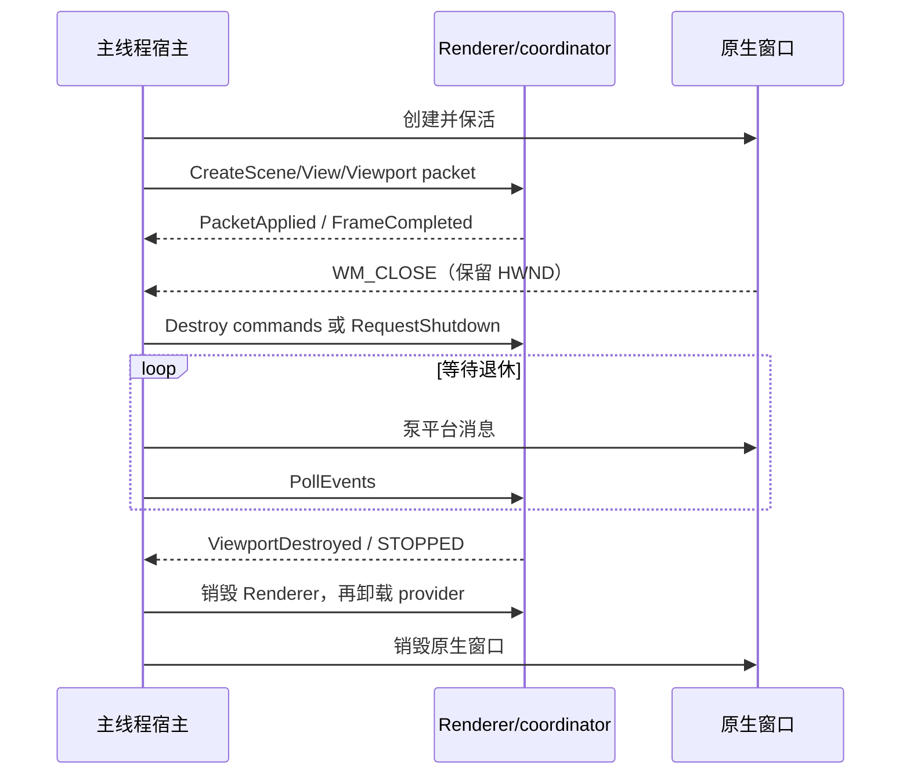
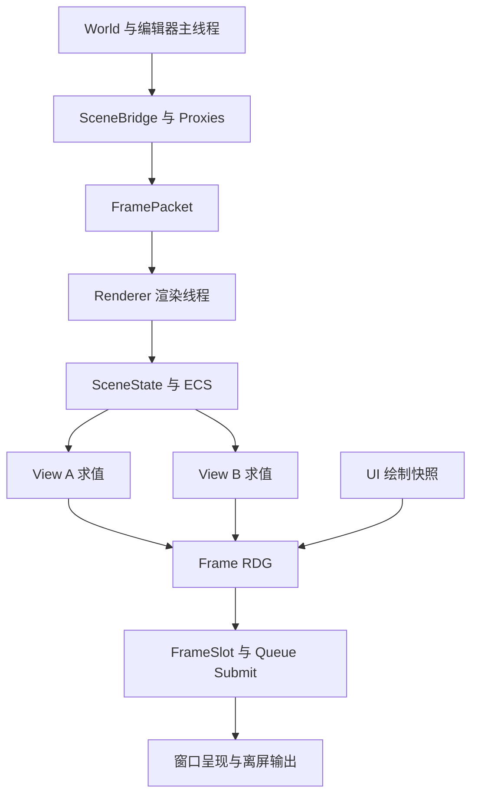
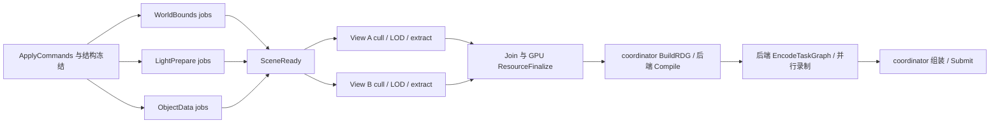
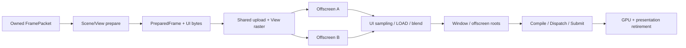
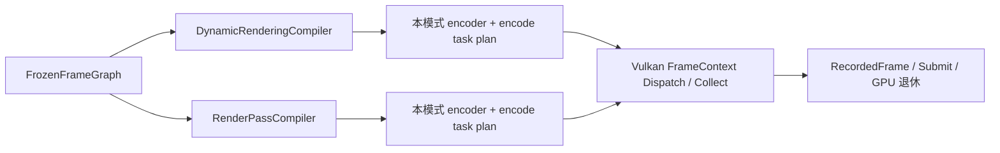
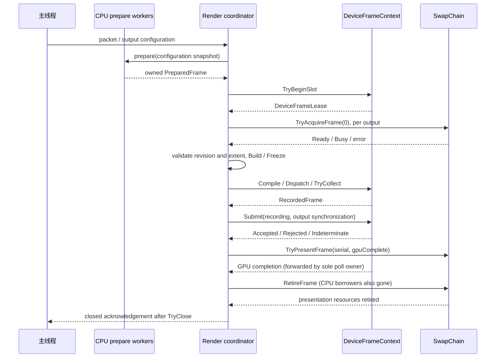
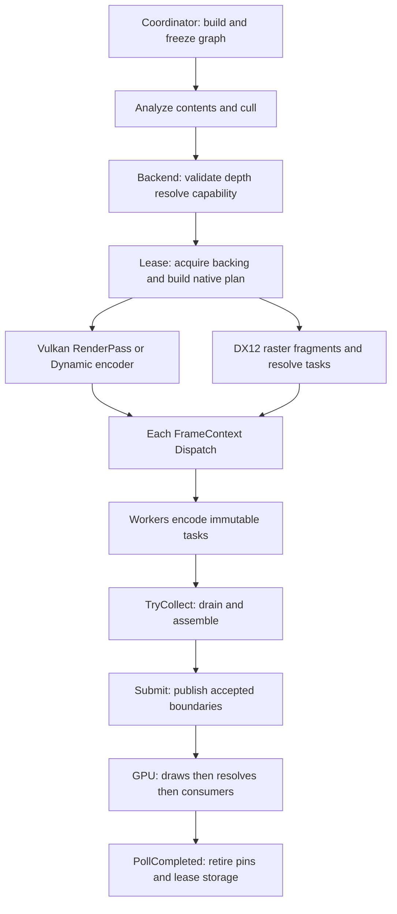
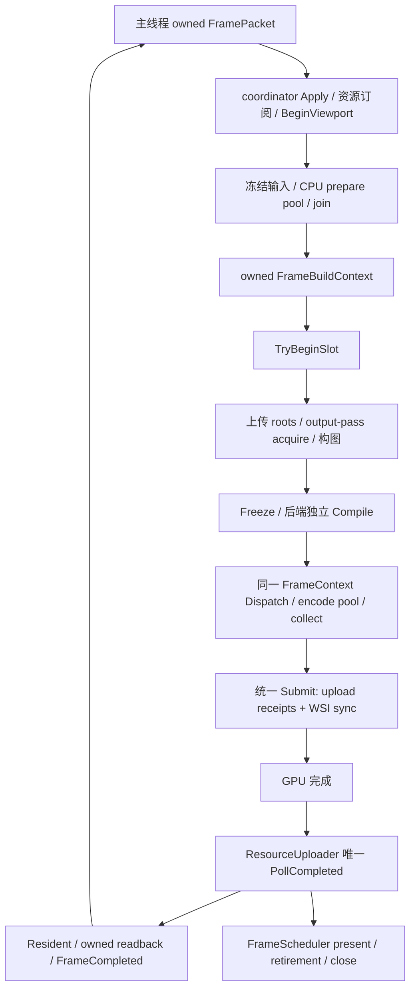

## Context

设计目标是 ECS + RDG + 多 viewport 的 Renderer 主体。现有 `aurora-renderer` 继续承载这项基础实现，
不另建同义 change；架构决策集中在本文件，外部可观察行为放 specs，实施顺序放 batches，验收编号放 tasks。

本文件描述目标架构；代码状态统一见 [status.md](status.md)，执行顺序只在 [batches.md](batches.md)，整项验收见 [tasks.md](tasks.md)。历史实施和测试保留于 review，不将旧阶段快照作为当前缺口。

| 接缝 | 代码归属与设计责任 |
| --- | --- |
| Renderer 契约 | `engine/aurora/core/include/aurora/renderer`：接口、签名数据、纯函数 |
| CPU 场景与 prepare | `engine/aurora/core/src/renderer/{scene,prepare,frame}`：store、coordinator、受限访问、CPU 调度；只消费 CPU 数据 |
| 资源/建图/生产组合 | `engine/aurora/core/src/renderer/{resource,graph}` 与 provider；具体绘制流程归现有 pipeline，Framework 接入归现有 adaptor |
| 冻结图和纯分析 | `engine/aurora/rhi/interface`：IR、结果契约、纯语义分析 |
| native 编译与帧执行 | `engine/aurora/rhi/{vulkan,dx12,metal,common}`：保留原路径；各后端 compiler/encoder 与 common slot/提交生命周期 |
| 宿主迁移 | AuroraModule / EditorRenderer 改为消费 IRenderer；平台和 UI 状态留宿主线程 |
| Core 基础 | `engine/core/ecs`、`engine/core/async`：通用访问依赖、批次执行和 Completion |

Aurora 是 foundation，业务 feature 的 engine 接口 / plugin 实现分置规则不适用于 Aurora。Renderer 复用既有 core/adaptor/runtime，接口 target 不链接实现；模块动态/静态装载与目录归属分开，Renderer 不依赖业务 plugin。

## Goals / Non-Goals

**Goals:**

- 单设备下多 Scene、多 View、窗口和离屏输出，生命周期与线程归属明确。
- 一张 Frame RDG 表达场景输出、合成和呈现之间的依赖。
- CPU prepare 使用组件/资源访问 DAG：跨 system 并行与单 system 分块并行都从首版主体考虑。
- 不依赖完整资产产品链路即可用真实 DrawItem 验证主体；预留 Framework 数据桥接。
- 后端自行完成编译、native pass 与编码任务构建，由对应 FrameContext dispatch；串行路径作为同一协议的参考模式。

**Non-Goals:**

- 本次不将 World 改为 ECS，不引入新 ECS 框架。
- 2026-10-15 确认继续 CPU ECS prepare + GPU RDG 主线，不要求同一 system 同时有 CPU/GPU 实现，不引入异构调度；后续 GPU Scene 可以复用数据语义，物理存储和调度仍分别设计。
- 不在主体 change 内实现完整材质编辑预览、复杂光照或各 feature 的绘制。
- 不把每个辅助类拆成独立 change，也不将所有渲染迁移合成一个长期无法验收的大 change。

## Decisions

### B14 宿主迁移分界（2026-10-17）

Windows 编辑器也通过 RendererHost 消费 provider-only 的 Aurora.Render。`modules_editor.json` 声明 provider、shader compiler 和编辑器扩展先于 SandboxModule；EditorApplication 在加载前追加 provider-only。每个宿主只有一个 packet producer 和事件消费者，SceneSource 回调在主线程向当前 packet 填充 owned 场景命令，不能取得另一个 sequence 或轮询器。该 seam 供 scene-bridge 后续接入，不自动提取 World。

EditorRenderer 主窗、工具窗使用独立 ViewportId，共享场景离屏 viewport（UI texture id 1）；普通纹理由 CPU-only UiSnapshotProducer 登记，id 0 为白纹理，id 2 起用于字体/图标。所有窗口先完成 UI/字体布局，再从最终 atlas revision 编码快照；快照保存顶点、索引、顺序、clip、圆角局部坐标和精确图像 key。主线程 shader 编译、coordinator native 创建/退休，UI shader 统一处理采样与圆角 SDF。只有 Renderer 的 Composer 可以解析 GPU image；宿主没有 Device/FrameContext/CommandPool。

UiSnapshotProducer 限制 64 MiB CPU 图像、1024 个含待释放项的纹理记录；扩展的精确资源表最多 1024 项，继续使用既有 packet、upload、frame staging 和 descriptor 预算。`FrameExtensionPayload.resources` 显式冻结相应候选/Resident，不选择旧 revision。`FramePacket.releasedResources` 幂等撤销 standalone 持有；catalog 等已冻结候选和未决 upload 退出后回收，已有 GPU backing 由提交 pins 保活。更新 atlas 可合并未发布 revision，不累计每次字体编辑的完整旧图像。

工具窗关闭只标记状态，后续 packet 追加 DestroyViewport；必须等 ViewportDestroyed 才清除该窗口的事件监听与 HWND。未提交创建的窗口可以直接销毁；整个宿主退出则先停止提交并完成 RendererHost drain。Windows 旧 EditorRenderer 实现和 AuroraModule 内联 GPU loop 编译排除，未迁移平台仍保留原入口，不移动模块或目录。

ModuleManager::RetainModule 返回真实 DynamicModule 的共享保活，最后一份 lease 才 StopModule/卸载；依赖库由消费者的代码 lease 一并持有。静态模块代码属于宿主，提供相同 lease 接口。Init 期间可取得自身 lease；UnLoadModules 停止模块并拒绝新 lease，库还受 application 清理阶段和既有 callback lease 保护。失败模块先 Shutdown/销毁，依赖消费者不启动，LoadModules 的显式失败由 Application 返回。feature registration 与 host 都必须按 feature 先、module lease 后的顺序释放。


B14.1 在现有 adaptor 中增加 RendererHost，负责通过 provider 创建/发布唯一 `Interface<IRenderer>`，以及保持平台事件泵的同步 Shutdown。它不另建 packet 队列、GPU ring 或调度器。AuroraModule 是单一 producer，独占 TrySubmit/PollEvents；其它模块解析到相同实例不等于可以各自使用 packet sequence 或消费其事件。SceneProxy 向这个 producer 的 owned packet 追加命令，host 负责背压、拒绝和事件分发，组件桥接继续由 scene-bridge 提供。

Windows AuroraModule 默认创建一个空 Scene/View 与主窗 viewport，由 Renderer 负责 BeginViewport、prepare、acquire 和提交。尚未接纳的 packet 不被 resize 原地修改；宿主先重试，然后把最新尺寸放入后续 packet。SceneProxy 记录已排入 packet 的生命周期意图；拒绝或致命错误由宿主终止该 Renderer，停止后重置 proxy，不把未接纳命令当作已完成。Scene/View/Viewport 的 ID 分配和 generation 仍由单一宿主负责。

Win32 的 WM_CLOSE 只是关闭请求；使用新 Renderer 的窗口设置 deferred-close，禁止 DefWindowProc 提前销毁 HWND。AuroraModule 保持借用至 Renderer 完全停止，再解除关闭保护。Game/Editor/XR 应用显式在自身窗口成员析构前 Shutdown；Application 基类的幂等入口只作最后保障。模块初始化失败时先 Shutdown/销毁对象，后 detach/unload DLL；Aurora 反射注册在设备创建成功后进行，provider-only 成功路径也注册反射。



B14.2/B14.3 的编辑器、精确资源与真实 loader 协议见本节前述设计；字体 atlas 只在版本变更时上传，禁止用可变 UI 指针代替快照。非 Windows launcher 保留原路径；不同模式不能共享 Device 再建第二条帧循环。

### D0 Aurora 渲染主流程总览

Aurora 的主流程统一为：**主线程提交场景与输出意图，Renderer 协调 ECS 准备和逻辑建图，各后端编译自己的执行计划，由对应 DeviceFrameContext 编码、提交并管理 GPU 退休。** 本节整合当前目标设计；具体契约以 D1–D10 和 capability deltas 展开，尚未表示实现完成。

总图：[Aurora 渲染主流程](review-images/12-renderer-main-flow.png)。编译与编码展开见 D5b/图 10–11，FrameContext 资源归属见 D7a/图 9。

**主体结构与所有权。**

```text
宿主主线程 World / Editor UI / SceneBridge
  IRenderer / FramePacket writer                  命令与不可变快照
                │ 有界 FIFO / 状态事件
RendererImpl（provider，专用 render coordinator）
  FrameScheduler                                 帧事务、等待、输出、提交及关闭编排
  SceneStore / ViewStore / ViewportStore          持久状态与 generation
  ScenePrepareScheduler + CPU prepare pool       组件访问依赖、场景/视图任务
  ResourceCache / Tickets / PipelineCache         精确资源版本、上传预算与 PSO
  ScenePipeline / FrameComposer                  共享上传 + 各 View + UI/输出逻辑图
  Device + 一个活动的 DeviceFrameContext
    本后端 RDG compiler                          native pass / 同步 / 编码任务计划
    EncodingSession + dispatcher + encode pool  本后端编码与结果组装
    GPU slot ring / allocators / completion      唯一 slot 状态、资源保活与退休
```

Scene 保存共享 ECS；View 保存相机、可见集合、LOD/history；Viewport 保存窗口或离屏输出状态。一个 Scene 可服务多个 View，一个原生窗口可合成多个离屏 View。每个 GPU 帧使用一个 slot lease，View 在其内取得独立常量/descriptor 切片。FrameScheduler 不再复制一套 GPU ring。

**执行域。**

| 执行域 | 负责的工作 | 交付物 |
| --- | --- | --- |
| 宿主主线程 | World/UI 更新、窗口事件、资源完成归并、提交命令；消费 renderer 状态 | owned FramePacket |
| 资产 executor | IO、解压、CPU 解码/编译；不直接改渲染 ECS | immutable CpuReady payload，先回主线程 |
| render coordinator | 应用命令、freeze/join、预算/GPU cache、声明图、调用后端 Compile/Dispatch/Submit、输出和回收 | 帧状态与提交记录 |
| CPU prepare workers | 按受限读写执行 Scene systems/chunks 和各 View 的 cull/LOD/extract | PreparedScene/PreparedViews |
| 后端 encode workers | 按后端任务计划使用独占 native 编码资源；不访问 live ECS | 稳定编号的编码结果 |
| GPU / presentation | 按提交同步执行 copy/draw/compute；按输出协议消费图像 | GPU completion 与独立 presentation retirement |

**初始化一次。** 宿主解析 IRenderer provider，创建 render coordinator；在受控初始化阶段选择 Device/后端，创建对应 FrameContext、编码资源和 prepare pool，注册 features，返回 Init 成功/错误。Scene/View/Viewport 的创建和销毁仍经有序命令；窗口本体属于主线程。

**每个 CPU 帧事务按下列主线推进。** 完成查询与控制事件在整个循环持续处理，不是只在“帧末”运行一次。

| 步骤 | 所有者与动作 | 进入下一步的条件 |
| --- | --- | --- |
| 1 接收与应用 | 主线程封包；coordinator 在安全边界按 FIFO 应用 create/update/destroy 与资源完成，取得输出配置/资源版本快照 | 句柄与版本有效，组件池预建，结构冻结 |
| 2 Scene/View prepare | Core 访问依赖计划驱动专用 CPU pool；每 Scene 准备一次，各 View 在 SceneReady 后分别求值 | jobs 与必要归并完成，产出 owned PreparedFrame；尚未占 GPU slot |
| 3 取得帧资源与输出 | scheduler 通过 TryBeginSlot 取得 lease，再有界 acquire/复核 outputs | slot 安全且输出 generation/extent 一致；变化则重做受影响 View 或跳过 |
| 4 资源落实与逻辑建图 | coordinator 按预算创建资源/PSO、准备 staging/UploadBatch；FrameComposer 声明 upload、逐 View、UI/composite 和输出 roots，Freeze | 精确版本固定，范围/访问/输出明确；资源未就绪只影响相关 draw |
| 5 后端 Compile | 当前后端完整分析/剔除/排序，构建 native passes、backing/bindings、同步、EncodeTaskGraph 与 SubmissionPlan | 成功生成绑定本 context/slot 的 BackendCompiledFrame；无 GPU 提交 |
| 6 FrameContext Dispatch | 本 context 执行 coordinator 步骤与 worker 批次，收齐并按稳定顺序组装 | TryCollect 返回 RecordedFrame；失败/取消须先 drain，无部分帧提交 |
| 7 Submit 与输出排队 | scheduler 请求 context 显式提交；Accepted 后登记业务 SubmissionRecord、上传状态及候选最终状态，按平台协议排队 Present | 接受结果可观察；Present 使用对应 render-done 同步，不将排队视为已完成 |
| 8 完成与回收 | completion pump 检查 GPU，发布资源 Resident/释放可退休引用；输出单独确认 presentation retirement | slot 只在真实 GPU 完成且 CPU 编码借用退出后复用；关闭等待全部相关责任结束 |

首版按单个 CPU 帧事务推进；本帧 CPU 借用与提交/放弃收尾结束后，再应用下一 packet。GPU 可仍在执行先前提交，因此 CPU 帧 N+1 的 prepare 可与 GPU 帧 N 重叠。CPU packet sequence、GPU submission serial、slot index 和 swapchain image index 分开管理；不通过独立 Tick 计数推进各 allocator。

**数据交接只沿拥有数据或受控 lease 的边界。**

```text
FramePacket
  -> 持久 Scene/View/资源目录增量 + CpuPrepareFrame
  -> PreparedFrame
  -> FrameBuildContext（prepared + slot lease + outputs + CPU arena）
  -> FrozenFrameGraph
  -> BackendCompiledFrame
  -> EncodingSession / RecordedFrame
  -> GPU slot + renderer SubmissionRecord
```

后端 plan 不跨 context/slot 重放；同一 plan/recorded 结果只消费一次。CPU 图和 prepare 内存在 jobs、录制及结果 borrowers 退出后回收，GPU 引用已移交 slot。无需让所有 CPU 临时内存都等待 GPU fence；也不能让 arena reset 代替非平凡对象析构。

**三种依赖计划各有职责。** ECS Prepare DAG 解决组件/CPU 数据读写冲突；GPU FrameGraph 解决资源 producer/consumer、内容有效性和 GPU 同步；后端 EncodeTaskGraph 解决 CPU 录制的输入发布、独占 native 资源和组装依赖。后两者由各后端 Compile 生成/落实。它们可以复用执行基础，但不能机械地共用同一组边。协程可在以后包装完成令牌，当前主流程不依赖协程 runtime。

**资源加载是旁路生产，上传接入主图。** `Requested -> CpuPreparing -> CpuReady` 在资产侧完成，经主线程 payload 进入 Renderer；`UploadQueued` 在步骤 4 接纳为本图 copy，步骤 5–6 编译/编码。步骤 7 Accepted 后为 UploadSubmitted；步骤 8 成功完成才为 Resident。同图消费者可用 InGraph 依赖 copy，无需 CPU 先等待上传；未接纳的新版本跳过或使用冻结前已选定的兼容旧版本。首版尚未 Resident 的跨图新资源仍不可直接消费。

**暂停、失败和退出也是同一循环的分支。** 无窗口但有获准上传可以产生 upload-only 图；无任何 GPU 工作则释放未提交 lease，不 reset fence。单个输出失败剔除其分支；已成功 acquire 的输出仍需收尾。CPU 准备/编码失败先 drain，再放弃候选；提交接受状态未知则隔离资源。Shutdown 停止接收新包，按约定排空/取消 CPU 工作并处理输出责任，等待 GPU 与 presentation 退休或进入明确的设备错误协议，最后销毁 caches/context/device、join 并通知宿主；宿主等待期间继续处理平台事件。

**阅读顺序。** 先看本节/图 12 掌握主线，再按问题查 D4a–D4c（ECS/并行）、D5a–D5b（图与后端编译）、D6a（异步资源）、D7–D8（FrameContext/提交/退休）、D9–D10（模块与接入）。实施依赖以 batches.md 为准，整项验收见 tasks.md；不另建第二份设计总纲。

### D1 保留 OpenSpec 并按可验收能力划界

`proposal.md` 定义范围；`design.md` 承担架构决策；`specs/` 定义契约；`batches.md` 定义实施依赖与退出条件，`tasks.md` 保留验收编号；`status.md` 记录当前能力，`review.md` 保存历史证据。
暂不另建 ADR 系统或第二份架构总纲，避免重复维护。若后续出现可复用的独立决策，再从本设计提炼 ADR。

| 工作 | 归属 | 交付边界 |
| --- | --- | --- |
| Renderer 主体及最小出图 | 当前 `aurora-renderer` | 程序化网格、两相机、窗口与离屏输出、生命周期验证 |
| 通用 ECS 访问依赖基础 | 当前 change 的 `core-ecs` delta | 访问数据、纯依赖编译、受限视图；不新增完整 ECS system/runtime 框架 |
| World/Actor/组件提取 | 已有 `aurora-scene-bridge` | 监听 lifecycle/transform/asset-ready，生成 Renderer 命令 |
| 完整材质 GPU 准备和资产版本更新 | 后续范围，尚未建 change | schema/program/variant 到 GPU cache；复用本次最小 pipeline 的接缝 |
| 地形、植被、导航可视化 | 各自已有 change | 通过 feature/pass 接口接入 |
| 更复杂的编辑器预览体验 | 后续范围，尚未建 change | 工具交互与产品行为；基础 UI 合成入口属于本 change |

保留主 change，拆成 B01–B14 与 P01/P02；共享 ABI 和同一 capability 的 SHALL 只维护一份。Core Completion 的通用语义归 async-threadpool，Renderer 只定义自身 job/consumer 生命周期；scene-bridge 只定义宿主提取，不重述资源就绪或退休协议。

批次完成状态统一记录于 status/batches；每批代码与该 change 的相关 spec 一起提交，commit/archive 遵循根 AGENTS 的用户确认规则。

### D2 Scene、View 与 Viewport 是三个独立对象

| 对象 | 数据 | 所有者与关系 |
| --- | --- | --- |
| `RendererImpl` | device、注册表、GPU caches、调度器 | provider 持有；每个进程的活动宿主使用一个实例 |
| `SceneState` | `RenderScene` ECS、dirty 数据、scene feature 状态 | Renderer 持有；首版一个 World 对应一个 Scene |
| `ViewState` | SceneId、相机、过滤、可见集合、LOD、history、pass state | Renderer 持有；多个 View 可以引用同一 Scene |
| `ViewportState` | window/offscreen 描述、尺寸、格式、输出 generation | Renderer 持有；与 Scene 生命周期分离 |
| `FrameSlot` | command/descriptor/upload/UBO、graph backing leases、完成状态 | DeviceFrameContext 持有唯一 GPU slot ring；scheduler 经 lease 调度，GPU 完成后复用 |

首版每个 scene View 绑定一个输出；同一相机渲染到两个不同尺寸的输出时建两个 ViewState。
一个编辑器原生窗口可合成多个离屏 View；无需把所有 UI 窗口强制绑定到一个 Scene。
同场景多 View 共享不可变 mesh/material GPU 资源，但不共享可变 camera/visibility/LOD/history。



备选的“每 viewport 独立 Renderer/Scene/Device”会重复资源并割裂合成依赖，因此不采用。

### D3 主线程提交拥有数据的 FramePacket

主线程独占 World、Actor、UI；渲染线程持有 Scene ECS、Device 和 GPU caches，并作为 prepare coordinator。
CPU prepare worker 仅在调度器授予的访问范围内借用 ECS/快照；结构变更、GPU 对象/cache 修改、逻辑建图与队列提交由 render coordinator 控制。GPU 命令编码由各后端 FrameContext 按计划在 coordinator/独立 encode workers 执行，使用独占编码资源和不可变绑定，不访问 live ECS。
平台窗口的创建、事件和销毁仍走宿主线程；平台需要的 surface 操作通过显式宿主协议完成。

`IRenderer` 只暴露配置、句柄、命令包、提交结果与完成事件，不暴露 World/Actor 指针或可变 RenderScene。
句柄包括 SceneId、RenderEntityId、ViewId、ViewportId，包含 index + generation；render entity 在各 Scene 内映射到现有 ECS EntityId。
句柄槽位回收需经过销毁确认；generation 耗尽时退休槽位，不能回绕后误认迟到命令。

`FramePacket` 由主线程持有的 writer 收集，含顺序号、时间、create/update/destroy 命令和只读 CPU 数据。
数据按值复制或通过明确定义的不可变所有权转移；CPU 资产载荷保活到所有读取结束/完整 staging 拷贝完成，staging 保活到 GPU 上传完成，不能只保存裸地址。
资产 worker 的结果先回到主线程归并，保持单生产者；渲染线程向主线程返回状态事件。

初版有界队列按 FIFO 消费，满时 `TrySubmit` 返回 Busy，调用方保留原包并继续处理窗口事件；不得静默丢弃 lifecycle 命令。
空闲渲染线程等待事件，不自行忙循环。CPU 待处理 packet 数与 GPU inflight slot 数是两个独立限制。
后续优化可合并 update，但不得越过 create/destroy、资产 revision 和帧事务边界。

Init 必须返回成功/错误；DestroyViewport 必须在 renderer 不再使用表面后发确认；Shutdown 停止接受包、排空工作、等待 GPU/呈现退休并 join。
宿主等待完成时不得阻塞平台消息处理，渲染线程也不得同步调用可能等待自己的主线程回调。

CPU 通道约定：Renderer core 的 `FramePacketQueue` 使用预分配的精确容量 ring、短 mutex 和条件变量。只有 Accepted 移交 unique_ptr 并推进提交序号；Busy/Rejected 保持原对象及载荷，序号不得回绕。Close 幂等地关闭入口并唤醒 consumer，WaitPop 先交付所有已接收包，关闭且为空后返回空；调用方须在销毁队列前 join consumer。这只是 CPU 通道，不把 Close 等同于 GPU/Renderer shutdown。

`CpuSceneStore::Apply` 先以只覆盖本包触及句柄的元数据 overlay 模拟 FIFO 命令，不复制整个 ECS。合法序号的 Apply 尝试消耗该序号，即使内容预检失败也不能重新应用同序号。格式错误（无效 ID、非有限矩阵/时间、零 update revision）或尚无 handler 的 ResourceCpuReady/extension 整包拒绝，不应用前面的命令。过期 generation、重复/迟到 revision、未确认退休的复用则按 commandIndex 返回 skip 诊断，继续处理其它合法命令。Create 以 revision 0 为基线，Update/Resize 在同一 generation 内必须严格递增。

CPU 删除返回内部 `CpuRetirement`，不会直接发出公共 Destroyed 事件。槽位保留 generation tombstone；只有 coordinator 确认 CPU borrowers、GPU、presentation 退休并可发布销毁确认后，才调用 `AcknowledgeRetirement` 开放更大 generation 的复用；最大 generation 没有可用后继。实体身份包含父 Scene generation，Scene 删除一并清理该代的实体索引。错误 generation、重复 ack 均无效。当前测试无 GPU borrowers，由测试宿主明确完成该步骤；生产 retirement 驱动仍待实现。

CPU coordinator 约定：`CpuRenderCoordinator` 在专属 CPU 线程内创建/持有 store，循环执行 `WaitPop -> Apply -> Freeze -> build/compile/bind prepare -> kernel DAG -> borrower drain -> CPU result`。这是 provider 内部 CPU 阶段，不实现 IRenderer；public provider 仍返回 NOT_READY。builder 仅构建 CPU system 描述与普通 kernel，不访问宿主 UI 或启动 GPU 工作。所有上下文校验完成后才运行第一个 kernel；计划/绑定/prepare 失败关闭入口，等待当前借用退出，并为队列里每个已接收包产生未执行失败结果。

输入包容量与未消费结果容量分开配置。TrySubmit 同时预留结果 credit，直至对应 `CpuPacketCompleted` 被 PollEvents 取走才归还；任一容量不足均 Busy 且保留包。结果以固定 ring 交付，停止结果另有一个槽，因而不需要宿主先读事件才能停机。PollEvents 零容量无副作用，结果 FIFO 且只取一次，Stopped 排在所有 packet 结果之后。RequestShutdown 关闭入口而不等待，正常路径排空 accepted 包；Join 前必须释放所有借用。错误包预检拒绝不终止 coordinator，写入/prepare 失败则保守停止整个 CPU coordinator，逐 Scene 恢复必须经过显式重建与独立验收。

`CpuPacketCompleted` 分别报告命令应用与 prepare 结果，附带 skip/retirement 记录，不持 live ECS 引用。它与 `CpuCoordinatorStopped` 均是内部 CPU 事件，不代替公共 PacketApplied/RendererStopped 或 GPU/presentation 退休确认；生产退休控制汇总各类使用结束后，才允许复用逻辑槽位。

### D4 场景更新一次，视图分别求值

Scene 更新分成串行命令应用、CPU prepare DAG 与结果发布；world bounds、light 数据等按访问依赖并行准备。
所有 Scene prepare jobs 完成后冻结本帧 scene revision，再执行各 View 的裁剪、LOD 与 CPU 绘制数据提取；不同 View 可以并行。
沿用现有 sparse-set ECS。首个可绘制实体组合为 WorldInfo、Bounds、MeshBinding、MaterialBinding、RenderFlags；binding 使用渲染资源句柄。
DrawItem 是当帧提取结果，不作为长期 ECS 组件保存。GPU 对象仍由 renderer cache 和 frame 引用管理。

DestroyEntity 必须移除所有池成员；延迟资产完成只在 entity generation 与 asset revision 都匹配时生效。
Scene 销毁使依赖它的 View 停止场景绘制并报告状态，但不会隐式销毁宿主窗口。

### D4a 通用组件读写依赖与 CPU Prepare DAG

访问计划约定：`core/ecs/Dependency.h` 提供拥有描述数据的 `AccessDesc/SystemDesc/DependencyPlan` 与纯函数 `CompileDependencyPlan`。domain、非零 owner instance/generation、kind 和非零 identity 组成访问键；组件使用 TypeId/TypeTag，具名资源使用 FNV-1a 64 bit identity 并保留完整名字做碰撞检查。相同 key 的重复访问归并为 Write，所有 tag 字符串与 system 名字由计划持有。

phase 是全计划屏障；相邻 phase 的节点间建边，其余 phase 顺序由传递关系保证。同 phase 先解析 Before/After，再以 `(phase, order, id)` 确定稳定拓扑序；数据 hazard 沿此序推导。系统顺序和边都规范化，保留 Phase/Before/After/RAW/WAR/WAW 来源与访问 key。错误结果携带诊断，环报告实际环成员和约束来源，而不把所有受阻下游都称为环成员。

串行参考执行位于 `engine/aurora/core/src/renderer/prepare`，实现并入 `Aurora.Core.Static`，该 CPU 代码仅消费 Core 和 Renderer 接口。`ExecuteSerialPrepareChecked` 在调用线程运行已编译计划，通过 PrepareNodeResult 接收显式失败、跳过失败节点的传递消费者，并完成其余独立节点；void callback 入口仅用于不会失败的任务。它不创建线程池、GPU 对象或共享注册表；不是 JobGroup/Completion 的实现。冻结绑定层和并行调度器复用同一失败协议。

需要通用机制，但首版复用现有 ThreadPool，不另造 JobSystem。分成三层：

| 层 | 职责与归属 |
| --- | --- |
| `AccessDesc / SystemDesc / DependencyPlan` | Core ECS 的通用数据及纯编译函数；不引用 Scene、RHI、FrameSlot 或 ThreadPool |
| `ScenePrepareScheduler` | Aurora core 的 prepare 实现；注册 system、绑定 Scene/View 实例、冻结结构、切块和提交任务 |
| `ThreadPool / TaskNode` | 已有执行机制；只执行依赖，不理解组件、场景或 RDG |

CPU DAG 描述组件/CPU 资源的先后关系；RDG 描述 GPU 资源访问及 barrier。二者通过 PreparedScene/PreparedViewData、UploadPlan 衔接，首版不合并成一种图。

**访问声明与身份。** 每个 system 声明 `Read<T>`、`Write<T>`、非组件资源访问，以及可选 Before/After。Write 包括读改写，与所有重叠 Read/Write 冲突；Read/Read 可并行。
组件访问键为 `(domain, owner instance+generation, TypeId<T>)`，owner 在绑定时对应具体 Scene；View 临时数据使用 View owner；共享 CPU 资源使用同一真实资源 owner。
同一 Bounds 类型在 Scene A/B 中不冲突；多个 View 读取同一 Scene Bounds 可并行；它们分别写 View 自有 visibility/LOD/draw buffers。
frame sequence 不能让同一份 live ECS 存储被当成两份资源：首版上一 CPU 帧全部 jobs 完成后才应用下一 packet，不做同 Scene CPU 跨帧重叠。
已有 TypeId 使用显式 SKY_TYPE_TAG 哈希，可跨 DLL 复用；计划编译保留 tag 碰撞检查。
通过组件句柄间接访问的共享状态也必须声明资源依赖，不能认为两个不同组件天然没有别名。

概念声明示例（表示所需语义，不冻结 C++ ABI）：

```cpp
prepare.System("WorldBounds")
    .Read<WorldInfo, MeshBinding>()
    .ReadResource<MeshMetadataSnapshot>()
    .Write<Bounds>();

prepare.System("LightPrepare")
    .Read<WorldInfo, Light>()
    .WriteResource<PreparedLights>();

views.System("CullAndSelectLod")
    .ReadScene<Bounds, MeshBinding, RenderFlags>()
    .ReadResource<ViewCamera>()
    .WriteResource<ViewVisibility, ViewLod>();
```

**依赖推导。** 读写集合只能发现冲突，不能自行判断哪个结果应先产生。先用 phase 和显式 Before/After 建语义顺序，再按稳定 system order/id 做确定性的拓扑排序；未显式排序的冲突使用这个稳定顺序，不使用 DLL 加载顺序。
沿逻辑顺序逐 key 维护 lastWriter 与 outstandingReaders：Read 等待 lastWriter；Write 等待 lastWriter 和此前所有 readers，然后替换 writer、清 readers。由此覆盖 RAW/WAR/WAW。
消费者若必须读到另一个 system 的本帧结果，应显式 After producer 或落在后续 phase；排在 writer 前的 reader 读取输入版本，不能靠 Write 声明自动反转业务顺序。
显式依赖成环、跨 phase 逆序或未知节点在提交前报错；诊断输出 system 名、冲突 key 与边来源。相同输入描述生成相同计划。
首版以“同 Scene 的整个组件池”作为 system 间冲突粒度；dirty/tag 查询不证明互斥，不以此消除依赖。无冲突节点可同时就绪。
稳定的 system/access 拓扑可缓存，按 system 集合、访问声明、显式顺序和资源别名版本失效；实体增删只要求重新绑定 query/chunks，不必无条件重编整张依赖图。

**结构冻结与受限访问。** ApplyCommands/Preflight 串行创建实体与所需组件池，预建本帧将写入的组件并解析 view；随后冻结池结构。

冻结的目的是给并发消费者一个稳定的读取范围和版本：prepare job 遍历组件池期间，如果 Apply 删除实体导致 swap-remove 或扩容，原来的行、指针及分块范围会失效。因此结构变更必须等本轮任务及借用全部退出；获授权的派生组件写入仍按访问依赖并行执行。冻结不复制整个 ECS、不停止主线程，也不要求等 GPU 完成才解冻；新的 FramePacket 可以先排队，owned prepare 输出生成且所有 ECS 借用释放后再应用下一包。
worker 不得使用可能懒创建的 Pool/Get/现有可写 View，不得 Add/Remove/Create/Destroy、reserve 或触发 swap-remove。
提供预绑定的 const ReadView 和受限 WriteView，只允许声明的类型/资源及有效区间；Read<T> 返回 const，debug 检查未声明访问。已有裸 registry API 不宣称自动线程安全。

冻结访问由 `FrozenCpuFrame/FrozenPrepareContext/FrozenReadView<T...>` 承载。Freeze 记录最近成功 Apply 的序号，复制 View 相机与输出 extent/format/revision（不含 native window），持有 Scene 存储 lease；上下文和 read view 都延长该 lease。冻结期间 Apply 与退休确认拒绝执行，且被冻结阻挡的 Apply 不消耗序号。最后一个借用释放后唤醒 coordinator；即使 store 外层 owner 先析构，仍被读取的实际存储保持有效。

上下文按已编译 SystemDesc 授权组件类型和 Scene owner：owner 为本 store 内 `(index + 1, generation)`，domain 为 scene。输入组件只读，派生组件按已注册的访问能力绑定；未知类型、过期 owner 和未声明访问显式报错。行表在 Bind 时生成，不修改或懒建池。RESOURCE 声明仅提供排序证据，不自动授予共享资源借用；View/output 是已复制的只读元数据。

`FrozenPrepareExecutor` 统一绑定整个计划的行表，执行时逐节点开启访问作用域。`Read/Write` 只选择预绑定行，不再遍历 registry 或创建池。四种输入仍只读，`RenderObjectData` 派生池在 Scene/实体创建时预建；其它派生类型需显式注册能力。`Write<T, Reads...>` 同时校验写组件及 join 的输入声明，Write 包含同组件 Read 权限。Read 返回 const，Write 回调仅收到 Value 候选，不允许改 stamp。行按外部 entity index 稳定排序；Read/Write 的 Slice 只允许缩小当前范围，空范围有效，超出父范围或长度溢出显式报错。

派生 Read/Write 均绑定单次同步 kernel 的执行线程。保存 view/context 继续保持帧 lease，但 kernel 返回后操作权限关闭；在另一线程访问也立即拒绝。因此不能将派生视图交给异步消费者，不能在同一执行中重复开启 scope；每个冻结帧只允许一次 prepare 执行。下游用自己的访问声明重新取得 ReadView，跨帧消费者需复制独立值。输入 ReadView 在 kernel 成功或失败结束后仍可使用，其 lease 阻挡下一包。任何组件引用都不得逃逸 ForEach 回调，此约束不能由 C++ 裸引用自动强制。

派生写入采用每个实际任务的私有候选：绑定时仅解析存储地址，执行 Begin 时才复制前驱已发布的值，避免连续 writer 使用陈旧快照。ForEach 每行使用局部 Value，回调未标记失败才更新候选。未分块 system 在 kernel 成功后发布；分块 system 等全部 chunks 和 join 成功后统一发布写过的行与输入 revision、preparedSequence、valid。context.Fail 或访问校验失败则丢弃整个 system 候选。已完成前驱/独立 system 不回滚，失败消费者按 DAG 跳过，coordinator 停止并 drain。

Bind 返回 context/error；未声明访问、非法 Slice 返回无效视图，迭代失败返回 false，并使活跃 scope 失败，调用方忽略返回值也不会误发布成功。跨线程拒绝只写原子失败标志，诊断字符串只由执行线程写入；过期 scope 的拒绝不改写已完成结果。FramePacketQueue/CpuRenderCoordinator 使用 Init 拒绝非法或重复配置，builder 返回 program/error；ECS Add 成功返回组件指针，失效实体或 generation 冲突返回 nullptr。

`PrepareRenderObjects` 将 world、逻辑 mesh/material binding、visibility mask 提取到 CPU 对象值。创建时 valid=false（revision 0 不是成功标记），新输入使缓存失效；ForEachDirty 只重新准备失效或 revision 不匹配的项，空包和迟到更新保留成功 stamp。对象 stamp 表示 CPU 对象提取成功；完整 draw packet 还须记录所用资源版本、bounds/LOD 等依赖，不能把对象 stamp 当作 residency 证明。

Slice 表示同步 kernel 的范围访问；chunk 并发由 scheduler 为每个实际任务发放独立范围、访问作用域与候选。禁止把同一个活跃 context scope 转交多个 worker，完整 system 的发布点由 chunks/join 共同决定。

system 并行执行约定：`ScenePrepareScheduler` 在 coordinator 编译依赖、校验并绑定全部行表，然后将无冲突 systems 提交至私有 CPU `ThreadPool`。coordinator 保持单帧执行，`PrepareJobGroup::Wait` 收齐全部节点，释放内部上下文与 kernel 后，再等待外部输入 ReadView 的存储 lease 归还。独立 Scene 可以同时准备；同 Scene 的派生写入与读者仍按完整组件池依赖排序。callback 的共享捕获由调用方保证并发安全。

**复用与有界进展。** 原 `DeviceFrameDispatcher` 实现抽取为 Core `TaskDispatcher`，RHI 旧头保留同名 alias；Renderer 的 CPU prepare 代码只消费 Core 和 Renderer 接口。复用原有节点计数/ready Schedule 机制，不再增加另一套任务队列。单批节点预算为 `min(maxParallelNodes, workerCount × localQueueCapacity)`，当前本地队列容量为 256。此证明要求 pool 被本批独占：每个节点最多入队一次，模 workerCount 的 round-robin 保证各队列总入队不超过容量，因此 worker 扇出不会因队列满自锁。超过预算的合法计划使用同一绑定上下文、同一 Invoke 和串行参考执行器；`maxParallelNodes=0` 可强制串行对照。aggregate `maxBoundRows` 限制各 system/Scene 行表总行数，超限在任何 kernel 执行前拒绝；它尚非完整 bytes/IR 预算。

**明确错误与发布。** 接口与 callback 不主动抛异常，也不使用 try/catch：Create/Submit/DependsOn 返回明确错误，dispatcher 的节点和批次 future 携带成功/失败/跳过状态，不使用 set_exception。依赖环、非法句柄、行绑定失败和预算在提交前校验；dispatcher 所需计数、队列任务体以外的图存储与 completion 状态在执行前准备。kernel 通过 `context.Fail(...)` 报告失败，通用任务使用 checked callback；标准库分配、容器、线程和 future 异常当前不处理。失败节点丢弃候选，传递消费者跳过，独立节点继续；所有节点收齐之后才发布批次完成。Clear 拒绝运行中批次，完成后可以复用。

PrepareJobGroup 的发布/订阅采用 D4b 的通用 Completion 契约；CPU coordinator 在 STOPPED 前排空 prepare、结果消费者和 continuations，再销毁专用 pool。现有 Poll/Wait 适配与后续 B09 的订阅/取消差距见 [status.md](status.md)，不以常规成功测试推断标准库 OOM 或线程启动异常处理能力。

分块使用显式 `ElementWisePrepare{system, scene, rowsPerChunk, scratchBytes}`。配置放在 Renderer scheduler / CpuPrepareProgram，Core SystemDesc 仍只描述依赖。未配置的 system 保持一次调用；已配置的 system 按稳定外部 entity index 的行表切成不重叠区间。当前仅支持一个 Scene 的组件访问，允许额外只读 RESOURCE 声明；跨 Scene 组件访问、共享 RESOURCE Write、重复/未知 system 和零 chunk 大小均在启动前拒绝，不能用 dirty/tag 查询暗示可分块。

每个 chunk 有独立 context/scope、仅包含自身区间的行表与候选、预分配并清零的 byte scratch。Read/Write 再次获取时也只能看到这个区间，Slice 不能扩大它；Chunk 返回稳定 index/total/first/count。Scratch 仅在该 kernel 的执行线程可取得，跨线程或完成后返回空 span；裸 span 和组件引用都不得逃逸调用。scratch 不是通用对齐对象 arena，任务不得自行向共享 vector append。全计划绑定、分块存储和 scratch 分配完成后才启动 kernels；转换期间原行表和分块副本可短暂同时存在，绑定行数预算不等于实际峰值字节预算。

**完整 system 发布。** 编译后的每条 system 边展开为 `producer exit → consumer 的全部 chunk entries`；配置过分块的 system 有显式 join 节点，所有 chunks 完成后才执行。每个 chunk 在前驱发布后复制候选，同步 kernel 返回时关闭 scope，但不写实际派生组件。chunk 将自身失败保存在独立槽内，仍向内部 join 释放完成依赖；join 按 chunk index 选择首个失败诊断，失败则整个 system 不发布，成功才按 chunk/行顺序无分配地发布对象值与 stamp。join 的最终状态驱动 system DAG 的消费者成功或跳过。无需 worker 等待同池子任务，独立 systems 和同组其余 chunks 继续收齐。

**分块预算。** soft 并行预算按实际展开的节点数计算，包含 join；超限在 coordinator 用相同分块、scratch 和 join 逻辑串行执行，不悄悄改成一个全范围 kernel。另有 hard `maxTaskNodes`（默认 4096）与 `maxScratchBytes`（默认 16 MiB），超过时提交明确拒绝且不执行任何 kernel；按减法/除法检查累加和乘法溢出。空行表产生一个 count=0 的 chunk 再 join，保持明确的 system 调用与完成语义；空计划仍直接完成。

输出容量使用 `PrepareOutputConfig{system,maxRecordsPerTask,maxBytesPerTask,maxDeferredPerTask}`。每个任务在启动前预留独占 records/bytes/commands，最终归并缓冲也提前预留；scheduler 检查实际 chunk 数乘容量的溢出及全批上限。未配置的 system 没有输出能力。`Emit(channel, bytes)` 复制调用方的无指针值载荷，channel 非零且 schema 由生产者/消费者共同约定；只复制字节不会延长载荷内裸指针的生命周期，因此不得输出这类指针。`Emit/Defer` 仅当前 kernel 线程可调用，越限/无效命令转为显式任务失败，完成后或跨线程调用直接返回 false。

JobGroup 收齐全部任务后，仅在整个计划成功时按已编译计划的 system 顺序、chunk index、任务内 emission ordinal 归并为 `shared_ptr<const PrepareProducts>`。结果与 ECS/FrameContext 无借用关系，可在 store/pool 销毁后读取；消费者按该固定顺序执行自身 reduce。首版不引入任意对象序列化、用户 reducer 回调或 DAG 内跨 system 读取这批 byte outputs 的接口；DAG 内已有派生组件仍在完整 system join 后发布。任一任务失败均丢弃整个批次的通用输出/deferred，已成功 system 的既有组件发布不回滚，coordinator 停止后续 prepare。

`Defer` 首版接受已注册渲染实体的 Create/Update/Destroy；create/destroy 一并添加/移除该实体固定组件集合，不开放任意组件类型的增删。更新/删除只能指向本任务绑定的实体行，并自动捕获 generation 和输入 revision；创建限定已绑定 Scene，逻辑 ID 由调用方分配。命令保留 system/chunk/ordinal，整体携带 sourceSequence。多个请求以稳定归并次序处理，重复创建、退休未完成、过期 generation/revision 作为可诊断 skip；不允许 worker 直接修改 registry 或分配共享逻辑 ID。

下一 Apply 将 deferred 前缀与外部 packet 一起预检，全部有效后才执行变更。deferred 更新/删除的 revision 前置条件对比边界入口状态，不与本批前面命令产生的临时 revision 比较；正常的命令顺序/存活检查仍使用 overlay。外部实体更新的首次有效 revision 对比边界入口值，故合法的新宿主输入可覆盖 deferred 候选；本包后续更新继续严格递增，旧宿主输入不会借此重放。外部 destroy 最终删除对象。deferred 整批只允许来自最近一次成功 Apply 的 sequence；包无效时不应用、不消耗 pending 命令，下一有效包重试；成功则包括 skip 在内只消费一次。Apply 报告来源 sequence、消费数量及区分 PACKET/DEFERRED 的 skip 索引。

Cpu coordinator 仅保留上一成功 prepare 的 owned 产品，等待所有 ECS borrowers 释放后才进入下一边界。正常 shutdown 排空已接受包，但不会凭空制造一个包来应用最后一轮 deferred；Stopped 报告未应用命令数量。容量是逻辑输出上限，任务副本与最终归并副本可并存（约双份载荷，另有 vector/行表开销），不是完整峰值内存预算。Apply 预检拒绝具有整体不修改语义，真正写入阶段的显式业务失败封闭 store；标准库分配异常不处理，不承诺通用事务回滚。

结构变更由各 job 的私有 deferred command buffer 记录，按稳定 system/chunk 顺序归并，默认在下一帧 ApplyCommands 生效；首版不在 prepare 中途改变本帧查询集合。

**两层并行。** system 间按 DAG 并行；单 system 的 dense driver 可拆成确定的 entity ranges。只有声明 element-wise 且每个 entity 至多写一次的 kernel 才允许切块。
跨池 sparse 查询按 entity 做一一映射，禁止 chunk 写入任意其它 entity；所有 chunks 共同占用该 system 声明的完整访问范围，下游等待全部 chunks 完成。
邻域/层级遍历、共享累加、全局 vector append 不能直接套 element-wise。使用 chunk 私有输出、确定顺序 merge/reduce，或作为未拆块 system 执行；Reduction 暂不引入新的通用访问模式。
FrameAllocator 不能由多个 worker 共用可变游标；使用任务私有 scratch/输出段，按 system/chunk 顺序归并，draw 排序增加 EntityId/submesh 等稳定 tie-break。

**阶段与完成边界。** 首版按以下顺序执行，阶段内由依赖释放并行度：



独立的 bounds/light/object 准备可并行，各 Scene 分别有 SceneReady；首版所有选中 View 的结果齐备后由 coordinator 建单张 RDG。
worker 产出 CPU upload plans 和含资源句柄的 draw packets；GPU 创建/上传、PSO/cache 解析以及最终 DrawItem 组装在 ResourceFinalize/BuildRDG 完成。
每帧保留 JobGroup 完成令牌，渲染线程只等待自身计划，不用 WaitIdle 代替本帧完成条件。worker 不嵌套阻塞等待同池子任务；所有依赖在首次 Submit 前建完。
执行适配层要覆盖空计划、单 worker、chunk 数为零和大任务数的进展性；空图直接完成，有界队列 Schedule 可能等待空间，不能把任意大 ready fan-out 直接塞入 worker 完成回调。
首版由 Renderer 持有一个独立的 CPU prepare ThreadPool 实例（所有 Scene/View 共用，不为每个 Scene 建池），限制整个计划的活动 TaskNode 数到经验证的队列预算；超出 soft 并行预算时以相同 chunks/join 串行执行，超出 hard 节点/存储预算则在执行前拒绝。
批次执行复用从 DeviceFrameDispatcher 提取的 Core TaskDispatcher，提交到上述专用 CPU pool；这里的节点预算同时适用于 dispatcher node，不能在 TaskNode 与 dispatcher 之外再造一套 ready-queue executor。dispatcher 提供显式失败收齐/最终结果与有界 fan-out；Core 依赖编译不依赖执行适配。
若 system DAG 本身已超出 soft 并发预算，提交一个 dispatcher 节点，在同一 pool 的一个 worker 上运行同一计划的串行参考执行器，保持可订阅/可取消且不占住 coordinator；后续再用性能证据决定是否支持分批并行提交。
逻辑 chunk 划分与 merge 顺序不随 worker 完成顺序变化。若改用与资产任务共享的池，必须先解决其它生产者占满队列时的 worker fan-out 进展问题，不能只靠 Renderer 自身预算声称安全。
job 通过显式结果记录失败和帧状态，正常释放完成依赖；失败的下游跳过计算，coordinator 收齐全部完成后停止发布部分结果，暂停受影响 scene 并报告，恢复需完整重建或重新初始化。
销毁 Scene、reset CPU arena、卸载 feature module 前必须等待引用它们的 jobs 退出；GPU lease 则仍遵循 FrameSlot 退休，二者不可混为一种完成状态。

**首版交付边界。** 访问描述、纯编译、system 并行和 element-wise 分块、只读多 View、结构冻结/延迟命令、串行参考执行器一起验收。
ECS prepare 范围不做查询集合精确别名分析、任意邻域写入并行、跨 CPU 帧 ECS 多版本或通用实时 system 热插拔；GPU command 并行录制由 D5b 的后端计划和 D7a FrameContext 承担。

### D4b 协程作为异步编排接入方式

**决策：现在定义完成与恢复契约，首版不引入协程 runtime，也不把协程作为 prepare 并行的前置条件。**
仓库已配置 C++20，但现有 Task/TaskNode 是回调执行到返回即完成的模型，尚未提供 coroutine task/awaiter。后续若引入，优先考虑 C++20 无栈协程；本次不增加 fiber 系统或第三方协程库。

| 工作 | 首版表达 | 协程适用性 |
| --- | --- | --- |
| Bounds、Light、cull/LOD、实体分块 | 访问 DAG + 普通 kernel | 计算过程中没有必要的异步等待，保持一次执行至完成 |
| SceneReady / ViewReady / 空闲 FrameSlot 的编排 | 有状态 coordinator + JobGroup 完成令牌 | 后续可 await 完成事件，释放 coordinator 执行其它可用工作 |
| 资产 IO、解码、shader 编译、上传完成 | 现有异步请求 + 拥有数据的完成结果 | 多阶段等待链是协程优先应用点；结果仍通过主线程归并到 FramePacket |

协程负责保存异步控制流；worker 并行由执行器安排，组件安全由访问 DAG 保证，GPU hazard 仍由 RDG 处理。
`co_await` 的挂起/恢复依赖 awaiter 与 coroutine handle 协议，不会自动把工作提交到 ThreadPool；参见 [C++ draft: await](https://eel.is/c++draft/expr.await)。

**先稳定与语法无关的 CompletionToken/JobGroup 语义。** 通用状态、订阅和 executor 交付由 Core 的 async-threadpool capability 拥有；Renderer JobGroup 只适配 kernel drain、ECS 借用与场景恢复。B09 使用 Core CompletionSource/ContinuationExecutor 和既有 ICompletion/CompletionToken，不保留 renderer 私有的通用完成协议。约束如下：

- 区分 Pending、Succeeded、Failed、Cancelled；CancelRequested 是独立请求标志，最终状态只在全部已启动 kernels 退出、未启动节点被收齐后发布一次。提前响应取消需要独立 CancelAck，不提前完成 JobGroup。结果 consumers/continuations 的借用另由 CPU lease 跟踪；JobGroup 完成不代表这些借用或 GPU 工作已退休。
- 完成状态不依赖调用方的 `future.get()`；coordinator 可检查状态或注册 continuation。订阅与完成并发时不得丢通知/重复执行，已完成对象也必须按约定交付结果。
- continuation 显式指定恢复 executor；涉及 SceneStore、GPU cache、RDG 的后续步骤回到 render coordinator，平台/UI 步骤回到主线程。完成发生在哪个 worker，不能隐式决定后续线程；排队交付避免在完成回调栈上意外重入。
- JobGroup、订阅者与捕获数据有明确所有权；shutdown 先拒绝新工作、处理取消并收齐 jobs/continuations，再释放相关对象与模块。不能通过丢弃 token 或 coroutine handle 假定底层工作结束。

后续 CoroTask/awaiter 只适配这一完成协议，不改变访问声明或 IRenderer 的 FramePacket 接口。共享的 coroutine runtime/executor 适配若开始实施，单独确定异步基础 change 的范围；本 change 不提前创建该 change。

**prepare kernel 不挂起。** 首版 kernel 不持有 ECS Read/WriteView、池元素引用、线程 scratch、锁或 encoder 跨 `co_await`。TaskNode 现有实现会在函数返回后标记完成并释放后继，而协程调用可能在首次挂起时返回，因此禁止将尚未完成的 coroutine 作为普通 kernel 的成功结果。
若未来某 system 真有异步等待，应拆为“提取拥有数据的输入 -> 异步工作 -> 新任务重新申请访问并校验 generation/revision -> 应用结果”，不能在 await 时自动释放组件依赖后又继续使用旧引用。
协调层等待 SceneReady 时仍保留本帧结构冻结和 JobGroup 所有权；恢复前不能应用同 Scene 下一 packet，CPU arena 不得提前 reset。

**外部等待不进入本帧组件计算临界路径。** 资源未就绪使用明确的跳过/占位策略，让异步工作独立推进；不要让一个 mesh 的 IO/编译阻塞整个 SceneReady。
GPU awaiter 必须由后端完成事件或 coordinator 的有界状态检查驱动，不能在 worker/await_suspend 内同步 Wait Fence。GPU submission 完成与 presentation retirement 仍是两种完成条件。
协程 frame 的存储与析构、显式错误传播、取消和恢复 executor 的竞态需要独立验收；当前不声称协程会提升 CPU prepare 吞吐，也不为每个 entity 创建协程。

**B09 实现。** CompletionSource 持有终态、原子取消标志与订阅；producer 必须保持 source，收齐工作后 Publish。ContinuationExecutor 在目标线程创建，仅该线程可 Pump，禁止嵌套 pump；不创建线程、不使用普通 worker 队列、不构成第二套 DAG scheduler。Environment 内 Singleton 维护弱 executor 注册表，不复用 ID，错误 generation/已关闭 executor 拒绝订阅且不消费 callback。容量计入 Pending、Ready 和执行中的通知，到捕获对象析构后才归还。

Accepted delivery 强持 executor；executor keepAlive 与 callback 显式捕获的 module/resource leases 保活至退出。Close 后 owner 必须继续 pump 到 IsDrained；放弃 token/source/pump 不免除交付义务。当前 CPU coordinator 容量为 1，没有通用控制任务队列或协程 runtime。

TaskDispatcher 的内部 onDrained hook 在所有 node body 与依赖记账收齐后执行；先移出 hook/promise 的独立所有权，再允许回收图存储，hook 返回后兑现 join future。PrepareJobGroup 的共享 State 保活到 hook 退出，末 worker 完成既有稳定 products 归并及 contexts/scratch/kernel captures 清理后发布终态。用户 continuation 只由指定 executor 执行，GPU 创建/建图不进入 hook。

取消在 kernel 入口检查，已进入者正常退出，未进入者 Skipped，chunk join 继续收齐。汇总时显式失败优先于取消；两者均不交付 products/deferred。汇总读取取消标志后才到达的请求可与成功竞争，已发布终态不变。取消不承诺抢占或回滚已发布的 system 派生值，失败/取消后须重建状态。

CpuRenderCoordinator 通过 continuation 收取 PrepareResult 并调用 CpuPrepareProgram.completed；host 可 RequestCancelPrepare，RequestShutdown 仍 graceful drain。当前验证组件失败/取消后封闭整个 coordinator，待任务、continuation 和外部 read views 退出后逐个报告已接受包；新实例从完整初始 packet 恢复。生产逐 Scene 恢复、真实 loader module pins/卸载和 GraphBuildArena/GPU 移交仍归 B12/B13。当前 CPU 冻结 lease 与任务私有存储已保证借用/释放边界，不代表完整 arena 已实现。

### D4c ECS 的初建、增量更新与帧数据提取

配图：[ECS 构建与提取](review-images/06-ecs-build.png)。

**持久 ECS，不逐帧重建。** Scene 初建时注册所需池和 prepare systems；主线程 bridge 维护 `(World instance, Actor id, component id, renderable part)` 到渲染句柄的映射。
一个 Actor 可以有多个渲染实体，不能用 Actor 地址作唯一键；submesh 首版作为同一实体提取出的多个 draw packets，不强制每个 submesh 一个 entity。
外部只看带 generation 的 RenderEntityId；SceneStore 在渲染线程维护它到内部 EntityId 的映射。首版不跨帧克隆整个 registry，也不把 FrameGraph pass 建成 ECS entity。

`CpuSceneStore` 持久拥有 Scene registry、外部 entity 映射、View 与仅含描述的 Viewport；用稀疏 map 接受宿主 index，避免按最大 index 扩容。输入基线分为 RenderTransform、RenderMeshBinding、RenderMaterialBinding、RenderVisibility 四池；每个 entity 保存输入 revision，每个 Scene 保存最后改变它的 packet sequence。空包不重建 registry。Scene 删除保留引用它的 View/输出，但不再将这些 View 纳入 prepare；新 Scene generation 不自动重绑旧 View。输出删除/零尺寸同样仅暂停受影响 View。`SelectPrepareInputs` 稳定去重 Scene，分别列出有效 View，随后冻结输入并按逐 View 计划提取。

该 core target 依赖 `Aurora.Renderer.Interface`，其传递依赖是 Core 与 RHI.Interface；不链接 Framework、RHI.Static、editor 或具体后端。Store 的 const 查询仅供 coordinator，Apply 前必须结束已有借用；冻结访问层给 workers 受限视图。预检失败保持业务状态，写入期显式失败则封闭整个 store 的查询/后续 Apply，要求重建，不宣称事务回滚或逐 Scene 故障恢复。生产 Renderer/provider 在此基础上组合 CPU drain 与 GPU/输出退休，不让 Core 直接依赖 native 后端。

| 数据层 | 首版内容 | 更新/使用规则 |
| --- | --- | --- |
| 输入组件 | WorldInfo、MeshBinding、MaterialBinding、RenderFlags、Light | ApplyCommands 串行写；binding 只存逻辑资源键、期望 revision 与 bindingRevision |
| 派生组件 | Bounds、派生数据的输入版本 stamp | 冻结前已存在；prepare worker 只改获授权元素，不增删组件 |
| 资源目录快照 | mesh metadata、已解码数据描述、资源版本状态 | device cache 生成不可变 CPU 视图；不把 native GPU 对象/cache 可变引用交给 worker |
| Scene 帧结果 | PreparedLights、PreparedObjects、上传意图 | 每个 Scene 一份；chunk 私有输出后稳定归并 |
| View 帧结果 | visibility、LOD、排序键、CpuDrawPacket | 每个 View 一份；不能写共享 Scene 的 visible/LOD 标记 |
| GPU 帧结果 | DrawItem、UBO/descriptor 切片、resource leases | coordinator 在 slot 可复用后解析；不长期存进 ECS |

**边界处理顺序。** 每轮 CPU 帧按以下顺序推进：

1. 等上一轮引用同一 Scene 的 jobs 与 CPU borrowers 结束。检查包序号、句柄、revision、payload 格式和资源预算；预检失败报告拒绝，不发布半份 PreparedScene。
2. 应用上一轮归并的 deferred structural commands，再按本包顺序应用外部 create/update/destroy。两类命令都校验 generation；外部新输入最终覆盖旧的派生请求，destroy 后的迟到命令不能复活对象。
3. 完成池预建、reserve、缺失派生组件补齐和 query/chunk 绑定；更新本轮不可变 ResourceCatalogSnapshot。载荷完成只是更新候选资源，不由 asset worker 直接写 ECS。
4. 关闭结构修改入口，生成访问计划并执行 Scene prepare；发布 SceneReady 后运行各 View prepare。对单个 Scene，不能因 View A 完成就允许下一包修改仍被 View B 读取的 ECS。
5. 稳定归并，发布 PreparedFrame；coordinator 消费它生成 GPU 数据。已拥有独立值的输出可与 GPU 跨帧重叠，仍借用 ECS 的输出必须先解除借用才允许下一轮写。

这里只保证成功边界可见，不承诺任意内存分配异常下完整事务回滚；Apply/prepare 途中失败按 D4a 暂停 Scene，并通过完整重建恢复。删除必须清理所有组件池和索引，再回收实体 generation；持有的 GPU 资源由独立 lease 退休。

**Dirty 的用途是少算，不是免同步。** WorldInfo、mesh metadata、binding、light 输入携带版本；Bounds 的 stamp 记录 `(transformRevision, resolvedMeshRevision)`。
任何输入版本变化都重新计算；stamp 仅在该结果成功生成后推进。首版可以全量 prepare 作为参考实现，再逐项加 dirty 跳过。
资源新版本的 bounds 必须和本帧实际选用的 mesh 版本一致；使用旧 resident 版本作热更新回退时，也使用旧 metadata。metadata 缺失时跳过该实体或使用明确的保守占位，不读取未初始化 Bounds。
旧版本回退在冻结前选定并固定到 ResolvedBindingSnapshot。若选择 CpuReady 的新版本参与 prepare、但之后上传未被预算接纳，本帧跳过它或对替代版本重新 prepare；ResourceFinalize 不得悄悄换回另一版本 mesh 后沿用旧的裁剪结果。

**提取边界。** CpuDrawPacket 至少含 EntityId、bindingRevision、mesh/material 精确版本键、submesh/draw range、world/object 数据、sort key。
它不含 RHI 指针、descriptor 或 RDG handle。Scene prepare 可以使用 CpuReady 的 metadata 提前算 bounds，即使对应 GPU backing 尚未上传；资源是否可被本帧绘制由 D6a 的 ResourceResolution 决定。
资源完成通知只在下一次边界更新快照；prepare 途中不把新版本塞进当前不可变输入。

### D5 一帧一张 RDG，pipeline 模板与可变状态分离

Renderer 汇总所有有效输出，创建一张 Frame RDG。ScenePipeline 组织场景 feature 的准备和建图；
每个 View 持有自己的可变 pass state/history。相同 pipeline 定义可以共享，不能通过轮流修改共享 mView/extent 来切换视口。

概念接口如下；具体 C++ ABI 在实现前细化，语义由 specs 固定：

```cpp
RegisterScenePrepare(PreparePlanBuilder&); // 注册访问、依赖、kernel；每个 Scene 每帧实例化一次
RegisterViewPrepare(PreparePlanBuilder&);  // SceneReady 后，分别求值各 View
BuildView(RenderGraph&, const ViewRenderContext&, const PreparedViewData&); // coordinator 串行建图
```

ViewRenderContext 携带 Scene/View 的只读数据、frame slot、实际 extent、attachment formats、output handle 和 bindings。
并行提取阶段只写任务私有 CPU 结果，不并发修改 RenderGraph、builder、共享 DrawItem vector 或 GPU cache。
RDG handle 仅属于当前 graph。单独的 FrameComposer 加入 UI/composite/present pass；它不让 Renderer 依赖 EditorShell。

选择单图是为了显式表达“场景离屏图像 -> UI 采样 -> 主窗”的依赖。按 viewport 分图可作为后续优化，但需要额外的跨图资源状态协议。
首版一条 graphics queue、一个主要 submission batch；后端自行决定 command buffer/list 数量、pass scope 和 CPU 编码任务划分。parallelNum=1 是同一后端计划的串行模式，parallelNum>1 的编码任务构建/dispatch 纳入本 change。
公共层不规定单 command buffer executor，也不把 CPU 并行编码解释为 GPU 多队列执行。

### D5a FrameGraph 的输入、构建与编译产物

配图：[双 View FrameGraph 构建](review-images/07-framegraph-build.png)。

**FrameGraph 是本帧组合层，保留现有 RenderGraph/RDG 声明模型；完整 Compile 与编码计划移交后端，见 D5b。**
FrameGraphBuilder/FrameComposer 实现在 Aurora core 的 renderer 内部；稳定的 pipeline 定义、feature 注册和 PSO cache 可复用，本帧逻辑节点、资源 handle、bindings 和输出租约重新实例化。
最小数据流为：`FramePacket -> ECS/ResourceCatalogSnapshot -> PreparedFrame -> FrameBuildInputs -> FrozenFrameGraph -> BackendCompiledFrame -> RecordedFrame -> SubmissionRecord`。

| 产物（概念名，非已存在 API） | 固定内容 | 生命周期 |
| --- | --- | --- |
| PreparedFrame | 每 Scene 的 revision、每 View 的 CPU packets、UI snapshot、资源意图 | 本轮 CPU lease；不持 native GPU 资源 |
| FrameBuildInputs | PreparedFrame + 成功 acquire 的 outputs + UploadBatch + ResourceResolution | 一个 GraphId；extent/generation 已复核 |
| BindingIntent | set/binding、逻辑 graph handle、range/view、所需 access/stage | Compile 前只声明，Compile 后才写 descriptor |
| BackendCompiledFrame | 后端 pass/scope、resolved bindings、同步计划、EncodeTaskGraph、SubmissionPlan、候选 upload receipts | 绑定 context/lease；CPU 数据保留至 dispatch drain，GPU 引用转交 slot |
| RecordedFrame | 已收齐的 native 编码结果、实际 copy receipts、候选最终状态和 GPU leases | 仅同一 context 可单次提交；失败不产出可提交结果 |
| SubmissionRecord | submission serial、结果、completion token、资源状态增量、上传 ticket 清单 | 提交完成或错误退休之前保留 |

**构建顺序固定在 coordinator。**

1. 用 actual output leases 复核 View extent/format/generation；选择所需有效 View 和 UI 输出。一个输出失败不抹掉另一个输出仍需要的共享生产者。
2. ResourceFinalize 在可复用 slot 上分配 staging/UBO/descriptor，按预算创建 backing 并确定 upload batch。固定本图 ResourceResolution：Resident、InGraph、Unavailable；不能在后续 pass setup 中随机改变资源选择。
3. ImportTable 按真实物理对象身份去重。持久资源从状态账本导入；swapchain 只借用 lease；CreateTexture/CreateBuffer 创建 transient 逻辑资源。名字用于诊断，不作为跨帧身份；resource identity 是 renderer/graph 内部概念，不要求暴露后端 descriptor cache ID。
4. 先声明共享 upload passes 和 scene 数据，再按稳定 ViewId 顺序调用 BuildView。每个 View 创建自己的 depth/color 与 pass-local bindings，返回 `ViewOutputs`（本 GraphId 内的 color/depth handles 等）。
5. FrameComposer 将 UI 快照中的 logical texture/ViewOutput ID + generation/revision 解析为本图 handle，声明采样读；添加原生窗口输出的最终 PRESENT 状态。Present pass 仅描述 GPU 状态，实际 present 调用仍归 scheduler。
6. 显式标记根：有效窗口输出、需要保留的离屏/history/export、被接纳的持久资源上传以及明确副作用。普通 Import 本身不是“必须执行”的根；不再无条件保留所有 imported resource 的最后 writer。
7. 冻结声明图，交给当前 DeviceFrameContext 的后端 Compile。后端完成 pass lowering、backing/binding resolve、同步和编码任务计划；同一 context Dispatch，收齐后得到 RecordedFrame 再提交。任一步失败，不提交普通帧、不发布上传完成或资源最终状态；已 acquire 输出走 D7 收尾。

例：同 Scene 的 View A 供编辑器主窗采样，View B 直接输出第二窗口：

```text
Upload(mesh/material/scene data) --+--> ScenePass(ViewA, colorA, depthA) --> UI(main) --> Present(main)
                                 +--> ScenePass(ViewB, colorB, depthB) --> Composite(windowB) --> Present(windowB)
```

两条 View 分支只读共享数据，具有各自 camera/object bindings；首版同一 graphics queue 录制，不把图上并列箭头解释为已实现 GPU 多队列并行。
本帧 ViewOutput 没有 consumer 时可被裁剪；需要跨帧留存则显式 export 到持久版本。历史读/写采用不同 backing（例如 ping-pong），带 ViewId/extent generation 和 last-use serial，不能仅靠改名字复用仍在途的纹理。

**编译器区分内容依赖与执行 hazard。** 对于 `A 写 R -> B 读 R -> C 覆写 R`，B 的来源必须是 A，不能被全局最后 writer C 替代。
内部 AccessRecord 表达 Read / WriteDiscard / ReadWrite 语义及资源范围；每次写在内部产生内容版本。
Read 绑定在它之前的生产版本；ReadWrite、attachment LOAD、混合/部分覆盖等需要保留旧内容的写保留前一版本的必要生产者。只有证明完整覆盖时才允许 WriteDiscard 去掉旧内容依赖。
STORE_DONT_CARE 后内容不能被后续消费者当成已定义；部分 mip/layer/region 上传的定义范围也要检查，不能因为创建了 image 就允许读取未上传区域。
首版 hazard 可保守按整资源串行化，不要求精确子范围并行；内容有效范围与 copy region 仍须正确。

各后端 Compile 必须满足以下语义顺序；可复用纯分析函数，具体阶段组织、native pass 和任务构建由后端控制，详见 D5b：

```text
校验 handles/范围/usage/已定义内容
 -> 绑定每次读取的 producer/content version
 -> 从显式 roots 沿内容依赖反向剔除
 -> 对存活 pass 推导 RAW/WAR/WAW + 显式先后关系并稳定拓扑排序
 -> 后端选择 GPU 顺序与 native pass scopes
 -> 按实际执行顺序计算生命周期 / 分配 frame leases
 -> resolve bindings / 推导后端同步 / 构造 native pass plans
 -> 构建 CPU EncodeTaskGraph 与 GPU SubmissionPlan / 冻结编译产物
 -> 对应 FrameContext.Dispatch / drain / RecordedFrame / Submit
```

内容依赖不能用所有 WAW/WAR hazard 边替代，否则已被完整覆写的无用 pass 永远无法剔除；剔除后仍须重建存活访问间 hazard。
诊断返回 pass、resource、producer/version、冲突/缺失原因；cycle、读未初始化 transient、缺失输出和布局不兼容不能只静默跳过后继续提交。
同图只读共享避免不必要的 RAR 顺序边；单队列并不免除写读之间的内存依赖和 layout 转换，见 [Vulkan 同步示例](https://docs.vulkan.org/guide/latest/synchronization_examples.html)。

**CopyBlit 要形成实际闭环。** 各 copy kind 使用类型正确的 source/destination 与拥有数据的 region 描述，不能把 buffer 当作 image，也不能只记录 callback 而无实际 copy。
buffer copy 与 buffer-to-image upload 明确 offset/row pitch/mip/layer/extent 和真实 encoder emit；复用 RHI copy 数据表达，并验证各后端对齐/格式块约束。其余已暴露 kind 必须实现对应 emit 或显式 Unsupported。各后端当前支持范围见 [status.md](status.md)。
FrameStagingBuffer 可复用其分配思路，但要暴露分配/拷贝计划、对齐和 slot 安全 reset；不能只调用隐藏 pending 的 Flush 而漏掉 RDG 的 staging read/target write。

**扩展入口。** Feature 是能力组织/注册层，高于 ECS system：一个 feature 可注册多个 Scene/View systems，并按需提供多个 logical GPU passes。所有 features 的 systems 汇总进同一访问依赖计划；CPU 调度 system/chunk，GPU 编译 pass，两侧可独立实现，不要求一一对应。完整生产注册在 B12/B13 接入。消费方 engine 接口分别定义 IScenePrepareFeature 与 IFrameGraphFeature。后者有注册/停用、BuildView/BuildFrame 和 retire 契约；UI 提供方 adaptor 实现 frame feature。
构图上下文只给受控 builder、ViewContext、冻结结果和逻辑资源解析器，不给可变 SceneRegistry、宿主对象或 Queue::Submit。
停用阻止未来建图；卸载 feature module 等待 jobs、录制回调、continuations 和相关 GPU/presentation leases 退出。UI 过期逻辑纹理引用按显式占位/跳过处理，不解引用裸 Image*。

### B13 合成与 feature 具体接口（2026-10-17）

沿用 Aurora core/adaptor/runtime。core 的 FrameComposer 实现消费方 FrameGraphBuildContext，UI 实现在既有 adaptor 的 UiRenderFeature，不新建 target，也不读取 EditorShell。IScenePrepareFeature 仍是独立的 CPU 扩展边界，本批不把任意插件 kernel 接入生产 prepare。

FramePacket 的 featureCommands 在 coordinator 校验后与本包状态一起应用；每包同一 feature index 至多一个命令。注册携带 generation、唯一 Name、feature 对象和 moduleLease，退休不可撤销。每次启停变更 activation，排队帧保存旧 activation，重新启用不会复活停用前尚未构建的旧回调。UI payload 先验证，再应用 Scene/Viewport 命令，非法快照不能留下半包状态。

注册者保证 feature 对象属于一个 Renderer，接受后不再从 host 修改它；外部持有 feature 对象时也必须持有对应 module owner。moduleLease 先于 feature 字段声明，保证 feature 析构先于模块引用释放。pending frame、冻结图/录制/提交及 presentation 记录共同持有 feature lease；最后借用退出后 coordinator 调用 OnRetired 释放 native cache，再发 RenderFeatureRetired。终态先销毁并收齐 context，再退休 feature，最后销毁 DeviceSession。真实 loader 将 moduleLease 接入其卸载责任归 B14，B13 用可观察 owner 验证协议。

公开上下文只提供本图 output、逻辑引用解析、shader/sampler 创建、lease UBO/geometry 上传和 Raster/Fullscreen 声明，不暴露 Device/Queue/可变 ECS/Compile/Submit。BuildView 按 ViewId、feature index 稳定顺序运行，BuildFrame 按 packet extension 顺序运行，均返回显式错误；回调不能把 context 交给异步任务。

ViewOutputRef 的具体身份是 `{ViewportId, revision}`，引用本帧离屏 viewport 的最终内容。generation 来自 ViewportId，revision 来自 Create/Resize（初始 0），不回读历史内容。多个 View 写同一 viewport 按稳定顺序 CLEAR/LOAD；需要独立相机图像时使用不同 viewport。解析要求本帧已生成输出、generation/revision 精确匹配且为 offscreen；旧引用跳过，不回退到旧 backing。排队帧继续使用自己捕获的输出版本。



acquire 仍发生在建图前、获得 slot 后，不增加第二次提交。已 acquire 但没有存活访问/export 的窗口独立 AbandonOutput；Submit 仅在纯图分析证明该 image 不属于存活资源时允许其它输出继续，实际使用的 backbuffer 不得绕过同步。presentation owner 独立于 GPU 完成保活 feature。

UI 快照为 owned vertices/indices/draws，位置和 clip 使用 top-left normalized 坐标，实际输出矩阵处理旋转/镜像及 Vulkan/DX12 clip 方向。生产者编译 RenderUiShaderSource；coordinator 创建 native shader/sampler，每帧复用 staging lease，声明 copy→indexed draw。每条 draw 显式声明 Texture2D/sampler，后端分片编码后保持透明顺序。首次写 CLEAR，已有 Scene/UI 内容则 LOAD；只跳过失效纹理引用对应的 draw。

固定范围为 RGBA8 ViewOutput 采样、vertex color/alpha 和矩形裁剪。普通资产纹理/字体 atlas、真实编辑器 draw data 与宿主卸载归 B14；完整材质资产/PBR/HDR pipeline 不属于最小合成验收。每包最多 64 个 feature 操作、64 个 extension、16 MiB extension bytes；每 UI 快照最多 65536 vertices、196608 indices、4096 draws。仍受现有 staging/descriptor/图预算约束，超额显式失败。默认 128 sampler descriptors 下，97 个 UI draws 验证多于 3 workers 的片段；257 draws 会触发已有预算。

### D5b 后端完整 Compile、编码任务构建与 FrameContext Dispatch

**完整编译流程归各后端。** 公共 RenderGraph 只提供声明、冻结 IR、诊断和纯语义算法。每个后端组织 native pass、资源/同步、EncodeTaskGraph 和 SubmissionPlan，由本后端 FrameContext 执行；串行与并行使用同一结果和生命周期协议。

**图冻结与 ECS 冻结是两个边界。** builder Freeze 封口资源、pass、范围、roots 和输入所有权；后续只能构建新图。ECS 冻结保护任务行地址，图冻结保护编译依据，GPU lease 保护命令引用。冻结声明不代表 GPU buffer 字节可被随意覆写。

**Vulkan 独立双 compiler。** context 创建时固定 RenderPass 或 Dynamic Rendering 模式；两者各自生成 native scope、PSO 与 encoder。共享纯分析、资源核验和底层命令辅助，不通过一个通用 encoder 的 Begin/End 分支代替两套 compiler。

| Compiler | 自有计划 | 对应编码 |
|---|---|---|
| VulkanRenderPassCompiler | attachment、subpass、dependency、framebuffer、scope-compatible PSO | render pass scope、subpass inheritance、secondary 片段与 primary 组装 |
| VulkanDynamicRenderingCompiler | rendering scopes、显式同步、format/sample-compatible PSO | rendering inheritance、secondary 片段与 primary 组装 |

单 color 子集采用保守合并：只将存活序列中连续、同一完整 attachment、前项 STORE/后项 LOAD 的 raster 组成一个 RenderPass。native attachment 使用首项 load/clear 与末项 store，内部按 logical 顺序创建 subpass 和 color-output 依赖；PSO 使用对应 subpass index。copy、不同 attachment、重新 CLEAR 和丢弃后的 LOAD 不能通过合并改变语义。Dynamic Rendering 保留逐 logical raster scope，必要 barrier 放在 scopes 之间。

编译产物保留 logical pass → native scope 的映射和模式专属 inheritance：RenderPass 保存 renderPass/framebuffer/subpass；Dynamic Rendering 保存 format/sample/viewMask，按需生成借用格式存储的 native 描述，不在可移动对象中缓存自指针。记录和提交期间仍由整个 plan 保活 native 对象。worker 从实际 ThreadContext 取得 slot pool，secondary 只录连续 draw 片段；primary 的 scopes/barriers/copy 和稳定组装由 coordinator 完成。

`FrameRasterPass::colorLocalRead` 表达 shader 对已加载 color attachment 的局部读取，要求 LOAD；普通 LOAD 或 blend 仅要求 color-output 依赖，不隐含 shader local read。当前两套 compiler 对存活 local-read pass 在创建 native 对象前显式返回 Unsupported，后续须补实际能力、bindings 与合法布局/同步后才可接受。该边界参照 [RenderPass 依赖](https://docs.vulkan.org/spec/latest/chapters/renderpass.html) 和 [Dynamic Rendering inheritance](https://docs.vulkan.org/refpages/latest/refpages/source/VkCommandBufferInheritanceRenderingInfo.html)。

先验证兼容性和 logical → native 映射，再决定合并/拆分；LOAD/STORE/resolve/中间读取不因优化丢失。local-read 语义须显式声明并检查能力；不满足条件时选择有等价语义的合法拆分或返回 Unsupported。B01 固定计划，B02 接 worker，B03 验失败 drain；bindings 和完整 raster 在 B07/B10 扩展，各步均保留串行读回对照。

当前分片计划以每段最多 32 draws 切连续队列；每个 task 记录 rasterPass、firstDraw、drawCount，结果按 task index 写独立槽位。两套 encoder 分别持有自己的 native steps 和 fragment ranges（SubmissionPlan）。bindings 在 Compile 冻结，当前 worker DAG 的节点互相独立，仅收齐到 coordinator 组装；不把 attachment/GPU 依赖变成 CPU 边。

parallelNum=1 不创建 worker pool，沿同一 encoder 的 inline 路径形成参考；大于 1 时预建 slot × worker pool，worker 在新 lease generation 首次使用时 reset，保留多个 recording ordinal 至退休。每 slot 的分片总数受 maxRecordingsPerSlot 和 Core dispatcher 队列预算共同限制，使单 worker 即使偷取整个批次也有进展；超额在启动 worker 前返回失败 ticket。copy-only/空 draws 仍由 coordinator 完成，不空造 secondary。

Dispatch 只启动批次并返回 ticket；TryCollect 非阻塞检查 completion，全部任务退出后才在调用它的 coordinator 组装 primary。当前沿现有轮询协议驱动；通用 completion 通知/指定 executor 续接在 B09，未宣称该通知链已完成。Cancel 只置请求，失败优先于取消，只有 drain 后返回 Failed/Cancelled；都不产出部分 RecordedFrame。汇总多个错误时 DeviceLost 优先于可恢复错误，同一优先级按稳定 task index 取首项；任一设备丢失都关闭 context，不能被较早的内存错误掩盖。context teardown 先请求取消以跳过未启动工作，收齐 CPU，再等待 GPU，最后销毁 worker pools。

错误/过期 ticket 不消费有效 session；全部 worker 已完成但尚未 TryCollect 时仍可取消，收齐只交付一次。RecordedFrame 已交给调用方后，旧 ticket 不能再取消它；未提交录制由调用方释放后走 Discard，Rejected 保留同一录制供重试，Indeterminate/完成查询失败保留 plan 和 native 资源至安全完成或 teardown。当前 Instance 持有 backend DynamicModule；调用方必须让 Instance/Device 活到 context 和所有录制/资源退出之后，不能把本批测试解释为支持任意卸载。

secondary 必须带 RENDER_PASS_CONTINUE；RenderPass 使用对应 renderPass/framebuffer/subpass，Dynamic Rendering 使用 null renderPass + rendering inheritance。primary 的 contents/flags 启用 secondary，按编译顺序调用 [vkCmdExecuteCommands](https://docs.vulkan.org/refpages/latest/refpages/source/vkCmdExecuteCommands.html)。

Compile 不 acquire、录制、提交或发布全局资源状态。plan 绑定 context/lease/mode，持有冻结图和 native 对象；native scope/PSO 必须先于其依赖资源释放。没有活跃 roots 返回无工作结果；失败释放未提交对象，不留下 slot 借用。业务/native 错误显式返回，不使用 throw/try/catch，标准库异常暂不处理。



能力子集和最近验证只记录于 status；本节 table 表示目标结构，不声明 secondary/多 subpass 已实现。已有配图见 [后端编译](review-images/10-backend-compile.png) 和 [编码任务](review-images/11-encode-task-graph.png)。

**边界与两种 pass。** FrameComposer/feature 声明 SceneRaster/Fullscreen/Compute/Copy/Present/Custom 等 logical pass：表达“做什么、读写什么”。后端把它们降为 native pass/scope 和编码单元：决定 attachment 描述、load/store/resolve、render area、合法合并/拆分、command boundaries 与 encoder 类型。logical pass 与 native scope、encode task 均不要求一一对应。Present logical pass 仍只是最终状态/输出意图，Compile/Dispatch 不调用窗口 present。

公共层可提供纯函数 `BuildContentVersions / CullFromRoots / BuildHazards / StableTopo / AnalyzeLifetimes`。它们供后端组合调用，统一正确性契约；不再由公共 RenderGraph::Compile 固定所有阶段、构造所有 native pass 或排出所有编码任务。所有后端都必须满足相同的内容有效性、剔除与访问依赖测试，后端优化不能改变这些语义。

**DX12 当前 native 计划。** `D3D12FrameCompiler` 组合公共纯分析，自行核验资源、选择状态、创建 PSO/RTV 与 `D3D12FrameEncoder`；每个任务保留 logicalPass 和 before/after barriers，raster 每段最多 32 draws。首段执行 load/clear，其余片段只恢复 RTV/PSO/viewport/scissor 和连续 draws。没有 live pass 但导出要求最终 image 状态转换时仍生成 barrier-only 任务，不误报 NoWork。shader local read 与未实现 bindings 显式拒绝。

DX12 的 CPU 任务彼此独立，每个实际 worker 使用 slot × worker × ordinal 的独占 DIRECT allocator/list；新 generation 首次使用才 reset。serial 使用同一 encoder 的单 list 参考，parallel 收齐全部任务后按编译顺序交给 common 生命周期层保活，由 Queue 一次 ExecuteCommandLists 提交。列表顺序和 GPU barriers 是 GPU 依赖来源，不要求 CPU 按该顺序完成。common 不生成、重排或编码这些任务。

图层 buffer-image copy 保持紧密完整 RGBA8 行和既有 offset 语义；DX12 用 GetCopyableFootprints 计算原生布局，GPU buffer rows copy 与 texture copy 经计划持有的 default-heap scratch 衔接。原生要求见 [纹理上传对齐](https://learn.microsoft.com/en-us/windows/win32/direct3d12/upload-and-readback-of-texture-data)。scratch 和 RTV heap 已由 B04 按 slot 分区复用；PSO 与冻结图随 recording 到真实 GPU 完成，不建立额外 ring 或上传发布协议。

Reset/Close 显式保留 HRESULT；Close 失败的 list 不可复用，后续安全 lease 中重建，allocator 不在其它录制/GPU 使用结束前 reset。依据：[D3D12 Reset/Close 约束](https://learn.microsoft.com/en-us/windows/win32/api/d3d12/nf-d3d12-id3d12graphicscommandlist-reset)。DX12 错误聚合、错误 ticket、晚到取消与 teardown 遵循前述 drain/DeviceLost 优先级；native queue 操作开始后的失败均按 Indeterminate 隔离。RTTI 不承担本路径的归属检查：RHI 对象可报告所属 Device，未知归属拒绝；compiled plan/recording 校验实际签发的对象、identity 和 borrower。

**调用关系。** Renderer 只持 DeviceFrameContext 基类；context 内部持与设备匹配的 RDGBackend/compiler。可沿用 Device::CreateRDGBackend 工厂，但其调用和生命周期归 context，不再每个 graph 创建一份并控制后端。

```cpp
// coordinator 上的概念流程；Result/所有权细节在实现时固定。
auto graph = composer.Build(inputs).Freeze();
auto plan = frameContext.Compile(lease, graph, options); // 虚调用/委托该后端完整 Compile
auto encoding = frameContext.Dispatch(lease, std::move(plan));
// coordinator 在等待期间继续处理控制流与完成事件，不在 worker 内阻塞等待子任务。
auto recorded = frameContext.TryCollect(encoding);      // Pending / Ready / Failed / Cancelled
auto submitted = frameContext.Submit(lease, std::move(recorded), outputSync);
```

Dispatch 的含义是执行 CPU 编码计划；不等于 shader Dispatch，也不等于 Queue::Submit。它包含必要的 coordinator 编码步骤、worker 批次以及最终组装。TryCollect 仅在全部编码任务/continuations drain 且组装成功后返回 Ready。Submit 由 scheduler 发起，只接受同一 context/slot 的 RecordedFrame；GPU 完成继续通过 PollCompleted 查询。

**每个后端自己的编译流水线。** 顺序是约束，不是必须继承的模板方法框架：

| 阶段 | 输入与处理 | 产物 |
| --- | --- | --- |
| 1 Validate / Analyze | FrozenFrameGraph、有效输出、资源状态快照；检查 handle/range/usage、读取 producer、LOAD/部分写与定义范围 | 内容版本、诊断、内容依赖 |
| 2 Cull / Order | 从显式 roots 保留内容；重建存活 RAW/WAR/WAW 与显式先后；选择稳定 GPU 执行顺序 | live logical passes、GpuDependencyGraph |
| 3 Lower Passes | 按后端能力与预算选 native scope、attachment 操作、合法合并/拆分、draw chunk 和 command 划分 | NativePassPlan、逻辑到 native 映射 |
| 4 Place / Resolve | 按候选实际 GPU 顺序计算 lifetime；申请 slot/backing leases；resolve views/bindings、校验 PSO/layout | PhysicalResourcePlan、BindingSnapshots |
| 5 Synchronize | 按真实物理身份、初始状态、alias 关系和 native scope 边界推导同步 | Barrier/encoder-boundary plan、候选最终状态 |
| 6 Build Encode Tasks | 依据 native 录制规则、CPU 数据和独占资源依赖构建任务及 executor 类型；建立稳定结果槽 | EncodeTaskGraph、recording resource budget |
| 7 Seal / Validate | 检查 task DAG 无环、native scope 合法、资源保活和完整覆盖；确定命令组装/队列顺序 | BackendCompiledFrame + SubmissionPlan |

第 3/5 阶段可能因同步限制需要重新拆 scope；一旦 GPU 顺序/资源使用边界改变，必须重新验证 lifetime/alias/barriers，不能沿用旧逻辑 topo 下的分配结论。首版单 graphics queue；以后多队列必须用真实 happens-before 分析 alias 安全性，不能把 topo 数字区间当作并发执行证明。

Compile 可以在该 slot 预算内申请后端对象与内存，但不能启动编码 jobs、重置提交 fence、Acquire/Present/Submit 或发布资源全局状态。失败释放候选分配；重复 Compile 生成独立 plan identity，旧计划必须显式销毁/释放候选预算，不能覆写正在 Dispatch 的 plan。

**共享范围。** RHI 的 `IsSameImageStorage` 只比较真实存储描述（不含 debug name）；后端通过 `GetDevice()` 验证精确归属后再下转型，未知 owner 显式拒绝。common 的 `FindEncodingFailure` 只在所有 worker 收齐后选择错误，DeviceLost 优先、同级保留首项。native pass/barrier、任务构建、recording 分区和提交组装继续归各后端；不为少量相似流程新增通用 executor 或 session 基类。compiler 类型与 inheritance 已表达 Vulkan 模式，不再另存只写不读的 mode 字段。

**后端编译产物不强制共用 native variant。** 原 CompiledGraph 的 logical typed payload 可作为中间数据/调试摘要；公共 `ICompiledFrame` 只暴露身份、诊断与受控所有权接口，具体 `VulkanCompiledFrame / D3D12CompiledFrame / MetalCompiledFrame` 保存自己的 native plans。宿主不能 switch API 再 downcast。后端销毁器和 plan 引用还需保活其模块。

```text
BackendCompiledFrame
  Identity: backend + device epoch + context id + slot generation + GraphId + PlanId
  NativePassPlans / PhysicalResourcePlan / immutable BindingSnapshots
  EncodeTaskGraph: 节点、CPU edges、Worker/Coordinator executor、稳定 result index
  SubmissionPlan: native command 组装顺序、GPU 同步、输出与候选 final states
  ResourceLeases / 候选 upload receipts / diagnostics
```

plan 与 lease 绑定且只能 Dispatch 一次，不能把编译结果缓存后换 slot 直接重放；可缓存的是经兼容性验证的纯拓扑/模板。Dispatch 消费 plan 并保活直到 drain，输出 RecordedFrame；后者在提交时交出 GPU refs 和实际 copy receipts。未实际编码的 copy 不得被标记上传成功。

**GPU 依赖与 CPU 编码依赖必须分开。** 例如 GPU 必须 `Upload -> SceneA/SceneB -> UI`；只要 backing、bindings、draw packets 均已冻结，CPU 可以同时录制 Upload、SceneA、SceneB 和 UI。UI 编码不需要等 GPU 产生 SceneA 的像素。GPU 顺序由 SubmissionPlan + barriers/必要同步保证，不能依赖 CPU worker 完成顺序。

EncodeTaskGraph 只添加真实 CPU/后端依赖：bindings 发布、parent encoder 创建、独占 recording context、secondary 结果供 primary 组装、所有 child 结束供 parent End 等。若回调会产生被另一任务读取的 CPU 数据，必须显式建边；默认 Custom/不透明 callback 走 coordinator 串行，只有明确可并行且访问受限的回调才放 worker。透明物体等顺序敏感 draw 允许按连续段并行编码，但必须按原 queue/draw 序号组装，不能按完成次序重排。

**各后端的建议首轮实现。** 以下是策略建议，不把三种 API 强行抽成同一种 command buffer 模型：

| 后端 | Compile 形成的 native pass 与任务 | 本后端 FrameContext dispatch / 组装 |
| --- | --- | --- |
| Vulkan | dynamic rendering scope、attachment/inheritance 描述；按 pass 或连续 draw chunk 构建 secondary encode tasks；primary 负责合法位置的同步与 scope | worker 用自己的 slot pool 分配 secondary；join 后按计划在 primary 中执行；inheritance 与 format/samples/viewMask 一致，不能在 secondary 中假定任意 barrier 合法 |
| DX12 | native render-pass 描述或显式 OM/clear 方案；完整 pass/list 或合法拆分的 DIRECT list tasks、预定 resource states | 独占 allocator/list 录制；Close 收齐后按计划组织列表与 barriers，再由 context 提交；不要模拟 Vulkan primary 执行 secondary；拆 pass 必须保持 LOAD/STORE/resolve，不能每段重复 clear |
| Metal | render/blit/compute scopes；大 raster pass 可生成 parent parallel encoder + 有序 child encoder tasks | coordinator 按稳定顺序创建 child，worker 分别编码并 End；全部 child 结束后 coordinator End parent；其它 scope 使用安全串行或独立 command buffer 策略，不并发写同一普通 encoder |

Vulkan inheritance 约束见 [官方接口](https://docs.vulkan.org/refpages/latest/refpages/source/VkCommandBufferInheritanceRenderingInfo.html)，线程资源隔离见 [Vulkan threading](https://docs.vulkan.org/guide/latest/threading.html)。DX12 多线程录制参考 [官方 sample](https://learn.microsoft.com/en-us/samples/microsoft/directx-graphics-samples/d3d12-multithreading-sample-win32/)。Metal child 创建次序决定命令次序，parent 的 load/store 包围整个 rendering pass，见 [Apple parallel rendering](https://developer.apple.com/library/archive/documentation/Miscellaneous/Conceptual/MetalProgrammingGuide/Render-Ctx/Render-Ctx.html)。这些仅是设计依据，不代表当前后端已经支持。

**FrameContext 内部 dispatch 资源。** 每个在编译/编码中的 slot 持 EncodingSession/plan、dispatcher 批次、result slots 和独立 command 资源；context 持自己的后端 ThreadPool/ThreadContexts。复用 DeviceFrameDispatcher 执行 ready 的 worker 子图，coordinator 亲自执行带 Coordinator 标记的节点/continuations。现有 dispatcher 不支持 executor affinity，不能直接把所有节点丢给它；需后端 dispatch adapter 分阶段衔接 coordinator，不能在 worker 等待 coordinator 或反向 future.get 形成死锁。parallelNum=1 内联执行同一逻辑计划；空图、失败、取消同样必须 drain。

任务没有固定 worker 亲和性时，必须在运行时从传入的实际 ThreadContext 取得自己的 slot recording arena；不能编译时假定 task 7 总在 worker 1。一个 worker/slot 可处理多个任务，因此资源索引是 `(slot, actual worker, recording ordinal)`，并保留每个已录完但尚未退休的 buffer/list。现有 `parallelNum × inflightNum` 预分配只是起始容量，不可 reset 上一任务的 buffer 录下一任务；若容量不足则分配受同样退休约束的新资源、合并任务或返回预算错误。Metal parallel child 由 parent 分配，不要求伪造一份 secondary buffer。

编译/serial setup 可用单线程 GraphBuildArena；worker 使用预分配互不重叠的结果槽和私有 scratch，不能并发 Allocate 到同一 FrameAllocator。descriptor/cache 更新必须提前发布不可变快照或走显式受控前置任务，不能在 Bind 时偷偷修改共享无锁计数/heap；尤其需审计当前 DX12 EnsureFrameCopy 路径。

取消/显式失败先阻止新依赖任务、收齐已启动任务并结束或放弃 native 编码对象，然后才允许 slot Discard；失败的 EncodingSession 不返回可提交 RecordedFrame。Submit 接受前不释放被 native 命令引用的资源；接受后统一 GPU 退休。单次 session 的完成不代表 presentation 已退休。

**迁移边界。** 新路径固定为 FrozenFrameGraph → 后端 Compile → FrameContext Dispatch/Collect/Submit，直接宿主路径在 B14 按平台切换。公共旧 executor 不可充当后端新协议的实现；P01/P02 分别验收 native 计划与窗口生命周期，不能以公共 fallback 宣称平台完成。

### D6 bindings 必须按 view 和 frame slot 隔离

保留 set 0/1/2 语义：set 0 为 frame/view 数据，set 1 为 pass 数据，set 2 为 batch/material/object 数据。
set 0 从整图唯一绑定改为逐 pass 的有效绑定；graph default 只作为显式 fallback。
每个 View 在当前 FrameSlot 获得独立常量区域和 descriptor 快照，未完成 slot 的区域不得覆写。
SceneView 提供完整 view/projection/viewProjection/camera position，替换当前占位值。

setup 声明资源访问和 binding 意图；后端 Compile 解析 transient backing 后完成 binding resolve，或将不可提前完成的写入声明为 EncodeTaskGraph 的前置任务。相关 descriptor 快照发布后，消费它的编码任务才能执行。
经 RG 隐藏引用的资源同样必须声明 RDG Read/Write，不能靠 opaque descriptor 让图猜依赖。
PSO 必须先于 RG 绑定；换布局时重绑所需 sets，兼容性由 reflection/layout fingerprint 验证。

PSO cache 属于 device，key 覆盖 program stages/variant/layout、vertex layout/topology、材质 state、attachment formats/sample count。
ViewId 和窗口 ID 不进入 PSO key。GPU resource cache 与 scene/view 的生命周期分开，由引用与退休记录连接。

### D6a 资源异步加载、GPU 创建、上传与发布

配图：[资源异步状态与发布](review-images/08-resource-async.png)。

资源流程分为宿主资产服务和 renderer GPU 资源服务。这里按“资源异步加载/创建/上传”细化；异步窗口获取/呈现沿用 D7，二者不共享完成状态。

**归属。** 资产读取、解压、CPU 解码、CPU shader 编译属于资产 executor/provider bridge，完成结果回主线程归并；只有主线程向 Renderer 提交 FramePacket。
现有 AssetManager 已有 LOADING/LOADED/FAILED 和 AssetExecutor，但 LoadAsset 在调度 handler 前仍有开文件、读 header、解压和递归依赖处理；不能直接称它是完整非阻塞入口。
完整资产 adapter 需要请求去重、耗时工作的调度与事件线程归属验证，留在 scene-bridge/资源产品链范围；Renderer 本 change 用拥有 CPU bytes 的程序化载荷验证同一接缝，不在 Renderer 内 include Framework AssetManager。
GPU backing、shader object、PSO、descriptor 创建由 render coordinator 按预算执行。所谓异步创建首先是“请求排队、稍后交付”，不承诺原生 Device::Create* 调用本身不阻塞，也不把它们随意放入 prepare worker 池。

**身份与订阅分开。**

| 标识 | 组成与作用 |
| --- | --- |
| ResourceKey | asset/product 身份 + content revision + usage/format/variant + device epoch；程序化资源用 renderer 分配的 ID |
| ResourceTicket | 一次候选构建的 ID/generation、状态、载荷、错误、upload receipts；同 key 去重 |
| ResourceSubscriber | Scene/Entity generation、binding slot、bindingRevision、request sequence；决定结果还适不适用 |
| ResourceVersionLease | 精确版本的 backing/metadata/bindings 及使用 serial；不受新请求覆盖 |

一个 ticket 可服务多个 entity/View/Scene。删除一个 subscriber 不取消其它订阅；所有订阅失效才考虑取消未提交工作。完成事件先按 ResourceKey/revision/device epoch 校验缓存，再逐 subscriber 校验 entity/binding，不能把共享请求绑死在某个实体生命周期上。
宿主交付不可变 RenderResourcePayload（布局、metadata、owned bytes/明确的只读 owner）；不能交付正在热更新的 Asset 对象引用。

**B05 当前实现。** `engine/aurora/core/src/renderer/resource/ResourceCatalog` 由 coordinator 独占写入，通过现有 CpuSceneStore 检查真实 Scene/Entity generation 和 mesh/material bindingRevision；CPU prepare 不依赖 GPU backing。ticket 用 catalog UUID、单调 attempt sequence 和完整 ResourceKey 标识；每个物理实体槽位保留 request sequence 水位，取消旧订阅不会撤销新订阅。相同 key 共用候选，失败/取消后需要显式 retry；旧 ticket 的 Supply/Fail/AdoptResident 均拒绝。目录不执行资产 IO 或编解码。

冻结结果拆为不可变 CPU 行与独立 version pins：每行保存 desired key 和 selected 的精确 CPU metadata，pins 保存同版本 backing。prepare 捕获 CPU 部分，coordinator/后续提交持有 pins；新版本完成不修改已冻结行。回退只在相同 product/usageVariant/device epoch 中选择不高于 desired 的最高 Resident。`usageVariant` 必须编码布局兼容族，不兼容产品布局须更换它；已收到 payload 的 format 额外限制回退，失败/重试不丢失该约束。当前 metadata 提供可选 bounds 和最多 8 档的距离 LOD，B08 已接入同版本派生处理；完整 mesh layout 解码仍由产品/adaptor 提供。

容量分别限制 ticket 数、物理 subscriber 槽位水位数和目录持有的 CPU bytes；拒绝 Supply 不消费 caller payload。`Prune` 保留活跃 desired 及其当前可选回退，移除其它缓存引用；已冻结 CPU 数据和提交 pins 独立延长版本寿命。取消/发布后目录 bytes 计费释放，但已借出的 source owner 仍由读取者保活，B06 必须另计上传/staging/在途预算。水位按物理槽位保留，合法 generation 复用该槽位；容量不足返回显式错误，不无界扩张。

`AdoptResident(ticket, backingVersion, backing)` 是内部上传拥有者接缝；B05 的目录测试以模拟完成驱动它，B06 的 ResourceUploader 在真实成功完成后才调用。已提交候选还需匹配初始化它的完整 SubmissionToken。B08 接入完整 prepare，B12 接通生产 payload 路由及 attempt 关联；现有 provider 和 Core `ResourceCpuReady` 仍未启用。CPU-only `Aurora.Renderer.ResourceTest` 独立存在，用于独立验收目录协议，GPU 测试仍仅在 Windows 构建。

**B06 当前 buffer 子集。** `ResourceUploader` 绑定一个 Device/FrameContext/ResourceCatalog，coordinator 串行调用，三者比 uploader 长寿。`Prepare` 按稳定 ticket sequence 去重接纳完整、非空且 4 字节对齐的 payload；每个候选新建自有 GPU_ONLY transfer buffer，拒绝复用未知 legacy transfer 目标。源 bytes 经 B04 `WriteFrameBuffer` 复制到 lease staging，copy 标为持久 sideEffect root，因此无输出时仍可上传。预算分别约束本 lease 的累计 bytes/创建数量、queued/submitted 的总 bytes 和批次数；OOM staging 延后，结构/原生错误要求放弃本次图，CPU payload 保留。失败或丢弃不重置同 lease 已消耗的分配预算。

`ResolveInGraph` 校验批次、ticket 和 builder 的 graph identity，提交/丢弃后的 token 不再有效；只能消费本图已接纳的完整版本。Buffer 的初始和最终边界均为 COMMON，图内 copy 顺序及 barrier 仍由各 native compiler 决定。B06 通过 copy/readback 验证同图消费，B07 已加入 vertex/index usage、UBO bindings 和 indexed draw 验证，image/分块、其它资源状态与范围账本在 B10 扩展，Metal 依 P02。

各 native compiler 保存自己计划中的 live logical passes；所有 worker 和最终命令成功结束后，context 交付 `FrameGraphReceipt{graph, passes}`。common 只搬运回执。Uploader 的 Submit 验证真实录制的源/目标 buffer、范围、图/lease 身份和最终 COMMON 状态，并拒绝后续 live pass 覆写该候选；仅此后调用真实 context Submit。Accepted 才登记精确 submission token 并释放 catalog 的源 bytes；Rejected 保留源和原录制供重试。Compile/Encode 失败或取消时先收齐、释放未提交计划/录制，再 Discard 批次回到 CpuReady。

Uploader 是该 context 的唯一 completion poller，透传非上传完成供其它业务处理。成功完成才构造带初始状态及初始化 token 的不可变 ResourceBufferBacking 并发布 Resident；被取消或旧 attempt 的完成只退休，不重绑新请求。Indeterminate 不记 Accepted，完成错误保留已有 Accepted 身份；两者隔离 owner 和在途计费，原生 context 持有图/资源直到安全 teardown。Uploader 析构只停止发布并释放自身引用，不替代 context 的 GPU drain。当前上传资源始终不可变，Accepted 状态登记限定这批独占 buffer；它不冒充通用跨图可写资源账本。

**状态与“可使用性”分开。**

```text
Requested -> CpuPreparing -> CpuReady -> UploadQueued -> UploadSubmitted -> Resident
                    \-> Failed          \-> Failed             \-> Failed / device lost
任何阶段可请求取消；已提交部分只停止发布，仍按真实完成/错误协议退休。
旧版本：Superseded -> Retiring -> Released（等待所有 CPU/GPU consumer leases）。
```

其中 CpuPreparing 位于资产侧；Renderer 目录用 Requested 记录尚未交付 payload 的请求，只有 Supply 成功后才进入 CpuReady。无需数据上传的资源走 GPU create/依赖就绪分支，不伪造 upload submission。
Graph 内的可用性是每次 resolve 的结果，不是一个全局 Ready 布尔：

| Resolve 结果 | 条件 | 本帧策略 |
| --- | --- | --- |
| Resident(version lease) | 上传已完成、所需状态/必要 ownership 交接已知且已初始化消费范围，依赖版本匹配 | 导入并声明实际访问，仍需要图内 barrier |
| InGraph(GraphId, handle, producer) | 该精确版本的全部必要 upload 已被当前图接纳，消费者显式依赖它 | 同图 copy 后 draw；不做 CPU 上传等待，不对其它图宣称 Resident |
| Unavailable(reason) | IO/编译/预算/上传仍未满足，或版本失效/失败 | 仅使用已按 D4c 准备的回退/占位；否则跳过该 draw，SceneReady 照常完成 |

InGraph 令牌随图重建/丢弃失效。资源已在更早 submission 上传但尚未完成，首版对其它图仍按 Unavailable 处理；未来可以增加带 submission dependency 的使用模式，不能拿 InGraph 令牌跨图复用。
GpuReady 不等于 Drawable：mesh、material/纹理集合、shader reflection/layout 与 PSO 都满足兼容版本后才能生成 DrawItem。首版 PSO 同步创建但有数量预算；未完成则使用匹配的 fallback 或跳过，不能在 Execute 中临时编译。

**首版上传路径。** CPU bytes -> slot-owned staging -> RDG copy -> draw 的同一 graphics queue 路径为默认。CPU 不等待 copy 完成；GPU 通过 RDG 依赖/barrier 保证先上传后消费。
本 change 覆盖程序化 vertex/index 与小纹理的 buffer-to-image 路径；完整材质依赖加载、细粒度 streaming 和专用 transfer queue 优化不扩大到本次实现。
现有 StaticBuffer/Texture 默认优先 TRANSFER 的 Upload 不作为 renderer 的无条件快捷路径；若通过兼容接缝导入，必须有上传完成、准确初始状态和必要 ownership 交接证明，否则保持不可用。
跨队列接入以后单独提供 wait/signal 和 ownership 协议，不能用 HasComplete 一个 bool 推导所有 GPU 状态。

**UploadBatch 有界。** 按优先级和稳定 ticket 顺序，控制 pending CPU payload bytes、每帧 staging bytes、GPU create/PSO 数量和在途上传量；内存限制不能仅统计请求个数。
超预算请求延后且保留 ticket/CPU owner，不让 render coordinator 等待外部 IO；大资源若需拆分，每个 receipt 记录范围及完成 serial，全部必需范围就绪前不发布 Resident，也不允许不完整版本 InGraph 绘制。
被接纳的持久上传显式作为图 root，即使当帧 View 都被裁剪，也可以完成预加载；没有窗口输出但有 upload 工作时，可提交不含 Present 的图。
没有输出也没有获准上传/其它 GPU 工作才是空帧，不能 reset 未提交的 fence。记录 defer/failure 原因与等待时间，避免长期低优先级资源无声饥饿。

**提交是发布边界，但不是完成边界。** Compile/Record 只生成 tentative upload receipts 与资源状态增量；只将实际存活且录制的 copy 计入 receipts。
Submit Accepted 后将它们绑定 submission serial，ticket 进入 UploadSubmitted，slot 保活 staging/backing；query 确认成功完成后才能发布 Resident。
已知未入队的 Rejected 可回滚本次候选，保留可重试 CPU 数据，并单独处理 acquire 收尾；DeviceLost/提交是否入队未知则隔离相关状态与资源，停止正常复用，走后端错误退休/重建设备 epoch，不假装 fence 将来会正常 signal。

资源状态账本分开记录“队列中最后已接受提交预计的最终状态”和“已完成 serial”。后续同队列图可以从已接受的顺序状态推导 barrier，不必把未知 GPU 当前时刻布局猜成 UNDEFINED；提交未接受不推进账本，device lost 使该 epoch 的账本失效。
这项状态跟踪不改变首版对尚未 Resident 的跨图资产使用限制。

**热更新、取消、内存。** 新旧 backing 同时存在，desired revision 与当前绑定版本分别保存。本帧 pins 精确 ResourceVersionLease；新候选不会原地改写在途 descriptor、mesh buffer 或被引用的 metadata。
同一逻辑资产热更新可配置继续使用旧有效版本；切换到另一资产或不兼容布局时不能随意显示旧资产，按占位/跳过处理。版本切换在下一次冻结/资源解析边界发生，mesh metadata 与 GPU backing 同步选定。
CPU 源数据若已完整复制到 staging，且不存在其它读取任务，可以释放源 owner；staging 持有到该 copy 提交完成，GPU 资源持有到所有消费提交完成。
取消不释放仍在读源数据的 CPU worker，也不提前回收已提交的 staging/backing；失败 ticket 不无限自动重试，重试需新 request sequence 或明确策略。

### B10 第十二子批落地：显式资源状态账本

账本归 BackendFrameContext，限定同一实际 Device、context/deviceEpoch 和固定 graphics queue；Vulkan 两套 compiler、DX12 继续独立生成原生 pass/barrier/encoder。公共层只验证导入边界及管理提交状态，不重新分析或重写图，不接管原生同步策略。

- `TrackResource(FrameResource, FrameResourceBoundaryState)` 显式纳管 BufferPtr/ImagePtr 及已知初始状态（image 在第十四子批支持逐 mip/layer）。调用方必须已知该状态，并把后续 GPU 使用交给此 context；不得同时交给其它 context、legacy/transfer queue，或在纳管期间从外部改写状态。未纳管的既有导入保留显式声明协议；transient 仍由池与图内物理同步管理，不进入持久账本。
- `FrameResourceStateSnapshot` 包含 accepted/completed，各有状态与完整 SubmissionToken；首次登记的两者均为调用方给定状态，serial=0 表示尚无本账本提交，不是 GPU 完成证据。GetResourceState 用于构建下一图 initial，图声明不被静默覆盖。
- native Compile 成功后，ReservePlan 仅遍历裁剪后 bindings 中实际存在的非 transient 导入。与 accepted 初态不符则显式失败，既有 descriptor/scratch 回滚仍生效。候选随 plan/recording 保留；全部编码收齐且 Submit Accepted 后才发布 final 与 token。不使用待提交计划的 final 作为下图依据。
- 完成轮询可能按 slot 顺序而非 serial 顺序返回；completed 只接受更大 serial。每个已纳管资源独立记录未退休使用数，旧 slot 回执未收齐时仍禁止 Untrack，防止重新登记后被旧回执污染。编译/编码/recording 的 borrower 存活时保守阻止纳管集合变化。
- `trackedResources` 默认 1024 个精确 backing；强引用防止地址复用冒充同一资源。容量为零可禁用纳管，满额显式 OUT_OF_MEMORY，不驱逐在途条目。数量预算不是显存字节预算，手动 TrackResource 的 owner 必须在所有使用退休后 Untrack；第十三子批另提供拥有租约的自动退休，不接管 ResourceCatalog 的版本预算。
- Rejected 保留候选供同录制重试；未提交放弃、编码失败/取消不推进账本。Indeterminate、完成错误、DeviceLost 关闭 context 后，查询/纳管/移出均失败，pins 保留到安全 context teardown。Metal 返回 Unsupported。

显式纳管还禁止绕过图 compiler 使用该 context 的低层 AllocateCommand/FinishRecording 路径；direct BeginFrame 协议不能混用。同步仍由图声明与各 native compiler 生成，不增加 CPU WaitIdle 或队列等待。

本批不产生跨图内容覆盖账本：initialized/initializedRanges/initializedRegions 仍由 owner 根据真实生产范围声明，状态转换不能把缺口变为有效内容。同队列验证可在前图 Accepted 后接续读取其确实生产的内容；ResourceUploader 仍只用 completed 前缀、完整版本才 InGraph/Resident，自动纳管/退休已由第十三子批接入；资产候选路由留 B12。混合 mip/layer 初末状态见第十四子批；跨 context/queue、共享外部资源交接另行设计。

### B10 第十三子批落地：上传 backing 的账本租约

`TrackOwnedResource` 复用 TrackResource 的身份/状态/容量验证，返回共享的只读 `FrameResourceTracking` 租约。手动纳管维持原 Untrack 语义；拥有租约的条目不能用 Untrack 强行移出。账本只保存 owner 的 weak_ptr 和 backing 的强引用，owner 不保存 context 指针，也不持有 backing，不形成环。

最后一个 owner 可在任意线程释放，析构只释放标记，不调用 context 或 GPU。FrameContext 在 TrackResource、TryBeginSlot、DiscardUnsubmitted、PollCompleted（含空 span）的协调线程入口扫描：只有 owner 已过期、pending 使用数为零且没有活跃计划/编码/recording 借用时才移除。终态不收集，资源留到安全 teardown；owner 可晚于 context 释放，但 Device/backend module 必须继续覆盖相关对象生命周期。回收不新增 WaitIdle，也不额外消费完成回执。

ResourceBufferBacking/ResourceImageBacking 各携带 tracking 租约，uploader 首次创建 backing 时纳管，后续块复用；初始化状态仍是新 buffer COMMON、新 image UNDEFINED。每块读取 GetResourceState.accepted，捕获状态和 token，导入使用该初态；回执核验同时比对捕获快照与实际入口。最终上传边界仍 buffer COMMON/image GENERAL；有效内容仍只由 completedBytes 前缀构造，账本不扩大范围。

完整上传完成后，租约随 ResourceBacking 转交给 catalog 的 ResourceVersionLease，冻结快照继续共享。PreparedRaster 为受管 backing 查询当前 accepted 初态，仍按 backing 的上传边界收尾；backing.state 是原发布边界，不是可变的全局状态缓存。调用方应保留 backing/version lease 至 Compile；只有裸 native 指针的尚未编译图不拥有账本租约。成功计划及已提交使用随后由既有 borrower/pending 机制保护。

Discard/Prepare 失败/取消/旧 ticket/owner 退出复用既有回滚和退休路径，释放持有的租约即可；uploader 析构不直接操作账本。部分进度在换 owner 时仍清零，已提交但未发布的版本仍失败；原生引用保活到完成或安全 context teardown。租约在目录及全部冻结 owner 消失后才会过期；兼容旧版本若仍用于回退必须保留，不能为了腾出容量驱逐。

账本容量不足返回 `STATE_TRACKING` 延后，保留 CPU_READY/payload、不改变提交/完成进度。当前顺序在 staging 拷贝和 native 创建后申请租约，满额尝试已经消耗的 staging、帧 bytes/create 预算不回退；资源数量/逻辑字节预算和账本条目预算分别生效。后续如测量显示持续满额创建成本显著，可添加容量预检；本批不新增第二套资源池或容量影子计数。

PollCompleted 先检查整批完成回执中的错误，再处理上传发布；同次轮询中稍后的设备错误会阻止前面的成功项发布 Resident。若查询账本已失效也停止发布；真实完成的批次可释放其 in-flight 计费，失败批次及 context 的隔离 pins 保持。原有错误优先级、完整内容才 InGraph/Resident 与单版本一个未决块均保留。

下一子批扩展逐 mip/layer 图边界和对应账本状态；跨队列、生产候选消费、更多格式/view/MSAA/cache/arena/pass kinds 与 Metal 未验收。

### D7 Acquire、Submit 和 Present 由 FrameScheduler 统筹

帧步骤：消费 packet/结构变更 -> BeginViewport 查询 surface/检查输出配置与资源目录快照 -> Scene prepare DAG -> View prepare DAG -> CPU join -> 取得可复用 slot -> ResourceFinalize/逻辑 pass 准备 -> 准备输出 pass 时有界 acquire 并复核输出版本 -> 完成 Build/Freeze RDG -> 后端 Compile -> context Dispatch/收齐 RecordedFrame -> Submit -> Present。
CPU prepare 先使用私有 scratch，GPU staging/descriptor/UBO 只能在对应 slot 可复用后分配。等待 jobs/slot/acquire 时继续处理 closing intent 和完成事件，但不越过 ECS 冻结边界应用下一 packet；输出 extent/generation 改变则重做受影响 View 或跳过该输出。
Compile 不再调用 Acquire，也不调用 Present；调度器将一次 acquire 的结果作为有 generation 的 borrowed output lease 交给图。
swapchain image 仍由 swapchain 持有，不包装成会删除 image 的 CounterPtr。

失败的单个输出不进入当帧 graph；其他窗口、离屏任务和生命周期命令继续执行。所有输出不可用但有获准上传时可以提交 upload-only 图；没有任何 GPU 工作时仍处理命令，不 Reset 未提交的 fence。
成功 acquire 后若构图失败，进入显式恢复：优先使用后端的未呈现图像释放协议；只有具备合法录制与同步时才可采用最小 transition/clear/present。surface/device lost 走后端退休路径。
不得调用 Present 去等待从未被 signal 的 render-done semaphore。

FrameSlot 状态为 Available -> Recording -> Submitted -> Retired；正常空帧回到 Available。
提交 fence 在确定提交时 Reset；提交失败进入错误处理并报告，不继续等待一个永远不会完成的 fence。
RHI 必须提供可观察的提交结果 Accepted / Rejected（已知未入队）/ DeviceLost 或不确定错误，以及 Pending / Complete / Error 的完成查询；概念名称不冻结 ABI。renderer 必须消费可观察错误的新协议，不依赖旧 void Submit 或 bool 查询包装。只有 Accepted 的成功完成能走普通 slot 退休；未知错误不视为未提交或已完成。

RHI 使用 `Queue::TrySubmit` 与 `Fence::Query/TryReset`，结果保留 GpuErrorCode/nativeCode。native 调用前完成对象/device/参数校验和本地暂存分配。Vulkan native OOM 是明确拒绝，device lost/未知提交错误为 Indeterminate；DX12 开始 native queue 操作后的失败保守按 Indeterminate 处理。fence Pending 不证明有提交存在；Reset 后拒绝必须回到未提交路径。

acquire semaphore 复用必须等待其消费提交完成；Vulkan present-wait semaphore 按 acquired image 管理，或使用有证明的 presentation completion 协议。
graphics fence 不能替代 presentation completion。resize/close 使旧输出 generation 失效；CPU 窗口销毁等待对应 presentation 资源退休。
参考：[Vulkan swapchain semaphore reuse](https://docs.vulkan.org/guide/latest/swapchain_semaphore_reuse.html)。

多窗口失败隔离不等于慢窗口时延完全隔离。当前 ClientViewport 使用无限 acquire，Metal 后端还忽略 timeout 参数，
DX12 Present 有 CPU wait；平台验证必须明确各自的有界等待/暂停策略。首版不承诺独立刷新率或无阻塞的多窗口调度。

#### B11 实现与延迟 acquire 边界

`core/src/renderer/frame/FrameScheduler` 只保存 coordinator 侧输出快照与退休记录，复用已有 DeviceFrameContext。`Snapshot` 不调用 RHI；prepare 结束并取得可分配的 lease 后，`Acquire` 对每个输出尝试一次 timeout=0 的获取，再复核 ViewportId、revision、swapchain extent 与实际 surface extent。尺寸变化只跳过该输出并安排安全 resize；已获取的图像进入 Abandoned，等待 CPU borrowers 退出后交后端释放。最多 64 个活动输出；每个后端的在途 presentation 记录上限为自己的 image count，不建立第二个 GPU slot ring。



这里的延迟 acquire 位于逻辑建图之前。因此 backbuffer 身份在 Freeze 前固定，三套 backend compiler 仍各自构造 native scope、同步和 encoder，Compile 不碰窗口。延迟到离屏 GPU 工作完成之后，必须将离屏图与输出合成图拆开，分别 Compile/Submit，显式保持跨提交的图像、状态、完成令牌和输出版本；不能在已编译图中替换 backbuffer。该扩展随 B13 的离屏/UI 合成评估，B11 不增加第二次提交或占位资源补丁。

`FrameImageReference` 区分自有 ImagePtr 与带 DeviceFrameLease/owner pin 的 borrowed Image*；swapchain 的 unique wrapper 不转换为拥有型 CounterPtr。输出当前使用单 sample、单 mip/layer，UNDEFINED→PRESENT 且不承诺旧内容。重复导入须有相同借用寿命；跨 lease 的借用在 native 分配前拒绝。RGBA8/BGRA8 UNORM/SRGB 输出格式只扩展 borrowed 附件，不扩大普通 RGBA8/D32 资源子集。每个成功 acquire 必须出现在 recorded exports；遗漏输出、已 Abandon 或直接绕过 scheduler 的无同步 Submit 均被拒绝，并保留录制供调用方收尾。

`FrameSubmissionSync` 的 wait/signal 与 owner 随 Accepted/Indeterminate 转交已有 slot。Rejected 不消费 acquire 同步，可重试或在编码借用退出后 Abandon；没有 GPU 工作只 DiscardUnsubmitted，upload-only 仍通过同一 context。资源 uploader 保持唯一 completion poll owner，向 scheduler 转发完成，不允许二者竞争 PollCompleted。Viewport generation 的分配与 tombstone 继续由 CpuSceneStore 管理；输出关闭确认后 B12 才能调用其 AcknowledgeRetirement。

Vulkan checked 路径要求可用的 swapchain-maintenance1 及其 surface 依赖。每个 presentation 记录独立持有 acquire semaphore/fence、render-done semaphore 和 present fence；正常复用必须同时证明 acquire fence、graphics completion、present fence 与 CPU borrowers 都结束。未提交失败等 acquire fence 后用 ReleaseSwapchainImages 释放图像，销毁没有消费者的 binary signals；不得 present 等待未 signal 的 semaphore。缺扩展明确 Unsupported，保留旧直接宿主协议，由 B12 创建能力门处理，不以 QueueWaitIdle 冒充 presentation 完成。依据：[Khronos semaphore reuse](https://docs.vulkan.org/guide/latest/swapchain_semaphore_reuse.html)、[maintenance presentation fence](https://docs.vulkan.org/refpages/latest/refpages/source/VkSwapchainPresentFenceInfoKHR.html)。

Vulkan present OOM 表示未入队，可以重试；OutOfDate/SurfaceLost 仍可能已排队，保留对应 fence 直到退休。DX12 获取当前 backbuffer index，不伪造 acquire semaphore；native present 在已确认 graphics completion 后使用 DO_NOT_WAIT，WAS_STILL_DRAWING 保留记录重试。Present 成功后排独立 queue fence，结合 DXGI 的 queue/buffer 引用契约证明应用侧资源交还；这不是屏幕扫描显示完成通知。Tearing 先查询实际支持。依据：[vkQueuePresentKHR](https://docs.vulkan.org/refpages/latest/refpages/source/vkQueuePresentKHR.html)、[D3D12 swap chains](https://learn.microsoft.com/en-us/windows/win32/direct3d12/swap-chains)、[DXGI Present](https://learn.microsoft.com/en-us/windows/win32/api/dxgi/nf-dxgi-idxgiswapchain-present)。

正常 resize/close 只在该输出记录清空后执行，不调用全设备 WaitIdle。acquire/present/resize/退休直接调用保留 VkResult/HRESULT；沿用的指针型 fence/semaphore 工厂仍只能报告空对象，不能据此推断具体 native 原因。提交结果不确定或退休失败时隔离输出，不发关闭成功。正常 Pump 不阻塞等待；终态销毁的 native fallback 可等待 GPU，并在 Vulkan 上另外等待已排队的 presentation fence，真实 device loss 交 native teardown。Host 必须保留窗口、Device 和 backend module 到收尾结束。0 超时 acquire 与 DO_NOT_WAIT 不代表整个驱动调用具备硬实时上限；多窗口独立刷新率、终态系统超时策略和实际宿主事件泵由 B12/B14 继续验证。

B11 全量同步验证同时修复了 B10 的 depth resolve 遗漏：DEPTH_STENCIL_ATTACHMENT layout 的访问范围必须包含固定功能 resolve 的 COLOR_ATTACHMENT_OUTPUT/COLOR_ATTACHMENT_WRITE。布局边界不能区分前一图的普通深度写与 resolve 写，当前采用这两类访问的保守并集，仍按实际子资源发 barrier；没有引入全队列等待。依据：[Vulkan attachment resolve synchronization](https://docs.vulkan.org/spec/latest/chapters/renderpass.html)。

#### B12 补充：BeginViewport surface 检查与输出 pass acquire

2026-10-17 用户明确：每帧 BeginViewport 必须获取 surface 状态、判断是否有效，并检查 transform 等配置变化，以决定是否需要重建 swapchain。B12 首子批已加入 Windows Vulkan/DX12 的 QuerySurface、scheduler BeginViewport 与 acquire 后复核；Snapshot 仅供读取缓存，不替代 BeginViewport。生产主循环、View 相机/UI 坐标映射和非 Windows 平台验收仍未完成。

BeginViewport 是 coordinator 的逐输出阶段，不新建模块、线程或 slot ring。通过 RHI 的一次显式查询结果取得当前 surface 有效性、可用像素范围、presentation transform 和相关能力，再由后端结合输出策略与已应用配置判断是否需要更新或重建。原生查询错误保留具体错误码，不得返回旧 extent 并冒充检查成功；查询本身不 acquire、不等待 GPU，也不销毁在途资源。完整 caps/formats/modes 留在后端，renderer 只消费检查结论、原因和准备 View 所需的已规范化配置。

当前接口为 SwapChain::QuerySurface → SurfaceQueryResult（PresentationStatus/GpuError + extent/format/transform/native revision）。READY 描述已应用配置，OUT_OF_DATE 描述所需配置，失败没有可用配置。native revision 只在成功创建/重建后增加；scheduler 的输出 revision 另覆盖可用性和准备配置变化。BeginViewport 返回可准备快照或逐输出进度；acquire 后再次查询，旧快照不匹配时真实 Abandon，未成功 acquire 的输出不增加同步或 Present。DeviceLost 保留原始原因并封闭 scheduler 的新获取/提交，已获取但未提交的责任仍收尾。

Vulkan 查询与创建共用配置选择逻辑，比较 extent、format/color space、preTransform、present mode、image count、usage 和 composite alpha；formats 排序且优先保留仍有效的已用 fallback，枚举顺序不影响选择。每次查询重新取得 caps/formats/modes，枚举变化导致 VK_INCOMPLETE 时有界返回 Busy，不以旧列表成功。Win32 未指定 extent 时读取 client pixels，Android 路径使用 ANativeWindow 尺寸（本轮未作 Android 构建/运行）；无可用平台尺寸时不回填旧 extent。DX12 当前为 HWND swapchain，输出映射固定 identity，检查窗口/设备、client pixels 和原生 descriptor；不把 Vulkan transform 生搬成 DXGI SetRotation。

重建仍由 Pump 在 CPU/GPU/presentation 责任退出后执行，执行前重新查询最新目标；查询错误可由下一帧 BeginViewport 重试。SurfaceLost 由宿主关闭旧输出、收到确认后用新 generation/窗口重新添加；本批不原地复活失效 surface。Suboptimal 成功图像照常保留，通过 acquire 后及下一帧查询复核配置，未变化就不重建。三条 Windows 编译路径的内容提交回归与原生查询故障注入覆盖此组件边界；注入的旋转元数据不等于真实旋转窗口的相机/UI 映射验收。

| 检查结论 | coordinator 行为 |
|---|---|
| 有效且配置可继续使用 | 发布当帧输出快照，进入 View prepare |
| 零尺寸/最小化/暂时不可用 | 暂停该输出的 acquire 和相关输出 pass；继续其它输出、上传和生命周期处理 |
| 有效但需要配置更新/重建 | 合并最新目标配置，停止旧配置的新 acquire；CPU/GPU/presentation 责任退出后应用，成功后才发布可用配置 |
| surface 丢失或原生窗口无效 | 停止该输出，通知宿主恢复或关闭；surface 恢复后重新查询并创建 swapchain，不能只反复 resize 旧 surface |
| 查询失败或 device lost | 返回显式错误；device lost 进入设备级收尾，不伪装成零尺寸、Busy 或普通重建 |

重建判定比较当前已应用配置与根据最新能力选出的有效配置，包括 extent、选定的 preTransform、format/color space、present mode、image count、usage 和 composite alpha。能力集合新增无关条目或枚举顺序变化不自动触发重建；所需配置不再支持时重新协商，无法满足则显式失败。后端允许原位更新的字段可走更新路径，renderer 不硬编码所有后端都必须销毁重建。连续变化只保留最新目标；不能以每帧查询次数增加输出 revision，也不能对同一已应用配置反复重建。

Vulkan 当前策略为 preTransform=currentTransform，因此 currentTransform 变化即使 extent 不变，也应安排重建并更新对应 View 快照；同时检查 supportedTransforms。该行为是本项目选定策略，不是 Vulkan 对所有 transform 策略的统一强制要求。currentExtent 未指定时使用平台提供的有效 drawable 像素尺寸并按 caps 限制解析，不能沿用旧 swapchain extent 掩盖窗口变化。format/color space、present mode 与其它创建约束也由后端查询和选择。依据：[surface capabilities](https://docs.vulkan.org/refpages/latest/refpages/source/VkSurfaceCapabilitiesKHR.html)、[swapchain creation/preTransform](https://docs.vulkan.org/refpages/latest/refpages/source/VkSwapchainCreateInfoKHR.html)。DX12 按自身窗口/输出契约判断；旋转的适用条件与 Vulkan 不同，不能机械映射 Vk flags。依据：[DXGI SetRotation](https://learn.microsoft.com/en-us/windows/win32/api/dxgi1_2/nf-dxgi1_2-idxgiswapchain1-setrotation)。

每帧必须检查动态状态；缓存能力列表时必须有明确的失效依据，不能仅依赖 resize 事件而漏掉同尺寸旋转/输出环境变化。OutOfDate 使当前输出失效并安排重新查询，Suboptimal 保留本次成功 acquire 的图像和同步责任，同时触发配置复核；不得忽略状态，也不因每次 Suboptimal 无条件重建相同配置。预检不能消除之后的 native acquire/present 竞态，这些结果仍须完整处理。

输出 revision 覆盖影响 View 准备和输出兼容性的配置变化，至少包含 extent 与 presentation transform；原生 surface/swapchain 替换也使旧输出快照失效。它沿用 scheduler 的配置版本语义，不替代 CpuSceneStore 的 ViewportId generation 或 DeviceFrameLease generation。View prepare 使用同一快照的内容方向、drawable/image extent 与 transform 映射；90/270 度的轴交换及 UI 坐标映射必须一致，不能只在 native 创建参数里改变 transform。

PreparePass 指 renderer 的逻辑 pass 准备，不是 ECS CPU prepare 或后端 native pass Compile。不依赖 backbuffer 的构图准备可以先进行；第一次需要该 viewport 输出 attachment 时，通过 scheduler 在有效 FrameContext lease 下 acquire 一次，其它 pass 复用。获取后、Freeze 前复核完整输出 revision/配置；查询失败或尺寸、transform、surface 身份变化时跳过该输出并安全 Abandon，或在明确预算内重做受影响 View。Freeze 后不能替换 backbuffer；Compile/parallel encode 不查询窗口、不 acquire。

2026-10-17 用户确认采用 pass 局部跳过：可恢复的 acquire 不可用只使当前需要该 backbuffer 的输出 pass 不进入冻结图，不取消其它 pass，也不撤销已经准备的 command buffer 提交。其它输出、离屏绘制和持久上传保留各自的 roots/side effects，按正常依赖编译、编码并提交；同一 backbuffer 的其它使用者分别检查可用性，不能读取未定义的输出。失败输出不伪造 image、尺寸或同步，不添加 acquire wait/render-done signal，不调用 Present；不引入 fake backbuffer。已成功 acquire 后复核失效仍走 Abandon 的真实退休责任，DeviceLost 和真实构图/编码错误仍按错误协议处理。

“没有成功输出”不等于“没有 GPU 工作”：只有正常图分析确认无剩余 pass、导出状态转换或其它提交责任时，才能 DiscardUnsubmitted；有离屏/copy/upload 工作时继续同一 FrameContext 的 Compile → Dispatch → Submit。B11 scheduler 已允许无输出的普通图提交；B12 主循环不得按 OutputAcquireBatch.outputs.empty() 提前结束整帧。普通 RDG 死 pass 裁剪规则保持不变，不能因输出失败额外取消其它有效 pass。

B12 验收必须覆盖：同尺寸 transform 改变、90/270 度映射、surface 查询失败/失效/恢复、未指定 currentExtent、能力无关变化不重建、选定配置失效、重复 Suboptimal、在途时连续重建请求，以及 CPU prepare 到 acquire 间仅 transform 改变。原生不可控场景可注入查询结果验证协议，同时保留各后端真实窗口的恢复/重建验证；设计记录不计为代码或测试已完成。

### D7a 复用 DeviceFrameContext，统一 slot 与后端帧资源

**决策：保留并完善现有 DeviceFrameContext。FrameScheduler 使用它，不另持一套 GPU ring、fence 或 command buffers。**
此前“FrameScheduler 持有 FrameSlots”收紧为逻辑调度关系：FrameSlot 是 DeviceFrameContext 的一个 GPU 资源槽位及其状态；scheduler 取得带 generation 的 lease，并持有 renderer 业务层的 SubmissionRecord。
Renderer 通过 `Device::CreateFrameContext(info)` 创建后端实现；公开执行契约全部定义在 DeviceFrameContext.h，compiler 留作后端私有实现，不另设执行接口或查询工厂。RenderDeviceExclusive 与空 Renderer/RenderGraphExecutor 包装已删除。

配图：[FrameContext 的职责和帧内接入](review-images/09-framecontext.png)。

| 对象 | 唯一负责的状态/资源 | 不承担的工作 |
| --- | --- | --- |
| FrameScheduler（Aurora core 的 renderer） | packet/output 选择、等待策略、业务 SubmissionRecord、上传/资源状态发布、present/关闭协议 | 不另建 native slot/fence ring，不自增其它 allocator 的索引 |
| DeviceFrameContext（RHI 后端实现） | GPU slot ring、后端 compiler、EncodingSession/dispatch、slot 状态/generation、completion、command resources、分配区及提交保活机制 | 不访问 Scene ECS、AssetManager、World/UI；业务 pass/上传优先级来自声明，native pass/编码策略由其后端决定 |
| DeviceFrameLease | 一次 Recording 使用的 slot index + generation + device epoch，以及受限 GPU 分配/编码入口 | 不是 CPU packet sequence，也不是 swapchain image index；提交或放弃后失效 |
| CpuPrepareFrame（renderer） | JobGroup、task/chunk scratch、PreparedScene/Views、CPU 输入/结果借用 | 不等待 GPU slot 才能创建，不使用后端编码 ThreadContext |
| FrameBuildContext（renderer 临时组合） | PreparedFrame、DeviceFrameLease、OutputLeases、GraphBuildArena 和资源解析服务的有效引用 | 不拥有另一个 GPU ring，不向异步回调泄露短生命周期引用 |
| ViewportState / PresentationLease | acquire image、输出 generation、呈现同步和关闭退休记录 | 不驱动全局 slot，不用其 image index 选择 UBO/command buffer |

物理 descriptor heap 或 transient pool 可以继续由 Device 服务拥有；DeviceFrameContext 负责给每个 slot 绑定唯一可安全复用的分区，而不是复制设备级 cache。
首版每个活动 Device 只有一个 DeviceFrameContext，且同时只有一个供 coordinator 建图/编译/dispatch 的 Recording lease；多个编码 worker 借用同一个 lease。显式路径按 lease 直接定位 descriptor 分区，不读写设备侧 legacy current-frame；EncodingSession drain 前不允许继续分配或复用分区。
context 只使用 RHI/rdg 侧 allocator 与接口，不向上 include Aurora Core 的 FrameStagingBuffer、资源 ticket 或 renderer 实现；高层 wrapper 改为消费 lease 指定的 RHI 分配结果。
ResourceTicket、资源语义版本和业务完成事件留在 renderer SubmissionRecord；RHI slot 只保留类型无关的 GPU refs/leases。多层引用保活可以并存，但不得有两个互不知情的槽位计数器判断同一片内存何时可覆写。

engine 的 DeviceFrameContext 保持接口 target；native 实现按独立后端 target 隔离，作为 Aurora foundation 保留在原 RHI 目录。common 只共享 slot、受 lease 约束的 buffer 范围分配与保活。一个生产 Device 只创建一个活动 context，直接宿主与显式 lease 协议在同一实例内互斥。B02 实现 command worker 分区，B04 统一 descriptors/staging/UBO，B11 处理输出退休，B12 由生产 provider 落实所有权；已实现子集见 status。

**一个 slot 的低层状态是单一事实来源。** DeviceFrameContext 维护 Available -> Recording -> Submitted -> Retired -> Available，以及明确的 Error/Quarantined 分支；scheduler 查询和驱动这些状态，不复制第二份可独立改变的状态机。
未提交 Recording 可 Discard 回可用，generation 改变使旧 lease 失效。已接受提交只能在完成/错误退休后释放；未知是否入队时隔离该 slot，不能 Discard。
输出的 acquire 收尾/presentation retirement 由 scheduler 单独处理，丢弃 GPU recording lease 不等于释放成功 acquire 的输出。

目标入口如下；伪代码表达阶段职责，不作为当前 ABI 定义：

```cpp
TryBeginSlot() -> Ready(DeviceFrameLease) | Busy | Error;
GetGpuAllocations(lease) -> Descriptor / Staging / Constant allocation views;
Compile(lease, owned FrozenFrameGraph) -> Result<BackendCompiledFrame>;
Dispatch(owned BackendCompiledFrame) -> EncodingTicket;
TryCollect(EncodingTicket) -> Pending | RecordedFrame | Failed | Cancelled;
Submit(owned RecordedFrame) -> Accepted(token) | Rejected | Indeterminate(token);
DiscardUnsubmitted(lease);  // 只适用于可证明未入队的 recording
PollCompleted(destination) -> completed/error submission record count;
```

TryBeginSlot 核验真实 completion、recording borrowers 与 generation；只重置已安全的该 slot 分区，不 Reset 提交 fence，不无界等待，也不推进隐式 frame index。RDG 路径不向宿主交出 command buffer 逐 pass 录制；后端内部通过 lease 获取资源，直接 RHI 工具路径需与 RDG EncodingSession 互斥。
Submit 是 scheduler 请求下的薄 RHI 提交机制：校验并接管 GPU refs 后，在实际 Queue::Submit 前 Reset fence，紧接着记录接受/拒绝/未知错误结果。slot 状态更新必须与提交结果闭合，不留下 Reset 后无人收尾的路径；Rejected 后需恢复可用协议或替换 fence，不能伪造 GPU 成功。
PollCompleted 交付可识别且只处理一次的 SubmissionToken；scheduler 据此发布 Resident、推进 completed serial、释放业务 version leases。过期 device epoch/generation 的 lease 不得操作新设备或新一轮 slot。

**各类 allocator 使用同一个 lease。**

| 资源 | 显式定位 | 可重置条件 |
| --- | --- | --- |
| graphics command buffer / allocator / pool | slot × worker/coordinator × recording ordinal；Metal child 随 parent 管理 | 相关 GPU 使用完成，且无 CPU 正在录制；不得复写同 slot 已录完待提交的其它任务 |
| shader-visible descriptors / RTV/DSV / descriptor batch | 同一个 slot 的分区 | 该分区全部 GPU 使用退休；descriptor batch CPU 累积数据还需 flush/record 消费结束 |
| staging / dynamic UBO / BatchAllocator | lease.slot 对应 arena 或 buffer 段；View 再分 slice | GPU 读取已完成，不按“经过 N 次 Tick”推断 |
| transient backing lease | Device pool 分配给本 slot/submission | 该 backing 的所有提交引用退休 |
| GraphBuildArena | 本次 CPU 建图/录制 scope | graph/compiled 容器及回调已析构、record borrowers 结束，GPU refs 已交给 slot |
| prepare scratch / outputs | CpuPrepareFrame 的 task/chunk arena | 相应 jobs 和结果 consumers 退出；无需固定等待 GPU fence |

**B04 实现边界。** RHI `DeviceFrameContextInitInfo::allocations` 为每 slot 配置 staging/UBO/scratch 字节数及 resource/sampler/set/target 数量。零预算禁用对应分配；backing 惰性创建且本轮不扩容。common 只持有 buffer backing、mapped 地址和线性范围，native Create/Map 仍由各后端实现并保留原生错误。`WriteFrameBuffer` 在 coordinator 上立即复制输入，返回 `{lease, buffer, offset, size}`；UBO size 含设备对齐与清零 padding，同一 View/batch 的多次请求也不重叠。预算包含对齐损耗，非法 alignment、溢出和容量不足显式失败，不消耗游标。

Vulkan 每 slot 一个 descriptor pool；资源与 sampler 分别按逻辑数量计费，各支持的原生资源类型池容量按最坏组合预留。native set 分配验证 shader owner/set 和 lease；只有新 lease 的安全 slot 才 reset pool，失败保留 generation，DeviceLost 关闭 context。遵循 [Vulkan descriptor pool reset/同步要求](https://docs.vulkan.org/refpages/latest/refpages/source/vkResetDescriptorPool.html)。DX12 每 slot 分开保存 shader-visible resource/sampler heaps 与 CPU-only RTV/DSV heaps，不调用 legacy BeginFrame/EnsureFrameCopy；类别依据 [D3D12 descriptor heap 约束](https://learn.microsoft.com/en-us/windows/win32/direct3d12/creating-descriptor-heaps)。原生 descriptor 入口属于各 backend，不形成跨平台 native compiler。

DX12 compiler 已消费 RTV 分区与 default-heap footprint scratch；同 slot scratch 使用互不重叠的 512-byte 对齐范围，原生 row layout 保持 GetCopyableFootprints 结果。共享 buffer 第一次 copy 从 COMMON 进入 COPY_DEST，后续 copy 从 COPY_SOURCE 进入 COPY_DEST；单次有序 ExecuteCommandLists 中不假设中间 decay，退休后下一提交再从 COMMON 开始，见 [D3D12 buffer state decay](https://learn.microsoft.com/en-us/windows/win32/direct3d12/using-resource-barriers-to-synchronize-resource-states-in-direct3d-12#state-decay-to-common)。编译失败/NoWork/保留 plan 失败回滚本次 native 游标，保留编译前写入的 staging/UBO；不回滚已经返回给调用方的 slice。

成功 Compile 的 borrower 阻止后续分配，直到 plan/recording/encoding 借用释放；放弃成功 plan 不单独回卷 arena，Discard 后重新取 lease 才整体复用。提交后的 backing 持有至真实完成交付；Indeterminate/查询错误隔离，不以报错作为复用证明。slice 的 buffer 强引用只延长对象生命，不延长 lease，也不允许调用方 Map/改写在途范围。worker 不分配或更新 descriptor，B07 已在 Compile 中写入并冻结 scalar UBO bindings。

旧 StagingBufferAllocator/DynamicBuffer 带独立 frame counter，无法直接表达 lease 校验、失败回滚和跨 backend 原生错误；因此沿用其线性 slice 模型，在 backend slot 存储中实现有界分区，不再加一套 renderer ring。旧 wrapper 仅供直接宿主；B06/B07 消费新入口，B14 迁移生产宿主，P02 补 Metal。context 的 inflightNum 是唯一分区数来源，新增文件不引入新 target 或通用 executor。
GraphBuildArena reset 前必须先析构含 std::function、引用计数/容器等非平凡对象；arena Reset 不能替代析构。被后端或异步录制保留的 CPU 数据必须转为相应 slot/record lease，不能按 Execute 返回就无条件释放。

**command pool 的 reset 范围必须与退休范围一致。** Vulkan/DX12 已为每个 slot 分离 pool；不能因为 slot 0 完成就 reset slot 1 的 pending 命令。
首版每个 slot/worker 使用安全 reset 域，或在后端证明安全后仅 reset 独立 command buffer。禁止 reset 包含其它 slot 在途命令的 pool。DX12 同样不能批量 reset 仍在执行的 allocator。
依据：[Vulkan command pool reset](https://docs.vulkan.org/refpages/latest/refpages/source/vkResetCommandPool.html)、[D3D12 command allocator reset](https://learn.microsoft.com/en-us/windows/win32/api/d3d12/nf-d3d12-id3d12commandallocator-reset)。

**CPU prepare 与 GPU record 两类 executor 不混同。**
DeviceFrameContext::parallelNum 的目标含义是后端编码 worker 与 ThreadContext；parallelNum=1 为串行参考模式，大于 1 时由各后端计划启用并行编码，pool/ThreadContext 不暴露给宿主。CPU prepare 并行度由独立配置和专用 ThreadPool 决定，不因为 prepare 有多个 worker 就分配 secondary command buffers。
ScenePrepareScheduler 已把 Core DependencyPlan 翻译成抽取后的 Core TaskDispatcher 批次节点，提交给专用 CPU prepare pool；DeviceFrameDispatcher 保留为 RHI 兼容 alias。dispatcher 不拥有或自动推动 DeviceFrameContext。
dispatcher 在同步 worker 回调返回后释放依赖，且 fan-out 直接 Schedule；单一 owner、独占 pool 和总节点预算保证当前有界进展，显式失败传播与批次收齐见 D4a。完成前后续读者生命周期仍由 JobGroup/CPU leases 管理。它不能自动识别组件冲突，也不能把返回后仍挂起的协程当作完成。
后端 EncodingSession 使用自己的 dispatcher 批次/ThreadContext，与 CPU prepare 的 dispatcher/pool 独立；每个 worker 借用本次 slot 的编码资源，drain/组装完成后才能 Submit，所有命令引用由同一提交退休，不改变主线程接口。

**整帧接法。** CPU prepare（不占 GPU slot）-> scheduler 请求 DeviceFrameLease -> 输出 acquire/复核 -> ResourceFinalize 与逻辑 RDG 构建 -> context 委托后端 Compile -> context Dispatch -> drain/组装为 RecordedFrame -> context Submit -> 释放安全的 CPU scopes -> PollCompleted 回收 slot/发布资源 -> presentation 独立退休。
所有 View/viewport 和本帧 uploads 共用这一个 lease；每个 View 只取得不重叠 slice。空帧不产生提交，upload-only 帧同样走 context。恢复/收尾提交也必须登记在对应完成协议中，不能私下使用宿主 command buffer 绕过 context。

### D8 CPU 图生命周期和 GPU 资源生命周期分离

FrameSlot 保留 command buffer、上传数据、UBO、descriptor 和所有当帧 GPU 引用直到提交完成。
编译后的裸指针只在这些引用保活期间使用。CPU graph/arena 只有在 prepare jobs、执行录制和捕获对象全部结束后才可清理，不能留下指向已 reset arena 的对象。

Transient pool 由 device 服务持有，使用 frame leases 隔离未完成提交。首版可采用按 slot 分区的池；同帧物理复用必须推导跨逻辑 handle 的真实 barrier。
为每个物理导入资源使用统一身份和状态记录；跨帧 history/离屏持久图像不能每次假定 UNDEFINED。
同帧消费的离屏输出可以 transient；跨帧保留的输出必须持久化并由 consumer lease 保活。

### D9 Aurora foundation 既有模块归属

2026-10-17 经用户 review 纠正：Renderer 是 Aurora core 内部职责，不再建立 renderer/core、renderer/adaptor、renderer/runtime 体系。结构纠正单独由 [aurora-renderer-layout](../2026-10-17-aurora-renderer-layout/design.md) 记录；本 change 继续拥有渲染功能协议。

```text
engine/aurora/core/
  include/aurora/renderer/   IRenderer、packet/IDs、feature 与准备阶段接口数据
  src/renderer/
    scene/                  Scene/View 状态、冻结借用
    prepare/                CPU system/chunk 调度与 owned products
    frame/                  CPU packet/coordinator
    graph/                  通用建图、PreparedRaster、shader 解析
    resource/               版本目录、预算与上传
    RendererProvider.cpp    foundation 实例工厂
  test/renderer/            接口、CPU、GPU 和模块验收
engine/aurora/adaptor/      Framework 服务注册、World/资产/组件接入
engine/aurora/runtime/      现有 Aurora.Render 模块入口
engine/aurora/pipeline/     具体绘制流程与 feature 合成
engine/aurora/rhi/          接口及现有 common/vulkan/dx12/metal
```

Aurora.Renderer.Interface 只依赖 Core/Aurora.RHI.Interface。实现并入 Aurora.Core.Static，不新增 Renderer.Static/Adaptor 实现 target 或独立 Renderer 模块；宿主只消费 IRendererProvider。AuroraModule 在 Init 成功后发布服务，拒绝覆盖另一 owner；Shutdown 仅撤销自己的注册。B12 已提供真实工厂与既有入口的 provider-only 模式；默认游戏/编辑器直接循环由 B14 迁移，不能与新的 DeviceSession 同时占用设备。

CPU prepare 的 scene/prepare/frame 代码不调用 RHI、不依赖 Framework 或 GPU graph/resource 实现；任务只消费冻结 CPU 数据，GPU 解析、建图和上传仍由 coordinator 完成。这是代码与执行职责边界，不靠重复模块体系表达。实现头不安装或公开传播，仅 core 和对应测试具有 private include 权限。

原生 compiler/encoder 与 DeviceFrameContext 保留现有 RHI target/路径；FrameBuildContext/CpuPrepareFrame 是内部实现数据。通用依赖编译与 Completion 仍属于 engine/core，Renderer 消费这些基础设施。World/Actor 提取由 aurora-scene-bridge 在现有 aurora/adaptor 实施；Renderer 不 include 业务 plugin。

### D10 最小出图与宿主迁移属于主体验收

最小 pipeline 使用拥有 CPU 数据的程序化 indexed mesh、明确的 VS/FS entries、简单 unlit 参数和已有 ShaderCompiler/Resolver 能力。
CPU prepare workers 生成资源准备计划与逐 View draw packets；render 线程 ResourceFinalize 创建/上传资源并组装带 vertex streams、index type、submesh draw args 的 DrawItem。
它验证真实 PSO、set 0/1/2、深度与两相机输出，不以只 clear 或只验证图结构作为通过标准。
完整 MaterialAsset/MaterialInstance 的 shader schema 和版本迁移另行确定范围；不创建虚假的 prerequisite。

AuroraModule 负责宿主参数与转发；RenderSceneProxy 负责 World 生命周期到 renderer scene handle 的映射。
aurora-scene-bridge 已按发命令设计；它消费 SceneProxy/IRenderer，不跨线程访问 SceneStore。

编辑器主线程产生拥有数据的 UI draw snapshot；渲染端 UI 扩展负责 GPU upload/draw，FrameComposer 声明离屏纹理采样依赖。
原生窗口/DPI/输入留在宿主线程。不能把现有捕获 EditorShell 的 GuiPaintFn 原封不动移到 render 线程。

### B10 第十四子批落地：逐 mip/layer 边界与账本接续

`ImageBoundaryState` 共用于 FrameGraphImage.initial/final 与 FrameResourceBoundaryState 的 image 分支。其 layouts 是统一 ImageLayout 或完整的 ImageLayout 数组，数组下标为 layer*mipLevels+mip，长度必须等于实际 mip/layer 数；空表、缺项、多项和非法枚举拒绝。统一声明与全等数组语义等价，重复导入仍比较全部初末状态与内容，不能合并冲突。采用完整表避免范围覆盖优先级与缺省继承歧义；统一路径不分配状态数组，混合路径受有界子资源总数约束。

ValidateImageBoundaryState 是接口层纯校验，不生成 native 同步。Import 和 Analyze（包括手工 FrozenFrameGraph）都验证声明，final 的每一项都不能为 UNDEFINED。初始 UNDEFINED 仅允许在未声明有效 texel 的 cell；完整范围/矩形归并后逐 cell 检查实际覆盖，仍不推断内容就绪。图声明的全部 image 合计最多 65,536 cells，死声明也计费。transient 继续仅接受 UNDEFINED → GENERAL 的统一语义，整对象 alias 不扩展到混合外部边界。

FrameContext 的 Track/TrackOwned 从已确认 Device 归属的 Image::GetMipLayerCount 查询真实 backing cell 数量；Vulkan/DX12 从原生对象保存的 descriptor 返回，未知 storage 返回零并拒绝纳管，不相信调用方传来的状态数组长度。trackedImageSubresources 默认 65,536，与 trackedResources=1024 分别限额，统一布局也按真实 cells 计费。所有 accepted/completed 表与候选保持 owned value，候选/提交/完成 token 仍按既有协议发布；一个 cell 的过期初态也使整图拒绝。手动 Untrack 和 owned 安全退休归还 cell 计数，pending/borrower/终态隔离不变。

Vulkan 两套 compiler 继续共享本后端的资源转换工具：初始化物理 cell 状态，最终按每层相邻相同目标 layout 分组，再按实际旧状态生成 barrier；RenderPass scope 与 Dynamic Rendering encoder 仍独立。DX12 逐 cell 记录并生成明确 Subresource 的转换，混合状态不用 ALL_SUBRESOURCES。无 pass 但有 image export 的图仍产生需要的最终转换；未触及 cell 也满足 final 声明。两者都保留原有 alias 同状态写依赖与 metadata/content 区分，不新增 queue wait。

ResourceUploader 捕获完整 accepted image 状态后导入并核验，下一块即使只有一个 mip 的旧状态变化也不能使用固定 GENERAL 冒充；每块最终仍统一 GENERAL，Resident 发布边界与完整内容资格不变。GetResourceState 对混合表返回 owned 快照，有 O(cell 数) 拷贝成本；Compile/Submit/完成也会复制候选和快照。默认上限约束规模，但不宣称运行时成本下降，压缩/共享不可变状态仅在生产 profiling 证明需要后考虑。

本子批仍限定单 context/graphics queue、RGBA8/D32 单 sample 的既有图能力；不扩展 aspect/plane、跨 queue/context 所有权、多 sample、附件 view 或 Metal 新协议。下一步先给 raster attachment 增加显式单 mip/layer view，再独立验收更多 view/格式和跨队列。


### B10 第十五子批落地：raster attachment 子资源 view

RasterAttachmentView{mip,layer} 独立于采样 RasterImageView：附件只选一个 mip 和一个 layer，默认 0/0，不复用采样的 mipCount=0 剩余范围或 shader array 维度语义。FrameRasterPass.colorView 与 RasterDepthAttachment.view 分别声明，保持既有 aggregate 字段顺序。RGBA8 color、D32 depth、2D、单 sample 是当前支持边界；layered rendering、MSAA/resolve 与其它格式后续验收。同 pass 采样 attachment 仍按整 image 拒绝。

ResolveRasterAttachmentView 是接口层纯函数，验证范围并给出子资源索引、range 和 mip extent；不构造原生对象。内容分析只对选中 cell 建立 LOAD/read、write/STORE 定义和失效范围，CLEAR 不补齐其它 cells，整图 export 仍要求全内容。depth 与 color 比较选中 mip 的尺寸，允许底层尺寸不同；scissor 按选中的 extent 校验。

VulkanGraphImageView 从原 sampled view RAII 泛化，缓存键仍是 physical backing/type/mip/layer range，供 sampling 与 attachment 共用；D32 使用 depth aspect，附件为单层 2D view。DynamicRendering step 持有 color/depth views，RenderPassObjects 保留 views 并先销毁 framebuffer/render pass。RenderPass 只合并 logical attachment 与选中 view 均相同、前 STORE/后 LOAD 的连续 pass；Get/SetImageState 操作选中 cell，未触及 cell 的 final 转换沿既有混合边界。两套 compiler 仍各自生成 pass/encoder。

DX12 使用显式 RTV/DSV：普通 2D 指定 MipSlice，array image 指定 MipSlice/FirstArraySlice/ArraySize=1；viewport 用选中 extent，状态和 metadata-ready 标记使用精确 subresource。descriptor heaps 沿既有 lease 分区和退休协议，不另建 allocator。native views/descriptors 在 coordinator Compile 构造，workers 只读冻结计划；失败销毁本次对象，已提交引用保留到完成/安全 teardown。

每个图最多 1,024 个 logical passes，附件 views 最多两个每 pass；Vulkan 计划内去重，不增加跨帧 view cache 或线程。显式 view 创建/缓存查询增加 coordinator CPU 成本，view 切换可能拆分 RenderPass；尚未做生产 Release profiling，不宣称性能提升。下一子批按 batches 推进 MSAA/resolve，生产宿主/跨队列/Metal 仍未接入。

### B10 第十六子批落地：RGBA8 color MSAA/resolve

FrameRasterPass.colorResolve 为可选 RasterColorResolve{image,view}，复用单 mip/layer 附件 view；resolve 目标是声明内的独立写入，保持在 raster pass 内表达，不增加公共 pass variant。MSAA 源支持设备可用的 X2/X4/X8、RGBA8、GPU_ONLY、2D、一个 mip、普通 array storage，usage 仅 RENDER_TARGET；不支持 cube、storage/sample bindings、buffer-image copy 或 initializedRegions。initialized/initializedRanges 对选中子资源承诺全部 samples 有效，内容坐标不按 samples 展开。

resolve 目标要求单 sample、同格式和所选 extent、RENDER_TARGET usage，可选择非零 mip/layer；源目标不能相同，源需 CLEAR 或 LOAD 以保证全部内容已定义。resolve 写入独立定义目标 cell，源 STORE_DONT_CARE 不丢失 resolve 结果，源后续 LOAD 仍需源 STORE。目标读依赖保留 producer，死 resolve 随 pass 裁剪，整 image export 仍不能把一个 cell 的写入扩大到全图。同 pass 采样 source/depth/resolve target 均按整 image 拒绝。本子批交付时 MSAA color 不与 depth attachment 组合，第十七子批补齐 D32 MSAA depth；depth resolve、layered rendering 和独立 resolve pass 后续分别验收。

VulkanGraphResources 在 Acquire 前查询 vkGetPhysicalDeviceImageFormatProperties 的 usage/format/sample/extent/layer 限制；DX12 查询 MULTISAMPLE_QUALITY_LEVELS，使用 quality=0。无支持返回 Unsupported，查询原生失败保留 cause，均不消费 transient 预算。只查询 live images，不新增公共 capability 字段或假定 X2/X4/X8 全设备可用。Vk 函数表加载原生入口，DX12 通过现有函数边界调用，允许故障验证。

Dynamic Rendering 的 color attachment 带 AVERAGE resolve view/layout，继承和 PSO sample count 取 color storage。RenderPass 使用独立单 sample resolve attachment，load=DONT_CARE/store=STORE，subpass 的 pResolveAttachments 指向它；带 resolve 的 pass 暂不合并，以保留每次输出版本，不让中间 resolve 被末项替代。resolve view 与 framebuffer/plan 一起退休，所有创建仍在 Compile。原生语义依据：[Vulkan dynamic rendering](https://docs.vulkan.org/features/latest/features/proposals/VK_KHR_dynamic_rendering.html)。

DX12 使用 TEXTURE2DMS/ARRAY RTV，PSO state/format 同步 sample count；在所有 raster fragments 后追加一个有序 D3D12ColorResolveStep，使用精确 source/destination subresource 和 RESOLVE_SOURCE/DEST 状态。新 resolve target 和局部 copy 共用 imageWriteBarrier/initializeImage：未初始化的 render-target metadata 先在 RT 状态 Discard，再进入实际写状态；只处理该 cell，不定义额外逻辑内容。worker 按不可变 task 录制，最终仍沿 context 的稳定顺序提交。原生约束依据：[ResolveSubresource](https://learn.microsoft.com/en-us/windows/win32/api/d3d12/nf-d3d12-id3d12graphicscommandlist-resolvesubresource)。

Transient pool 的逻辑字节按 width*height*layers*4*samples 计费，除法检查避免溢出；仍不等于驱动分配实际显存。兼容性含 samples，计划/录制/GPU pins 退休前不能复用。ResourceUploader 将 resolve target 纳入额外写入检查，防止回执声称覆盖上传版本却发布 Resident。上传 backing 仍不加 RENDER_TARGET usage，未扩大资产上传格式。

成本：live MSAA 描述的 native 查询、samples 倍数存储、resolve 带宽和 DX12 每 pass 一个额外 task；Vulkan resolve scope 暂不合并。未新增 queue wait、线程、跨帧 cache 或通用 compiler。生产 Release profiling 与更多 sample/format 组合仍待验收。

### B10 第十七子批落地：D32 MSAA depth

沿用 RasterDepthAttachment 与 RasterAttachmentView，不增加公共 pass 或 depth 专用调度器。D32 多采样 storage 限制为 GPU_ONLY、2D、单 mip、普通 array、无 view flags、usage 仅 DEPTH_STENCIL；采样数为设备可用的 X2/X4/X8。color/depth 的选中 extent 与 sample count 必须一致，任何方向的单/多采样混用在图分析阶段失败。

depth 的内容单位继续是 mip/layer cell：CLEAR/STORE 定义全部 samples，LOAD 读取已有完整内容，STORE_DONT_CARE 失效该 cell；不因 color resolve 定义或保留 depth。允许 color/depth 选择不同 layer，只需 extent/sample count 匹配；未选中 cell 独立。initialized/initializedRanges 的可信导入承诺覆盖全部 samples，initializedRegions、buffer-image copy 和 sampled binding 仍不开放 depth。

Vulkan 查询实际 D32 format 与 DEPTH_STENCIL_ATTACHMENT usage，DX12 查询 D32_FLOAT 的 MULTISAMPLE_QUALITY_LEVELS；不得把 RGBA8 支持当成 depth 支持。所有 live MSAA 描述预检完成后才能 Acquire transient；失败保留原生 cause 或 Unsupported，同 lease 可重试。无新跨帧 cache，仍由 coordinator 查询。

RenderPass 的固定附件容量增至三项：color 在 0，depth 可选，color resolve 追加到实际 attachmentCount；depth samples 来自描述，resolve 始终单 sample。clear values、framebuffer views 与 attachment indices 同步；带 resolve 的 scope 不合并，无 resolve 的相容连续 color/depth passes 保留多 subpass 路径。Dynamic Rendering 已有 depth attachment/view 与 PSO/inheritance，复用该实现；两个 compiler 仍分别输出自身 encoder。

DX12 按 sample/array 选择 TEXTURE2DMS 或 TEXTURE2DMSARRAY DSV，显式 array slice；单 sample 保留原 mip/slice 路径。PSO samples 来自已校验匹配的 color，深度同步继续按选中 cell；每个 fragment 重绑，首次 CLEAR 和后续 LOAD 沿既有任务顺序。color resolve 仍在最后 draw fragment 后执行，深度没有额外 resolve task。

CPU 成本为 live D32 格式查询、Compile view/DSV/PSO 构造，均受现有 graph/slot 上限限制；worker 不做查询和创建。GPU 成本为 samples 倍数的 depth storage/带宽；沿现有 barriers、frame pool 与 GPU pins 退休，不增加 queue wait。双 backing 预算验证的是逻辑字节，非驱动显存；生产 Release profiling、Metal、depth resolve 与跨队列仍需后续验收。

### B10 第十八子批设计：D32 depth resolve（B10r 设计记录）

以下保留 B10r 的设计与验收要求；Vulkan 两套 compiler 和 DX12 已在 B10 连续收尾完成原生实现，当前结果见本文件末尾的收尾决策与 [status.md](status.md)。本节中的设计阶段 review 结论属于当时记录。

#### 决策与接口形状

第一版支持 D32 多采样 depth → 单采样 D32 depth，作为 raster pass 的可选附件操作。沿用现有 graph image、RasterAttachmentView、lease 与提交退休；不新增公开 Resolve pass、通用 native compiler 或独立 scheduler。结果可由后续单采样 raster 以 depth LOAD 消费，depth sampled binding、buffer-image copy、HZB/compute 另行验收。

在 RasterDepthAttachment 末尾追加 optional resolve，保留现有聚合字段顺序；目标数据放同一接口头：

```cpp
enum class DepthResolveMode : uint8_t { UNDEFINED, MINIMUM, MAXIMUM };
struct RasterDepthResolve {
    GraphImageHandle image;
    RasterAttachmentView view;
    DepthResolveMode mode = DepthResolveMode::UNDEFINED;
};
// Append to RasterDepthAttachment:
std::optional<RasterDepthResolve> resolve;
```

optional 缺省表示不 resolve，UNDEFINED 表示声明不完整并报错；MINIMUM/MAXIMUM 指数值上的 min/max。调用方必须选择，不能按 CompareOp 或 clear 值猜测：普通 Z 最近值常取 min，reverse-Z 最近值常取 max，但保守遮挡/HZB 等用途还要选择所需最远/最近语义。暂不暴露 SAMPLE_ZERO、AVERAGE、DECOMPRESS 或 stencil 模式，也不把它们静默转换成 min/max。

| 边界 | 第一版契约 |
|---|---|
| source | 现有 D32 X2/X4/X8 depth attachment；GPU_ONLY、2D、单 mip，选中单 layer，samples/extent 与 color 匹配 |
| destination | D32、X1、GPU_ONLY、2D、DEPTH_STENCIL usage；复用普通 mip/layer view，选中 extent 与 source 相同 |
| identity | 与 source 及同 pass 其它 attachment/resolve backing 不同；同一物理 image 的不同 view 也不作为逃逸入口 |
| contents | source depth 必须 CLEAR 或合法 LOAD，保证所有 samples 已定义；不接受 DONT_CARE 后假设 draws 全覆盖 |
| result | resolve 定义目标整个选中 cell；目标没有独立 load/store 参数，语义固定覆盖并保留；其它 cells 不变 |
| source store | STORE 保留多采样 source，DONT_CARE 只失效 source，不失效已 resolve 的 destination |
| boundary | 沿既有逐 cell initial/final 与 accepted/completed 账本；resolve 不是 CPU Resident 发布，也不增加跨 queue/context 语义 |

#### Graph 与内容依赖

AnalyzeFrameGraph 在任何 native 分配前检查 mode、format、samples、usage、extent、view、物理身份和初始化。目标加入当前 pass 的 writes/defines/lifetime；source 由既有 depth LOAD 读取或 CLEAR 定义，不把本 pass CLEAR 后的数据误建成一条要求 pass 前已有内容的外部读取。只有 destination 被后续消费也必须保留 source raster；未消费且无 sideEffect 的 pass 可整体裁剪。

同一目标重复 resolve 产生逐次版本，不能只保留最终值并破坏中间读取。精确 cell 的内容资格不扩大成整 image export；源丢弃后的 LOAD、目标未写 layer 的 LOAD 仍失败。同 pass sampled feedback 按整对象拒绝；同 pass 的 source/target lifetime 重叠，transient pool 不得 alias 到同一 backing。默认池容量和 samples 计费沿 B10p/B10q，无新资源池。

ResourceUploader::Verify 必须把 depth resolve target 纳入额外写入核验；成功 Compile 或部分 native encoding 不能构造成功回执。当前上传格式仍仅 RGBA8，增加此检查是保持回执的完整写集合，不扩展上传格式。

#### 原生能力与各自编译计划

Vulkan 的 depth resolve 在 Vulkan 1.2/core 或相应扩展中提供，supportedDepthResolveModes 只保证 SAMPLE_ZERO，不能据 D32 MSAA 可用就推断 min/max 可用。Compile 对 live depth resolve 查询所选 mode，并继续验证 source/target 的 format、usage 与 sample 描述；纯 D32 不需要 stencil 独立 resolve 能力。查询使用已有 vkGetPhysicalDeviceProperties2，暂不增加公共 capability/cache。[Vulkan resolve properties](https://docs.vulkan.org/refpages/latest/refpages/source/VkPhysicalDeviceDepthStencilResolveProperties.html)

| 后端 | Compile 产物 | 执行与同步 |
|---|---|---|
| Vulkan RenderPass | 追加 X1 D32 depth resolve attachment，最多 color/depth/color-resolve/depth-resolve 四附件；VkSubpassDescriptionDepthStencilResolve 通过 subpass pNext 指向实际 attachment index，stencil mode=NONE | 带任一种 resolve 的 logical raster 独立 scope；目标 load=DONT_CARE/store=STORE，初末布局及 depth stages/access 按目标 cell 建立；framebuffer 先于各 view 销毁 |
| Vulkan Dynamic Rendering | depth 的 VkRenderingAttachmentInfo 填 mode、resolveImageView/layout；独立持有 depthResolveView，与 color resolve view 分开 | 目标进入 DEPTH_STENCIL_ATTACHMENT，原生 resolve 在 rendering scope 末尾；inheritance/PSO samples 继续对应多采样 source |
| DX12 | 在最后 raster fragment 后追加 depth resolve task；复用现有 task/before/after/resource pins，以 ID3D12GraphicsCommandList1 调用 ResolveSubresourceRegion | 精确 source/destination subresource，整个 cell、目标 offset=0，MIN/MAX，先 RESOLVE_SOURCE/RESOLVE_DEST，再按后续使用或 final 转换；color/depth resolve 的内部次序固定但不对公共语义暴露 |

Vulkan 两套 compiler 保持各自 encoder，使用各自原生 scope；RenderPass pNext 所指结构在 vkCreateRenderPass2 期间保持稳定，不引用临时对象。resolve 目标的 stage/access 采用 depth attachment 访问，不能从 color resolve 复制 COLOR_ATTACHMENT_OUTPUT/WRITE。[RenderPass resolve](https://docs.vulkan.org/refpages/latest/refpages/source/VkSubpassDescriptionDepthStencilResolve.html)、[Dynamic Rendering attachment](https://docs.vulkan.org/refpages/latest/refpages/source/VkRenderingAttachmentInfo.html)

DX12 必须同时确认 CommandList1 与 D3D12_OPTIONS2.ProgrammableSamplePositionsTier >= 1；仅能 QueryInterface 或仅有 D32 multisample quality 不构成全部支持。MIN/MAX 可作用于 depth/stencil 格式；原生 Format 使用现有 D32_FLOAT typed storage。保留默认 sample positions/quality=0，不在此批开放可编程采样位置。[DX12 模式](https://learn.microsoft.com/en-us/windows/win32/api/d3d12/ne-d3d12-d3d12_resolve_mode)、[DX12 capability 与 sample-position 约束](https://microsoft.github.io/DirectX-Specs/d3d/ProgrammableSamplePositions.html)

现有 DX12 State::Encode 在实际 worker 的 partition 内懒建/reset command，设计保留这个所有权。coordinator 在 depth resolve Compile 的分配前预检 tier 与 CommandList1，必要的 native 接口探测通过现有 command 创建边界完成；无接口时普通 color/copy 仍可用。支持的设备上，AllocateChecked 直接按已选定 IID 创建 CommandList1 并随 command 保存，worker 不额外 QueryInterface/CheckFeatureSupport；已有基础 command 在安全 retired lease 下重建，不能改动在途 partition。首次创建或 Close 失败后的重建仍可发生在原 worker，失败保留 HRESULT 并沿既有 drain，不能缓存失效接口。扩展 D3D12Functions 的可注入创建/查询边界，不另建 command pool；缺少功能在 Compile 返回 Unsupported，真实创建/查询故障按发生阶段显式返回。

DX12 imageWriteBarrier 当前只初始化 RT metadata，需扩为根据 attachment usage 选择 RENDER_TARGET 或 DEPTH_WRITE。首次 depth resolve 写入未就绪 cell：转 DEPTH_WRITE → 精确 cell DiscardResource → 转 RESOLVE_DEST → resolve。已有内容/metadata 不 discard；逻辑内容仅由实际 resolve 定义。使用现有 task.initializeImage，无独立初始化 scheduler；每个 resolve 保持一个目标，避免把 optional 扩成通用列表。[DiscardResource 状态约束](https://learn.microsoft.com/en-us/windows/win32/api/d3d12/nf-d3d12-id3d12graphicscommandlist-discardresource)

#### FrameContext 与时序



无额外 CPU/GPU wait；resolve 属于原有 graphics queue 的帧计划。GPU 顺序由各 backend 编排保证，不是 CPU worker 完成先后。图声明错误为 COMPILE_FAILED/既有参数错误，合法但设备缺能力为 Unsupported；native 错误保留 cause。Compile 失败不留下 borrower、描述符游标或成功回执；取消先收齐任务，已提交 pins 到 GPU completion/安全 teardown 才释放。状态账本沿原有 accepted/completed，不记录内容有效性或 resolve mode。

无原生 mode 时不生成伪成功或隐式 shader 替代。调用方可重新构建单采样路径，或保留 MSAA depth 而不请求 resolve；当前生产 provider 尚未接通，因此这些是明确的调用方策略，不能声称已有自动 fallback。

#### 下一实施子批与退出条件

现有代码接入点如下，沿原文件扩展：

| 职责 | 文件与当前缺口 |
|---|---|
| 图契约/分析 | `engine/aurora/rhi/interface/include/aurora/rdg/FrozenFrameGraph.h`、`engine/aurora/rhi/interface/src/rdg/FrameGraphAnalysis.cpp`：增加可选 depth resolve 与 target 内容/身份校验 |
| Vulkan | `engine/aurora/rhi/vulkan/src/rdg/VulkanGraphResources.cpp`：补 mode 预检；同目录 `VulkanRenderPassCompiler.cpp`、`VulkanDynamicRenderingCompiler.cpp`：分别增加 depth resolve 附件和保活 |
| DX12 | `engine/aurora/rhi/dx12/include/D3D12CommandPool.h` 及对应 src：按预检结果创建/保存可选 CommandList1；`include/D3D12Functions.h` 补可注入创建/查询；`src/rdg/D3D12DeviceFrameContext.cpp`、`D3D12FrameCompiler.{h,cpp}` 接能力、task 和 depth metadata |
| 回执 | `engine/aurora/core/src/renderer/resource/ResourceUploader.cpp`：补 depth resolve 额外写入核验 |
| 验证 | `engine/aurora/core/test/renderer/ImageSubresourceTest.cpp`、`IndexedRasterTest.cpp`、`ResourceUploadTest.cpp`：沿现有 fixture 扩展，必要的 sample coverage shader 放既有 test/shaders |

1. 在现有 GPU test target 做 native 垂直验证：实际 capability、D32→D32 MIN/MAX、首次未初始化目标、后续 DSV LOAD 与 InfoQueue；Vulkan 两模式对应测试。先确认目标确实可继续作为 depth 使用，再扩展完整矩阵，不引入 R32 color 替代语义。
2. 同批接入 public data、Analyze/contents、两套 Vulkan encoder、DX12 task/CommandList1/metadata 与 uploader 回执。复用既有文件；实现变更保持可单独 review，不做目录重排或提前建立通用 resolve 框架。
3. 用部分 sample coverage 产生不同深度值，再以单采样 pass LOAD 目标并进行已知深度比较，回读 RGBA8 结果；同时覆盖 CLEAR-only 和 70 draws/多 fragments。只用所有 samples 相同的 clear 不能证明 min/max 正确。
4. 完整矩阵：MIN/MAX、支持的 X2/X4/X8、1/3 workers、普通/array、非零目标 mip/layer、同时 color/depth resolve、source STORE_DONT_CARE、source 后续 LOAD 拒绝、目标后续 LOAD、邻近 cells 保留、同目标重复写和中间版本、只消费 depth 目标的 culling。
5. 故障矩阵：未知 mode、源 X1/目标多采样、错误格式/usage/extent/view/身份/内容；缺 mode/tier/interface 在分配前拒绝与 lease 重试；native 创建失败、view/descriptor 回滚、recording 预算上限、取消 drain、Rejected/Indeterminate 与 GPU 退休；回执识别新增写入。
6. 三模式真读回、Vulkan synchronization validation、DX12 InfoQueue、RHI/CPU/模块回归及 OpenSpec strict 全部通过后才把 depth resolve 标为已实现。Metal、stencil、深度采样/copy、可编程 sample positions、生产自动 fallback 留后续；稳定总任务不以本子集完成而整体勾选。

CPU review：**Risk**。Hot-path owner 为 coordinator Compile，新增 mode/tier 检查、view/task 构造，受原有 image/pass/recording 上限约束；CommandList1 归已有 command 对象生命周期，worker 保留原有 command 分区懒建/reset。Evidence 是上述现有文件与 native 约束，尚无实现性能数据。Required correction：实施时验证 worker 无能力/COM 查询及 view/PSO 创建，覆盖失败回滚和预算；生产 profiling 后再决定缓存。

Desktop GPU review：**Risk**。Cost driver 为 depth resolve 带宽、目标存储、DX12 metadata/状态转换以及 Vulkan scope 拆分；不额外增加等待。Evidence 为原生路径设计，B10q 的 592 项只证明 MSAA depth，不证明 depth resolve。Required correction：以部分 sample coverage 的真读回和目标再次 depth LOAD 证明语义，验证 capability/fallback 后再开放；B10h 未归因的 0xC0000005 保留独立跟踪。

## Risks / Trade-offs

- [单图依赖声明不完整] -> 给导入资源统一身份，测试双 view、离屏到 UI、同资源多次写读与失效输出剔除。
- [CPU 访问声明遗漏或结构失效] -> 预绑定读写视图、结构冻结、资源别名声明，串行/并行对照并检查延迟命令边界。
- [任务扇出或生命周期导致停滞] -> 有界任务预算、非阻塞 worker、逐帧 JobGroup 完成与销毁 join；验证空计划和单 worker。
- [跨帧资源提前释放] -> slot lease 与 presentation retirement 分开验证，覆盖两帧以上 GPU 在途、resize 和 close。
- [平台窗口线程限制] -> Vulkan/DX12 先验收，Metal 在独立平台 probe 通过前保留原可用入口并报告未迁移状态，不在同一进程开启两个设备宿主。
- [一张图串行处理多个窗口] -> 先做失败隔离和有界等待，独立刷新率与多队列留到有性能证据后。
- [change 变大] -> 只带主体闭环必需修复及最小 pipeline；组件覆盖与产品 feature 保持各自 change。

## Migration Plan

唯一执行顺序见 [batches.md](batches.md)。B01–B03 固定 Vulkan scope/并行/失败协议；B04–B08 完成分配、资源与真实绘制；B09–B12 收口 Completion、图资源、输出和生产 Renderer；B13/B14 完成多 View、feature 与宿主切换。P01/P02 逐项验收 DX12/Metal，不将单平台成功扩大为三后端完成。

scene-bridge 可先用 fake IRenderer 测试，真实宿主集成在 B12/B14 就绪后完成，不阻塞程序化场景验证。

迁移开关必须在启动前选择整套帧宿主；回退时停机并退回旧入口，不允许两套 loop 同时拥有同一 Device/swapchain。
主 specs 只在确认 archive 时合并；当前所有修改留在 change 目录。

## Open Questions

主体关系和首版帧节拍已有建议默认值，以下问题在对应任务实现前通过 prototype 收敛：

- Metal surface 操作的宿主线程分工，以及各后端 secondary window 的等待上限。
- Vulkan presentation retirement 扩展可用性与无扩展回退策略；不能只用 graphics fence 给出错误完成通知。
- UI snapshot 中字体/图标上传的所有权与数据复制成本；Renderer 不接收编辑器回调。
- 最小 shader program 的 VS/FS 组合如何与后续材质 companion schema 衔接；不在本 change 冻结完整资产格式。
- prepare 的分块阈值、每帧活动任务预算与共享池争用，通过代表性 scene profiling 决定；依赖和结构安全语义不依赖这些阈值。

## B07 实施边界：基本 indexed raster（2026-10-16）

FrozenFrameGraph 的 draw 拥有 vertex stream ranges、float attributes（含 owned semantic）、可选 indexed command、scalar UBO ranges/dynamic offsets 与 depth state；pass 可带 D32 attachment。图分析将这些范围视为读取，追溯真实 producer；D32 的 CLEAR/LOAD/STORE/DONT_CARE 同样参与内容定义、剔除和未定义读取检查。索引 buffer 的字节范围由图验证，索引值对 mesh 顶点域的合法性由 geometry producer 保证，compiler 不做 GPU 数据回读。

本批支持 16 个 streams/attributes、每 draw 32 个 UBO bindings、set 0/1/2、scalar 普通/动态 UBO；其它 binding 类型和 push constants 显式拒绝。descriptor range 需覆盖 reflection block，动态偏移参与图实际读取范围校验，native Compile 检查设备对齐/范围。RASTER_READ 表达当前 vertex/index/UBO 只读合集，stage/access/state 仍由后端决定；它不是通用状态账本。

Vulkan DR 独立生成 color/depth rendering info、barrier 与 depth inheritance；传统 RenderPass 独立生成附件、subpass/dependency/framebuffer，仅兼容 color/depth LOAD/STORE 链合并。buffer 读取同步置于 native scope 外。DX12 独立分配 DSV/CBV，生成 vertex/index views 与 root bindings，按计划顺序提交 DIRECT fragments；每片恢复全部必要状态，只有首片清附件。新 raster 状态显式开启 depth clipping，即使关闭 depth test，也保持 Vulkan/DX12 对裁剪范围外三角形的一致行为。两套 Vulkan 与 DX12 均先 Pipeline/layout 后绑定本 draw 所需 sets，不访问 legacy ResourceGroup 或 EnsureFrameCopy。

Vulkan descriptor sets 来自 B04 lease pool；失败 Compile 仅 free 本次新增集合并恢复资源/set 计数，保留之前分配；free 失败返回原生错误并保留占用，DeviceLost 优先。DX12 继续回滚 heaps/scratch cursors。成功 plan/recording 持有 graph、PSO 和 backing；pool/heap 的复用仍以 slot 退休为依据。

RasterShaderResolver 位于 Aurora core 的 renderer/graph，在 coordinator 使用既有 ShaderResolver/ShaderBuild 解析 VS/FS、合并一致 reflection 并标记动态 UBO，输入必须匹配目标 API/stage。compiler 只接收已解析且归属已验证的 ShaderPtr。接入修复了 Slang SPIR-V cbuffer 类型识别，以及 Vulkan 稀疏 set 的空 layout 槽位；shader 源码/缓存与编译工作不进入 encode worker。

最小 PSO cache 限于单次 Compile 的 native pass/subpass，按 immutable shader 对象、attributes/stride/input rate、blend/depth 做有序查找；attachment/样本/topology/subpass 由该作用域固定，不能跨不兼容 scope 复用。它消除同 pass 每 draw 建 PSO，仍不代替目标设计中的 device 跨帧缓存；持久缓存、容量/淘汰及扩展状态在 B10 实施。当前 UBO descriptor 仍按 draw/set 分配，受 lease 预算限制，不新增隐式 ring。

验收覆盖 70 draws 仅创建两个 PSO、两份独立 View 常量、布局切换及稀疏 set 2、双 slot/单多 worker、depth 跨 scope LOAD，以及 B06 首次上传后 indexed draw 再发布 Resident。B08 消费这里的 draw 声明组织完整 CPU packets；B12 才由生产 IRenderer 编排。纹理/存储 descriptors、stencil、MSAA/resolve 与通用资源扩展在 B10，Metal 在 P02。

## B08 实施边界：Scene prepare、View 提取和 raster 输入（2026-10-16）

BuildPreparedSceneProgram 只组合既有 ScenePrepareScheduler：每个活动 Scene 一个分块 producer，每个 View 一个分块只读 consumer，显式 after 加组件读写声明建立依赖。Object、世界 AABB 与点光源范围在同一次 Scene 遍历中更新，共用相同输入和失效条件；不为三个小计算增加三轮绑定/调度。RenderProperties 保存 tag/点光参数，派生值留在 RenderObjectData，不把 DrawItem 放回 ECS。其它功能确有独立依赖时再拆 system。

输入世界矩阵必须有限且为仿射矩阵。点光源 color/intensity/range 为有限非负值，range 是世界单位，零强度或零范围停用；位置来自同一 world，范围不随实体缩放改变。mesh metadata 的 bounds 应保守覆盖该版本所有 LOD；没有 bounds 时保守保留。LOD 是到 worldBounds 中心（无 bounds 时为 world 原点）的相机距离；最多 7 个严格递增、有限、正阈值，距离等于阈值时进入下一档。metadata/LOD 与 backing 必须属于同一精确版本。

资源目录在 coordinator 冻结不可变 CPU 行与 GPU pins；CPU 类型移到 engine 的 PreparedFrame 签名数据，不向 CPU prepare 引入 Framework 或 GPU 解析调用。新冻结仍使用 Resident 或同兼容族旧版本；未选中 mesh/material 时跳过 draw，点光源产品可独立生成。worker 逐项核验 desired key/bindingRevision；输入 revision 或选中 CPU version 改变才重做 Scene 派生数据，只有相机变化不重算 bounds。过期快照显式失败，整个批次不发布通用产品。B12 再组合首次候选 InGraph 接纳：上传若延后只能跳过已冻结候选，不能在 GPU finalize 偷换 mesh。

View 使用 projection * view 的列向量变换，齐次六面裁剪采用 0..1 depth（包含 reverse-Z），接触边界保留，clip 容差为 1e-5 * max(1, abs(clip components))。可见性 mask 同时过滤 draw/light；draw tag 只过滤 draw。分块只写现有 task-local products；该字节 schema 仅限进程内 CPU ABI，不作序列化或哈希。join 后 CollectPreparedScene 复制为 owned PreparedFrame，draw 按 tag、material/mesh 精确 key、LOD、subMesh、完整 entity ID 排序，light 按 entity ID 排序；不使用地址或完成次序。串并行数值验收容差 1e-5，离散 ID/LOD/次序精确一致；阈值附近不承诺不同平台浮点位级一致。生产 opaque FRONT_TO_BACK 队列策略仍在完整 pipeline 迁移中实现。

ResolvePreparedRaster 在 coordinator 接收显式 View、lease、冻结 pins 和精确版本的 mesh/material layout，将单 subMesh 的 stream/attributes/index LOD 解析为 B07 RasterDraw；不会搜索更新版本或改变 prepare 选择。它复用 WriteFrameBuffer：set 0/b0 是 column-major viewProjection + camera float4；set 1/b0 是已解析 material owned bytes；set 2/b0 是 column-major world。View 一份常量、每个实际使用材质一份常量、每 draw 一份 Object 常量，set 0/2 使用 dynamic offset；不创建额外 ring。完整反射/范围/原生 usage 验证仍由三套 compiler 完成，encoder 不访问 ECS。

解析结果携带使用到的版本 pins，coordinator 将本图所有结果合并保活至图/提交退休。无效精确版本在分配前拒绝；分配或 import 中途失败后应丢弃 builder 并 DiscardUnsubmitted，取得新 lease 后重建，不在部分构建上继续追加。首版固定 UBO ABI、完整 buffer、单 subMesh indexed mesh；不是完整资产布局解码器。点光源已提取但尚未参与光照 shader；HDR、纹理/Fullscreen、更多光类型与生产 feature/pipeline 在 B10/B13，provider 编排在 B12。

默认沿用 256 行/块；小于一块不拆多个 worker 任务，仍有 system join。绑定/节点/输出预算由已有 scheduler 统一限制，超并发队列预算使用既有串行 fallback，超容量显式失败。当前 Debug 8192 实体/2 View 为 96 chunks + 3 joins，4 workers 和 1 worker 均未回退；1024 行/块为 27 节点。实际 build、绑定/提交、worker wait、最终 copy/sort 都计入 profiling，不能只拿 worker 时间代表 prepare 总耗时。Release/生产数据布局和帧预算门尚未收口。

### B10 首批：物理 image 身份与子资源内容

FrameGraphBuilder 的 image 导入与 buffer 一致：同一引用计数对象、完整 storage 描述和 initial/final/initialized 声明相同时复用 handle，调试名不参与比较。冲突不修改已有声明，容量检查在去重后；Freeze 后拒绝追加。FrozenFrameGraph 可被直接构造，因此纯分析仍拒绝重复物理声明，而非容忍绕过 builder 后产生两套状态。

当前 copy 支持单 sample 的 2D RGBA8，每个 pass 读写一个完整 mip/layer。纯分析在校验非零 mip/layer 数、最大合法 mip 数和 subresource 索引范围后，使用 layer * mipLevels + mip 作为内容范围单元，沿用既有版本/剔除算法。copy 的 bytes 由该 mip 的宽高计算；整图 export/initialized=true 对应全部声明单元。多个子资源之间的写入不互相定义或覆盖；同一个单元的中间读取保留其当时生产者。这里不支持部分已初始化导入，不能把单 mip 上传冒充整图就绪。

Vulkan 两套 compiler 仍各自构造 native plan/encoder，共用 transfer helper 解析 mip/layer；DX12 自己计算 subresource index、对应 footprint 和 texture copy location。DX12 在查询 footprint 前核对原生资源的 mip/layer 数，拒绝 RHI 描述被原生 16 位字段截断的情况。紧密行继续使用已有 lease scratch，不新增 allocator 或后台线程。为保持当前整图 initial/final 边界，native barrier 暂覆盖全部 mips/layers，保守串行化而不改变其它单元的内容；细粒度状态、原生并发和 alias 同步在后续实现。Vulkan copy-only 继续在 coordinator 录制，DX12 沿既有 DIRECT tasks 顺序提交。

局部矩形、显式行距、一次多个 layer、3D/其它格式/MSAA copy 和多 mip/layer raster attachment 均在不支持时显式拒绝；非法索引、尺寸、offset、溢出或 native storage 不符返回错误。编译失败不留下 plan borrower，lease 可用于修复后的 Compile 或 Discard。完整 image 上传事务/Resident 发布、transient backing、同帧 alias、缓存和 arena 析构不在首批完成范围内。

### B10 第二子批：transient 声明与 plan/frame lease

本子批沿原后端目录实施，不改变三套 compiler/encoder 的职责。builder 的 `CreateTransient` 写入 descriptor-only 声明：buffer 使用可选 descriptor，与 imported BufferPtr 互斥；image 使用 transient 标记与既有 descriptor，与 imported ImagePtr 互斥。初始内容必须未定义，名字不参与身份。纯分析验证这些约束并执行内容裁剪，各 native compiler 只为 usedBuffers/usedImages 获取 backing。FrozenFrameGraph 不写入解析后的 native 对象；回执仍指向原冻结图，避免破坏 uploader 对图/pass 的核验。

Vulkan/DX12 Device 各持有唯一 `FrameTransientPool`，common 只共享缓存/借用与 logical→resource 绑定存储，不生成访问计划。完整兼容描述包括 buffer size/usage/memory、image 类型/尺寸/mips/layers/samples/format/usage/viewUsage/memory，并隔离 device epoch。每次存活图解析共享一个 lease token，池仅保存 weak borrower；已借用项不参与匹配或淘汰。借用绑定进入各自 compiled plan，随后由既有 context/session/recording/slot 所有权传递，CPU kernel 或 worker 不分配资源。

plan 的 encoder/native scopes 先析构，资源绑定随后释放，最后释放 transient lease。未提交丢弃和编译失败归还借用；Rejected 保留 recording；Accepted 必须由成功 PollCompleted 退休。Indeterminate 或查询错误继续持有，context teardown 先收齐 CPU、等待 GPU 安全收尾，再归还；不能以错误通知、帧号或 BufferPtr 引用数推断可复用。Device 必须比 context/plan/recording 更长寿，池先于 native allocator/device 销毁。

本子批交付时只做整对象跨帧复用，同图 alias 在下一节实施；当时即使两个逻辑资源的寿命不重叠，也各自持有本图独立 backing。buffer 边界固定 COMMON→COMMON；image 声明初始 UNDEFINED、最终 GENERAL，DX12 映射到 COMMON，Vulkan 根据自身 layout 规则处理；复用只复用存储，不定义旧 texel 内容。每次编译失败留下的空闲缓存可复用，但本次 borrower 必须清空。旧 ObjectPool 的 raw Acquire/Release 不具备提交退休协议，因此不用于这条新路径。

池默认限制 512 个对象和 256 MiB 逻辑字节；image 当前只有 RGBA8/D32 单 sample，按所有 mip/layer 的 texel 字节计算，且检查溢出。此预算不宣称等于驱动实际显存（含 padding/metadata/allocator blocks）。超预算只淘汰无 borrower 项，不足则显式 OUT_OF_MEMORY；RHI 现有指针工厂返回空时为 COMPILE_FAILED，尚不能在该工厂边界细分 OOM/device loss，不能声称已验证原生资源创建的精确错误码。池配置当前为 backend 内部能力，生产设备预算配置随后续宿主接入评估。

transient 的语义不是 RHI memoryless TRANSIENT usage；本批只允许 GPU_ONLY，memoryless/不支持的格式、维度、samples 显式拒绝。Vulkan 纯 transfer image 不创建无 usage 支撑的 default view；raster 仍要求合法 attachment view。第三子批的 alias 另行维护物理访问依赖，不能只复用逻辑内容依赖或跳过前后使用的同步。

### B10 第三子批：存活区间、整对象 alias 与物理状态

纯分析先完成逻辑内容验证和 culling，再为 buffer/image 输出 `FrameResourceLifetime{first,last}`。区间以 logical pass 索引为闭区间，包含每个存活读取和写入，STORE DONT_CARE 仍是物理写访问；roots/export 延长到图末 sentinel。被剔除资源保持无使用区间。当前各后端保留 logical pass 的 GPU 顺序，CPU encode 任务可并行但提交次序不变；将来重排、async compute 或跨队列时必须按实际 happens-before 重新验证 alias，不能直接沿用线性区间。

`FrameTransientPool` 按 first 排序后贪心选择可用 backing，只有旧组 last 严格小于新 first 且完整描述相同时才加入该组。buffer 与 image 分开处理，import 不加入候选；同 pass 使用、重叠生命周期或 export 到图末阻止过早复用。每组保存一个 canonical logical index，bindings 同时保存 logical→physical 映射及解析后的 native 指针，冻结图和回执仍保持原身份。每个 canonical backing 只借用一次、按物理对象计入容量；同图 `aliases` 与跨图池命中 `reuses` 分开统计。

这一级 alias 是多个逻辑资源共用同一个 native Buffer/Image，不创建不同的 placed resources，也不做 heap、跨格式或 buffer/image 间别名。逻辑内容仍按各自 handle 验证；新 owner 的未写 bytes/mip/layer 不因旧 owner 曾写入而变成已初始化。整个 alias 组沿既有 plan/frame lease 保活，另一个未完成图不能借用；编译失败、取消、Rejected、Indeterminate 和查询错误不另设退休协议。

Vulkan 的 buffer access/image layout 表改按 canonical backing 访问，不能在逻辑切换时重置成声明初始状态；Dynamic Rendering 保留显式 barrier，传统 RenderPass 从实际物理 layout 设置 initialLayout、经外部依赖保持同步并回写物理状态。RenderPass 合并仍比较 logical attachments，物理地址相同不构成 LOAD 合并条件。相同 layout 的写后写也保留内存依赖，DONT_CARE 不豁免。该规则依据 [Vulkan 同步示例](https://docs.vulkan.org/guide/latest/synchronization_examples.html)；最终边界转换只遍历每个 canonical backing 一次。image 状态暂仍按整个对象，内容定义继续逐 mip/layer。

DX12 自己维护物理 state 与当前 logical owner；状态改变使用普通 transition，alias 交接且旧状态与目标相同时以旧状态→COMMON→目标状态建立依赖。COMMON 不产生自转换；当前 transient 受支持的实际访问均有明确 copy/raster 目标状态。这里复用的是同一个 ID3D12Resource，因此不使用面向不同重叠 heap 资源的 ALIASING barrier；两类场景的区分见 [D3D12 Resource Barriers](https://learn.microsoft.com/en-us/windows/win32/direct3d12/using-resource-barriers-to-synchronize-resource-states-in-direct3d-12)。最终转换同样每 backing 一次，encoder 仍只执行后端自身的已编译任务。

映射构建在 coordinator、池锁外完成，只有 native 缓存查找/创建和借用操作持锁。匹配最坏为 O(T²)，当前受 256 buffers/256 images 声明预算限制，import 不进入 alias 候选；池已有 512 对象上限。没有增加 worker 分配或第二个 scheduler。验收证明三个不重叠 buffer 只需一个 backing，并验证 color/depth alias 在 1/3 worker 下内容相同；这不等于生产 GPU 时间改善，额外依赖和保守整图转换的成本仍需真实 workload 测量。

image 上传事务/Resident 为下一子批，细粒度 native 状态、部分区域、MSAA/resolve、跨帧 cache、完整 pass kinds 和 arena 组合继续留在 B10 后续；Metal 和生产宿主分别跟随 P02/B12–B14。既有稳定任务保持整项未完成，不以本次整对象 alias 代替所有平台和资源扩展验收。


### B10 第四子批：完整 image 上传事务与 Resident

RenderResourceMetadata 增加无 RHI 依赖的 RenderImageLayout，表达完整 RGBA8_UNORM 2D image 的 width/height/mipLevels/arrayLayers。owned bytes 按 layer 再 mip 排列，各 mip 行紧密存储；RenderImageByteSize 是 engine 侧纯验证/大小计算。Supply 在移动载荷前验证布局、溢出及总字节数，失败不消费调用方数据。此数据是 Renderer 消费接口，非资产文件 schema；加载/解码仍由资源提供方完成，生产 AssetManager/packet 接入随 B12/B14。

ResourceUploader 保持一个事务拥有者，按整个版本核算 frame bytes、inflight bytes、一次创建和 staging；不足时整张 image 延后，不提交部分 mip。支持最多 1024 个子资源并受整图 1024 passes 限制，超子资源上限在 staging/queue 前返回 Unsupported。一次 WriteFrameBuffer 拷贝完整 payload，随后创建 GPU_ONLY、TRANSFER_SRC/DST/SAMPLED image，逐 mip/layer 追加持久 BufferImageCopyPass。每次 copy 使用已有后端完整子资源路径，DX12 的 footprint scratch/行重排和 Vulkan 双 compiler 均不变；image 边界 UNDEFINED→GENERAL，DX12 映射 COMMON。一个 batch 可混合 buffer/image，仍只有一个 lease/提交账本；admission 中途失败回滚本批已 Queue 的 tickets，调用方丢弃部分图/lease 后用新 lease 重试。

ResolveInGraph 返回带 GraphId 的 buffer/image handle variant。Item 保存预期 copies、源 staging 和 backing；Submit 先核验实际录制的每一个 pass、offset/extent/mip/layer、source/target 身份及边界。一次构建 executed 索引避免逐 mip 线性搜索回执；其它存活 pass 不得覆写待发布版本，包括 image copy 和 raster attachment 写入。任一子资源遗漏、范围或状态变更均拒绝提交，不登记 UploadSubmitted。读取消费者可以留在同图；本批只验 copy/readback，SAMPLED usage 不表示 texture descriptor/采样 shader 路径已实现。

ResourceBacking 是 renderer/resource 内部的 buffer/image variant；image 分支持有 image、完整 descriptor、最终 state 和 initializedBy。FrozenResourceCatalog 的 CPU metadata 与 backing 来自同一精确版本，mesh resolver 明确只接受 buffer。已知 image 候选不得回退到同 schema 名字的 buffer，旧合法版本仍由 pins 保活。只在 Accepted 对应的成功 PollCompleted 后发布 image Resident；GPU 已 idle 但尚未 poll、取消、新 attempt、Rejected、Indeterminate/查询失败均不误发布。image 与 buffer 共用原有预算/隔离/退休路径，停止 uploader 不替代 context 的安全 teardown。

当前只支持完整 RGBA8 2D、单 sample，尚无部分初始化/分块、多格式/压缩/3D 上传或通用状态账本。image 采用固定最终 GENERAL，跨图消费须保持已知边界并保留精确 backing；不能用缓存对象存在或原生创建成功宣称就绪。native 指针工厂失败返回 COMPILE_FAILED，仍不能细分 OOM/device loss。第五、六子批已接纹理/sampler bindings、实际采样、类型反射与显式 view，第七子批补原生子资源状态与部分初始化导入，第八子批补局部区域/行距，后续扩展分块上传、更多范围、MSAA/resolve 和 cache；不新增 uploader/scheduler 或搬迁后端目录。

### B10 第五子批：冻结采样绑定与后端 descriptor

RasterDraw 拥有 RasterImageBinding{set,binding,GraphImageHandle} 与 RasterSamplerBinding{set,binding,SamplerPtr}。image handle 纳入图的读取声明，sampler 是不可变状态对象，不形成内容 producer。所有 descriptor 共用 set 0/1/2 与唯一 binding 命名空间，合计最多 32；ValidateRasterBindings 按 reflection 核验数量、类型、位置，UBO 的 block/range 与 dynamic offset 约束保持不变。RasterShaderResolver 在 coordinator 合并 VS/FS UBO/image/sampler，不在 worker 编译 shader。

首版采样限定 RGBA8_UNORM、2D、单 sample/layer、完整 mip 链；内容分析读取全部 mip，不能因 shader 当前 SampleLevel(0) 就跳过其它 mip 的定义。采样 producer 参与裁剪与闭区间 lifetime，同 pass sampled image 与 color/depth attachment 重合直接失败。逻辑内容/物理 alias 仍沿用原分析，CPU 并行录制不改变 GPU 顺序。显式 view 与按暴露内容读取见第六子批；部分初始化导入与原生子资源状态见第七子批。

Vulkan 的公共资源辅助生成 SHADER_READ_ONLY_OPTIMAL 与 VS|FS/SHADER_SAMPLED_READ 依赖，两套 compiler 各自放置 barrier 和 scope；RenderPass 合并时同一外部纹理只做首次转换。每 draw/set 在 Compile 分配 lease-owned set，独立写 SAMPLED_IMAGE 和 SAMPLER；dynamic UBO offsets 仍按 binding 排序。DX12 compiler 建 PIXEL_SHADER_RESOURCE|NON_PIXEL_SHADER_RESOURCE 状态，按反射顺序在 CBV_SRV_UAV heap 写 CBV/SRV、在 SAMPLER heap 写 sampler，encoder 每段绑定存在的两个 heaps 再按 root 参数绑定 tables。原生规则参见 [Vulkan 同步示例](https://docs.vulkan.org/guide/latest/synchronization_examples.html) 与 [D3D12 descriptor heaps](https://learn.microsoft.com/en-us/windows/win32/direct3d12/descriptor-heaps-overview)。

sampler 和 shader 一样必须具有匹配 device 归属，检查后才进入具体后端类型。采样图保留 image/sampler，Compiled/Recorded/Submitted 沿现有 frame lease 退休；释放 catalog、外部 pins 或 sampler 引用都不会重写在途 descriptor。Compile 失败由现有 context 恢复本次 set/heap cursor，worker 不写 descriptor、不创建 PSO，也没有新增 sampler ring 或缓存。

第五子批交付时的类型反射缺口由第六子批补齐，当前支持边界见下节。Metal 新协议及生产材质/packet 接入仍未验收。

### B10 第六子批：反射形态、view 内容范围与原生对象退休

ShaderResource 增加 ShaderTextureType（dimension/scalarType/components/arrayed/multisampled）、sampler 类型与 descriptorArray。数组维度逐层解包，count 溢出/无界为零，长度一也保留数组身份；ConstantBuffer/ParameterBlock 仅在元素没有其它资源类别时作为纯 UBO。Slang 同时读取 type 与 element layout，避免将 buffer 数组误判为含嵌套资源的 block。共用 IsRasterResourceSupported 纯校验使 coordinator 前置解析与 native Compile 使用同一子集：scalar UBO、float4 Texture2D/Texture2DArray、普通 sampler；storage、descriptor 数组、comparison、MSAA、其它维度/数据类型显式 Unsupported，未知类型不默认当作可采样。

stage 合并比较完整资源形态；已创建 shader 进入 Compile 后仍核对 view 是否 array。反射不是 native 后端的互换协议，各 compiler 仍独立生成 binding/pass/encoder。缓存 index/blob 统一升 v2，blob 增加 magic/version，compile hash 纳入格式版本；旧/缺版本或截断 blob 拒绝且不修改输出。发布时需重建离线 shader 缓存，运行时有 source fallback 才可重编译，不以缺失元数据默认猜测旧 blob。

RasterImageBinding 的 RasterImageView 是纯描述：type、baseMip/mipCount、baseLayer/layerCount。mipCount=0 在 Compile/分析中规范化为剩余 mips；layerCount 非零，范围先用减法检查边界，避免溢出。2D view 仅接受单 layer image，array image 的单层切片仍用 2D-array view，保持 Vulkan/DX12 一致；shader 使用相对 view 的 LOD/layer。当前固定 RGBA8_UNORM、单 sample，不接 swizzle、format reinterpretation、cube/3D、storage 或 attachment view。

图分析逐 layer 记录选定 mip 区间，只有这些 texel 内容必须有 producer；未暴露区间的上传可以被裁剪。图内部分内容有效不等于整版本 Resident 或全图 export 有效；initialized=true 仍为全资源承诺。本子批交付时物理 barrier 仍为整 image，第七子批改为子资源状态；alias 继续整对象，view 不建立独立物理寿命、不允许同 pass 的 attachment feedback，也不假设 CPU encode 并行改变 GPU 访问顺序。

VulkanGraphResources 在 Compile 以 canonical backing、view type 和规范化范围为 key，计划内共享 VkImageView；VulkanDraw 保留 view，encoder 和现有资源 pins 共同随 RecordedFrame/提交退休。创建失败只销毁已成功创建的 view，并保留 VkResult；worker 不创建或修改 view。两个 Vulkan compiler 仍各自决定 scope/barrier。DX12 compiler 在 lease heap 中写 Texture2D/Texture2DArray SRV，填写 MostDetailedMip/MipLevels/FirstArraySlice/ArraySize，图 pins 保留 backing。没有 device 级 view cache、额外 descriptor ring 或通用 encoder。

原生依据：[Slang reflection](https://docs.shader-slang.org/en/stable/external/slang/docs/user-guide/09-reflection.html)、[Vulkan image view](https://docs.vulkan.org/refpages/latest/refpages/source/VkImageViewCreateInfo.html)、[D3D12 SRV](https://learn.microsoft.com/en-us/windows/win32/api/d3d12/nf-d3d12-id3d12device-createshaderresourceview)。第七子批落实部分初始化导入与后端 subresource 状态，保留完整 export/上传事务边界；局部区域与分块继续后续实施。

### B10 第七子批：内容导入集合与物理子资源状态

FrameGraphImage.initializedRanges 复用 ImageSubRange，不增加新的 view/range 类型。它仅声明入口已有的完整 mip/layer 内容，不声明 GPU 状态；initialized=true 表示全体内容，两种形式互斥。空集合且 initialized=false 表示全部未定义。UNDEFINED 初态和 transient 均禁止已有内容，aspect 必须与当前 RGBA8/D32 格式匹配，零范围/越界/溢出拒绝。ResolveInitializedImageContents 是接口层纯函数，第九子批统一输出 texel 前缀地址和排序合并区间，用于重复导入比较和内容分析；重排、重叠或拆分不会产生新的物理身份，冲突不会合并扩大旧声明。

本子批保留 uniform 图边界：调用方提供实际统一 initial layout，所有被本图使用的 backing 在提交尾部汇合到统一 final layout。图内可以同时存在多个 layout；未访问的 mip/layer 在 Vulkan 也须完成必要的最终转换。最终 layout 与内容是否定义是不同承诺，全图 export 仍要求完整内容，部分图内读取只检查所选范围。提交完成后可在下一图显式传入有效内容集合，不自动记录跨图 contents/layout，也不以 Compile 或 Submit Accepted 发布全局状态。ResourceUploader 仍从未初始化整 image 开始上传全部子资源，核验完整回执后发布 Resident。

每图声明 image 的 mipLevels*arrayLayers 合计最多 65,536，每 image 的 initializedRanges 与 initializedRegions 声明合计最多 256；超预算在 native 分配前失败，包含没有存活 pass 的声明。这个保守预算按逻辑资源计数，即使稍后发生 alias 也不放宽。ResolveInitializedImageContents 不使用像素 bitmap；空初始化不产生内容区间，texel 前缀表受子资源预算约束。原生状态表只为存活 canonical backing 分配，alias 共用物理状态。该上限防止小 IR 声明诱发无界状态数组/循环，不是硬件 texture layer 能力声明。

VulkanGraphResources 为每个 backing 保存 mip/layer layout。Copy 传入单子资源，RasterInputs 传入已规范化的 view；每层按连续同旧状态 mip 区间生成 VkImageMemoryBarrier2，相同 sampled-read 直接复用状态。其它访问仍保留所需内存依赖，状态相同不能省略写依赖。RenderPass 的初末 attachment layout 与 external/subpass dependencies 仍由自身 compiler 负责，attachment 约束为单 mip/layer；Dynamic Rendering 使用同一资源状态辅助生成自己的显式 barrier。Finish 按各子资源实际旧状态汇合，不能拿任一 mip 的状态代替整 image。

DX12 compiler 使用 mip + layer*mipLevels 索引，为实际 copy/view 范围生成 D3D12_RESOURCE_TRANSITION_BARRIER，不用 ALL_SUBRESOURCES 覆盖混合状态。每个物理子资源保存逻辑 owner，alias 相同状态交接仍保留 COMMON 往返；buffer 原有策略不变。最终 GENERAL 映射 COMMON，其余边界使用对应原生状态；一批有序 command lists 中不假设中途资源 decay。各后端只在 Compile 修改计划私有表，失败重试重新从声明边界推导，不更新 image 全局状态。

原生依据：[Vulkan image barrier 范围与 layout](https://docs.vulkan.org/refpages/latest/refpages/source/VkImageMemoryBarrier2.html)、[DX12 subresource transition](https://learn.microsoft.com/en-us/windows/win32/api/d3d12/ns-d3d12-d3d12_resource_transition_barrier)、[DX12 state decay](https://learn.microsoft.com/en-us/windows/win32/direct3d12/using-resource-barriers-to-synchronize-resource-states-in-direct3d-12)。第七子批不开放混合初末 layout、矩形内容、分块 Resident 或跨队列状态；矩形内容与行距见第八子批，之后推进分块上传。

### B10 第八子批：矩形内容覆盖与 buffer 布局

复用 BufferImageCopy 的 offset/extent/bufferRowLength/bufferImageHeight，不增加 copy kind 或上传器。当前仍为单 sample RGBA8、每次一个 mip/layer。bufferRowLength 与 bufferImageHeight 单位为 texel，0 分别取 extent.width/height；非零值不得小于复制区域。单层 2D 不使用额外 imageHeight 定位下一 slice。公共 RGBA8 子集限制实际 rowPitch <= INT32_MAX；bufferOffset 按 4 字节对齐，末端为 offset + (height - 1) * rowPitch + width * 4，检查真实 buffer 范围，不要求末行 padding 存在。

纯分析沿用有序 Range 集合，把 mip/layer 的 texel 数累计成前缀地址；不是物理显存偏移。完整宽度矩形和紧密 buffer 各用一个连续区间，局部宽度/带 padding 的行分别展开。image 的未覆盖像素和 buffer 的行间/末尾 padding 不进入访问，多个矩形并集可以满足完整读取。反向 culling 保留读取版本，前向定义校验防止空洞/其它子资源/alias 旧内容漏入。initializedRanges 仍表示完整子资源；第九子批另以 initializedRegions 表达跨图矩形内容，仍不引入提交状态账本。

前缀表受已有每图 65,536 子资源预算约束，累计地址溢出显式失败；所有 image copy 的读写区间合计最多 65,536，展开前拒绝超额，包含死 pass 声明。Include/Remove 使用有序区间定位，只操作重叠区间；覆盖与相交查询使用二分查找。没有逐像素 bitmap，完整子资源 copy 不按高度放大分析数据。高度碎片化时 vector 移动和 culling 仍有成本，生产 profiling 后再决定矩形集合/压缩表示，不在 worker 建表。

VulkanRenderPassCompiler 与 VulkanDynamicRenderingCompiler 继续各自输出 encoder，transfer helper 把 region 的 origin/extent/pitch 传给 VkBufferImageCopy；barrier 仍覆盖实际 mip/layer，矩形不形成独立 layout。DX12 compiler 以矩形宽高查询 GetCopyableFootprints，512 对齐 scratch 和 256 对齐 RowPitch 仍由 lease 管理；encoder 按逻辑 bufferRowPitch 衔接行，并用 imageBox 指定读回区域或上传目的 origin。scratch 重排仍存在，显式行距不承诺消除 GPU 中转。

DX12 placed render-target 子资源首次局部写入需要原生 metadata 初始化。Compile 按 canonical backing/subresource 维护本图 imageReady：有效导入、完整 copy、CLEAR/LOAD 或首次 discard 建立原生可用状态；未初始化 RT 的首个矩形 upload 先转 RENDER_TARGET、DiscardResource，再转 COPY_DEST。该 discard 只允许作用于无已知有效内容的子资源；同图后续 patch、已初始化导入和已初始化的同对象 alias 不重复 discard。逻辑有效内容始终仅来自声明或实际写入，native metadata ready 不等于整图有效/Resident。worker 只消费编译后的 discard/transition，不修改共享状态。

ResourceUploader 仍接纳完整版本并比较原始 region 的所有字段；即使矩形 copy 原生可执行，篡改为局部范围或不同 pitch 的回执仍不能发布 Resident。第九子批补齐跨图矩形内容声明，后续分块事务复用现有 uploader、lease、Accepted/完成协议。

原生依据：[VkBufferImageCopy 的 texel 行距与默认值](https://docs.vulkan.org/refpages/latest/refpages/source/VkBufferImageCopy.html)、[Vulkan copy 范围与行距约束](https://docs.vulkan.org/refpages/latest/refpages/source/vkCmdCopyBufferToImage.html)、[DX12 CopyTextureRegion](https://learn.microsoft.com/en-us/windows/win32/api/d3d12/nf-d3d12-id3d12graphicscommandlist-copytextureregion)、[GetCopyableFootprints](https://learn.microsoft.com/en-us/windows/win32/api/d3d12/nf-d3d12-id3d12device-getcopyablefootprints)、[DiscardResource 与状态要求](https://learn.microsoft.com/en-us/windows/win32/api/d3d12/nf-d3d12-id3d12graphicscommandlist-discardresource)。

### B10 第九子批：已完成矩形的跨图接续

ImageContentRegion 是接口数据：明确 mip/layer 与 Rect2D，不携带 buffer pitch 或 native 状态。initializedRegions 仅支持 RGBA8、2D、单 sample；与完整 initializedRanges 取并集，initialized=true 与这两类声明互斥。所有声明由同一纯函数校验和归一化，重复导入只比较实际覆盖；重排、重叠、拆分和完整矩形等价，冲突声明不合并扩大承诺。零范围、负坐标、mip/layer 越界、extent/地址溢出、UNDEFINED/transient 入口均拒绝。

ResolveInitializedImageContents 一次生成 layer-major/mip-major texel 前缀与内容 spans；全宽矩形压成一个区间，其余逐行展开后排序并线性合并。expandedRanges 记录合并前计费，全图上限 65,536，每 image 两类声明合计 256；与 copy 访问区间预算分开。Analyze 直接移动前缀与初始 spans，避免再构造同一前缀表。此工作归 coordinator 的 Import/Compile，不进入 encode workers。

DX12 的 imageReady 表达原生 metadata 可用性；任何已有 texel 都要求保留其子资源 metadata，不能因未覆盖整个 mip 而 discard。逻辑有效范围仍严格按 spans 校验，不扩大到整个子资源。Vulkan 保持子资源 layout/barrier 和双 compiler/encoder，不为每个矩形建立状态。下一图必须由 owner 提供可信的内容和统一边界，本批测试选择前图成功完成后接续；Compile、录制或 Accepted 都不自动改变下一图声明。

第十子批 uploader 接入 RGBA8 image 的分块事务；每版本同时最多一个未决分块，用既有 ticket/epoch/backing 身份隔离版本。Prepare 只产生候选范围，Accepted 绑定 token；成功完成才累计已定义范围并允许下一块。已提交与已完成进度分开，Rejected 保留原录制及候选范围，Discard 丢弃本次候选而保留以前完成内容，Indeterminate/完成失败停止该 owner 并隔离在途引用。所有内容成功完成才发布 Resident，部分版本不进入普通冻结快照。

分块时 CPU payload 至少保留到最后一块 Accepted，staging 按每块 lease 退休，GPU backing 跨块保留；创建预算只在首次创建计费，上传/in-flight bytes 按块计费，取消/重试不能复用旧 attempt 的有效内容。ResolveInGraph 只有本图加上已完成前缀能覆盖完整版本时才可用于整版本消费者。上述 image 进度与事务调整已由第十子批实现；buffer 仍整版本接纳，部分 byte 导入另行补齐，不借 initialized=true 绕过缺口。

### B10 第十子批：分块进度、预算与 owner 生命周期

ResourceCatalogStatus.upload 保存 totalBytes/submittedBytes/completedBytes。Supply 建立总量，QueueUpload 只转入候选；Accepted 后 submitted=completed+本块 bytes，成功完成后 completed=submitted。未覆盖全部时回 CPU_READY 并清除当前 token；末块仍在 UPLOAD_SUBMITTED 内完成 AdoptResident，要求全部 bytes 已完成且 token 匹配。仅 Accepted 或直接提供相同 backing 不能提前发布。

ResourceUploader 按 layer→mip→row 的连续四字节前缀构建候选，不维护另一个内容账本。块大小取剩余版本、帧字节、inflight 字节、AvailableFrameBufferBytes(STAGING,4) 的最小值并向下对齐；小于一行也能推进。起始行尾、连续完整行、末尾部分行分别生成紧密 copy；图 pass 余量也限制切块。初态用已完成前缀生成 compact initializedRanges/initializedRegions，首块 UNDEFINED、后续 GENERAL，最终保持 GENERAL。实际回执必须匹配该前缀与本块所有 copy，不允许其它存活 pass 覆写目标。

可用容量查询与 WriteFrameBuffer 使用相同 lease 可分配校验；按 alignment 计算起点，uniform 同时扣除设备 padding，查询不创建 native buffer、不移动游标。实际 native 分配仍可失败；这种失败保留原显式错误协议。图 pass 数限制不替代各后端 recording/dispatcher/scratch 容量；后端失败后 drain、丢弃候选，完成前缀不丢失。

images 表只属于 uploader coordinator，按不可复用 ticket.sequence 保存同一 image 与 pending 状态；进度仍唯一保存在 catalog。整张部分 image 的逻辑 texel 字节与数量单独有界，默认 256 MiB/64 个，不把原生 padding 算成已测显存。续块不重复消耗创建预算；每块 staging/inflight 按实际上传字节计费。未提交候选放弃时删除零进度 backing，保留已有完成前缀；取消/失效的 idle backing 在下一次接纳或完成清理，pending backing 等安全完成或 context teardown。

一版本一个未决块减少状态推导和依赖管理，但有一块 GPU 完成的延迟；owner 不插入 WaitIdle 等待。CPU payload 到最后一块 Accepted 才释放。owner 销毁时，未提交候选先回滚，idle/回滚后的部分版本清零进度并保留 CPU payload，新 owner 从头上传；已提交未发布版本转 Failed，GPU 保活仍由 context 负责。不得让新的 backing 继承旧 owner 的 completedBytes。

本批不增加新的 uploader、scheduler、后端 compiler 或目录层级，不实现 buffer 分块、通用状态账本、混合初末 layout、跨队列、Metal 或生产资源入口。Renderer 实现继续归 engine/aurora foundation。

### B10 第十一子批：buffer 字节覆盖与统一 pending backing

FrameGraphBuffer 增加 initializedRanges（BufferContentRange{offset,size}），不修改物理大小或状态边界。ResolveInitializedBufferContents 是接口层纯函数：要求 size 非零、范围非空且不越界，以减法检查避免加法溢出；排序后合并重叠和相邻范围，支持字节精度，不用 bitmap。每 buffer 最多 256 条声明，结合每图 256 buffers 限定总初始范围成本；initialized=true 与范围互斥，transient 不允许已有内容。全初始化可与覆盖全体的部分声明规范化为同一集合，但同一声明不可同时使用两种形式。

FrameGraphBuilder 增加 Import(FrameGraphBuffer)；既有 BufferPtr/initial/final/initialized 入口转发到同一实现。真实 size 必须匹配，重复物理对象按 size/初末状态/覆盖集合比较，错误声明不修改已有内容。Analyze 在进入 culling 前验证全部初始声明，前向内容检查将其作为初始有效区间；copy、image source、vertex/index/UBO（含 dynamic offset）及 export 共用现有读取范围。初始范围不制造 roots，也不能使死 writer 或 transient alias 的旧内容变有效。

完整/无初始化的常见导入保持 bool 快速路径，不为其创建临时规范化列表；只有部分声明或完整/部分形式的等价比较进入范围归一化。Analyze 的完整初始化仍直接生成定义区间，部分初始化才复制规范化范围。

ResourceUploader 的 image 专用表收敛为 PendingResource{ticket,ResourceBacking,bytes,pending}，没有第二套 buffer 续传状态机。pendingResources/pendingResourceBytes 与 PendingResourceBytes/RESOURCE_COUNT/RESOURCE_BYTES 同步替换原 image 专用名称，限制所有待完成 backing 的逻辑 buffer/texel 字节和数量。共享 catalog 的 total/submitted/completed 进度、一个未决块、Accepted 登记、完成推进、Rejected 保留、Discard 回滚、取消/新 attempt 隔离及 owner 重启协议。

buffer 目标首次按完整版本大小创建，后续复用；块大小取剩余版本/帧/inflight/lease staging 最小值，向下四字节对齐，目标 offset=completedBytes。每块只生成一个 BufferCopyPass，图满时按既有失败/丢弃协议处理。导入前缀 [0,completedBytes)，边界固定 COMMON；回执核验源/目标、目标完整 size、本块 offset/size、有效前缀和其它 live writes。image 仍按 layer/mip/row 规划，整版本 InGraph/Resident 判定对两种资源一致。

AdoptResident 拒绝有部分进度的 CPU_READY 版本和未经过提交完成的真实 buffer backing；仅无 native backing、无上传进度的 CPU-only 验证入口保留。真实 buffer/image 都必须由匹配提交成功完成后采用，部分有效内容不能冒充 Resident。

这批只扩展内容资格和同 graphics queue 的上传事务，不建立通用状态账本，不开放异步 transfer queue、混合边界状态、storage buffer/pass kinds、其它图像格式或 Metal 新协议。原生三套 compiler/encoder 无新策略；buffer barrier 仍按后端既有粒度执行，内容范围与原生同步范围不可混淆。

### B10 连续收尾实现决策（2026-10-17）

B10r 中的 depth resolve 设计已落地，代码路径仍在 Aurora 既有 core/rhi 内，无新 target 或目录搬迁。D32 MIN/MAX 经实际多采样边缘覆盖、单采样 depth LOAD 与颜色读回验证；DX12 的扩展 command 接口随既有 command 持有，Close 失败后清理基础/扩展引用，安全 lease 下按原 IID 重建。

**缓存**：公共 FrameObjectCache 只提供加锁、128 项 LRU owner 与失败不入缓存，不生成原生计划。两个 backend 各自创建 PSO；Vulkan 另有 native RenderPass exact-key 缓存，scope identity 单调递增，避免 native handle 复用误命中。keys 包含 epoch、shader 强身份、vertex layout、固定状态、附件签名及传统 scope/subpass；RenderPass key 还含 load/store/layout/resolve/dependency。淘汰不销毁其它帧持有的对象，device 在销毁原生设备前清缓存。framebuffer、view、descriptor、UBO offsets 不跨帧缓存。

**CPU/GPU 所有权**：GraphBuildArena 为单线程有界 typed storage，按构造逆序析构；借用存在时 Make/Reset 拒绝。Freeze 把 arena generation 的所有权交给冻结图，builder 只保留弱退休记录。图根由 arena 构造，vector 等子对象沿原 RAII 存储，不宣称全部 graph heap allocation 已消除。native 编码收齐后，FrameGpuPayload 独立持有 bindings/encoder/shader/sampler/调用方 GPU payload；图仅由待提交 receipt 保留。提交校验完成并 Accepted/Indeterminate 后释放 receipt，Rejected 保留原图供重试。取消/失败仍必须 drain；生产 FrameBuildContext 组合归 B12。

**公开 pass**：Fullscreen 要求一个无 vertex/index 输入的 generated triangle，使用现有 raster compiler/encoder，并做三模式读回。FrameComputePass 与 FrameCustomPass 当前无 native 支持，纯分析直接给 Unsupported，禁止被无 exports 的裁剪掩盖。没有开放无访问声明的任意 native callback。

**成本与限制**：缓存查找在 coordinator，local pass map 避免逐 draw 重复进入 device cache；miss 创建、native capability query 与 descriptor resolve 仍在 Compile。缓存容量固定为 128 项，不等价于原生显存字节上限。没有新增 GPU 等待、queue/context 交接或线程池；生产 Release profiling、Metal 和完整宿主验收另行执行。

## B12 生产组合决策（2026-10-17）

### 所有权与主流程

`RendererRuntime` 是既有组件的组合层，放在 Aurora core 原有 renderer 实现目录。主线程 `RuntimeRenderer` 只持有同一个 CpuRenderCoordinator 和事件队列；不增加协调线程、GPU ring、调度器或模块 target。Create 等待 coordinator 初始化握手；失败在该线程按逆序清理，不返回半初始化对象。



DeviceSession 与 legacy Instance::Init 互斥，session 释放前必须先销毁 uploader/catalog/scheduler/context 和全部 GPU owners。Instance 由宿主持有并跨 Renderer 重建存活，epoch 单调增加；调用方不得在活动 session 期间 Destroy Instance。后端 DLL 随 Instance 的 DynamicModule 保活，coordinator 在 STOPPED 前释放它。provider 所在 Aurora.Render 由宿主保活至收到 RendererStopped 并销毁接口对象；当前不引入通用 Framework module lease 系统。

沿用 Aurora.Render 启动入口，`--aurora-provider-only` 只注册真实 provider，不提前运行 legacy device/loop；动态/静态模块使用同一注册路径。默认启动行为留给 B14 整体切换，不能把新 Renderer 混入已有 direct-host loop。

### 冻结、上传与输出版本

FrameBuildContext 持有 owned PreparedFrame、不可变资源 CPU metadata/pins、对应的 mesh/material layout、输出版本、surface snapshot 与可选回读请求。CPU jobs/read views 先全部退出，再允许下一次 Apply；等待 GPU slot 时这些产品不再借用 ECS。离屏输出在 resize 时创建新逻辑版本，旧帧保留旧 image owner 和 extent；已提交状态只在 Accepted 后写回那个版本。

ResourceCpuReady 接受四字节对齐完整 buffer 或完整 RGBA8 image，可附带纯数据 RenderMeshData/RenderMaterialData。生产者执行 IO、解码和 Slang 编译，在主线程归包；native shader/layout 创建属于 coordinator。最小 material ABI 固定为 set 0 View（80 bytes）、set 1 Material（payload bytes）、set 2 Object（64 bytes），binding 0、scalar UBO；其它声明显式拒绝。该 ABI 不是完整资产 schema，纹理材质/feature 继续归 B13。

冻结优先选择精确 Resident 或兼容旧 Resident；没有可用 Resident 才选择 CpuReady 候选。建图时只能接纳同一精确版本的 Resident 或本图完整 InGraph backing；分块未完成便省略该 draw，不能更换被冻结的 mesh/bounds。mesh/material layouts 随帧保活，避免全局目录 prune 或热更新改变排队帧。资源订阅取消先发布事件再 prune；显式再次提供失败版本的 payload 产生新 ticket attempt，旧 attempt 的迟到结果无效。

ResourceUploader 独占 context completion polling，并转交非上传/输出完成。FrameScheduler 将 WSI sync 交给 uploader 的同一次 Submit，不分别提交两份录制；账本、资源、输出均只在 Accepted 推进。不含 host packet 的后续分块以 sequence 0 upload-only 帧继续，无窗口也能发布 Resident。

BeginViewport 先查询真实 surface，得到的格式/逻辑 extent/revision 写入 prepare 输入，未就绪输出不产生 View 工作。slot 可用后，output-pass 再 acquire 并复核 snapshot；变化只省略该输出，保留其它 raster/copy/upload。ViewportMapping 为 top-left 归一化坐标定义先水平镜像、后顺时针旋转，clip 与 UI 点使用同一个变换；90/270 度交换逻辑宽高。Vulkan 的正高度 viewport 使用此 clip 变换，DX12 当前 surface 为 identity。该决策参考 [Khronos surface rotation 示例](https://docs.vulkan.org/samples/latest/samples/performance/surface_rotation/README.html)；Windows 的查询注入和纯坐标测试不替代 Android/物理旋转设备验收，后者归 P02；编辑器 UI 消费归 B13/B14。

### 错误、结果与预算

PacketApplied 只表示 CPU 应用；FrameCompleted 表示 GPU 完成或无 GPU 工作，serial 0 专用于无提交帧。ViewportReadback 只在完成后复制出 owned RGBA8 bytes，当前限离屏输出、每包最多 16 个请求、总 bytes 不超过 maxPendingResourceBytes。ViewportDestroyed 等确认等待此前可能引用对象的帧以及对应 presentation retirement，后续无关帧不阻挡确认。

可定位的 prepare kernel/投影失败暂停该 Scene，收齐后丢弃失败产品；有效实体/View 更新恢复，其他 Scene 可继续。普通 encode/compile 错误丢弃当前帧并继续；SurfaceLost 通知宿主关闭旧输出、按新 generation 替换；DeviceLost、不确定提交或无法证明 presentation 退休的终态错误关闭整个服务。graceful shutdown 完成已接受的帧和已提交责任，未完成上传发布失败后释放；不得把未完成资源标成 Resident。标准库异常不处理，业务和 native API 使用显式返回。

工厂范围：1–8 inflight slots、1–64 pending packets、prepare/encode 各 1–64 workers；上传单帧预算至少 4 bytes，乘法溢出拒绝。CPU 结果 credit 独立于 GPU slots；事件未被消费时不无限释放输入 credit，ResourceStateChanged 按精确 key 合并待交付状态。

8192 实体、双 View 的 Release 5 轮测量选择生产 rowsPerChunk=1024。保留 ScenePrepareInit 的 soft 256 system 节点、hard 4096 task 节点、1024² bound rows、16 MiB scratch/output 与 65536 output records；soft 超额沿用相同 chunks/join 的单 worker 回退，hard 超额执行前拒绝。4 workers 的 dirty/clean 总耗时中位数为 18.428/17.865 ms，256 行为 19.405/18.789 ms；阶段成本和机器记录放 review，不把该测试提升为跨机器性能门槛。
