# Aurora Renderer 总体设计复审

## 已归档、提交并 rebase（2026-10-17）

用户确认后，`aurora-renderer-layout` 与本 change 已归档并同步 8 个主 spec，实现与 spec 保持同一提交。随后将三个本地提交 rebase 到 `origin/dev_refactor_rhi` 的 `9e52ed3f`。rebase 前状态保存在 `codex/aurora-before-origin-rebase-20261017`，没有 push。以下早期“未提交/未归档”描述是各批次当时的记录。

合并保留远端项目管理器的布局、主题和 surface 路由，接回异步建项/进度及 busy 状态；Core/Framework 测试沿用远端的新目录；退役的 `.claude/skills` 保持删除，现用 `.opencode` 规范保留。模块注册合并进程级 RegisterMetaOnce 与加载失败清理/DLL lease，Application 在派生宿主窗口销毁前完成 worker drain 和模块 shutdown。

另修正一个无文本冲突的语义差异：远端圆角顶点以 UV 保存变换前布局坐标，UiSnapshotProducer 的 SDF 改用该坐标。新增三模式实际像素回归验证非均匀缩放、平移、圆角和 surface clip；新增模块首次 Init 失败后重试的回归，验证 metadata 只注册一次且每个实例均清理。修复 `IModule.h` 粘连的 include。远端 `ProjectManagerLayoutTest.cpp` 仍有原有 `dynamic_cast` 类型断言，本轮没有扩改该测试。

| rebase 后验证 | 结果 |
|---|---|
| VS 2022 Debug 最终构建 | 通过；`output/aurora-rebase-final-build.log` |
| 完整 GPU 回归 | 810 项：807 通过、3 个 Vulkan-only 用例在 DX12 预期跳过、0 失败；`output/aurora-rebase-gpu.xml` |
| Core / Framework | 46/46、18/18，含 ECS/调度、模块重试和 shutdown 顺序 |
| EditorCore / EditorShell / EditorWidgets / SandboxProject | 165/165、128/128、33/33、7/7；实际创建中文及含空格/特殊字符的临时工程 |
| Aurora CTest | 13/13 组接口、CPU、资源及动态/静态模块；`output/aurora-rebase-ctest.log` |
| 真实 SandboxEditor | 三模式 × hub/project 共 6/6 正常启动退出；`output/aurora-rebase-editor-smoke.json` |
| 规则与规范 | 8 个主 spec、6 个 change 严格校验通过；无新增 throw/catch/dynamic_cast，相关文档相对链接检查通过 |

Vulkan VUID/SYNC-HAZARD/Validation Error 与宿主错误日志均为零；DX12 GPU 用例检查 debug InfoQueue。汇总见 `output/aurora-rebase-verification.json`。本轮未增加 Metal、完整 World bridge、HDR 等验收范围，原 37 个移交条目保持未完成。

## 归档准备审计（2026-10-17）

本轮只调整文档与追踪，不改生产代码。原 40 项待办中 7.3/7.6/7.7 按已有证据校准完成，主 change 为 41/78；37 项仍未完成，35 项由平台对等同编号追踪，3.11/4.1 由 extensions 接收。Core 依赖专项新增本轮证据 9/9，GPU/宿主沿用 B14 最终验证。

发现旧 pipeline delta 混入未实现的 HDR/ViewRenderContext 模板迁移，已保留到 extensions。主 delta 改为实际最小管线；RHI 能力门明确 Metal 尚未支持。未 archive、未 stage、未 commit；具体操作、文件清单和同步预览见 closeout。


## B14.2/B14.3 收口（2026-10-17）

- 本轮基线：`output/b14-finish-before/` 与 `output/b14-finish-baseline.json`，保留 B14.1 的 `b14-review.diff`。独立生产差异 `output/b14-finish-production.diff`，完整差异 `output/b14-finish-review.diff`，五组文件在 `output/b14-finish-review/`；没有目录/target 移动。
- EditorRenderer 在 Windows 成为 CPU producer；主窗/工具窗/离屏共用 RendererHost，纹理 0=白、1=场景输出、2 起=字体/图标。全部窗口 glyph/layout 结束后选最终版本；新 UI wire v2 包含圆角局部数据、clip、精确资源表，渲染端统一 SDF/采样，实际 Viewport 面板使用逻辑离屏引用。
- 扩展资源随 prepare 冻结，完整 InGraph 或精确 Resident 才解析；release 撤销 standalone，未决候选/upload 与提交 pins 保活。CPU registry 限 64 MiB/1024 记录，非法图像/耗尽通过 Snapshot 返回错误，不覆盖既有数据。未新增 ring、GPU allocator 或线程池。
- provider-only 在加载前选择；Sandbox 声明 provider/编译器/编辑器扩展依赖。RetainModule 持有真实 DynamicModule，最后 lease 才 StopModule/unload，依赖库随消费方代码保活；失败模块和其消费者不进入 Start/Tick，Application 返回失败。动态与静态测试覆盖 manager 销毁后的 lease，动态断言 native DLL 仍加载/最终卸载。
- 工具窗 WM_CLOSE → DestroyViewport → 回执 → 定向断开监听/销毁 HWND；shutdown 先 drain。修复 shell 浮窗回调原先忽略 surfaceId，恢复 resize 几何反馈。Windows 旧 renderer/launcher GPU loop 编译排除，未验证平台仍使用完整旧入口。B14 完成后，3.12 的 loader 退出条件及 4.14/P01 的 Windows 输出/宿主条件同步满足；其余跨平台任务继续待 P02。

验证：

| 范围 | 结果与日志 |
|---|---|
| 完整 GPU 基线 + 修正后覆盖 | 804 pass / 3 skip / 0 未解决 failure；`b14-finish-gpu.xml` 与 `b14-finish-final-gpu.xml` 按 testcase 去重合并 |
| 最终 RendererRuntime/UI/native host | 94/94，`b14-finish-final-gpu.*`；非空 mesh/material 像素、真实 native 输出、工具窗回收、atlas 红→蓝精确版本、圆角/clip/readback、非法图像与取消回执 |
| Aurora CTest | 最终 13/13 接口/CPU/资源/动态与静态模块组；`b14-finish-final-ctest.log` |
| Framework / EditorShell | 4/4 和 33/33；`b14-finish-framework.xml`、`b14-finish-shell.xml` |
| 真实 SandboxEditor | Vulkan dynamic / RenderPass / DX12 × hub/project 共 6 次启动退出，`b14-finish-editor-smoke.json`；临时工程 `output/b14-host-project/B14Review/B14Review.skyproj` |
| 窗口/视觉 | `b14-finish-visual.json`；实际窗口 resize、WM_CLOSE 和退出，字体/图标/圆角；截图 `b14-finish-hub.png`、`b14-finish-project.png` |
| 构建/规则 | 最终 `b14-finish-corrective-build.log`；strict OpenSpec、diff check、ASCII/无 BOM/无新增异常与 dynamic_cast 审计；汇总 `b14-finish-verification.json` |

完整回归首次出现 3 个 SharedUploadSurvivesOneSubscriberAndCancelsAfterTheLast 失败：回收先于通知发布吞掉 CANCELLED。修复为先发布状态再 prune，回收后清理过期 tickets；最终重跑全部受影响 runtime/host/UI 用例通过。初次宿主专项还修正了测试按固定 Win32 class 查找工具窗及 resize 单帧即要求成功 acquire 的假设。构建曾遇 MSVC PDB 争用，最终采用串行构建通过。Vulkan VUID/SYNC-HAZARD/Validation Error 为零；DX12 native tests 检查 InfoQueue。完整回归中的预期故障注入错误日志不当作 validation 错误。

边界：非空场景由宿主 SceneSource 提交 owned 实体/mesh/material，并验证 native 绘制与同 Scene 离屏像素；临时项目编辑器只验证真实 shell/UI，未宣称完成 World 资产自动提取。World bridge、Metal 新协议/物理设备验证、完整材质与光照仍是后续工作。未 commit、未 archive。


## B14.1：Windows launcher 与公共宿主生命周期（2026-10-17）

本次只完成 B14 的第一个子批。AuroraModule 的 Windows 默认入口通过 IRenderer 发包，新增 RendererHost 负责进程内服务与退出事件泵；SceneProxy 只管理 Scene ID/owned 命令和精确销毁回执。它们仍位于原 adaptor，没有新 target、plugin 或目录移动。每帧仍使用 B12 的唯一 coordinator/FrameContext，GPU 路径没有新增 clear/pass/submit。

### 复审收口

- 主线程最多保留一个未接纳 packet，BUSY 原样重试；尺寸变化留给后续 packet。Renderer 仍使用原有有界队列与默认双 inflight slot，不增加第二个队列或 command ring。
- 新宿主在 WM_CLOSE 期间保留 HWND；Shutdown 停止/收齐 Renderer 并泵平台消息，之后才放开窗口销毁。Game/Editor/XR 应用在派生类窗口成员析构前调用幂等 Shutdown，修正基类析构过晚的问题。
- 动态模块 Init 失败时，在 DLL 仍加载时 Shutdown/销毁对象，再调用 StopModule；静态失败对象同样清理并从可 Start/Tick 集合中移除。Aurora 反射推迟到设备创建成功后注册，避免失败卸载留下回调。
- `Interface<IRenderer>` 只发布一个活动实例；服务消费者不能各自占用 sequence 或分抢 PollEvents。第二个 RendererHost 在调用工厂前拒绝；DeviceSession 继续拒绝并行创建第二套设备。旧 EditorRenderer 增加显式新/旧宿主互斥，尚未迁移其 UI 绘制。
- 原路径只由未迁移平台选择，Windows 不自动回退到旧帧循环。非 Windows/Metal 没有运行验证；本轮也未声称完成 World 组件提取、真实编辑器 UI、loader feature lease 或非空场景的完整宿主验收。

### 验证与 review 产物

- 最终构建：`output/b14-final-build.log`，原生命令退出码 0；GpuSubmissionTest、AdaptorTest、动态/静态 ModuleTest、FrameworkTest、SandboxModule、SandboxEditor。
- 13/13 组 Aurora 接口/CPU/资源/模块回归：`output/b14-ctest.log`；Framework 模块失败清理 2/2：`output/b14-framework.{log,xml}`。
- 三模式宿主与生产主流程组合回归 84/84：`output/b14-gpu.{log,xml}`；其中 6 个原生宿主用例包括 resize、最小化/恢复、WM_CLOSE 保活、重复宿主拒绝及新 epoch。Vulkan validation 与 DX12 InfoQueue 由实际运行核验。
- 动态/静态 ModuleTest 各新增原生窗口用例：留下已接纳帧，卸载前完成 Renderer drain，原生窗口仍有效，服务已撤销。公共宿主 CPU 用例覆盖唯一发布、失败初始化和 Scene 退休回执。
- 现有 SandboxEditor hub 在 Vulkan/DX12 各运行 30 帧，进程退出码均为 0：`output/b14-editor-{vulkan,dx12}.log`、`output/b14-editor-smoke.json`。Vulkan 旧 UI shader 报一个 vertex location 3 未被 fragment 使用的 warning；未改动该 shader，留 B14.2 正式 UI 迁移。没有做截图/逐像素验收，不把有界启动当作新 UI 迁移完成。
- OpenSpec strict 通过：`output/b14-openspec.log`；整项进度 33/78，45 项仍待完成：`output/b14-apply-final.json`。本轮没有重跑 RHI 全量或 Metal，也没有 commit/archive。
- 独立批次 diff：`output/b14-review.diff`；生产 C++：`output/b14-production.diff`；分组 diff、文件清单与摘要：`output/b14-review/`、`output/b14-files.json`、`output/b14-verification.json`。基线为 `output/b14-before/` 的 2153 个文件。

引擎根工程不生成项目所属的 Launcher target，最初合并构建命令因此在该目标停止；最终已改为实际存在的目标。原生测试运行的是真实 AuroraModule 与 Win32 窗口，不把它当作已完成的游戏项目/非空 World 场景验收。一次测试编译遇到 Windows `CRITICAL` 宏污染，调整测试头文件分组后解决；无生产 workaround。

## B13：多输出与 feature 合成（2026-10-17）

实现保留 Aurora core/adaptor/runtime，不新建 plugin/target，不搬迁目录。FrameFeatureRegistry 管理 generation、activation、停用与退休；FrameComposer 暴露受控建图接口；UI feature 位于既有 adaptor，通过纯 owned 快照采样本帧离屏内容。B14 负责真实宿主和 loader。

### 复审修正

- FrameGraphBuilder::KeepAlive 是替换语义，因此资源目录 pins 与 feature owners 聚合成一个 payload。presentation 单独持有 feature owner，不能用 GPU 完成代替其退休。
- pending frame 保存 feature activation；停用后再启用不会复活旧回调。注册者仍须为其自己持有的 feature 对象保留 loader owner，RenderFeatureRetired 只证明 Renderer 一侧已退出。
- 同 viewport 的多个 View 保持稳定 CLEAR/LOAD，ViewOutputRef 代表该输出最终内容。各相机需要独立图像时使用不同 viewport；stale generation/revision、不再生成的输出均跳过，不复用历史 backing。
- acquire 后 feature 可以不生成绘制；只 AbandonOutput，并在 Submit 异常路径用纯图分析确认其不属于存活资源，其他输出继续提交。正常提交不重复进行该分析。
- UI 与 Scene 共用 slot staging 和 backend descriptor 预算。首轮 257 个 UI draws 正确触发默认 128 sampler descriptor 上限；稳定片段顺序测试采用 97 draws，仍多于 3 workers 的分片数。未扩大默认预算掩盖失败。
- 排队 resize 测试先等资源 Resident，再单独验证输出版本。首帧上传已提交但未完成时，后续帧跳过精确资源 draw 是既有协议，不能误判为合成丢图。

### 验证与范围

- `output/b13-complete.{log,xml}`：87/87，覆盖 B12 全公共入口和 B13 新增行为。三模式均验证真实像素：双相机/第二 Scene、offscreen→UI、LOAD/alpha、97 draws 顺序/clip、多帧 resize、过期 generation/revision、无效 UI 原子拒绝、feature 失败继续/退休/重注册、窗口最小化和 presentation owner。
- `output/b13-ctest.log`：13/13 组接口/CPU/资源/模块测试。
- `output/b13-final-build.log`：GPU/接口/CPU/模块与 SandboxModule/SandboxEditor 相关目标成功。未运行真实编辑器 UI，属于 B14。
- `output/b13-openspec.log`：strict validate 成功。C++ 审计覆盖 ASCII/no BOM、无 throw/try/catch/dynamic_cast、public include 分隔符和行尾空白。
- `output/b13-gpu-regression.{log,xml}`：其余 704 项中 701 通过、3 个 DX12 不适用的 Vulkan surface 专项跳过；与专项合并共 791 项，788 通过、3 跳过、0 失败。最终两份 GPU 日志中 Vulkan VUID/SYNC 错误为零，DX12 InfoQueue 断言通过。

Desktop GPU review 结论：固定 Windows 范围可用；主要成本是每 UI 快照的几何 copy、逐 draw descriptors 和透明顺序。复用现有 staging/transient pool/PSO cache，以一个 raster pass 保存该快照 draw 顺序，未在 core 引入 editor 或 shader compiler 依赖。Metal 与物理旋转设备未新增验证。真实 DLL loader 的 feature owner 接入留 B14；本批用可观察 owner 和受控 presentation 延迟验证退休协议。

独立 review 产物：`output/b13-review.diff`（代码+spec）、`output/b13-production.diff`、`output/b13-files.json`；`output/b13-review/` 分契约、composer/feature、runtime/output、UI adaptor、测试、OpenSpec 六组。基线 `output/b13-before/` 共 543 文件，最终哈希与验证摘要见 `output/b13-verification.json`。此前 B10/B11/B12/layout diff 均保留。未 commit/archive。

## B12 收口：公共 Renderer 的完整帧链路（2026-10-17）

**状态：Windows 三路径固定范围完成。** 按 B12.1–B12.8 连续推进真实 Provider、owned packets/stores、生产 prepare、FrameBuildContext、统一上传/输出提交、surface 映射、失败/退休及公共入口验收。没有新插件、目录搬迁、模块 target 或第二套 coordinator/GPU ring。下一批 B13 处理 feature/多 View 合成，B14 切换真实游戏/编辑器宿主；Metal 和物理旋转设备留 P02。

### 实现与复审结论

- 创建使用既有 CpuRenderCoordinator 的启动握手；DeviceSession 保证与 legacy device 互斥，并保留后端 DLL 至 context/资源释放。既有 Aurora.Render 的 `--aurora-provider-only` 模式已经动态/静态模块验证，宿主负责在 STOPPED 与对象销毁后卸载 provider。
- 生产 prepare 使用相同 ECS 依赖/受限访问/分块机制，Scene 失败可定位后暂停，输入修正可恢复；没有异常兜底或协程 runtime。CPU-only coordinator 默认失败关闭语义保留。
- FrameBuildContext 冻结 owned 产品、精确资源 pins/layouts 与输出版本。复审修正了等待 slot 时读取最新离屏尺寸、全局 layout 被 prune 后影响旧帧的问题，连续 resize 与旧材质/新材质像素读回已覆盖。
- uploader 是唯一 completion poller；资源 receipts 与 WSI sync 使用同一 Submit。首次 InGraph draw 使用同一个已导入 graph handle；空 upload batch 不参与 graph receipt 校验。DX12 回读目标保持 HOST_READ 对应的原生 readback 状态。
- surface 查询结果进入 CPU View 配置；acquire 只影响该输出 pass。8 种旋转/镜像由同一纯映射生成 clip/UI 坐标。SurfaceLost 要求替换输出，DeviceLost 或无法证明退休的终态错误关闭服务，避免无限等待 presentation fence。
- 资源取消先发布再 prune；显式 payload 重试更换 ticket attempt。正常退出先完成已接受的排队帧，再关闭输出；未完成后台资源上传发布失败后释放。DeviceLost 的当前帧只发布一次失败结果，后续可用新 epoch 创建服务。

Architecture status：**OK（B12 Windows）**。实现落在 Aurora core、adaptor 仅做已有模块的服务模式选择、RHI Instance 管理设备会话；接口只增加 owned 数据/事件。沿用各后端独立 compiler/encoder、单 context、单 graphics queue。公开最小材质仍为 set 0/1/2 scalar UBO，完整纹理材质与 UI 合成不算本批交付。

### 验收证据

| 验证 | 结果 | 日志 |
|---|---|---|
| 公共 IRenderer 三路径与坐标映射 | 52/52；17 项各三模式 + 1 个映射测试 | `output/b12-runtime-complete.{log,xml}` |
| 既有 GPU/RDG/输出 | 原有 701 通过、3 跳过；命令另重复执行了映射 1 项 | `output/b12-runtime-gpu-all.{log,xml}` |
| GPU 用例去重合计 | **753 通过、3 跳过、0 失败**；3 个 DX12 不适用的 Vulkan 专项 | `output/b12-runtime-verification.json` |
| RHI | 133/133 | `output/b12-runtime-rhi.{log,xml}` |
| 接口/CPU/资源/core/adaptor/模块 | 13/13 组；其中资源 34、coordinator 18 | `output/b12-runtime-ctest.log` |
| 最终 shutdown 改动后的模块复验 | 动态 3/3，静态 4/4 | `output/b12-runtime-{module,static-module}.{log,xml}` |
| 相关目标和 SandboxModule/SandboxEditor | Debug 构建通过，未运行编辑器 UI | `output/b12-runtime-{host,last}-build.log` |
| OpenSpec | strict 验证通过 | `output/b12-runtime-openspec.log` |

公共测试覆盖真实 Slang indexed draw、首次上传候选/像素回读、upload-only、分块预算、共享取消、热更新、native/offscreen 混合、最小化后离屏/上传继续、排队 resize 后立即 shutdown、generation 重用、旧 epoch 拒绝、Scene kernel/投影失败恢复、encode 错误恢复和 DeviceLost 后重建。Vulkan synchronization validation 没有错误，DX12 公共 fixture 检查 InfoQueue 的 ERROR/CORRUPTION；本轮没有重现此前尚未归因的 Vulkan 初始化间歇异常，不将它列为已修复。

### Release prepare 成本

Windows / VS 2022 Release，Intel i7-12700KF（GPU 回读设备 RTX 3080），8192 实体、双 View，各配置 5 轮。单位 ms；每列为该阶段中位数，最后一列是每轮总时长的中位数，不能由列中位数直接相加得到。

| workers | chunk | dirty | build | submit | wait | merge | total |
|---|---|---|---|---|---|---|---|
| 1 | 256 | 是 | 1.919 | 8.598 | 8.395 | 4.541 | 23.567 |
| 1 | 256 | 否 | 1.864 | 8.479 | 7.264 | 4.356 | 21.881 |
| 1 | 1024 | 是 | 1.835 | 7.970 | 7.850 | 4.516 | 22.111 |
| 1 | 1024 | 否 | 1.903 | 7.844 | 6.868 | 3.961 | 20.636 |
| 4 | 256 | 是 | 1.820 | 8.099 | 5.231 | 4.086 | 19.405 |
| 4 | 256 | 否 | 1.883 | 8.418 | 4.144 | 4.391 | 18.789 |
| 4 | 1024 | 是 | 1.873 | 7.865 | 4.850 | 4.090 | 18.428 |
| 4 | 1024 | 否 | 1.890 | 7.737 | 3.892 | 4.545 | 17.865 |

据此生产默认采用 1024 行分块，保留现有 soft/hard 节点与输出预算、串行回退。数据来自 `output/b12-runtime-profile.log`，Release 构建记录 `output/b12-runtime-release-build.log`；不宣称所有场景都因相同阈值更快。后续优化应优先测量绑定/提交与归并成本，不能只增加 worker 数。

### Review 产物

本轮以 `output/b12-runtime-before/` 的 538 文件快照为基线，独立 diff 为 `output/b12-runtime-review.diff`，生产代码为 `output/b12-runtime-production.diff`，按职责分组在 `output/b12-runtime-review/`。它们不混入已有 B10/B11/结构纠正修改；同一个文件只归属一个分组，生命周期逻辑在 runtime 分组，测试在验证分组。清单与检查记录为 `output/b12-runtime-files.json`、`output/b12-runtime-verification.json`。未 commit/archive。

## B12 首子批：surface 预检与配置复核（2026-10-17）

RHI 新增 QuerySurface/SurfaceQueryResult，后端返回显式状态、具体错误和规范化配置；Vulkan 查询与创建共用配置选择，DX12 检查当前 HWND、设备、client pixels 和 native descriptor。FrameScheduler::BeginViewport 生成准备快照，acquire 后再查询；同尺寸 transform/创建代次变化也使旧准备失效。重建前合并最新配置，仍等待 CPU/GPU/presentation 责任退出；未成功获取的输出只省略自身 pass，已获取后复核失败走真实 Abandon。普通查询错误可重试，SurfaceLost 关闭旧输出后由宿主替换，DeviceLost 拒绝新获取和已录制帧的提交，并保留清理责任。

验证：最终输出专项 **93 通过、3 跳过、0 失败**（96 个参数化条目；3 个是 DX12 不适用的 Vulkan capability/Suboptimal 用例），较上轮增加 36 个实际执行用例。覆盖每帧查询而不 acquire、原生 resize、查询错误/Busy 恢复、同尺寸旋转、获取中 transform/查询错误、连续 resize 合并、错误原因不被 OutOfDate 掩盖、SurfaceLost 关闭/替换、DeviceLost 释放已获取输出和拒绝录制帧提交。Vulkan 另验证能力查询原始错误、usage 不支持、枚举顺序、未指定 extent 与重复 Suboptimal。旋转通过 native 查询注入和受控输出元数据验证，不声称完成真实旋转设备的相机/UI 映射。

RHI **133/133**；Aurora.Renderer.GpuSubmissionTest、Aurora.RHITest、SandboxModule/SandboxEditor 构建通过，未运行编辑器 UI。Vulkan 同步验证无错误，DX12 窗口用例 InfoQueue 无错误；日志 `output/b12-surface-gpu-final.*`、`output/b12-surface-rhi.*`、`output/b12-surface-build-{final,last}.log`。本轮未重复无关的完整 GPU/CPU 套件；历史 Vulkan 初始化间歇异常不在本轮修复声明内。

Architecture status：**OK（Windows 输出组件）**。接口留在 RHI，配置选择属于原生后端，调度/输出版本留在 Aurora core，仍为同一个 FrameContext；没有新模块、target、ring 或 compiler 抽象。生产 provider 继续 NOT_READY，主线程 writer/render coordinator、FrameBuildContext/uploader 的完整组合，以及相机/UI transform 消费仍归后续 B12。

CPU status：**Risk（尚无生产 profiling）**。QuerySurface 运行于 coordinator；Vulkan 每次查询 caps/formats/modes，两份枚举列表各限制 1024 项，VK_INCOMPLETE 有界返回 Busy。先保证动态配置正确，不加入缺少失效依据的缓存；生产接入时测量重复查询和驱动开销。Desktop GPU status：**OK（本次 Windows 提交行为）/ Risk（其它平台未验）**。不增加正常帧 pass/提交/全设备等待，resize/close 继续按逐输出退休；未实现 Metal checked 查询，Android 源分支未构建运行，未将能力不支持伪装成 Ready。依据沿用 design D7 的 Vulkan surface/create 与 DXGI rotation 官方引用。

OpenSpec strict、稳定任务编号/依赖/链接、8 个修改 C++ 文件的 ASCII/BOM/异常/RTTI 与 diff 空白检查通过。独立审阅产物 `output/b12-surface-review.diff`，基线 `output/b12-surface-before/`，验证清单 `output/b12-surface-verification.json`。任务总项保留未完成，未 commit/archive。

## 输出 pass 跳过边界确认（2026-10-17）

用户确认：acquire 不可用只跳过当前输出 pass，其它有效 pass 与 command buffer 继续提交；不使用 fake backbuffer。BeginViewport 的完整 surface 预检仍归 B12，输出 pass 准备时获取并在 Freeze 前复核。全部输出失败也不能取消有效离屏/copy/upload 图，只有无 GPU 工作和提交责任时释放未提交 lease。

本轮未改运行时代码：现有 FrameScheduler 已隔离各输出，并允许空输出同步列表的普通图 Submit。`FrameSchedulerTest.cpp` 新增两个组合用例，在 acquire 前准备 buffer copy、独立离屏 clear/readback，注入一个或全部输出 OutOfDate；检查其它 pass 的录制回执、Accepted/完成、copy 字节和全部离屏像素。失败输出不 Present/Retire，不重复 acquire；仍有效的窗口完成呈现及安全关闭。此处验证原生图提交，不替代 B12 的 ResourceUploader/生产主循环组合验收。

验证：Vulkan RenderPass、Dynamic Rendering 与 DX12 输出专项 **57/57**，含新增 **6** 个后端用例；Vulkan 同步验证零错误，DX12 InfoQueue 无错误。相关测试目标构建、OpenSpec strict、稳定任务编号/依赖/链接以及 C++ ASCII/BOM/异常/RTTI 检查通过。日志 `output/output-pass-skip-{build,gpu}.log`，独立 diff 为 `output/output-pass-skip-review.diff`，基线不包含本轮新增内容；未 commit/archive。

## B11：延迟 acquire 与输出退休（2026-10-17）

实现位于既有 Aurora foundation：`core/src/renderer/frame/FrameScheduler.{h,cpp}` 组合输出快照、lease 校验、借用图像、提交同步与逐输出退休；`rhi/interface` 定义 checked SwapChain/FrameSubmissionSync/FrameImageReference，Vulkan 和 DX12 各自管理原生同步。未新增 target、plugin 或重复 renderer 子模块，未改生产 provider 的 NOT_READY 边界。

延迟 acquire 放在 CPU prepare 完成、FrameContext 可分配 lease 就绪之后、Build/Freeze 之前。Acquire 逐窗口只尝试 timeout=0，复核 revision/extent；Compile 无窗口操作。已获取后构图失败通过后端未呈现释放收尾，不用未 signal 的 render-done semaphore 做 Present。提交遗漏输出或跨 lease 被拒绝；Rejected 保留录制，Indeterminate 隔离。正常关闭等待 CPU borrowers、graphics completion 和 presentation 资源交还；通知后宿主才销毁 HWND。

Vulkan 新路径使用可选 maintenance1：acquire 与 presentation 各有独立 fence，配套 binary semaphores 按有界记录退休后复用；缺能力明确 Unsupported。DX12 等 graphics 完成后 DO_NOT_WAIT Present，再排独立 queue fence，按 DXGI buffer 引用契约退休；不宣称扫描显示完成。正常 resize/close 不全设备 WaitIdle；终态 native 析构另行安全等待，并保留 Device/module/window 生命周期要求。RHI 的旧指针型同步对象工厂仍不能提供精确原生创建错误，不把空指针统称为 OOM。

验证：全量 GPU 656/656（既有 608 + 当时输出 48）；最终补充 resize SurfaceLost 的单次错误通知后，输出专项 51/51，合并覆盖 659 个不同用例。RHI 133/133、13/13 组 CTest、SandboxModule/SandboxEditor 构建通过，未运行编辑器 UI。全量与最终专项的 Vulkan 同步验证错误为零，DX12 窗口测试的 InfoQueue 无错误。日志 `output/b11-gpu-final.*`、`b11-output-final.*`、`b11-rhi.*`、`b11-cpu.log`、`b11-build-{final,last,close}.log`；新路径验证于 Windows/NVIDIA RTX 3080，Metal 未运行。

定向用例覆盖双输出、Busy/恢复、零输出/upload-only、prepare 后及 acquire 中 resize、已获取编译失败/CPU 借用、GPU 完成但 presentation Pending、遗漏 export、绕过同步、过期 lease、原生获取/呈现/resize 故障、不确定提交和终态析构。全量第一次检查发现普通资源的逐 cell PRESENT 漏检，已修复；同时发现 B10 日志也存在的 20 条 depth resolve 同步验证错误，补齐 COLOR_ATTACHMENT_OUTPUT/COLOR_ATTACHMENT_WRITE 后，54 项针对回归通过且验证错误为零，最终全量也通过。以完整日志检查而非单独 gtest exit code 作验收。

Architecture status：**OK（Windows 组件范围）**。Boundary 为 Aurora core 与 RHI checked 输出接口，证据为上述路径及 `core/test/renderer/CMakeLists.txt` 仅加入现有 GPU 测试 target 的源文件。后端 compiler/encoder 和唯一 FrameContext 保持独立职责。Required correction：本批无结构待修；B12 负责真实 provider、唯一 completion poll owner 与 CpuSceneStore 销毁确认的组合，B13 评估离屏/输出两图后再延后 acquire。

CPU status：**Risk（未作生产 profiling）**。Hot-path owner 为 render coordinator，最多 64 个输出，native 在途记录受 image count 限制；prepare worker 不等待 swapchain、不持 RHI backing。Evidence 为 `FrameScheduler.cpp` 和 native output 测试的次数/关闭回执，未用短测试推断帧延迟改善。Required correction：B12/B14 实测事件泵、驱动 Present 调用和终态等待；0 超时/DO_NOT_WAIT 不构成硬实时保证。

Desktop GPU status：**Risk（平台与设备能力门明确）**。Cost driver 为 backbuffer 同步/窗口呈现；新增 acquire/present 记录复用原 slot ring，不增加离屏 pass 或提交。Evidence 为 Vulkan 双 compiler/DX12 的原生窗口测试、同步验证和现有 GPU 回归。Required correction：Metal 留 P02；缺 maintenance1 的 Vulkan 设备当前新协议 Unsupported，生产入口必须显式处理，不能退化成错误的 graphics-fence 退休证明。B10 间歇 0xC0000005 尚未归因，本批不宣称修复。

两项 OpenSpec strict、稳定任务编号/依赖/文档链接、30 个修改 C++ 文件的 ASCII/BOM/异常/RTTI 检查及 git diff --check 均通过，合并验证清单为 `output/b11-verification.json`。独立审阅产物：`output/b11-review.diff`、`output/b11-production.diff` 与 `output/b11-files.json`，基线为本批开始前的 535 文件快照；不混入此前 layout/B10 diff。跨平台未完成状态保留。未 commit/archive。

## B10 收尾：Windows 三路径固定范围已完成（2026-10-17）

D32 depth resolve 已接通显式 MINIMUM/MAXIMUM：Vulkan RenderPass 与 Dynamic Rendering 分别生成自己的 resolve scope/encoder，DX12 在 draw fragments 后生成 CommandList1 resolve task。能力预检先于 transient 分配，保留具体 native 错误；未支持设备明确 Unsupported。源 CLEAR/LOAD、STORE/DONT_CARE、目标非零 mip/layer、同时 color/depth resolve 与部分 sample coverage 已由真实深度消费和 RGBA8 读回验证。

设备级 PSO 与 Vulkan RenderPass 缓存各自最多 128 项，LRU 淘汰只移除 cache owner。PSO key 包含强持有的 shader 身份、vertex/fixed state、附件格式/sample、device epoch，以及传统 RenderPass 的单调 scope identity/subpass；不包含每帧 descriptor、UBO offset 或 framebuffer。RenderPass key 记录附件、子 pass、resolve 模式、初末 layout 和依赖，framebuffer/views 仍归帧。缓存淘汰后在途引用仍保活，worker 不查询或写入缓存。

GraphBuildArena 以明确容量、对齐分配和逆序析构管理非平凡对象。Freeze 将图根所有权转交冻结图；builder 不再额外保留旧图，Reset 拒绝仍有消费者的 generation。native 编码收齐后，资源 bindings、shader/sampler、payload 与 encoder 转交 slot；图回执保留到提交校验，Accepted/Indeterminate 后清理 CPU 图，Rejected 保留重试，GPU 引用继续按完成/隔离协议退休。

公开 Fullscreen 通过单个 generated triangle 复用 raster 编译路径并通过三模式读回；Compute/Custom 已有明确 IR 声明，Compile 返回 Unsupported，即使无 exports 也不作为空图成功。生产 FrameBuildContext 与 Renderer 主循环仍归 B12；Metal、跨队列、storage/aspect/layered 扩展不属于本次固定范围。

验证：调试捕获下完整 GPU **608/608**，RHI **133/133**，接口/CPU/资源/模块与原 core/adaptor **13/13 组 CTest**；SandboxModule/SandboxEditor 构建通过，未计 UI 运行验收。日志 `output/b10-finish-{build-final,build-last,gpu-debug,rhi,cpu}.log`。一次非调试全量在 Vulkan 初始化期间出现 0xC0000005，最后用例在捕获下重复 20 轮、三路径共 60 次通过，尚未取得崩溃 dump，保留未归因风险。本次功能 diff 从结构纠正完成后取基线，独立于 `renderer-layout-review.diff`。未 commit/archive。

架构 status：**Pass（固定范围）**。边界沿 Aurora core/adaptor/runtime 和既有 rhi 后端；共享 cache 仅管理对象所有权，三套 compiler/encoder 保持独立。结构移动仍只在独立 layout diff，当前不改变模块图。

CPU status：**Risk（正确性已验，生产 Release profiling 待 B12）**。Owner 为 coordinator Compile；成本是分析、descriptor/view、native capability query 与 cache miss。证据为跨帧 PSO 原生创建计数、epoch/state 隔离、编码期间无晚创建、arena 借用/逆序析构和 CPU 图提前释放测试。缓存按 128 项计数有界，未把它描述为原生显存预算。

Desktop GPU status：**Risk（功能矩阵通过，间歇进程崩溃未归因）**。Cost driver 为 MSAA/resolve 带宽和必要转换；无新增队列等待。证据为三模式 MIN/MAX 不同 sample 内容、CLEAR/LOAD、源丢弃、同时 color/depth resolve、普通/array 非零目标 cell 与串并行读回；能力拒绝、native 失败、在途/隔离保活和缓存淘汰回归。B10h 的历史 0xC0000005 尚无根因，本轮非调试全量也在 DiscardedAttachmentWritesStillParticipateInAliasSynchronization/1 的 Vulkan 初始化期间出现同异常码，不能确认同源。调试捕获下该测试三模式重复 20 轮（60 次）和完整套件通过；未取得失败 dump，不宣称修复。捕获工具为 output/run_gpu_debug.py，失败日志 output/b10-finish-gpu-final.log，重复日志 output/b10-crash-repeat.log。

本轮发现并修复 Freeze 后 builder 额外保留 arena 的延迟析构；旧 GPU 保活测试改为观察独立 GPU payload，缓存生命周期测试主动淘汰 cache owner 后继续验证在途存活。新测试经公共 FrameContext 验证 DX12 Close 失败收齐与同 slot 重建，没有扩大 DLL 导出接口。

## B10 第十八子批：depth resolve 契约与后端边界设计（2026-10-17）

按 B10q 的下一批约定完成设计，未改 Aurora C++。官方规范确认 Vulkan 只保证 SAMPLE_ZERO，MIN/MAX 要查 supportedDepthResolveModes；DX12 的 MIN/MAX 经 CommandList1.ResolveSubresourceRegion，并要求相应 tier。候选接口把显式 mode 与单采样 D32 target 归在既有 depth attachment，保留 source STORE 和 resolve target 独立内容语义，不根据 CompareOp 推测模式。

代码差距已定位：FrozenFrameGraph 缺 depth resolve 数据，Analyze 缺 target writes/defines；Vulkan 未查询 depth resolve properties，RenderPass 仅三附件，Dynamic 仅 color resolve；DX12 encoder 只有基础 CommandList/ColorResolveStep，imageWriteBarrier 只处理 RT 初始化；ResourceUploader 只核验 color resolve 额外写入。design 提供各文件接入路径、FrameContext 时序、失败/退休与验收矩阵，没有引入新的通用编译器或资源系统。

CPU status：**Risk（设计阶段）**。Owner 为 coordinator Compile，主要成本是查询、views 和 task 构造；worker 保留现有 command 分区懒建/reset，按预检结果直接创建所需接口，不额外查询能力/COM。Evidence 为现有 State::Encode 与原生 API 约束，未运行新性能测试。Required correction：native 接入必须有预算/回滚/worker 无查询验证，生产 profiling 后再决定缓存。

Desktop GPU status：**Risk（尚未实现）**。Cost driver 为 resolve 带宽、depth target metadata 和 scope 拆分；不添加队列等待。Evidence 是 design 中链接的 Khronos/Microsoft 规范；不能用 B10q 的同 sample 深度遮挡结果替代 MIN/MAX 验证。Required correction：以部分 samples 不同的深度、单采样目标 LOAD/比较和 RGBA8 回读证明模式；支持不足返回 Unsupported，调用方显式换图。B10h 一次 0xC0000005 仍独立待归因。

验证：两项 OpenSpec strict、稳定任务/requirement 编号、文档链接与 git diff --check 通过；Aurora 源码哈希与批前一致。最近运行时基线仍为 B10q GPU 592/592、RHI 133/133、CPU 11/11 组。本批未重跑，未新增完成勾选；独立 diff：output/renderer-b10r-review.diff；未 commit/archive。

## B10 第十七子批：D32 MSAA depth 与 color resolve（2026-10-17）

复用现有 depth attachment/view；纯分析接受严格 D32 多采样 storage 并校验 color/depth samples/extent。Vulkan/DX12 预检改查实际 format/usage，D32 能力独立于 RGBA8；RenderPass 支持三附件和真实 depth samples，DX12 增加 MSAA DSV 普通/array 分支。Dynamic Rendering 的既有 depth/PSO/inheritance 路径直接复用。没有新接口、通用 native compiler、plugin、目录迁移、线程或 GPU 等待。

新增 17 项测试；首轮专项 37/37，补无中间 resolve 的连续绘制/最后 resolve 路径后仍 37/37，包含可合并的多 subpass 和邻近 layer 清除。专项 **37/37**；最终 GPU **592/592、零跳过**，RHI **133/133**，CPU/接口/动态静态模块 **11/11 组 CTest**。Vulkan 同步验证与 DX12 InfoQueue 无错误。SandboxModule/SandboxEditor 构建通过（未计 UI 运行验收）；两项 OpenSpec strict、文档稳定编号/requirements/链接及代码格式检查通过。

CPU status：**Risk（有界，未做生产 Release profiling）**。Hot-path owner：coordinator Compile；成本由 live MSAA 描述的格式查询、depth views/DSV 与 PSO 构造驱动，沿现有最多 256 images/1,024 passes/slot 预算；不增加 worker 工作以外的查询或创建。Evidence：独立 D32 查询故障在分配前拒绝、合法重试、view 回滚与创建时机探针。Required correction：生产宿主测量查询/Compile 成本后决定缓存，不据此声称性能提升。

Desktop GPU status：**Risk（D32 MSAA depth + RGBA8 color resolve 子集）**。Cost driver：samples 倍数的 depth storage/带宽，沿原生 depth barriers、CLEAR/LOAD、color resolve 和 scope 合并条件；没有新增队列等待。Evidence：三模式 2/4/8×、1/3 workers、普通/array、70 draws 实际遮挡回读，选中 layer 保留、双 backing 预算/取消/GPU 退休与 native view 生命周期。Required correction：depth resolve、更多格式/aspect、Metal、跨队列和生产宿主仍需独立验收；逻辑池字节不冒充原生显存。B10h 一次 0xC0000005 仍未归因，重现需 dump。

日志 output/renderer-b10q-{build,build-final,focused,focused-final,gpu-final,rhi,cpu-final}.log。独立 diff：output/renderer-b10q-review.diff；纯实现 diff：output/renderer-b10q-production.diff。未 commit/archive。

## B10 第十六子批：RGBA8 color MSAA/resolve（2026-10-17）

可选 RasterColorResolve 挂在 FrameRasterPass，复用 B10o view；图内容按目标 cell 建立写入/定义，源 STORE_DONT_CARE 不影响 resolve，目标尺寸/格式/sample/反馈独立验证。三套 compiler 各自实现：Vulkan native attachment resolve、正确 PSO/inheritance，RenderPass resolve scope 不合并；DX12 在全部 fragments 后安排单独 resolve task，显式子资源与状态。设备 sample 能力查询先于 backing 分配，pool 预算乘 samples；uploader 回执识别额外 resolve 写入。未搬目录、未新增 plugin、线程、队列等待或公共 native compiler。

新增 23 项测试；首轮 MSAA 专项 13/15，两项 DX12 失败为首次 resolve 不能初始化 placed render-target metadata。把原局部 copy 的初始化提到 task，共用 imageWriteBarrier/initializeImage，保持已有内容和其它 cell；扩展 copy 回归后 39/39、补中间 resolve/退休/回执后 45/45，最终专项 49/49。新增 view 过滤探针首次构建成员位置错误，修正后通过。最终 GPU **575/575、零跳过**，RHI **133/133**，CPU/接口/动态静态模块 **11/11 组 CTest**；Vulkan 同步验证与 DX12 InfoQueue 无错误。SandboxModule/SandboxEditor 构建通过（未计 UI 运行验收）；两项 OpenSpec strict、文档稳定编号/requirements/链接及代码格式检查通过。

CPU status：**Risk（有界，未做生产 Release profiling）**。Hot-path owner：coordinator Analyze/Compile；每个 live MSAA storage 查询格式能力，最多 256 images；Vulkan native resolve view 由既有 cache/RAII 持有，DX12 每 resolve 多一个 encode task，受现有 slot recording/队列上限约束。Evidence：能力故障注入在分配前拒绝、lease 重试、70 draw 多片段与 native view 创建时机检查。Required correction：在生产宿主测量 capability query/Compile/task 成本后决定缓存，不在 worker 查询或创建。

Desktop GPU status：**Risk（已验证 RGBA8 单 mip/layer 的 color resolve 子集）**。Cost driver：MSAA samples 倍数存储和 resolve 带宽、Vulkan scope 拆分、DX12 首次 metadata 初始化及额外状态转换。Evidence：三模式 2/4/8× 真读回、serial/parallel 中间版本、邻近 cell 保留、sample 预算及完成前不复用。Required correction：MSAA depth/depth resolve、更多格式/resolve 形态、Metal、跨队列与生产宿主后续验收，不把当前 logical pool bytes 当原生显存测量。B10h 一次 0xC0000005 仍未归因，重现需 dump。

日志 output/renderer-b10p-{build,build-tests,build-fixed,build-extended,build-final,build-final-fixed,build-related,focused,focused-fixed,focused-extended,focused-final,gpu-final,rhi,cpu-final}.log。独立 diff：output/renderer-b10p-review.diff；纯实现 diff：output/renderer-b10p-production.diff。未 commit/archive。

## B10 第十五子批：raster attachment mip/layer view（2026-10-17）

增加最小 RasterAttachmentView{mip,layer} 与纯解析函数，color/depth 独立选择子资源；图分析按选中 cell 计算 LOAD/STORE、初始化、裁剪和 extent。Vulkan 复用原 sampled-view RAII/cache，重命名为 VulkanGraphImageView，两个 compiler 仍各自构建 pass/encoder；RenderPass 比较两种附件的 view 身份。DX12 显式填写 RTV/DSV mip/slice、viewport 和子资源状态。没有新 plugin、目录迁移、通用 native compiler 或独立 allocator。

新增 17 项测试，另更新既有 5 项旧限制测试；首轮专项 17/17，补充 depth 切换和 view 生命周期后 22/22。包括全 mip/layer 读回、CLEAR/LOAD/STORE_DONT_CARE 内容边界、旧版本保留、未初始化 cell/整图 export 拒绝、lease 重试、70 draw 串并行深度结果和普通/array RTV/DSV。Vulkan 注入第二个附件 view 创建失败验证回滚，验证相同 view 共享、取消收齐与 GPU 完成前保活，无 worker 晚创建。首次构建发现 VkImageAspectFlagBits 到 flags 的窄化诊断，修正显式 flags 转换后构建通过。首轮全量 550/552：两项旧 Vulkan 测试把声明改为两级 mip 后仍导出全图，旧期望 Unsupported 已不适用；现在先因未定义的 mip 1 返回 COMPILE_FAILED。更新内容错误断言，并分别增加真实 backing 描述不匹配和附件 view 越界拒绝，未放宽验证。最终 GPU **552/552、零跳过**，RHI **133/133**，CPU/接口/动态静态模块 **11/11 组 CTest**；Vulkan 同步验证与 DX12 InfoQueue 无错误。SandboxModule/SandboxEditor 构建通过（未计 UI 运行验收）；两项 OpenSpec strict、文档稳定编号/requirements/链接及代码格式检查通过。

CPU status：**Risk（成本有界，未做生产 Release 测量）**。Hot-path owner：coordinator Compile；解析为常量时间，附件额外 native views 和 map 查询按 distinct view 数增长，图上限 1,024 passes，每 pass 最多两个附件，计划内共享。Evidence：FrameGraphAnalysis、VulkanGraphResources、三个 compiler 和 view 次数/退休测试。Required correction：实际宿主测量 Compile 创建成本后决定跨帧 cache，worker 不创建 view，不宣称性能改善。

Desktop GPU status：**Risk（当前 RGBA8/D32 单 sample 子集）**。Cost driver：相同 view 可沿原 STORE/LOAD 合并，切换 view 必须拆 scope；转换仅选中 cell，final 仍兑现全边界，未新增 queue wait。Evidence：三模式完整读回、非零 mip 深度测试、串并行 70 draw、内容隔离及 scope 检查。Required correction：MSAA/resolve、layered rendering、其它格式/aspect、跨队列/Metal 与生产宿主仍需单独验收。B10h 一次 0xC0000005 仍未归因，重现需 dump。

日志 output/renderer-b10o-{build,build-fixed,build-tests,build-final,build-regression,build-related,focused,focused-final,gpu-first,gpu-final,rhi,cpu-final}.log。独立 diff：output/renderer-b10o-review.diff；纯实现 diff：output/renderer-b10o-production.diff。未 commit/archive。

## B10 第十四子批：逐 mip/layer 图边界与状态接续（2026-10-17）

ImageBoundaryState 以统一 layout 或精确覆盖全部 cells 的 owned 数组描述边界，图与账本复用，避免两套状态声明。显式数组使用 layer-major/mip-major 顺序，等值数组与统一布局等价；非法长度、枚举和 final UNDEFINED 拒绝。初始内容归并后逐 cell 检查，UNDEFINED 不可携带有效 texel。FrameContext 从 native Image 查询实际 mip/layer 数，增加总 cell 预算；已有 owner/GPU 退休和候选发布协议保持不变。

Vulkan 两模式按新旧 layout 分组生成范围 barrier，DX12 按原生 subresource 生成转换；没有统一后端 compiler。无 pass export 和未触及 cell 均兑现 final。uploader 的 image 分块从实际 accepted 状态接续，最后仍回 GENERAL。Aurora 保持 foundation，未搬目录、未新增 plugin/线程/scheduler/queue wait。

新增 14 项：2 项纯声明/内容验证，加 4 组 × 3 模式的全 mip/layer 串并行往返、无 pass export 原生 barrier、未使用 mip 的非法边界/lease 重试、双 slot Accepted 接续与单 cell 过期初态、owned/manual cell 容量回收。既有 6 项 uploader 接续测试的 image 分支增强为两个 mip 的混合状态，并读回完整 80 字节。原有基线 521/521；首轮专项 22/25，错误来自边界校验复用 COMPILE_FAILED，不适用于 TrackResource 的参数校验，统一改为 INVALID_ARGUMENT 后完整专项 73/73。首次构建发现公共 Image 尚无描述查询，补最小 GetMipLayerCount 虚接口，未知 storage 返回 0，避免 RTTI 或重复传入可伪造 descriptor。最终 GPU **535/535、零跳过**，RHI **133/133**，CPU/接口/动态静态模块 **11/11 组 CTest**；Vulkan 同步验证与 DX12 InfoQueue 无错误。SandboxModule/SandboxEditor 构建通过（未计 UI 运行验收）；两项 OpenSpec strict、文档稳定编号/requirements/链接与代码格式检查通过。

CPU status：**Risk（有界，未做生产 Release 测量）**。Hot-path owner：coordinator 的 Import/Compile/账本查询与提交。统一状态不分配数组，混合声明/快照比较和复制 O(cell 数)，图与 ledger 分别限 65,536 cells；native 状态表沿原 canonical backing。Evidence：FrameGraphAnalysis.cpp、FrameContext.cpp、ResourceUploader.cpp 与专项读回/预算测试。Required correction：生产测量大表拷贝和提交成本，再决定压缩/共享；不在 worker 建表，不宣称性能提升。

Desktop GPU status：**Risk（当前子集专项通过）**。Cost driver：细化既有 barrier 的旧/新状态，未新增 pass/等待；Vulkan 合并同层相邻同旧/新状态，DX12 明确 cell 索引。Evidence：三模式串/并行全子资源读回、boundary-only export 原生 barrier 检查、双在途与 uploader 混合接续。Required correction：attachment view、更多格式/aspect/plane/MSAA、跨 queue/context、Metal 与生产宿主仍待验收。B10h 一次 0xC0000005 仍未归因，重现时需 dump。

日志 output/renderer-b10n-{build,build-fixed,build-tests,build-final,build-related,baseline,focused,focused-final,gpu-final,rhi,cpu-final}.log。独立 diff：output/renderer-b10n-review.diff；纯实现 diff：output/renderer-b10n-production.diff。未 commit/archive。

## B10 第十三子批：上传 backing 纳管与租约退休（2026-10-16）

复用 FrameContext 状态账本新增 TrackOwnedResource；owner 是无 context 指针的共享标记，账本强 pin backing、弱引用 owner。租约析构只释放标记，协调线程的既有入口在 owner 过期且所有 plan/GPU 使用退出后回收；手动 Untrack 不可破坏受管 owner，终态不收集。没有增加 scheduler、线程、等待或跨 DLL 普通 static 单例。

ResourceUploader 创建时纳管，分块复用同一 token/backing；每次导入捕获 accepted 状态及 SubmissionToken，验证回执时对照。Resident backing 带租约交给 catalog，冻结快照继续保活；取消、失败、旧 ticket、owner 退出沿既有回滚/退休路径自然释放 owner。PreparedRaster 查询当前 accepted 状态，backing.state 继续表示固定上传收尾边界。容量不足 STATE_TRACKING 延后；目录保留为回退的旧版本不能被强行驱逐。完成轮询预检整个数组的错误，修复“先成功后失败”可能提前发布的边界。

新增 51 项：3 组 × 3 模式的租约线程释放/计划/GPU/终态保活，加 7 组 × 6 backend-kind 的 uploader/Resident/冻结快照、满额延后/回收、Discard/owner 退出、跨块实际状态变化、Prepare 回滚、owner 提交后销毁，以及同次混合成功/错误的发布抑制。首轮专项 78/84，6 项失败源于测试仍把旧版本用作另一订阅的回退，修正版本前提后保持原保活规则。首次构建另修正测试 CounterPtr 的地址比较。首轮全量 518/521，3 项旧 image 初态篡改测试现在于 Compile 被账本提前拒绝，已更新拒绝阶段断言。最终 GPU **521/521、零跳过**，RHI **133/133**，CPU/接口/动态静态模块 **11/11 组 CTest**；Vulkan 同步验证与 DX12 InfoQueue 无错误。两项 OpenSpec strict、稳定编号/requirements/链接、10 个 C++ 文件格式/ASCII/no BOM/异常与 RTTI 检查和 git diff --check 通过。

CPU status：**Risk（有界，暂无生产 Release 测量）**。Hot-path owner：FrameContext/uploader coordinator；每个安全入口扫描受 trackedResources 限制的条目（默认 1024），每块查询 O(log N)，owner 释放不产生回调/锁或第二套回收队列。Evidence：FrameContext.cpp、ResourceUploader.cpp 和新增生命周期测试。Required correction：满额检测当前发生在 native 创建/staging 拷贝后，已花费预算不回退；持续满额/大规模条目的成本需生产测量，必要时补容量预检，不宣称 CPU 性能提升。

Desktop GPU status：**Risk（当前功能子集回归通过）**。Cost driver：沿用原 copy/barriers/encoder，租约仅延长 backing 保活，不新增 GPU pass 或等待；计数预算不等于显存字节预算。Evidence：三模式分块中间改变初态后继续上传并完整读回、双 slot 完成故障与 owner drain。Required correction：逐子资源混合图边界、跨 queue/context 交接、Metal 和生产资产/模块退休仍待验收。B10h 一次 0xC0000005 未归因，若重现须捕获 dump。

SandboxModule、SandboxEditor 已重建，覆盖公共 FrameContext 接口变更。联合构建最后请求的 Launcher 目标不存在，故命令退出非零；根 CMake 已明确 Launcher 属于项目侧，本次不计 Launcher 构建/运行验证。

日志 output/renderer-b10m-{build,build-fixed,build-final,build-hosts,focused,gpu-initial,gpu-final,rhi,cpu-final}.log；独立 diff output/renderer-b10m-review.diff，纯实现 diff output/renderer-b10m-production.diff。tasks 整项不新增勾选，未 commit/archive。

## B10 第十二子批：单 graphics queue 的跨图资源状态账本（2026-10-16）

FrameContext 新增显式 TrackResource/GetResourceState/UntrackResource，使用 BufferPtr/ImagePtr 与对应状态 variant，验证 Device 归属、重复纳管和数量上限。资源强 pin 作为精确身份；纳管期间状态只允许此 context/queue 修改，既有未纳管导入保留调用方声明协议。不是全局自动注册表，不承诺检测其它 context/legacy 的越界使用。

ReservePlan 消费 native 编译后裁剪 bindings，只为实际使用且已纳管的非 transient 资源检查 accepted 初态并形成共享候选；计划和录制不会发布状态。Accepted 推进 accepted final/token，真实成功回执推进 completed；按 slot 返回的旧 serial 不倒退状态。每资源在途使用计数阻止旧回执尚未收齐时移出/重新登记。所有计划借用退出前保守禁止纳管集合变化；低层手动录制不能绕过有账本的 context。终态使整个 context 的查询/修改失效，pins 安全 teardown 后才释放。

新增 11 组 × 3 模式共 33 项原生测试，专项 33/33 已通过。双 slot 前后图在 timeline gate 阻塞 GPU 时先后 Accepted，第二图读取第一图实际生产内容，释放后逐字节读回；还覆盖逆序 slot 完成、计划放弃/取消、编码故障、wrong-context 与 Vulkan native Rejected 重试、buffer/image 过期初态、死声明、无 pass 导出转换、类型/Device/容量/pin、内容不自动有效、Indeterminate 和完成错误。首次构建修正测试的 Semaphore 名称歧义；没有放宽验证条件。

CPU status：**Risk（有界，尚无生产 Release 测量）**。Hot-path owner：coordinator 上的 FrameContext；未纳管时跳过候选遍历，纳管时每图至多遍历 256 buffers + 256 images，map 查询 O(log N)，N 默认 1024；Submit/完成仅更新候选条目。Evidence：FrameContext.cpp、FrameResourceStateTest.cpp。Required correction：生产 owner 必须显式退休条目，后续测量纳管规模与计划分配成本；本批不宣称 CPU 帧时改善。

Desktop GPU status：**Risk（统一边界功能专项通过）**。Cost driver：仍复用已有 native barriers/encoders，不加 GPU 命令或 CPU WaitIdle；资源 pin 会延长 backing 生命周期，计数预算不代表显存字节上限。Evidence：Vulkan DR/RP 与 DX12 双在途真实读回及故障测试，同步验证/InfoQueue 专项无错误。Required correction：下一子批接 uploader 自动纳管/退休；混合 mip/layer 初末状态、跨 queue/context 交接和生产资源预算仍需验收。B10h 的一次 0xC0000005 未复现但仍无根因，若重现须捕获 dump。

最终 GPU **470/470、零跳过**，RHI **133/133**，Renderer CPU/接口/动态静态模块 **11/11 组 CTest**。Vulkan 同步验证与 DX12 InfoQueue 无错误；两项 OpenSpec strict、文档编号/requirements/链接检查、6 个 C++ 文件格式/ASCII/no BOM/异常与 RTTI 检查及 git diff --check 均通过。日志 output/renderer-b10l-{configure,build,build-fixed,build-final,ledger-initial,gpu-final,rhi,cpu-final}.log；独立 diff：output/renderer-b10l-review.diff，纯实现 diff：output/renderer-b10l-production.diff。稳定 tasks 不新增勾选。未 commit/archive。

## B10 第十一子批：buffer 字节导入与共用分块事务（2026-10-16）

FrameGraphBuffer.initializedRanges 使用 BufferContentRange{offset,size} 表示字节内容，新增纯函数验证和规范化；相同物理 buffer 的等价覆盖集合复用 handle，冲突拒绝。初始内容进入既有 culling/前向内容校验，copy、image upload、vertex/index/UBO 与 export 不能跨未定义缺口。每 buffer 最多 256 条，和每图 256 buffers 一起限定声明规模；全初始化与范围互斥，transient 禁止旧内容。完整/无初始化导入保持原 bool 快速路径，不额外构造临时规范化列表。

ResourceUploader 将 image 专用 pending 表和预算收敛为 buffer/image 共用 ResourceBacking 表，名称统一为 pendingResources/pendingResourceBytes、PendingResourceBytes、RESOURCE_COUNT/RESOURCE_BYTES。buffer 只首次创建完整大小 backing，按帧/inflight/staging 余量切四字节对齐块，以 completedBytes 为目标 offset 和导入前缀。共用既有提交/完成进度、一个未决块、Rejected/Discard/失败隔离、取消/重试与 owner 重启协议；完整版本才 InGraph/Resident。AdoptResident 阻止 CPU_READY 部分版本或未经完成的真实 buffer backing 绕过发布；仅无 native backing/零进度的 CPU-only 验证入口保留。

新增 **34 项**：4 个纯图内容/预算用例；15 个 buffer 原生专项；原有 5 组 image 分块生命周期用例推广到 buffer/image 共用参数，增加 15 项。完整 GPU **437/437、零跳过**；RHI **133/133**；Renderer CPU/接口/动态静态模块 **11/11 组 CTest**。覆盖逐字节不同的 100-byte 五块读回、对齐/staging 尾部、同 backing 与完成进度、单字节缺口的六类 consumer、范围顺序/重叠/等价/冲突/溢出/预算、死写剔除、transient 内容隔离、非连续导入补洞后跨图读回、混合资源预算，以及前缀/offset/size/覆写回执篡改、编码失败/取消、旧 ticket 晚到、owner 重启、Indeterminate/查询失败隔离。Vulkan 同步验证和 DX12 InfoQueue 无错误。

首轮全量 437/437；复查后避免整 buffer 导入的临时归一化分配，再次构建并全量验收。日志 output/renderer-b10k-{build,build-final,build-verified,gpu-initial,gpu-final,rhi,cpu-final}.log；没有通过放宽范围或原生验证消除失败。本批无 native compiler 策略变更，仍各自生成 buffer 同步与 encoder，字节有效性不等同于原生同步范围。

CPU status：**Risk（部分区间有界，无生产 Release 测量）**。Hot-path owner：builder Import、Analyze 和 uploader coordinator；部分范围排序合并 O(R log R)，R≤256，整 buffer 常见路径保留直接比较；buffer 分块每次一个 copy，不增加独立 scheduler 或第二份进度状态。Evidence：FrameGraphAnalysis.cpp、FrameGraphBuilder.cpp、ResourceUploader.cpp 与范围/分块测试。Required correction：大量碎片输入及很多小块会增加 Compile/提交次数，需生产测量后调预算；不宣称更低 CPU 帧时。

Desktop GPU status：**Risk（当前子集功能通过）**。Cost driver：真实 copy 字节按块分摊，backing 跨块复用；分块增加提交和边界转换，同版本等待完成再接下一块，owner 不插入 WaitIdle。共享 64 个/256 MiB 上限计逻辑 buffer/texel 字节，不包含 native padding。Evidence：Vulkan 两模式/DX12 精确读回、混合预算与故障退休。Required correction：通用跨图/跨队列状态、Metal 与生产吞吐未验证；保留 B10h 那次未归因 0xC0000005，本批未复现，不能宣称已修复，复现须 dump。

OpenSpec 两项 strict、稳定任务/requirement/链接、9 个 C++ 文件格式/ASCII/no BOM/无异常与 RTTI 下转型和 diff 检查通过。独立完整 diff：output/renderer-b10k-review.diff；纯实现：output/renderer-b10k-production.diff。下一批先做单 graphics queue、统一边界状态的跨图资源账本；更多格式/views、MSAA/cache/arena/pass kinds、Metal 与生产 provider 仍待后续。没有目录搬迁/plugin、新 commit 或 archive，整项 tasks 不新增勾选。

## B10 第十子批：RGBA8 image 分块上传（2026-10-16）

复用现有 ResourceUploader/ResourceCatalog，没有新建 plugin 或调度框架。按帧、inflight、对齐后 lease staging 与图 pass 余量切分紧密 RGBA8 数据；同一版本只有一个未决块，跨块复用 backing。目录维护 total/submitted/completed 三个字节进度，Accepted 不等于完成；末块同图才开放整版本 InGraph，全部成功完成才发布 Resident。

初始内容来自已完成前缀，以完整层/mip 和最多两个矩形压缩声明；回执必须证明该前缀、本块 copy 与物理 backing 不变。CPU payload 到末块 Accepted，staging 随块退休；部分 image 另限 64 个/256 MiB 逻辑 texel 字节，防止小块绕过整张资源预算。Rejected 保留原录制，Discard/编码失败保留旧前缀；取消/新 ticket 不混用内容。idle/未提交 owner 销毁时清零部分进度并保留 CPU 数据，已提交未发布版本 Failed，context 继续负责安全 GPU 退休。

新增 **27 项 GPU 用例**，完整 GPU **403/403、零跳过**；原生 RHI **133/133**；Renderer CPU/接口/动态静态模块 **11/11 组 CTest**。覆盖每字节不同的 9×5、4 mip/2 layer 跨块读回，预算小于一行、非零 staging offset/尾部余量、已提交与完成进度、未完成版本拒绝直接采用、旧 ticket 晚到、前缀篡改、Rejected/编码失败、Indeterminate/查询失败隔离、部分 backing 限额与 owner 重启、300 layer 紧凑前缀，以及图仅剩一个 pass 时缩小候选。同步验证无 VUID/SYNC-HAZARD/validation error，DX12 InfoQueue 无错误。

首轮专项 122/123：300 layer 用例以默认 DX12 并行配置产生 299 个编码任务，超过既有 256 recording 容量，未产生 RecordedFrame；该用例改为单 worker 参考路径验证紧凑前缀，原生容量检查没有放宽。最终全量包含修正用例及新增隔离/pass 容量回归。上传 bytes 接纳不承诺满足后端独立的 recording/dispatcher/scratch 预算，失败仍需 drain 后丢弃候选。

CPU status：**Risk（有界成本，无生产 Release 测量）**。Hot-path owner：coordinator 的 Prepare/Submit/Poll；每块规划最多扫描 1024 个子资源，copy 数受图余量限制，初始化前缀最多四条声明；容量查询不分配，worker 无新增工作。Evidence：ResourceUploader.cpp、FrameContext.cpp、跨 mip/layer 与 pass 余量测试。Required correction：大量小块会增加图构建/回执归一化次数，生产 profiling 后再调整块大小；不承诺更低 CPU 帧时。

Desktop GPU status：**Risk（当前功能通过，保留此前未归因退出记录）**。Cost driver：同一 backing 复用，按块复制实际字节；DX12 仍使用既有 footprint scratch，每块增加提交/边界转换，单版本等待成功完成后才接下一块，owner 不插入 WaitIdle。Evidence：三模式真实逐字节读回、失败隔离和生命周期测试。Required correction：B10h 曾有一次 0xC0000005，本批未复现但无根因，复现需 dump；没有生产吞吐或显存收益结论，逻辑 texel 预算不包含 native padding。

日志：output/renderer-b10j-{build,build-final,focused,gpu-final,rhi,cpu-final}.log。本批独立 diff：output/renderer-b10j-review.diff；纯实现 diff：output/renderer-b10j-production.diff。OpenSpec 两项 strict、文档稳定编号/requirements/链接、9 个 C++ 文件格式/ASCII/no BOM/异常与 RTTI 检查及 git diff --check 通过。下一批 buffer 部分 byte 导入/分块；通用状态、更多格式/views、MSAA/cache/arena/pass kinds、Metal 与生产 provider 仍待后续，整项 tasks 不新增勾选。未 commit/archive。

## Aurora foundation 归属纠正（2026-10-16）

用户明确 Aurora 属于 foundation，不需要 Aurora plugin。之前把业务 feature 的分层规则套到 Renderer 是目录归属判断错误；本条替代历史 review 中关于 Aurora plugin/provider plugin、backend 迁入 plugin 的建议。Renderer 的 64 个实现/构建/测试文件按相同相对结构迁入 engine/aurora/renderer，公共接口仍独立；原生后端保留原 RHI 目录。移除 plugins.json 的 aurora-renderer 项及对应生成开关，由 Aurora 自身 CMake 配置。模块注册和动态/静态包装机制保持，provider 仍为 NOT_READY，不能把路径纠正算作生产接入完成。

移动前逐文件备份并记录 SHA-256；迁回 foundation 后重新配置、重建并复验：GPU 376/376（19 组）、renderer CPU/接口/动态静态模块 11/11 组，无 Vulkan 同步验证或 DX12 InfoQueue 错误；RHI 133/133 已在相同功能代码上通过。Aurora plugin 清单/构建开关和源码旧路径引用已清除，64 个迁移文件与移动前 SHA-256 一致。日志 output/aurora-foundation-{configure,build,gpu-final,cpu-final}.log；两项 change 的 OpenSpec strict 通过，未 commit/archive。独立目录 diff：output/aurora-foundation-review.diff；本批 B10 功能 diff 另行保留。未 commit/archive。

## B10 第九子批：跨图矩形内容接续（2026-10-16）

FrameGraphImage 增加 ImageContentRegion 数据，完整 mip/layer 与矩形统一通过 ResolveInitializedImageContents 校验和规范化；移除旧的子资源索引专用函数，分析直接复用前缀和 spans。初始化声明合计每 image 最多 256，合并前初始区间全图最多 65,536；完整宽度连续表示，非完整宽度按行展开，先计费再展开，不使用像素 bitmap。保留完整读取/LOAD/export、重复导入冲突和 UNDEFINED/transient 拒绝语义。

DX12 按 canonical backing 判断每个子资源是否含任何有效 texel，续写保留 metadata；Vulkan 双 compiler/encoder 沿用其子资源同步。ResourceUploader 仍整版本上传，新增初始化声明进入回执防篡改核验；尚未实现自动分块、进度和部分版本发布。下一批事务边界已写入 design，采用每版本一个未决分块、完成后累计、全部完成才 Resident。

新增 12 项：3 个纯声明/归一化/预算用例，6 个三模式跨图读回与 LOAD 用例，3 个 70 draws、1/3 worker 的跨帧采样用例。专项连同已有用例 37/37；迁移前完整 GPU 376/376、RHI 133/133、renderer 11/11 组 CTest，同步验证及 DX12 InfoQueue 无错误。覆盖非零 mip/layer、矩形拼接、缺口/全图导出拒绝、同 lease 编译失败后重用、顺序/重叠声明等价、越界/溢出/预算及上传回执篡改。迁回 foundation 后完整复验结果另列；日志 output/renderer-b10i-{build-final,focused,gpu-final,rhi,cpu-final}.log。

CPU status：**Risk（有界成本，尚无生产 Release 测量）**。Hot-path owner：builder Import 与 coordinator Analyze/Compile；前缀 O(S)，矩形归一化 O(R log R)，DX12 metadata 扫描 O(S+R)，S/R 均有预算，worker 无新增工作。Evidence：FrameGraphAnalysis.cpp、FrameGraphBuilder.cpp、初始区间预算测试。Required correction：高碎片化 Compile 和既有图内区间增删仍需生产测量；不宣称当前归一化降低帧时。

Desktop GPU status：**Risk（当前功能通过；保留 B10h 未归因退出记录）**。Cost driver：不增加 pass、GPU copy 或等待，仍使用 DX12 lease scratch 与已有子资源 barrier；有效导入阻止破坏内容的 discard。Evidence：三模式真实跨图读回/LOAD/采样及 DX12 discard 检查。Required correction：B10h 一次 0xC0000005 本批未复现但仍无根因；再现需 dump。分块 uploader、Metal、生产 provider 与通用跨图/跨队列状态未验收，整项 tasks 不新增勾选。未 commit/archive。

## B10 第八子批：局部矩形 copy 与显式 buffer 行距（2026-10-16）

复用既有 BufferImageCopy 字段，保持紧密默认，当前开放单 mip/layer RGBA8 2D 矩形。纯分析使用 texel 前缀地址与行区间，区分 image 覆盖和 buffer 布局；padding 不参与读写/初始化，多个矩形并集可定义完整区域。预算限制全图 copy 读写区间合计 65,536，展开前拒绝；前缀地址与 buffer 范围显式校验。区间集合保持有序合并，覆盖与相交查询二分定位，没有像素 bitmap。

Vulkan 两模式各自保留 scope/encoder，传递 origin/extent/pitch；DX12 以矩形大小查询 footprint，在 lease scratch 上逐行重排。原生专项发现 placed render-target 首次矩形 copy 缺少 metadata 初始化，虽然像素正确仍有 InfoQueue 错误；已补 canonical backing/subresource 的本图 imageReady 与首次 discard/transition，未放宽验证。有效导入、后续 patch、已初始化物理 alias 不被 discard，逻辑有效内容不会因原生初始化扩大。

新增 **22 项**，专项连同原有上传回执用例 **25/25**；完整 GPU **364/364、零跳过**，RHI **133/133**，renderer **11/11 组 CTest**。覆盖不同 upload/readback 行距及 canary、非零 origin/mip/layer、最后一行无 padding、buffer padding 不读不定义、矩形拼图/重叠/旧版本/culling、跨图已初始化内容保留、alias 内容隔离、非法范围/行距/地址/预算、70 draws 的 1/3 worker 采样；上传回执额外拒绝部分矩形和行距篡改。Vulkan 同步验证与 DX12 InfoQueue 无错误。

首轮专项 16/19，三个 DX12 RT 初始矩形用例报原生初始化错误，修正后 25/25；中间构建发现测试把 buffer/image handles 合在一个 auto 声明，已拆开。首轮全量 362/364：旧 Vulkan 测试把合法矩形 copy 当 Unsupported，其超范围导出现在正确报内容未定义，已将两模式预期改为 COMPILE_FAILED。拒绝及 lease 可复用性保持。日志 output/renderer-b10h-{build-final,build-verified,build-headers,focused-fixed,gpu-final,rhi,cpu-final}.log，初轮结果保留在 focused/build-fixed/gpu-initial 日志。第二轮全量在 Vulkan DiscardedStoreEndsScopeAndCannotFeedLoad/0 的设备初始化日志中以 0xC0000005 退出，没有对应 Windows 事件/调用栈；附近两组用例单独重复 5 轮共 20/20，随后独立全量通过，未证明异常原因或修复。异常日志 gpu-crash 和复现日志 crash-repro 保留，后续若再次发生须捕获 native dump。本批独立 diff 为 output/renderer-b10h-review.diff；9 个 C++ 文件规范（旧 Vulkan 测试仅改一行预期，保留其余格式）、OpenSpec strict、稳定任务/requirement/链接及 diff 检查为交付门。未搬目录，未 commit/archive。

Desktop GPU status：**Risk（功能验证通过，另有一次未归因 native 退出）**。Cost driver：DX12 每行两阶段 scratch copy，首次未知 RT 子资源增加一次 discard 和两次状态转换；Vulkan 保持单 region copy。Evidence：VulkanGraphResources.cpp、D3D12FrameCompiler.cpp、ImageSubresourceTest.cpp、ResourceUploadTest.cpp。Required correction：上述一次 native 退出尚无根因，若复现须带 dump 排查，不能归因于环境或宣称已修复；显式行距允许直接消费已有布局，但不宣称移除 DX12 scratch 或降低 GPU 时间；其它格式/MSAA/多 layer 与 Metal 待验收。

CPU status：**Risk（碎片化区域成本待生产测量）**。Hot-path owner：公共 AnalyzeFrameGraph 与 native coordinator Compile；完整宽度/紧密行保持一个区间，碎片行受 65,536 预算约束，worker 不分配或修改状态。Evidence：FrameGraphAnalysis.cpp 的前缀表、区间并差/覆盖和预算，DX12 imageReady 只为 canonical backing 建表。Required correction：高数量细长矩形仍可能增加 vector 移动和 culling 成本，需测量 Compile 时间后评估批量区间算法；跨图矩形有效性与分块上传须单独实现，不能假借 initialized=true。

## B10 第七子批：物理子资源状态与部分初始化导入（2026-10-16）

复用 ImageSubRange 定义 initializedRanges，不增加通用状态机或调度器。初始化集合与初末 layout 分开；重复导入比较规范化内容集合，重叠/拆分/重排等价，错误声明不修改已有数据。内容分析保留全图 export 的完整要求，uploader 仍发布完整 image Resident。新增每图 65,536 个逻辑 image 子资源、每 image 256 个导入范围的预算，未初始化声明走无内容表的快速路径。

Vulkan 两模式共享按物理 backing/mip/layer 的状态辅助，但分别保留自己的 scope/encoder；同层同旧状态的相邻 mips 合并 barrier，copy/view 只触及实际范围。DX12 对各 subresource 编译 transition，alias 同状态交接保留 COMMON 往返。只为存活物理 backing 建表，alias 不继承内容或重置物理状态，所有最终子资源汇合到统一图边界。worker 不修改状态，失败/取消不会推进跨图账本。

新增 **14 项**，专项及关联旧用例 **18/18**；完整 GPU **342/342、零跳过**，RHI **133/133**，renderer **11/11 组 CTest**。覆盖内容集合等价/10 类非法声明/预算、跨图部分内容保留与缺失拒绝、交错子资源 copy、Vulkan 实际 barrier old/new/range 和 DX12 编译计划的 subresource、未访问 mip 最终状态、alias 内容隔离，以及重叠 view 的 70 draws 在 1/3 worker 下实际回读。完整回归也覆盖已有创建失败/取消/Rejected/Indeterminate/查询错误和退休；同步验证与 DX12 InfoQueue 无错误。

首轮旧回归 327/328：原来测试 DX12 native 16 位 arrayLayers 截断的超大声明，现由公共子资源预算更早拒绝，错误从 INVALID_ARGUMENT 变为 COMPILE_FAILED；已调整该预期，拒绝和同 lease 重试保留。没有放宽输入或状态检查。最终日志 output/renderer-b10g-{build-final,focused,gpu-final,rhi,cpu-final}.log，本批独立 diff 为 output/renderer-b10g-review.diff；OpenSpec、稳定任务/requirement/链接、9 个 C++ 文件格式/ASCII/no BOM/无异常或 RTTI 下转型及 diff 检查为完成门。原目录保留，未 commit/archive。

Desktop GPU status：**OK（当前单 sample RGBA8/D32 子集）**。Cost driver：barrier 范围缩小到实际 copy/view；图末必须统一所有使用 backing 的子资源，可能拆成多个原生 barrier，不承诺更低 GPU 时间。Evidence：VulkanGraphResources.cpp、D3D12FrameCompiler.cpp、ImageSubresourceTest.cpp、ResourceUploadTest.cpp。Required correction：本子集无阻塞项，生产 profiling 后再决定更大范围的合并；Metal、更多格式/MSAA 和跨队列未验收。

CPU status：**Risk（大范围图的 Compile 成本未测量）**。Hot-path owner：adaptor coordinator 解析导入集合，公共纯分析验证内容；后端 Compile 拥有有界物理状态表和 barrier 生成。Evidence：FrameGraphBuilder.cpp、FrameGraphAnalysis.cpp、VulkanGraphResources.cpp、D3D12FrameCompiler.cpp。Required correction：生产场景测量高 mip/layer 数和重复 view 的解析/遍历成本，再评估稀疏区间表；不能把可变状态移到 worker 或新增全局 tracker。

## B10 第六子批：shader 类型反射与显式采样 view（2026-10-16）

沿原路径补齐资源形态与 cache v2；adaptor/native Compile 共用纯类型约束，未知形态、descriptor 数组（含 `[1]`）、comparison/MSAA/storage 等在新 raster 路径前置拒绝。2D/2D-array view 显式选择 mip/layer，只要求暴露内容已定义，未选 producer 可裁剪；array image 单层切片仍使用 array view。整图 export、initialized 导入、物理 barrier/alias 与 attachment feedback 的原边界保留。

Vulkan 计划内按 backing/范围共享 view，创建失败保留 VkResult，成功对象通过 encoder 到提交保活；DX12 使用 lease SRV 的 mip/layer 范围。所有 view/descriptor 写入在 Compile 完成，worker 只消费冻结数据。两个 Vulkan compiler 与 DX12 继续各自构建 native scopes/同步/encoder；后端目录未迁移。

新增 GPU **14/14**，完整 **328/328、零跳过**；RHI **133/133**、Shader **42/42**、Aurora Core **68/68**，renderer **11/11 组 CTest**。覆盖相对 mip/layer 与 LOD clamp、部分内容读取/culling、70 draws 单/多 worker、连续 LOAD、非法 view/缺失内容/shader 形态、真实 Slang 非支持声明；Vulkan 验证两个 view 被 70 draws 共享，第二次创建失败清理、同 lease 重试、取消、Accepted 完成、不确定提交/查询错误到 teardown 的退休。cache 测试覆盖完整元数据往返及旧版本/缺头/截断/尾随字节拒绝。Vulkan 同步验证与 DX12 InfoQueue 无错误。

首轮修正两处测试输入：140 draws 超出默认 descriptor 预算，已显式提供容量；本地 Slang 不允许 ParameterBlock 数组，改用 ConstantBuffer 数组验证。该用例随后揭示数组解包仅推进 type、未推进 layout 的实际反射缺口，已修复并通过全量 Shader。最终检查移除显式 view 路径对 default view 的冗余依赖，创建失败不接管未定义输出 handle。未放宽生产范围或内容校验。

日志 output/renderer-b10f-{build-final,build-verified,gpu-final,views-lifetime,shader-final,core-final,rhi,cpu-final}.log；本批独立 diff 见 output/renderer-b10f-review.diff。旧 shader cache 不兼容，离线包须重建，有 source fallback 时可重编译。OpenSpec、稳定编号/requirement/依赖/链接、14 个 C++ 文件 ASCII/no BOM/无异常语句/无 RTTI 下转型/clang-format 及 diff 检查作为本批完成门；不新增稳定任务勾选，未 commit/archive。

Desktop GPU status：**OK（RGBA8 2D/array 采样 view 子集）**。Cost driver：每 draw descriptors 与现有整 image barrier；选择 view 不增加 GPU pass/wait，Vulkan 相同 view 共享原生对象。Evidence：FrameGraphAnalysis.cpp、VulkanGraphResources.cpp、D3D12FrameCompiler.cpp、ResourceUploadTest.cpp。Required correction：后续分别实现原生子资源状态与部分初始化导入；更多格式/MSAA/storage、Metal 与生产 GPU profiling 尚未验收，不宣称性能收益。

CPU status：**Risk（生产 Compile 成本待测量）**。Hot-path owner：adaptor coordinator 解析 shader，native coordinator 规范化 view、逐 layer 生成内容区间并查询计划内 map；native view 数不超过实际 image bindings，仍受图/draw/descriptor 预算约束。Evidence：ShaderCompilerSlang.cpp、RasterShaderResolver.cpp、FrameGraphAnalysis.cpp、VulkanGraphResources.cpp。Required correction：生产接入时测量多 layer/重复 draw 的分析与 descriptor 成本，再决定区间合并和 device cache；禁止 worker 懒创建共享 view。

## B10 第五子批：Texture2D/sampler 与实际采样（2026-10-16）

沿原路径扩展 RasterDraw 绑定、纯内容分析与三套 compiler/encoder；没有合并 backend compiler 或引入通用 descriptor executor。图采样读取全部 mip，参与 producer/culling/lifetime，拒绝 attachment feedback；native descriptors、PSO 在 Compile 冻结，worker 只绑定。Vulkan 两模式使用 sampled-read barrier，RenderPass 的共享只读纹理避免重复转换；DX12 分别分配资源/sampler heaps，按 root table 绑定。Sampler::GetDevice 补齐所有者检查，记录与提交持有图到安全退休。

新增 **18/18**，完整 GPU **314/314、零跳过**；原生 RHI **133/133**，CPU/接口/动态静态模块 **11/11 组 CTest**。真实回读覆盖 VS/FS 采样、mip 1、同图上传/Resident、70 draws 串并行、不同 shader set/UBO/SRV/sampler 混合布局、repeat/clamp、render producer/culling/连续 LOAD、11 类无效声明、资源与 sampler descriptor 耗尽后同 lease 重试、Prune 与外部引用释放后的两帧旧新像素。Vulkan 同步验证和 DX12 InfoQueue 无错误。

首轮发现两处测试协议错误：upload UBO 必须以 HOST_WRITE 导入，下一 slot 必须在前一录制 Submit 后获取；已修正，未放宽生产校验。最终日志 output/renderer-b10e-{build-final,build-lifetime,contract-build,gpu-final,cpu-final,rhi,lifetime}.log。本子批单独 diff 见 output/renderer-b10e-review.diff；原生目录未搬迁，未 commit/archive。

Desktop GPU status：**Risk（支持子集已验证，shader 形态检查仍有限）**。Cost driver：每 draw 的 sampled image/sampler descriptors、现有整 image barrier；没有新增 pass、GPU wait 或跨队列路径。Evidence：VulkanGraphResources.cpp、两套 Vulkan compiler、D3D12FrameCompiler.cpp 与 ResourceUploadTest.cpp。Required correction：当前调用方限 Texture2D<float4>/普通 SamplerState；现有通用 reflection 不表达维度/数组/采样数据类型，下一子批须先补该信息和不支持声明的前置拒绝，再开放显式 view。Metal 新协议、生产材质接入及 GPU profiling 未验收。

CPU status：**Risk（逐 draw descriptor 写入成本待生产测量）**。Hot-path owner：adaptor coordinator 做 shader 前置解析，native coordinator Compile 做绑定验证、set/heap 分配与写入；图分析每 draw 最多 32 bindings，worker 没有新增分配/共享状态写。Evidence：FrameGraphAnalysis.cpp、RasterShaderResolver.cpp、VulkanGraphResources.cpp、D3D12FrameCompiler.cpp。Required correction：生产场景测量 Compile/descriptor 写入成本再决定持久 material cache，不能在并行 encode 阶段懒写共享 descriptor；本批不宣称性能收益。

## B10 第四子批：完整 image 上传事务与 Resident（2026-10-16）

复用 ResourceCatalog/ResourceUploader，未新增上传器、任务调度器或 native compiler。Renderer 消费数据增加 pointer-free RenderImageLayout 与纯验证函数；首版完整 RGBA8 2D、layer→mip 紧密 bytes。adaptor 的 ResourceBacking 使用 buffer/image variant，metadata 与 backing 同版本冻结，mesh consumer 检查 buffer 类型；已知 image 候选不能选择旧 buffer。Supply 错误不消费 payload，image 不支持 CPU_READY 直接冒充原生 Resident。

整张 image 一次 staging/创建预算，逐 mip/layer 持久 copy，并核验全部实际回执、source/target、region 和最终 GENERAL。已有 upload graph 可读取消费，任何其它存活写入待发布版本都拒绝；Accepted、GPU idle、部分 mip 成功均不足以发布。成功 PollCompleted 才生成 image backing；buffer/image 共用取消、回滚、Rejected 重试、Indeterminate/查询错误隔离。中途 admission 失败回滚已 Queue 的 buffer/image，部分图/lease 丢弃后重试。单 image 超 1024 子资源在 staging 前拒绝；native 创建失败仍是通用 COMPILE_FAILED。

新增 GPU **51 项**（原有 12 个事务用例各增加三种 native 模式的 image 参数，共 36 项；5 个 image 专项 × 三模式，共 15 项），完整 **296/296、零跳过**。新增 CPU 目录 **2 项**，ResourceTest **33/33**；CPU/接口/动态静态模块 **11/11 组 CTest**。覆盖 9×5、4 mips/2 layers、非零 offset、同图/跨图实际 readback、upload-only、混合资源预算、未 poll 不发布、旧版本冻结/回退、admission 半途失败、缺失 mip/范围/最终状态篡改与覆写拒绝，以及取消、Rejected、native 编码/查询/不确定提交故障。Vulkan 同步验证和 DX12 InfoQueue 无错误；OBS 隐式 layer API 提示仍为环境提示。

首轮构建发现 if-init 变量名在 else 内重定义，已更名；没有测试失败遗留。最终构建日志 output/renderer-b10d-{build-final,contract-build}.log，全量验证见 renderer-b10d-{gpu-final,cpu-final}.log；首轮专项 renderer-b10d-upload.log 为 81/81，最终多出的两组 image 专项在全量验证。OpenSpec strict、稳定任务/requirement/依赖/链接、9 个 C++ 文件 ASCII/no BOM/无异常语句/无 RTTI 下转型/clang-format 与 diff 检查通过。未修改原生后端路径，未 commit/archive。

Desktop GPU review：**OK（完整 RGBA8 image 上传子集）**。Cost driver 为每 mip/layer 一个逻辑 copy、已有整 image barrier 与 DX12 footprint 行重排；没有新增队列或上传后等待，测试中的 WaitIdle 仅用于有界验证。Evidence：ResourceUploader.cpp、ResourceUploadTest.cpp；原生 Vulkan 双 compiler/DX12 保持原实现。Required correction：下一子批补纹理/sampler descriptor 和真实采样，不以 SAMPLED usage 声称完整纹理渲染；分块/压缩/3D、Metal、生产资产集成待后续，未作生产 GPU 性能测量。

CPU review：**Risk（生产上传预算尚需测量）**。Hot-path owner 为 renderer adaptor coordinator；源数据一次拷入 staging，布局/回执检查无 worker 分配，逐 image 预留 copy 列表，executed 索引避免 O(copies×passes) 的回执查找。immutability 核验仍按 admitted items×live passes，有 graph/budget 上限。Evidence：RenderResourceTypes.h、ResourceCatalog.cpp、ResourceUploader.cpp。Required correction：生产接入时测量大 mip/layer 批次的 Prepare/Verify 时间，再决定批量 copy/索引；不新增资源调度线程或重复状态机。

## B10 第三子批：同图整对象 alias 与物理同步（2026-10-16）

沿原 RHI 路径实现 live pass 闭区间与 canonical backing 映射。完整描述相同且区间严格不重叠的 transient 共用一个 native 对象，声明顺序不影响选择；DONT_CARE 计入访问，export 延长到图末，import 和重叠资源不 alias。逻辑内容验证独立，不能继承旧 owner 的 buffer bytes 或 image mip/layer。每个物理对象只借用一次，容量按实际 backing 计算，整个组沿原 frame lease 退休。

Vulkan 两套 compiler 按物理 backing 跟踪访问/layout，RenderPass 仍按逻辑 attachments 决定合并；DX12 在 alias 同状态交接时经 COMMON 转换。三者保持物理写依赖并只做一次最终边界转换。当前 GPU 顺序仍为 logical pass 顺序，CPU encode 并行不改变它；不同资源共用 heap、跨格式和跨队列 alias 不在本子集。同步依据与方案边界见 [design.md](design.md)，参考 [Vulkan 同步示例](https://docs.vulkan.org/guide/latest/synchronization_examples.html) 和 [D3D12 Resource Barriers](https://learn.microsoft.com/en-us/windows/win32/direct3d12/using-resource-barriers-to-synchronize-resource-states-in-direct3d-12)。

新增 **24/24**，transient/alias 专项 **54/54**，完整 GPU **245/245、零跳过**，动态/静态模块 **5/5（两个测试程序）**，最终相关构建通过。新增测试覆盖声明乱序/死资源、三个 buffer 只占一对象/256 字节预算、mip/layer 内容、导出和重叠阻止 alias、新 owner 未定义读取、同状态写、color/depth 70 draws 的 1/3 worker 读回、LOAD 合并边界与 DONT_CARE。旧跨 context/epoch、compile/cancel、未 Poll 提交、Rejected、Indeterminate/查询失败与 teardown 用例改用 alias 图继续验收。Vulkan 实际 `vkCmdPipelineBarrier2` probe 核验写后写依赖，DX12 检查实际 encoder task 的成对 transition，配合内容读回与 debug layer。

首轮测试直接调用未导出的私有 VulkanGraphResources 方法导致链接失败，已改为本地 native command probe，未为测试扩大 DLL 公共接口。最终 Vulkan 同步验证无 VUID/SYNC-HAZARD/validation error，DX12 InfoQueue 无错误；OBS 隐式层 API 版本提示仍为环境提示。Vulkan copy-only 仍串行，多 worker 的并行验收使用 raster 分片，未把 copy 配置当作并行证据。

OpenSpec strict、稳定编号/requirement/依赖/链接、9 个 C++ 文件 ASCII/no BOM/无异常语句/无 RTTI 下转型/clang-format 与 diff 检查通过。最终日志 output/renderer-b10c-{build-verified,gpu-final,module-final,static-module-final}.log；专项见 renderer-b10c-focused.log，初轮失败保留在 renderer-b10c-build.log。未重跑无关 CPU prepare/Core，未作 Metal 原生验证；生产 provider 仍 NOT_READY，未 commit/archive。下一子批 image 上传事务与 Resident 发布。

Desktop GPU review：**OK（当前整对象 alias 子集）**。Cost driver 为必要物理依赖、DX12 同状态交接的 COMMON 往返及现有整图 barrier；三个逻辑 buffer 的 allocation 从三份降为一份，但未做生产 GPU 时间测量。Evidence：FrameTransientPool.cpp、VulkanGraphResources.cpp、VulkanRenderPassCompiler.cpp、D3D12FrameCompiler.cpp、FrameTransientTest.cpp。Required correction：当前子集无阻塞项，后续 GPU 重排或跨队列必须重算可复用关系，不能按逻辑声明次序推断安全。

CPU review：**Risk（规模化成本仍需生产 profiling）**。Hot-path owner 为后端 coordinator Compile；先在池锁外计算 alias 映射，import 不进入候选。贪心匹配最坏 O(T²)，受 256 buffers/256 images 预算约束；每计划仍一个 lease，worker 不分配。Evidence：FrameTransientPool::Acquire/AssignBacking。Required correction：生产接入时测量高瞬态资源数下编译时间，再决定描述索引或 interval allocator；不为本子集引入通用 compiler/scheduler。

## B10 第二子批：device transient pool 与 frame leases（2026-10-16）

沿原 RHI 目录实现 descriptor-only transient buffer/image、裁剪后分配与有界 device pool；Vulkan 双 compiler 和 DX12 分别持有 resolved bindings 并生成自己的 native pass/encoder。FrozenFrameGraph 不写入 backing，RecordedFrame 保持原图/pass 回执。每个图解析只创建一个 lease token，共享给本次所有 transient；不以 native 资源引用计数、CPU 帧号或错误通知判断退休。

计划、编码任务、录制和提交全程持有借用；Rejected 保留录制，Indeterminate/查询失败隔离，成功完成或安全 teardown 后才归还。编译失败/取消/未提交丢弃释放本次借用；无副作用的死资源不分配。池按完整描述和 epoch 匹配，只淘汰空闲项；默认 512 对象/256 MiB 逻辑字节预算，不声称等于驱动显存。同图资源目前独立分配，alias 及物理同步留下一子批。旧 ObjectPool 只服务旧 mutable RDG，即时 Release 不进入新图路径。

新增 **30/30**，完整 GPU **221/221、零跳过**，动态/静态模块 **5/5（两个测试程序）**；最终相关构建通过。测试覆盖三套 compiler 的 buffer→transient buffer→指定 mip/layer→readback、三轮内容更新与 backing 命中、color/depth clear、跨 context/epoch、未 Poll 的提交、Rejected、取消终态、Indeterminate/查询失败和安全 teardown、死资源、13 类非法声明、预算不足/空闲淘汰/失败回收、同图独立 backing。Vulkan 同步验证无 VUID/SYNC-HAZARD/validation error，DX12 InfoQueue 无错误；OBS 隐式层的旧 API 版本提示属于环境提示。Vulkan copy-only 仍串行，不能据多 worker 配置宣称 copy 并行。

Vulkan 原生 image 创建此前总生成 default view；本批接通纯 copy transient 时改为只在 usage 支撑 view 时创建，避免无效 view。buffer 使用 COMMON→COMMON，image 使用 UNDEFINED→GENERAL（DX12 COMMON）；复用不继承旧内容。格式/维度/sample、cube view、初始化标志与边界在分配前验证；编译失败后仍可同 lease 重编译/Discard。RHI 指针工厂的 native 创建失败当前只能返回通用 COMPILE_FAILED，无法在该边界细分 OOM/device loss；本轮故障注入覆盖提交/查询，未声称覆盖精确的原生 allocation 错误分类。

OpenSpec strict、稳定编号/requirement/依赖/链接、19 个 C++ 文件 ASCII/no BOM/无异常语句/无 RTTI 下转型/clang-format 与 diff 检查通过。日志 output/renderer-b10b-{configure,build,build-final,build-verified,focused,gpu,gpu-final,module-final,static-module-final}.log。未重跑未改动的 CPU prepare/Core 测试，Metal 未作原生验证；生产 provider 仍 NOT_READY，未 commit/archive。

Desktop GPU review：**OK（当前整对象复用子集）**。Cost driver 是已有 copy/raster 和必要最终状态转换；pool 本身不增加 pass/draw，退休后命中避免 native allocation。Evidence：FrameTransientPool.cpp、两套 Vulkan compiler、D3D12FrameCompiler.cpp、FrameTransientTest.cpp。Required correction：本子集无阻塞项；同图 alias 必须单独加入物理同步，逻辑字节预算不能冒充真实显存预算。

CPU review：**Risk（规模化成本尚待生产 profiling）**。Hot-path owner 是后端 coordinator 的 Compile；池锁与线性匹配有 512 项上限，worker 不分配；每计划一个 lease 避免每资源控制块分配。Evidence：FrameTransientPool::{Acquire,MakeRoom} 和 native plan ownership。Required correction：后续结合生产 workload 评估 key 索引和实际内存预算，当前不预建统一 compiler 或额外 scheduler；arena 析构/生产预算接入仍按后续批次处理。

## B10 首批：image 物理身份与 mip/layer copy（2026-10-16）

保留原 RHI 目录，本轮统一 builder 重复 image 导入并拒绝冲突；纯分析逐 mip/layer 追踪内容、剔除与读取版本，initialized/整图 export 覆盖全部声明子资源。Vulkan 两套 compiler 共用的 transfer helper 使用正确 mip/layer，DX12 自己选择 subresource/footprint 并复用 lease scratch；各自 encoder/dispatch 保持原归属。

支持 2D RGBA8 单 sample、每 pass 一个完整紧密 mip/layer；非 2 次幂尺寸和非零 buffer offset 实际读回。局部矩形/显式行距/多 layer 单次 copy/multi-subresource raster view 明确 Unsupported。原生 barrier 暂覆盖整张 image，内容定义不随状态转换扩大。ResourceUploader 的 image/分块/Resident、transient/alias 和跨帧缓存仍未完成；稳定任务保持未勾选，下一子批 transient pool/frame leases。

验证：新增 **16/16**、完整 GPU **191/191、零跳过**，动态/静态模块 **2/2**；最终相关构建通过。Vulkan 开启同步验证，无 VUID/SYNC-HAZARD/validation error；DX12 InfoQueue 无错误。覆盖两模式 Vulkan/DX12、1/3 worker 配置、9×5 四级 mip/两个 layer、紧密行/非零 offset、旧 writer 剔除、中间读取版本、其它子资源未定义、整图导出、16 类错误/Unsupported、失败后同 lease 重编译/Discard。Vulkan copy-only 仍串行，不把多 worker 配置当作 copy 并行验收。

首次测试编译缺 DeviceFrameContext 直接 include，并误用 CounterPtr::Reset()；已补直接依赖并改为 Reset(nullptr)。末轮审查补 DX12 原生 mip/layer 数校验与真实 16 位截断回归，避免用 RHI 描述直接查询不匹配的 native footprint。OpenSpec strict、稳定编号/requirement/依赖/链接、7 个 C++ 文件 ASCII/no BOM/无异常语句/无 RTTI 下转型/clang-format 与 diff 检查通过。日志 output/renderer-b10a-{configure,build,build-final,rebuild,focused,gpu,modules,build-verified,gpu-final,modules-final}.log；前两份 build 日志保留失败诊断，最终构建为 build-verified。本批未重跑未改动的 CPU prepare/Core 测试；Metal 未作原生验证。未 commit/archive。

Desktop GPU review：**Risk（细粒度同步和上传产品链仍待后续；本批内容正确性通过）**。Cost driver 为整图 barrier 的保守串行化以及 DX12 每个 copy 既有 footprint scratch/行重排；本批未增加 worker 分配、scheduler 或统一 compiler。Evidence 为 FrameGraphAnalysis.cpp、VulkanGraphResources.cpp、D3D12FrameCompiler.cpp 和 ImageSubresourceTest.cpp。后续按真实 workload 评估逐 subresource 状态与批量 copy；不能以目前整图 barrier 宣称 alias 或跨子资源并发已经实现。

## Review 可读性：撤回后端目录搬迁（2026-10-16）

用户要求先恢复原路径，以便直接 review 实际修改；结构整理后续单独起 change。Vulkan/DX12/Metal 由 plugin 路径移回 `engine/aurora/rhi`，新增 common 一并放回 RHI；保留全部现有 native/FrameContext/compiler/encoder 内容，恢复 CMake 配置和宿主部署依赖，更新测试 include 与文档入口。

后续暂记 `aurora-backend-layout`，尚未创建/实施：单独评估 plugin 位置、外层目录名与内部组织，并连同 CMake/include/部署、平台验证一起 review。本次不提前确定 `backends` 名称，不把目录迁移加入 B10–B14，也不撤回已完成功能。B10 本轮尚无实现写入。

验证：144 个后端文件迁移前后 SHA-256 一致；133 个已跟踪文件恢复原路径，此前功能重构已删除的 MetalDeviceFrameContext.mm 保持删除。配置及 Vulkan/DX12、GPU 测试、Renderer 模块、Aurora.Render、SandboxModule 构建通过；GPU **175/175、零跳过**，动态/静态模块 **2/2**，Vulkan 同步验证无 VUID/SYNC-HAZARD/validation error。OpenSpec strict、文档编号/依赖/链接与 diff 检查通过；Metal 未作 Mac 构建。本轮没有修改 native 源码内容，未 commit/archive。

日志：output/backend-layout-{configure,build,gpu,modules}.log；迁移前文件与 SHA-256 清单位于 output/backend-layout-before，校验脚本为 output/restore_backend_layout.py。旧目录不再作为构建入口；既有任务编号和完成状态未改变。

## B09：公共 Completion、prepare 取消与消费者 drain（2026-10-16）

- Core CompletionSource 实现四态、单次发布与取消请求；ContinuationExecutor 有界预留、指定线程 pump、关闭后交付、捕获析构后归还容量。注册表使用 Singleton/Environment，弱表项与不复用 ID；未引入线程、协程或第二套 scheduler。
- TaskDispatcher 增加独立持有的内部 drain hook，保留原 future；hook 可释放图存储。PrepareJobGroup 在末任务收齐后归并/释放内部借用并发布结果，Wait 不再驱动完成逻辑。串行 fallback 为同一 pool 单任务，直接 serial reference 函数仍在调用线程。
- CpuRenderCoordinator 指定 executor 执行 completed；RequestCancelPrepare 独立于 graceful shutdown。取消跳过未进入的 kernels，已开始者收齐；失败优先，取消/失败丢弃 products/deferred。frozen read views 与 continuation captures 独立阻挡下一包、Scene 销毁及 CPU 存储释放；失败后整体封闭，重建新实例恢复。
- 扩展 Core 验证复现现有 NamedThread 析构先释放 semaphore、后等 pool，pending Signal 触发 Windows invalid-handle（0xC0000008）。改为先收齐 pool；旧 FrameTest 退出前同步最后一次栈数据访问。

验证：Core **298/298**（其中 Completion/dispatcher 专项 **12/12**），Coordinator/Completion **18/18**，CPU/接口/动态静态模块 **11/11 组 CTest**，完整 GPU **175/175、零跳过**。覆盖订阅前后/发布/取消竞态、重复发布、指定线程/拒绝嵌套、Pending/Ready/执行中容量、Close 后交付与捕获析构、worker 队列饱和、空/非空 drain hook 回收、serial/parallel 取消、chunk 输出/deferred 丢弃、借用阻挡下一包与重建恢复。Vulkan 同步验证及 DX12 InfoQueue 无验证错误。OpenSpec strict、文档编号/依赖/链接与 16 个 C++ 文件 ASCII/no BOM/无异常语句/无 RTTI 下转型/clang-format 检查通过。

日志：output/renderer-b09-{rebuild-final,core-build-final,core-final,core-focused,coordinator-final,cpu-final,gpu-final}.log。首次 Core 全量在 AsyncTest.FrameTest 复现 invalid-handle，单独复现后修复并补 pending Signal 析构用例；两个旧 fallback 测试依赖调用线程，按新契约验证同一个 worker 串行执行。最终无跳过或遗留失败。

CPU review：**Risk（生产帧预算与模块/arena 组合尚未验收）**。Hot-path owner 为 Core 通知机制与 renderer prepare plugin；每 kernel 新增一次原子取消读取，每批一次终态发布，executor 队列容量创建时固定。末 worker 承担已有稳定归并与 contexts 清理，coordinator 在指定线程恢复，无 worker 等待自身 pool。Evidence 为 Completion.cpp、TaskDispatcher.cpp、ScenePrepareScheduler.cpp 与 CpuRenderCoordinator.cpp；B08 Release/Tracy 生产测量门保留，不宣称提升吞吐。

边界：3.13/7.10 收口；3.12/3.15/3.19 保留生产验收，真实模块卸载/逐 Scene 恢复和 GraphBuildArena/GPU 移交随 B10/B12/B13。Feature 组织 CPU systems/GPU passes，两侧分别调度；当时建议保留 backends 外层命名；后续用户决定撤回目录搬迁并单独评估（见本页顶部）。下一批 B10；未 commit/archive。

## B08：Scene/View CPU 产品到真实 raster（2026-10-16）

- PreparedScene 复用现有访问 DAG、分块、失败收齐与 products；每 Scene 融合 Object/Bounds/point-light，一次增量 prepare，View 独立裁剪/LOD/tag。只增补外部版本失效谓词，不新增调度器。世界矩阵/灯光与资源 metadata 校验为 engine 侧纯函数，packet 和 deferred 共用校验。
- 精确 CPU version 参与失效，资源到达无需伪造 entity revision；旧 mesh metadata/bounds/LOD/draw key 成组回退。PreparedFrame 拥有数据，可在 Scene 删除后消费；CPU 不持 native backing。稳定排序与乱序 products 测试覆盖独立 View、Scene、灯光及 generation。
- adaptor PreparedRaster 使用精确 mesh/material layout 与 pins，校验 device/epoch/LOD 后经同一 lease 写 View/Material/Object UBO，导入实际 mesh backing，输出 B07 RasterDraw。三种 native 模式都从真实上传完成后的目录冻结，验证旧版本回退、非单位 projection、view/world、camera 和 LOD 范围，目录/CPU 临时对象释放后图仍能完成。

验证：CPU 新增 **15/15**，资源总计 **31/31**；GPU 新增 **3/3**、完整 **175/175、零跳过**；CPU/接口/动态静态模块 **10/10**。Vulkan 同步验证和 DX12 InfoQueue 无错误；覆盖受控双 worker 重叠、serial fallback/parallel/乱序输出、六面/reverse-Z/边界裁剪、负缩放/剪切、缺失资源、迟到版本、删除、无效快照/metadata/矩阵/光参数和 bounds 溢出不发布。日志 output/renderer-b08-{resource-final,gpu-final,gpu-prepared-final,cpu-tests,module-tests}.log。

CPU review：**Risk（性能未作生产验收；功能与线程归属通过）**。

- **Hot-path owner**：renderer core plugin 负责 Scene/View CPU 计算，adaptor coordinator 负责 GPU 解析；没有把开销移到 gameplay/editor，也没有 worker shader 编译或 GPU cache 写入。
- **Evidence**：engine/aurora/core/src/renderer/prepare/PreparedScene.cpp、ScenePrepareScheduler.cpp、engine/aurora/core/src/renderer/graph/PreparedRaster.cpp。Win32 Debug、8192 entities、2 views、1/4 workers、256/1024 rows，dirty/clean 分别采样；数据初始化与 pool 创建不计入下表。
- **Required correction**：B12 生产接入前补 Release/Tracy 场景测量，优先检查每 system 的 frozen row 绑定复制、每帧资源索引构建和最终排序；再决定缓存/数据布局与阈值，不以 Debug 数字推算生产帧率。不引入未经测量的 SIMD 假设。

| workers / rows | dirty | build ms | submit/绑定 ms | wait/worker ms | copy/sort ms |
|---|---|---|---|---|---|
| 1 / 256 | 是 | 52.66 | 84.59 | 82.22 | 148.85 |
| 1 / 256 | 否 | 51.73 | 84.44 | 76.87 | 148.78 |
| 4 / 256 | 是 | 51.92 | 83.72 | 59.41 | 150.61 |
| 4 / 256 | 否 | 52.22 | 84.39 | 63.76 | 147.99 |
| 4 / 1024 | 是 | 51.47 | 82.50 | 66.01 | 148.14 |
| 4 / 1024 | 否 | 51.52 | 83.07 | 64.79 | 149.97 |

这是单次 Debug 诊断样本，wait 同时含 worker 执行和 join 等待，不等于纯同步成本。默认暂保留 256 行，代表场景 99 节点，低于 256 并发节点预算；1024 行为 27 节点。当前无新增无界等待，任务输出容量统一预留，独立 Scene 实际重叠已用有界受控同步证明。

边界：点光源仅 CPU 数据；单 subMesh、距离 LOD、固定 UBO ABI、Resident/兼容旧版本。4.1 的完整 HDR/Fullscreen 与 FRONT_TO_BACK 队列仍待 B10/B13，3.11 的生产注册/更多光类型待 B12/B13，7.9 的 Release 门待 B12；不把基本 helper 称为生产 IRenderer。下一批 B09 Completion/取消/消费者 drain；未 commit/archive。


## B07：indexed raster、冻结 bindings 与 depth（2026-10-16）

- 图声明新增多 stream、owned attributes、U16/U32 indexed command、set 0/1/2 UBO/dynamic offset 与 D32 depth；纯分析追溯 buffer 读取并检查 depth 内容，未定义、越界和布局不匹配显式失败。上传 buffer 加入 vertex/index usage，首帧同图消费不等待 Resident。
- 三套 compiler 各自产生 bindings、PSO、depth scopes 与同步；Vulkan 保留两套 encoder/inheritance，DX12 使用 lease DSV/CBV 与冻结 root bindings。worker 不走 ShaderResolver、ResourceGroup 更新或 EnsureFrameCopy。Vulkan 新增 Compile descriptor rollback，DX12 复用 heap/scratch rollback。
- plugin adaptor 的 RasterShaderResolver 复用既有解析/构建，合并 VS/FS reflection 后固定动态 UBO；修复 SPIR-V cbuffer 反射与 Vulkan 稀疏 set 编号。Slang SPIR-V/DXIL 均参与实际 draw/readback。
- PSO 在 native pass/subpass 内有序复用，70 draws/两个布局只建两个 PSO。旧生命周期测试改为检查实际缓存对象数（FragmentGraph 为 7），保留退休前零销毁及失败/取消 drain 断言。

验证：新增 **27/27**，完整 GPU **172/172、零跳过**；原生 Vulkan/DX12 RHI **87/87**，shader **40/40**，接口/资源/动态静态模块 CTest **4/4**。覆盖 serial/parallel 与双 slot、depth CLEAR/LOAD/遮挡及关闭 depth test 时的裁剪、首个资源上传→indexed draw、非法读取/reflection/offset、预算中途失败重试、PSO 数量与编译后 descriptor 不变。Vulkan 同步验证与 DX12 InfoQueue 无验证错误。日志 `output/renderer-b07-{gpu-final,rhi,shader,cpu-modules}.log`。

桌面 GPU review：**OK（当前基本子集），持久缓存优化待 B10**。新增成本为 vertex/index 读取、depth attachment 和每 draw/set descriptor，受 lease 预算约束。PSO 使用有序查找，重复 draw 共用 native PSO；编码不增加 CPU 等待或 shader 编译，也不新增 ring。测试证明行为及创建次数，尚无生产吞吐基准。缓存仅覆盖单 pass/subpass 的此次 Compile；跨帧复用/淘汰、纹理/存储 bindings、stencil/MSAA/resolve 留 B10，完整 CPU draw packets 留 B08，生产 provider/Metal 留 B12/P02。未 commit/archive。

## B06：真实 buffer 上传、录制回执与发布（2026-10-16）

- adaptor 增加 `ResourceUploader`，复用 B04 lease staging、B05 目录和现有图 builder，不创建第二个 GPU ring。完整 buffer copy 为持久 root，支持无窗口上传、按 ticket 稳定接纳和 frame/create/staging/inflight/batch 容量限制；超预算保留源载荷。
- Vulkan 两套 compiler 与 DX12 各自保存 live pass 集合，所有编码及最终转换成功后输出 RecordedFrame 回执；common 只交付。提交前核验图/lease、真实源目标、范围/状态与不可变版本约束，缺失 copy 或后续覆写均拒绝。
- Accepted 才登记 SubmissionToken 并释放目录源 bytes，真实成功完成后发布带 COMMON 初始状态的 ResourceBufferBacking。Rejected 保留原录制重试；失败/取消收齐后丢弃候选。Indeterminate/完成错误停止接纳并保留原生引用至 context 安全退出；取消或重试后的旧 completion 不修改新 ticket。
- B05 的泛型模拟 backing 收敛为有类型的 ResourceBufferBacking；CPU frozen rows 不增加 GPU 对象。成功/取消/失败的目录迁移仍显式返回或核验状态，未引入 throw/try/catch/dynamic_cast。

验证：新增 **36/36** 上传测试（三种模式各 12 项）、完整 GPU **145/145、零跳过**、资源目录 **16/16**、接口/资源/模块 CTest **4/4**。真实读回、upload-only/culling、缺失回执、后续覆写、拒绝重试、编码失败/取消、四类预算、旧 attempt、两帧在途热更新及旧 GPU bytes、Indeterminate/查询错误均通过。Vulkan 同步验证与 DX12 InfoQueue 无验证错误。日志 `output/renderer-b06-{configure,build-final,gpu-final,cpu-modules}.log`。

桌面 GPU review：**OK（当前完整 buffer 子集）**。成本来自每个接纳资源的一次完整 staging copy 和 GPU copy，默认每 lease 最多 64 次创建且有字节/在途上限；上传独立 root 保证无输出进度，不增加 CPU 同步等待。证据为 `adaptor/resource/ResourceUploader.cpp` 和三套 native compiler/context 的成功录制回执；各后端仍独立决定 barrier/command 计划。当前 transfer-only buffer 的 vertex/index usage 与绘制留 B07；image/分块、通用可写资源状态账本留 B10；Metal 留 P02，生产 provider 留 B12。未 commit/archive。

## B05：资源目录与精确版本（2026-10-16）

- adaptor 新增 `ResourceCatalog`，复用 ResourceKey、owned payload、CpuSceneStore 和 prepare scheduler；目录写入留在 coordinator。相同 key 共享 ticket，mesh/material 和不同 Scene 的订阅独立；按真实 ECS generation/bindingRevision/request sequence 校验，失败仅显式重试，catalog/attempt 身份拒绝迟到回调。
- 冻结时成组选定 CPU metadata 与 backing，CPU 行不携带 GPU 引用；新版本就绪不修改旧快照。`Prune` 只移除缓存持有，CPU borrowers 和提交 pins 分别保活。布局兼容族由 usageVariant 指定，已知 format 约束在失败/重试后保留。
- 目录限定 tickets、subscriber 水位槽位和 owned CPU bytes；Supply 失败保留输入。共享请求用订阅计数更新，不在每次 Request 扫描整个订阅表；版本查询按有序 key 定位同一资源族。
- 当前 Resident 由测试模拟的上传拥有者通过内部 adoption 接缝提供，未宣称实际 GPU 上传就绪。B06 接入 staging、receipts、Accepted/完成/状态账本；B08 组合完整 prepare/draw packets；B12 连接生产 payload/attempt 路由。provider/Core payload 路径保持未启用。

验证：资源专项 **16/16**；接口、资源、场景、并行 prepare 与动态/静态模块的 CTest **6/6**，Renderer 模块及相关测试构建通过。覆盖共享取消/重试、迟到 attempt、实体/Scene 复用、binding/epoch、载荷/容量拒绝、回退 metadata/backing 一致、独立退休、实际 worker 读取冻结版本时发布新版本。日志 `output/renderer-b05-{configure,final-build,tests}.log`；本批不改 native compiler、不新增 GPU 上传验收。8.1/8.2/8.6 与 3.14 的跨批范围继续未勾选；下一批 B06，未 commit/archive。

当前模块状态与能力边界以 [status.md](status.md) 为准，实施顺序见 [batches.md](batches.md)，稳定验收编号见 [tasks.md](tasks.md)。本文件只保存历史决策、实现与验证证据；各历史章节中的“当前”“下一批”只代表记录当时，不覆盖现状与计划。

## B04：lease 分配分区（2026-10-16，Vulkan/DX12 当前子集）

- 公共入口新增有界 `FrameAllocationLimits` 与 `WriteFrameBuffer`：先验证 lease，再对齐/检查溢出并复制 owned bytes；逐 View UBO 的 binding size 含清零 padding。分配失败保留游标；Compile 后以现有 borrower 阻止新的分配，无额外 frame counter。
- Vulkan 按 slot 拥有 descriptor pool，验证 shader owner/set，分别计资源、sampler、set 预算；DX12 按 slot 拥有四类 heap。native 错误保留 VkResult/HRESULT；descriptor reset 失败不消耗 generation，DeviceLost 禁止后续取槽。Vulkan serial teardown 也在销毁 descriptor pool 前安全收尾 GPU。
- DX12 compiler 使用 slot RTV 与共享 footprint scratch，检查容量并在失败时回滚本次分配；不同 copy 保持非重叠 footprint offset 和连续资源状态，避免将同次 ExecuteCommandLists 中的后续任务误当 COMMON。worker 只读取已确定的结果。
- 旧 DynamicBuffer/StagingBufferAllocator/EnsureFrameCopy 留给直接宿主；B06/B07 消费新 lease 入口。真实 shader bindings、完整 View 数据、Metal 和生产切换仍分别归 B07/B08/P02/B14，3.17/4.2 不提前整项勾选。下一批 B05。

验证：GPU **109/109、零跳过**，包含新增 allocator **15/15** 和 DX12 compiler **16/16**；原生 Vulkan/DX12 RHI **87/87**，模块 CTest **2/2**。覆盖错误 lease、容量/对齐/溢出、逐 View UBO、编译冻结、upload-only owned payload 读回、双 slot 在途与连续空帧/裁剪输出、descriptor native 创建/分配/reset 错误、DeviceLost、DX12 编译预算回滚及退休复用。完整 GPU 启用 Vulkan 同步验证，DX12 专项检查 InfoQueue；最终日志无 VUID/SYNC-HAZARD/validation error。Renderer/模块测试、Aurora.Render、SandboxModule/SandboxEditor 构建通过。日志 `output/renderer-b04-{tests-build,host-build,gpu-final,rhi-final}.log`。

桌面 GPU review：**OK（当前子集）**。不增加 pass/draw/command-list 数量，RTV 和 scratch 从逐图 native 创建改为 per-slot 惰性 backing；scratch 状态转换数量保持每 copy 两次。固定预算换取可预测失败，UBO padding 与 Vulkan 各类型 descriptor 最坏容量存在内存开销；本轮未做生产性能基准。完整 bindings 的像素消费仍待 B07。未 commit/archive。

## 当前增量清理与抽象边界（2026-10-16）

- **复用现有契约**：Vulkan buffer/image/shader/function/command/fence/semaphore 实现已有的 `GetDevice()`；compiler/queue 在下转型前验证精确 owner。删除 Vulkan 的六处 `dynamic_cast` 和两后端十处重复 `BelongsTo`，shader binary 读取统一经过 provider 接口，未知 provider/function 显式拒绝。
- **只提取稳定规则**：RHI 纯函数 `IsSameImageStorage` 比较 image 实际描述并忽略 debug name；common 的 `FindEncodingFailure` 在 worker 收齐后做 DeviceLost 优先、同级首项选择，保留完整 native cause。native layout 能力和 barrier 仍由后端决定。
- **删除多余状态**：Vulkan context/compiled plan 的 mode 没有读取方，选择的 compiler 类型、encoder 和 inheritance 已携带模式语义，移除额外字段与赋值。清理相关 include 分组和无意义分隔注释。
- **保留必要差异**：CPU prepare 有 read/write 依赖、chunk join 和候选发布；GPU encode 保持 native 录制、任务构建和不同的提交组装。Vulkan RenderPass/DR、DX12 不合成统一 compiler；也不为相似 Dispatch/Cancel 模板新增通用 session/executor 基类。descriptor/staging/UBO 真实 lease 需求交给 B04，PSO/cache 交给 B07。
- **标准同步**：根 `AGENTS.md` 与 `.opencode/.claude/.github` coding skill 写明优先接口/visitor/type/owner 契约，`static_cast` 前必须有类型依据，禁止用机械转换消除 RTTI。源码注释继续只保留关键约束。

验证：GPU **93/93（零跳过）**，其中 Vulkan 两模式 **40/40**、DX12 专项 **15/15**；Vulkan/DX12 原生 RHI **87/87**；模块 CTest **2/2**。新增回归覆盖未知 buffer/image/shader、声明与实际 image 不符、同 lease 失败后重新编译、未知 shader function 和非 binary provider。最终启用 Vulkan 同步验证的日志无 VUID/SYNC-HAZARD/validation error；DX12 专项继续检查 debug-layer InfoQueue。

扩大 RHI 验证时，旧 RDG clear 和 staging ring 暴露未重编的静态库对象与当前虚接口不一致；完整重建 `Aurora.RHI.Static` 并重链接，两个用例及完整原生 RHI 子集全部通过，无需修改这两条业务路径。最终日志为 `output/renderer-cleanup-{build,build-final,rhi-rebuild,relink,gpu-final,rhi-final,modules}.log`。未作 Metal/生产宿主运行验收，未 commit/archive。

桌面 GPU review：**OK（本次行为保持）**。未增加 pass、draw、barrier、DIRECT list 或 secondary 数量；改动是 CPU 侧校验和错误选择，native 计划/编码策略保持独立。现有逐图 PSO/RTV 与 scratch 分配成本仍留在 B04/B07 验收。

## P01 当前阶段：DX12 对齐 B01–B03（2026-10-16）

- 独立 `D3D12FrameCompiler` 输出自己的 `D3D12FrameEncoder`：buffer/image copy、单 RGBA8 raster、native 状态转换、logical/task 映射和有序 DIRECT list 计划。连续 draw 每片最多 32 个，仅首片 clear；死 pass 不创建 PSO，无 pass 的 image export 仍发出必要最终转换。
- `D3D12DeviceFrameContext` 按实际 worker/slot/ordinal 独占 allocator/list；serial 单 list 为参考，parallel 节点独立录制，TryCollect 收齐后按 task index 交付 common slot 层一次提交。公共层新增接收 backend command 列表，不生成公共 native executor。
- 保持逻辑 image copy 的紧密行与 offset，由 GPU 行拷贝、原生 footprint scratch 和 texture copy 衔接；RTV heap、PSO、scratch 与 graph 随计划/录制到 GPU 退休。此为正确保活的当前子集，统一 descriptor/UBO/staging 容量和分区仍归 B04。
- 显式传递 native HRESULT，DeviceLost 优先于 OOM/取消；错误/过期 ticket 不消费有效 session，全部 worker 完成后未 Collect 仍可取消。Close/Reset 失败丢弃 native list，安全 lease 再重建；native queue 操作开始后失败按 Indeterminate 保留。teardown 先取消/drain CPU，再等待 GPU、释放 command storage。
- 新路径用对象 Device 归属和实际签发的 plan/recording 身份校验，移除 DX12 当前 compiler/queue/shader binary 路径及 common Submit 的 RTTI 依赖。未知 owner 拒绝；标准库异常不处理，没有新增 throw/try/catch。

验证：**15 项 DX12 专项、完整 GPU 89/89（零跳过）、现有 DX12 RHI 27/27、模块 CTest 2/2**。专项覆盖像素一致、双 worker 重叠、乱序完成、双 slot 在途、预算、copy 中间读、dead pass、export-only 状态、allocator/list/Begin/Close/PSO/RTV 故障、DeviceLost 优先、ticket/取消/重复操作、错误 context 后原录制重试、Signal 不确定提交、查询失败隔离及 CPU/GPU teardown。每个 DX12 新用例检查 debug-layer InfoQueue 的 ERROR/CORRUPTION；Vulkan 开启同步验证，GPU 日志无 VUID/SYNC-HAZARD/validation error。

原两项 Vulkan fence reset/queue API 故障测试改为仅实例化 Vulkan，DX12 用原生 Signal/query 与 recording 保活测试验收；原 Begin 失败用例已同时覆盖两平台。首轮失败来自故障注入误落在取槽 allocator reset，以及旧测试对 image 一律 Unsupported 的过期预期；已分别限定 worker 注入并更新为真实非法图诊断，最终回归通过。

桌面 GPU review：当前子集正确性通过；主要成本来自逐图 PSO/RTV 创建、footprint 行拷贝和 DIRECT list 分片数，证据在 `D3D12FrameCompiler.cpp`。B04/B07 继续处理分配预算、复用与缓存，尚未进行生产场景性能验收。

构建覆盖 GPU/RHI 测试、Renderer 模块、SandboxModule、SandboxEditor 与 Aurora.Render，日志 `output/renderer-dx12-{configure,build-final,gpu-build-final,gpu-final,rhi-final,modules-final}.log`。未作 Metal 原生验证，未切换生产宿主。P01 后续资源/bindings/depth/MSAA/resolve/cache/输出与宿主验收继续按 B04/B07/B10/B11/B13/B14；稳定任务未提前勾选。文档/spec 同步；OpenSpec 严格校验、任务/依赖/链接、格式与 diff 检查通过，未 commit/archive。

## B03：Vulkan 编码故障、取消与退出收齐（2026-10-15，完成当前子集）

- **修复错误优先级**：此前按 task index 只保留首个错误，较早的 OOM 会掩盖后续 DeviceLost，使 context 仍可获取新 slot。两模式先复现失败，再改为 DeviceLost 优先、同级保留首个原生原因；仍保留完整 VkResult，不引入异常处理。
- **退出顺序**：Vulkan FrameContext 析构先请求取消，再等待 CPU worker 收齐；未开始任务可跳过，已开始任务仍退出后才释放 session。worker pools 在 graphics queue 收尾后销毁，base 保留的录制资源随后释放。
- **native 故障矩阵**：扩展现有 RecordingProbe，在 worker reset/allocate/Begin/End、primary Begin/End 注入错误，验证失败不生成部分 RecordedFrame、不提交、不提前 reset，回收借用后可重试。混合 DeviceLost 用例还在另一个 worker 未结束时取消，验证失败不会被取消掩盖。
- **身份与单次消费**：覆盖 ticket 的 8 个身份字段、旧 generation、重复 Dispatch/Collect/Submit，以及 worker 已结束但尚未 Collect 时的取消。错误 ticket 不影响原 session，取消结果只收齐一次；成功 Collect 后的旧 ticket 不影响已交出的 recording。
- **提交与保活**：fence reset 和 queue 拒绝提交后保留原 recording 并可重试；Indeterminate 或 completion query 失败时不提前释放图/PSO/slot。受控 teardown 用例分别阻塞 CPU worker 和 queue wait，验证 CPU/GPU 收尾完成前不销毁 command pools。

实现仅修改 `VulkanDeviceFrameContext.cpp`，测试扩展既有 `VulkanFrameCompilerTest.cpp`，共六组新用例、每模式各一份。Instance/Device 必须活到 context 与所有录制退出，backend DynamicModule 由 Instance 持有；本批没有实现任意模块卸载或独立 module pin。上传发布、输出 acquire/present 退休分别留 B06/B11，DX12/Metal 对等验证留 P01/P02；公共 Completion 仍归 B09，当前由 TryCollect 轮询。

验证：相关 GPU 目标构建通过；Vulkan 两模式 **38/38**，完整 GPU 回归 **73 通过、3 个原有 DX12 跳过**。开启 Khronos validation 与同步验证，日志无 VUID、SYNC-HAZARD 或 validation error。两模式 mixed DeviceLost 回归的修复前失败记录为 `output/renderer-b03-red.log`；构建与修复验证见 `output/renderer-b03-{build-red,build,vulkan,gpu}.log`。未重跑无关 CPU/宿主目标，未作 DX12 并行或 Metal 原生验证。

同步 proposal/design/specs/tasks/status/batches 与模块 AGENTS；跨批/跨平台任务保持未勾选。OpenSpec 严格校验、文档编号/依赖/链接检查与 diff 检查通过。未 commit/archive；下一批为 B04 的 descriptor/UBO/staging 显式 lease 分区。

## B02：Vulkan 并行录制与 include 规范（2026-10-15，完成）

- 两套 compiler 各自保留 native steps/fragment ranges 和 encoder；每段最多 32 draws，稳定 task index 对应独立结果槽。当前 bindings 已冻结，worker 节点彼此独立，GPU attachment 依赖仍由各自的 subpass/barrier 表达。
- Vulkan FrameContext 在 parallelNum>1 时创建专用 Core ThreadPool 与 slot × worker pools；任务从实际 ThreadContext 取分区，每个 worker 保留多个 recording ordinal。新 generation 首次使用才 reset；分片总数在启动前同时检查 recording/dispatcher 预算。单 worker 不创建 pool，沿同一 encoder inline；copy-only 不创建无用 secondary。
- worker 使用模式对应 inheritance 录制 secondary；coordinator 在 TryCollect 收齐后编码 scopes/barriers/copy，并按计划顺序执行 secondary。Dispatch 消费的是本 context 实际签发的对象与 identity，不依赖 RTTI。当前 coordinator 仍由轮询驱动，公共 Completion 通知/指定 executor 续接留 B09。
- session 保活 plan、任务结果和 lease；Cancel 仅请求取消，drain 前保持 Pending。原生失败优先于取消，不产出部分 RecordedFrame；teardown 先收齐 CPU，再等待 GPU 后释放 worker pools。B03 继续补完整 allocation/Begin/End/primary/提交故障和退出竞争矩阵。
- include 规则加入根 AGENTS 与 `.opencode/.claude/.github` 三份 coding-rules，并在 cpp-file-creation/clang-style 引用：公开 target 头和系统/三方头用 `<>`，实现私有/测试/生成头用 `""`。修正三后端、adaptor、模块入口与测试的用法，保留模块路径；移除 RendererModule 为裸头路径添加的冗余 include 目录。同步纠正 clang-style 中与根规则冲突的异常建议。

验证：最终配置/相关构建通过；两模式新增并行测试 **6/6**，完整 GPU 回归 **61 通过、3 个原有 DX12 跳过**，其中 Vulkan 两模式 **26/26**；模块动态/静态加载 CTest **2/2**。受控同步观测两个实际 worker 重叠；8 个分片多于 worker，故意让后段先完成仍稳定组装，像素与单线程一致；验证两个 slot 未退休时不互相 reset、退休后复用、一个 worker 失败/取消而另一个仍运行时保活，以及超预算不启动任务。

开启 Khronos validation 与同步验证；最终日志无 VUID、SYNC-HAZARD 或 validation error。日志：`output/renderer-b02-configure.log`、`renderer-b02-build-final.log`、`renderer-b02-parallel.log`、`renderer-b02-gpu-final.log`、`renderer-b02-modules-final.log`（均在 output 下）。Metal 本批只改 include，在 Windows 上未作编译/原生验证；无关 CPU/宿主测试未重复运行。

OpenSpec strict、稳定任务/requirement/批次依赖/文档链接检查通过；4.13/4.18 收口，跨平台与完整错误矩阵任务仍未勾选。include 审计通过，B02 C++ 无非 ASCII、throw/try/catch。skill-creator 自带 quick_validate 因两个 Python 环境均缺 PyYAML 未能运行；替代检查确认 9 份 skill frontmatter 未改变、相对链接存在且无占位内容。未 commit/archive；下一批 B03。

## B01：Vulkan native pass/scope（2026-10-15，完成）

- RenderPass compiler 将存活序列中连续、同一完整 color attachment、前 STORE/后 LOAD 的 raster 合成多个 subpass；首 load/clear、末 store，内部 color-output 依赖，PSO 使用各自 subpass。中间 copy、不同 attachment、CLEAR 或丢弃存储形成边界。
- Dynamic Rendering 保持独立的逐 logical raster scope 与显式 barrier；两套 compiler 各自产生 encoder，并保留 logical/native 映射及对应 inheritance。当前只验证 inheritance 计划，真实 secondary/worker 录制留 B02。
- 图新增 colorLocalRead 的显式声明，要求 LOAD；两模式尚无 shader local-read 执行/绑定能力，存活请求在 native 创建前返回 Unsupported。普通 LOAD/混合继续可用；没有引入 throw/try/catch。
- 新增两模式各 5 项用例：三 subpass 混合与插入中间读回的拆分参考、CLEAR/attachment 边界、STORE_DONT_CARE、local-read 能力拒绝、后续 PSO 失败清理。覆盖 native scope/PSO/inheritance 对应、scope 内无外部 barrier、像素结果及资源释放。

验证：配置和 GPU 测试目标构建通过；Vulkan 两模式 **20/20**，完整 GPU 回归 **55 通过、3 跳过**。跳过项仍为 DX12 未移植的 Vulkan 故障注入。启用 Khronos validation layer，并设置 `VK_LAYER_ENABLES=VK_VALIDATION_FEATURE_ENABLE_SYNCHRONIZATION_VALIDATION_EXT`；日志无 VUID、SYNC-HAZARD 或 validation error，保留环境原有 OBS layer API 版本警告。故障注入产生的 native PSO 错误日志属于预期验证。

日志：`output/renderer-b01-configure.log`、`output/renderer-b01-build.log`、`output/renderer-b01-vulkan.log`、`output/renderer-b01-gpu.log`。沙箱内 MSBuild 再次停在启动阶段，停止后使用此前已获准的沙箱外构建；首次编译暴露测试 fixture 与新包含的私有 compiler 同名，重命名 fixture 后通过。未重跑无关 CPU/宿主测试；未 commit/archive。

B01 仅完成当前单 RGBA8 color 子集，未扩展 depth/MSAA/resolve、完整 bindings 或 worker pool。4.11 的通用 alias/平台部分与 4.18 的真实 secondary 条件仍未勾选；下一批 B02。

收口检查：OpenSpec strict、任务/requirement/批次依赖与链接交叉检查、clang-format dry-run、git diff --check 均通过。

## 文档与实施批次重组（2026-10-15）

保留 aurora-renderer 主 change，拆为 B01–B14 和 DX12 P01 / Metal P02；每批写明前置、范围、spec 归属与退出条件。aurora-scene-bridge 保持独立，分 S01/S02 的假 Renderer 契约验证与 S03 的真实宿主集成。

- proposal 负责范围与 change 关系，design 负责目标架构，specs 负责可验收行为；status/batches/tasks/review 分别负责现状、执行顺序、稳定 checklist 和证据。
- 保留原 77 个 task ID 及勾选状态，新增 4.20 显式检查公开 pass kinds 的真实命令或 Unsupported；清除 design 中与当前 WriteView/chunk/显式错误协议冲突的早期快照。
- 通用 Completion 契约归 async-threadpool，Renderer 保留 prepare 借用、取消与重建规则；补两套 Vulkan compiler 的 scope/inheritance/local-read，以及实际 worker/ordinal 和真实并发验收。
- 本次只修改 change 文档，不开始 B01、不改变源码完成状态，不 commit/archive，也不合并到主 specs；代码验证结果仍引用下一节的源码迁移记录。

文档验证：两个 change 的 `openspec.cmd validate <change> --strict --no-interactive` 均通过，`git -c core.safecrlf=false diff --check` 通过。交叉检查保留全部原任务编号/状态与 74 条 requirement，新增一条 Core Completion requirement；16 个 B/P 批次引用和依赖 DAG 有效，当前文档本地链接目标存在。未重跑源码构建或二进制测试。

## 显式错误协议迁移（2026-10-15，已获用户确认并完成）

用户明确不使用 try/catch，当前不处理标准库异常。根 AGENTS 已删除“标准库/第三方异常可自行边界捕获”的例外；FrameGraphBuilder、纯分析、Vulkan/DX12 Compile/Dispatch、公共 FrameContext 与两后端 Queue 已移除 18 处仅为标准库失败兜底的 try 块。原生返回码、RAII、Rejected/Indeterminate 和任务/提交退休协议保留。

用户已确认本轮一起迁移 CPU prepare、冻结访问、coordinator 和 ECS。原有异常注入测试已改验显式错误，实施如下：

| 位置 | 原有依赖 | 已实施修改与验收 |
|---|---|---|
| `engine/aurora/core/src/renderer/scene/FrozenCpuFrame.{h,cpp}`、`FrozenPrepareExecutor.cpp`、`CpuSceneStore.cpp` | 未声明访问、非法 Slice、失效 kernel scope 和绑定失败通过 throw 传给上层 catch | Bind 返回 context/error；访问和 Slice 返回无效视图，迭代返回 bool；活跃 scope 的非法访问使 system 失败并丢弃候选，过期 scope 不改写完成结果 |
| `SerialPrepareExecutor.cpp`、`engine/core/src/async/TaskDispatcher.cpp`、`CpuRenderCoordinator.cpp` | callback 抛异常后被转为节点/批次失败，独立任务继续完成 | checked callback、PrepareNodeResult、context.Fail 统一报告失败；builder 返回 program/error；失败消费者跳过、独立任务收齐、每个 accepted packet 完成通知保留；重复 GetFuture 显式拒绝 |
| `FramePacketQueue.cpp`、`CpuRenderCoordinator.cpp`、`engine/core/include/core/ecs/{EntityRegistry,SparseSet}.h` | 构造参数和失效实体通过 throw 报错，SparseSet 用 catch/rethrow 回滚分配失败 | Init 拒绝零容量、零 worker 和重复初始化；未初始化对象安全拒绝提交；ECS Add 返回组件指针或 nullptr，不为 std 分配异常提供回滚 |

跨线程非法派生访问仅写原子失败标志，执行线程持有诊断字符串，避免错误通道本身的数据竞争。测试发现并修复了输入视图的权限退化：system 失败结束后，已保存的只读输入仍可读取并保活；派生读写权限不会重新开启。

验证：CPU 七个测试目标、全部 **11 个 Renderer CTest 目标通过**；Core ECS/dependency/dispatcher/thread pool **57 项通过**；NetworkEcsTest 通过；RHI/dispatcher **40 项通过**。GPU **45 通过、3 跳过**，日志无 VUID/validation error；三项跳过仍是 DX12 未移植的 Vulkan 故障注入。Core/CPU 测试、GPU/RHI、SandboxModule、SandboxEditor、Aurora.Render 构建通过。

本轮审计范围内的 Aurora、Core ECS 和 TaskDispatcher 已无 throw/try/catch 语句。未更改全局异常编译选项和标准容器，标准库异常不处理；无关 Core 历史模块不在本轮迁移范围。未 commit/archive。

日志：`output/renderer-no-exceptions-build.log`、`output/renderer-no-exceptions-host-build.log`、`output/renderer-no-exceptions-cpu-final.log`、`output/renderer-no-exceptions-core-final.log`、`output/renderer-no-exceptions-renderer-final.log`、`output/renderer-no-exceptions-rhi-final.log`；NetworkEcsTest 结果在首轮 `output/renderer-no-exceptions-cpu-test.log`。

## M3 第二批：Vulkan 双 compiler 串行基线（2026-10-15）

- **独立编译与编码**：context 初始化固定 RenderPass 或 Dynamic Rendering 模式；两个私有 compiler 分别生成自己的 encoder/native scope/PSO。公共层仅分析声明和内容存活，FrameContext 管理计划借用、recording、提交和 GPU 退休。
- **实际 GPU 闭环**：typed image import、全图 buffer-to-image/image-to-buffer、单 color raster、CLEAR/LOAD/STORE、scissor draw/readback。RenderPass 使用 VkRenderPass2/subpass/framebuffer；Dynamic Rendering 使用显式 barrier 与 begin/end rendering，PSO 路径彼此独立。
- **失败与保活**：拒绝未定义内容、无效布局/描述/范围及不支持的 raster；native PSO/framebuffer 失败保留 VkResult，device lost 关闭 context。编译对象随 RecordedFrame 保活至 GPU 完成，取消/失败不遗留 slot 借用。DX12 对新增 image/raster 明确 Unsupported，原 buffer copy 路径保留。
- **验证**：两模式共 10 项 GPU 用例，覆盖三轮双 slot、上传/clear、连续 LOAD 局部绘制及读回、死 pass 剔除、API/PSO 路径、编译失败注入、native 对象释放顺序和设备丢失。最终整体测试结果见上节。

当前支持普通 RGBA8 2D、单 mip/layer/sample、单 color attachment 和无 bindings/vertex input 的绘制。多 subpass/pass fusion、depth/MSAA/resolve、更多 subresource、PSO cache 与并行 secondary 编码仍归 4.18/4.19，未声称完成整个 M3/M5。下一批先扩展 RenderPass 的 pass/subpass 组织和两模式的 inheritance，再接后端独立的 encode task graph；不回到统一公共 compiler。

接续：`D:/Code/Engine/SkyEngine`，`dev_refactor_rhi`，工作区包含此前 M1/M2 与本批未提交改动；现状以本节和 tasks 为准。实现细节见 design D5b。旧 M3 首批及后续各节保留为当时快照。

## M3 首批：冻结 copy graph 与后端串行执行（2026-10-15）

按用户决定继续 CPU ECS prepare + GPU RDG 主流程，不强求同一 system 支持异构执行。本批完成真实 buffer copy 的最小编译执行闭环；完整 M3 仍进行中。

- **冻结声明与内容分析**：[FrameGraphBuilder](../../../../engine/aurora/core/src/renderer/graph/FrameGraphBuilder.cpp) 将单份 IR 转交 [FrozenFrameGraph](../../../../engine/aurora/rhi/interface/include/aurora/rdg/FrozenFrameGraph.h)，封口后所有建图入口拒绝修改。[纯分析](../../../../engine/aurora/rhi/interface/src/rdg/FrameGraphAnalysis.cpp) 检查句柄/范围/定义内容，按导出范围和副作用反向裁剪，保留中间读依赖，剔除被后续写入完全覆盖的死 producer。
- **后端自己编译与录制**：[Vulkan](../../../../engine/aurora/rhi/vulkan/src/rdg/VulkanDeviceFrameContext.cpp) 构造 native copy/barrier，[DX12](../../../../engine/aurora/rhi/dx12/src/rdg/D3D12DeviceFrameContext.cpp) 构造自己的状态转换与 copy list。当前各一个 graphics command、串行 Dispatch，公共层不生成统一 native executor；空图返回 FrameNoWork。
- **所有权与失败**：[FrameContext](../../../../engine/aurora/rhi/common/FrameContext.cpp) 将计划借用、ticket、录制结果和提交保活衔接。错误 context/ticket 不消费原产物；编码结果只收齐一次；串行 Cancel 不掩盖编码失败；存在计划或未收齐结果时不能复用 slot。GPU 提交继续沿用 M2 的 Accepted/Rejected/Indeterminate 协议。
- **本批限制**：仅导入普通 buffers，不支持同 buffer copy、image/raster/compute/transient 或并行 worker。Vulkan HOST 边界要求 coherent；DX12 default heap 图边界只接受 COMMON。图当前整体保活到 GPU 完成，尚未优化 CPU IR 的提前释放。资源账本、module pin、生产 provider、presentation retirement 和 Metal 新协议未完成。

冻结用于保证消费者看到稳定版本，而不是把整条流水线停住：

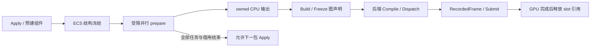

ECS 冻结阻止增删/扩容使 job 的行指针和范围失效，仍允许依赖声明授权的派生写入；图冻结阻止 pass/读写变化使编译计划失效；GPU 保活避免 command 引用悬空，buffer 内容仍受在途访问限制。主线程可以继续封包，ECS 不必等 GPU 完成才处理下一包。

验证：VS 2022 Debug 构建 Vulkan/DX12、GPU/契约/RHI 测试、SandboxModule、SandboxEditor、Aurora.Render 通过。GPU 测试 **33 通过、3 跳过**（Vulkan 故障函数注入未移植到 DX12），包括三轮双 slot readback、释放 builder/外部输入、部分写拼合、死 writer、无 roots、错误范围/usage/size、错 context、取消及 native begin 失败。RHI 回归 **24 通过**，Renderer **11 个 CTest 目标通过**；最终日志无 VUID/validation error。OpenSpec strict validation 与 diff whitespace 检查通过。

日志：`output/renderer-m3-copy-final-build.log`、`output/renderer-m3-copy-test.log`、`output/renderer-m3-copy-ctest.log`、`output/renderer-m3-copy-rhi.log`。构建使用已获准的沙箱外 MSBuild；默认沙箱的 PDB 服务问题仍不作为源码失败。

**接续记录。** 工作区 `D:/Code/Engine/SkyEngine`，分支 `dev_refactor_rhi`，含此前 M1/M2 及本批未提交改动，不能 reset 或把已有改动误当本批新增。未 commit/archive。下一批建议从 typed buffer-to-image upload + image readback 开始，先补图像 subresource/状态与对齐规则，再接 raster/多 View；保持各后端 Compile/Dispatch 所有权，暂不做异构调度。M1 Completion/取消、M2 allocator/worker/输出退休等未完成项仍见 tasks.md，不因 copy 闭环通过而勾选完成。

## M2 第二批：统一 FrameContext 与 GPU slot（2026-10-15）

本轮先落实复审中对下一批 GPU 接入有直接影响的入口、状态归属和空包装精简；其它 A1 建议继续按任务推进，未宣称全部重构完成。

- **统一执行入口**：[DeviceFrameContext](../../../../engine/aurora/rhi/interface/include/aurora/rdg/DeviceFrameContext.h) 直接定义 Compile/Dispatch/Submit/PollCompleted，移除 IDeviceFrameExecution、IFrameGraphCompiler 与 getter 转接。pool/arena 不再暴露给宿主；compiler 保持后端私有。
- **状态与所有权**：[slot 实现](../../../../engine/aurora/rhi/common/FrameContext.cpp) 非阻塞获取 lease，核验 backend/context/epoch/generation；取槽只 reset 安全 command pool，提交前才 reset fence。每 slot 命令独立，ordinal 有上限。Rejected 保留录制结果，Accepted/Indeterminate 接管 GPU refs/CPU payload；未交付完成事件不回收，查询错误只报告一次并隔离。
- **模块收敛（历史）**：当时将 Vulkan/DX12/Metal 移入 plugin，保留 target 与 include 名；2026-10-16 按用户要求恢复原 RHI 路径，目录迁移留独立 change。common 只共享 slot/提交生命周期，不承担 native 编译或统一 executor。删除空 Renderer、RenderGraphExecutor、RenderDeviceExclusive，更新宿主 include 和构建依赖。
- **设计对齐**：更新 D7a/D9 和 RHI spec；scene-bridge 的 draft 已改为 owned FramePacket → coordinator Apply，不再设计成宿主直写渲染 ECS，尚未实施 bridge。

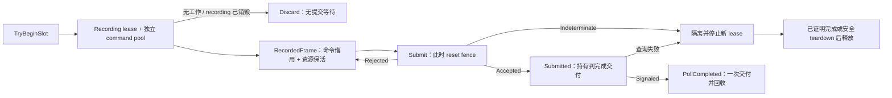

验证：VS 2022 Debug 构建 Vulkan/DX12、RHI/GPU/契约测试、SandboxModule、SandboxEditor、Aurora.Render 通过。RTX 3080 上 GPU 测试累计 **20 通过、2 跳过**（Vulkan 故障函数注入未移植 DX12）；新增 slot 测试覆盖双 slot 同时 Pending、每 slot 两个命令、三轮 copy/readback、完成通知背压、空 lease、错误身份、拒绝重试和隔离保活。RHI 相关回归 **24 通过**，Renderer **11 个 CTest 目标通过**。GPU/RHI 最终日志没有 VUID/validation error；两项 OpenSpec strict validation 通过。

日志：`output/renderer-m2-slot-final-build.log`、`output/renderer-m2-slot-test-final.log`、`output/renderer-m2-slot-rhi-final.log`、`output/renderer-m2-slot-ctest-final.log`。沙箱内 MSVC PDB 服务失败，已在获准的沙箱外构建中验证通过。

边界：Compile/Dispatch/TryCollect/Cancel 当前仍明确 Unsupported；直接宿主协议与 lease 在同一 context 内互斥，宿主迁移/空帧输出问题未宣称解决。descriptor/staging/UBO 和 worker 分区、presentation retirement、Metal 新协议、生产 Renderer 仍待实现；device epoch 由创建方传入，一个生产 Device 一个 context 由后续 provider 落实。下一批为 M3 typed copy 冻结图及 Vulkan/DX12 各自完整编译、串行 Dispatch。未 commit/archive。

## 架构精简复审：Renderer / RDG / RHI 与周边模块（2026-10-15）

本节按最终架构评估，不将旧 API 兼容、历史实现保留或迁移成本作为设计约束。结论来自当前接口、关键实现、CMake 与相关 active change 的交叉检查；这是职责和抽象复审，不是全部源码的逐行正确性审计。本节为实施前复审快照；最新完成范围见顶部 M3 首批记录，其余建议继续推进。下方 M0–M2 各批记录保留为当时的实现快照。

**结论：有明显精简空间，主要在重复所有权、重复协议、同形数据搬运和职责混合；ECS + RDG + 多 View 的主方向可以保留。** 应收敛状态拥有者和公共入口，再优化局部代码；不以类数量最少或所有后端代码相同为目标。

### A0 建议的最终职责

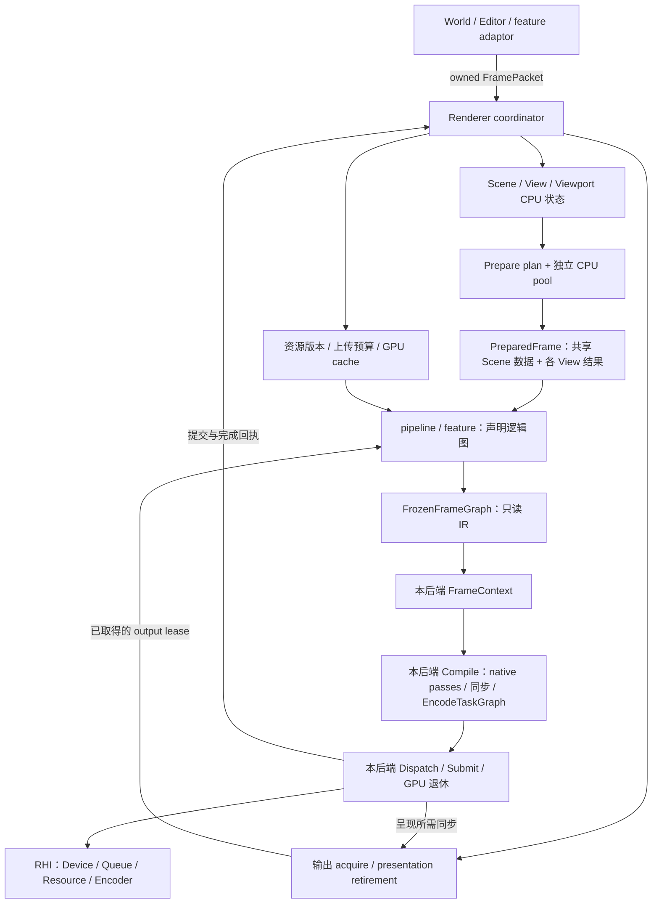

| 领域 | 唯一职责 | 不承担 |
| --- | --- | --- |
| Renderer | 接包、场景/视图状态、帧事务、资源版本与输出编排 | native pass、command pool reset、第二套 GPU ring |
| CPU prepare | 受限 ECS 访问、派生数据、cull/LOD/extract、稳定发布 | Device 创建、上传、图执行、窗口操作 |
| Pipeline / feature | 从 prepared 数据声明图；提供算法、shader/PSO key 与渲染策略 | 持有活动 Scene/View 裸指针、直接提交、独立帧轮换 |
| RDG | 图 IR、版本/访问/roots、冻结与纯分析；后端编译契约 | Scene/材质语义、acquire/present、统一 GPU 执行器 |
| Backend FrameContext | 唯一 GPU slot 状态、完整 Compile、编码任务、Dispatch、Submit、完成退休 | 业务 ECS、资产 IO、输出的 presentation 退休 |
| RHI | GPU 对象、命令、队列与同步原语、明确错误结果 | 资产任务、scene/pass 分类、业务资源就绪状态 |
| 资产 / shader 工具 | CPU payload、编译与缓存产物 | 借用 render worker 等待 IO、直接发布 Resident |

`FrameScheduler` 可以是 Renderer 内部的帧状态机/成员，不需要另一套线程、事件通道或公开 manager。CPU prepare 与 encode pool 分开，但复用 Core 的任务执行机制。`ScenePipeline` 与 `FrameComposer` 可先采用普通组合函数，只有出现独立状态或替换需求时才升为对象。

### A1 代码收敛清单

优先级表示对后续设计的影响，不是线上缺陷等级。后端链接已更新至当前恢复后的 RHI 路径；问题描述及下述目标目录建议保留复审时状态，目录整理现已移出本 change。

| 优先级 | 证据与问题 | 建议 |
| --- | --- | --- |
| 高 | [DeviceFrameContext](../../../../engine/aurora/rhi/interface/include/aurora/rdg/DeviceFrameContext.h) 原先暴露 pool/arena/fence，经 GetFrameExecution 转接执行接口；RDGBackend 又转接 compiler | M2 第二批已合并执行入口并删除独立转接接口；compiler 是后端私有组合对象。直接宿主 fence API 待 M6 迁移移除 |
| 高 | [RenderGraph](../../../../engine/aurora/rhi/interface/include/aurora/rdg/RenderGraph.h) 同时持 graph、backend、transient pool、resolved tables、compiled graph；[ProduceCompiledGraph](../../../../engine/aurora/rhi/interface/src/rdg/Compile.cpp) 复制 tables、attachments、queues/items | builder 只负责声明和 Freeze；冻结后转移共享 IR 所有权。后端计划保存自己的映射、backing、同步和任务；不在二者间再复制一份通用可执行图 |
| 高 | [DynamicBuffer](../../../../engine/aurora/core/include/aurora/resource/Buffer.h)、[StagingBufferAllocator](../../../../engine/aurora/rhi/interface/src/StagingBufferAllocator.cpp)、[DX12 descriptor allocator](../../../../engine/aurora/rhi/dx12/src/D3D12DescriptorAllocator.cpp) 分散处理帧轮换 | slot lease 统一驱动资源分区与 reset；allocator 接受显式分区，不自行 AdvanceFrame。保留 UBO、staging、descriptor、command 的不同分配策略 |
| 高 | [RenderResource::Upload](../../../../engine/aurora/core/include/aurora/resource/RenderResource.h)、StaticBuffer/Texture、[Queue upload](../../../../engine/aurora/rhi/interface/include/aurora/rhi/Queue.h)、[FrameStagingBuffer](../../../../engine/aurora/core/include/aurora/resource/FrameStagingBuffer.h) 各有上传入口和等待状态 | renderer 统一 ResourceRecord + UploadBatch；typed copy 进入主图。Queue 保留提交/同步原语，资源包装不拥有上传线程或析构等待；工具上传也复用同一上传事务实现 |
| 高 | [PipelinePass](../../../../engine/aurora/pipeline/include/aurora/pipeline/PipelinePass.h) 持 PSO/RG；[SceneRasterPassTemplate](../../../../engine/aurora/pipeline/include/aurora/pipeline/SceneRasterPassTemplate.h) 持 Scene/View；FullScreenPass 持帧内 handles | 改成只读 pipeline 配置 + Build(inputs, graph)；GPU cache 集中按 key 管理，View 历史状态归 ViewState，帧内 bindings/handles 归当前构建事务 |
| 中 | [SceneRaster/FullScreen payload](../../../../engine/aurora/rhi/interface/include/aurora/rdg/CompiledGraph.h) 重复 attachment/area/binding 字段；RDG 携带 techniqueTag、queue sort 等业务语义 | RDG 合成一个 RasterPass：attachments + 有序 draw 列表。场景、全屏、UI 是 pipeline 的建图方式；tag/filter/sort 在 renderer 完成。Compute/typed Copy/受控 Custom 仍独立 |
| 中 | [CpuPrepareProgram](../../../../engine/aurora/core/src/renderer/frame/CpuRenderCoordinator.h) 分开保存 systems、partitions、outputs 与一个总 kernel；[Submit](../../../../engine/aurora/core/src/renderer/prepare/ScenePrepareScheduler.cpp) 再按 SystemId 拼接 | plugin 内合成 PrepareSystemDesc{accesses, kernel, optional partition, output limits}；Core 仍只消费纯访问描述，避免把 callback 和 renderer 类型塞入通用依赖编译器 |
| 中 | [FrozenCpuFrame::Bind](../../../../engine/aurora/core/src/renderer/scene/FrozenCpuFrame.cpp) 为 system 建行表；[MakeChunk](../../../../engine/aurora/core/src/renderer/prepare/FrozenPrepareExecutor.cpp) 又复制行范围，行内含 RenderObjectData 候选 | 按 Scene/query 共享不可变输入行索引，chunk 只存范围；写候选按写入 system/chunk 独占。禁止把所有 system 的 staged 数据合成共享可写数组 |
| 中 | [PrepareRenderObjects](../../../../engine/aurora/core/src/renderer/prepare/RenderObjectPrepare.cpp) 当前只复制 transform/mesh/material/visibility；[PreparedViewData](../../../../engine/aurora/core/include/aurora/renderer/PreparedFrameTypes.h) 又按 View 保存完整对象信息 | 共享 PreparedScene 对象/资源表，View 保存可见索引及自己的 LOD/submesh/sort 数据。无实际派生语义的 RenderObjectData 镜像可并入 owned 提取；Bounds 等真实派生结果仍保留版本和 dirty cache |
| 中 | [DescriptorEncoder](../../../../engine/aurora/rhi/interface/include/aurora/rhi/DescriptorEncoder.h) 与 [DescriptorBatch](../../../../engine/aurora/rhi/interface/include/aurora/rhi/DescriptorBatch.h) 重复 WriteBuffer/Image/Sampler 和完成协议 | 对外保留一套 descriptor write/batch 契约，单 group 写入是它的轻量 facade；template 更新、跨 set 批量、即时写入是后端优化。encode 前发布只读 binding snapshot |
| 中 | [ShaderCompileFuture](../../../../engine/aurora/core/include/aurora/shader/ShaderCompileTask.h)、PrepareJobGroup、dispatcher future、EncodingTicket 各包装完成状态 | Core 统一 CPU completion 的发布/取消/drain 基础；业务结果与 native 编码保活仍留各领域。shader task 改为 owned variant/输入或显式 lease，复用资产 executor；GPU/presentation 完成不伪装为普通 CPU future |
| 中 | [Aurora.Core.Static](../../../../engine/aurora/core/CMakeLists.txt) 同时含 scene、GPU resource、shader build/cache；[cook](../../../../engine/aurora/cook/CMakeLists.txt) 为取 schema 链 adaptor；[shader compiler](../../../../engine/aurora/shader/CMakeLists.txt) 链整个 Core/RHI 实现 | 按 CPU 数据、GPU adaptor、工具拆依赖；共享资产 schema 留 plugin 的纯数据 target，真实跨 plugin 消费的契约才进 engine；纯 shader 编译/cache 与 CreateShaderFunctionFromResult 分离 |

### A2 需要落实到接口和存储的精简

**一个 FrameContext 入口，但阶段产物保留。** 对外保留 `TryBeginSlot -> Compile -> Dispatch -> TryCollect -> Submit/Discard -> PollCompleted`。`BackendCompiledFrame`、`RecordedFrame`、`SubmissionToken` 分别表示编译成功、CPU 编码完成、GPU 提交责任，不能用一个可变的万能 Frame 对象代替。`IFrameGraphCompiler` 若没有独立消费者，可成为后端内部类/函数；每个后端仍完整决定 pass、backing、barrier、encode 任务和提交顺序，公共层只能提供纯分析 helpers。

`DeviceFrameContext` 的公共身份最终归 RDG 执行契约；RHI `Device` 不再创建 RDGBackend 或包含图执行职责。后端模块的注册/工厂在 RDG 消费接口下提供匹配 Device 的 context 创建入口。它是现有模块入口的能力，不额外引入一组全局 manager；Device/context 归属和 device epoch 校验仍必需。

**单份图语义，后端拥有执行计划。** 建图时 mutable builder，Freeze 后只有一个不可变 IR owner；后端保留 IR 引用或所需 owned 数据。live-pass 列表和 logical-to-native 映射用索引，不再复制全部声明。native 合并/拆分后的 attachment、barrier、descriptor 和 command 数据是必要编译结果，不属于可删除的重复。可缓存纯分析结果，但不得把某个公共 Compile 固定成后端必须遵守的执行流程。

**资源类型使用组合，减少仅修改 descriptor 的继承。** `VertexBuffer/IndexBuffer/UniformBuffer/StorageBuffer` 和 `Texture2D/Cube/Array/3D` 中的便捷构造可变成 desc 工厂；顶点 layout、索引类型、buffer range 保留在带类型的数据视图中。`Mesh -> RenderGeometry -> 多个资源包装` 可收敛为 CPU MeshProduct + GPU MeshRecord：streams/index slices/submesh bounds/skin binding 各有明确数据。静态、动态、transient 表达分配和生命周期策略，不由同一个虚 Upload 方法隐式决定。

`RenderResource::Upload(data,size,offset)` 对 buffer 与 image 的 offset 含义不同，图像还需要 mip/layer/row pitch/extent；使用分别带完整范围的 typed requests。保留 image/buffer、binary/timeline、资源版本与 submission identity 的类型区分，不为了减少类型而退化为裸整数和 `void*`。

**prepare 的执行机制统一，业务发布与通用调度分开。** 生产路径共用编译好的 prepare work 描述、Invoke、chunk join、Publish、Merge；inline 与 pool 是执行策略。小型串行参考解释器可以留在测试中作为独立正确性基准。不要另建三个包含同一失败传播逻辑的公开 executor，也不要使 Core TaskDispatcher 知道 ECS 发布规则。

目前读写模板只支持固定组件组，writer 仅 RenderObjectData。应先做小型 typed binding/派生组件 adapter，让新增 Bounds/Light 不必复制一套 frozen frame/scheduler；不扩张成通用 ECS runtime、动态反射 job 框架或自动推断任意 lambda 依赖。将访问校验前置为明确 Result，保留 scoped view 与范围约束，逐步消除依赖主动 throw/catch 表达普通访问失败的路径。

**所有权可以集中，借用语义不能省略。** 批次对象集中持有输入 lease、绑定表、scratch 和产物存储，任务使用稳定索引/受限 span；逃逸的只读视图仍持有一个可验证的输入 lease。写候选和 kernel scope 不得因共享 owner 而变成可跨线程、跨 kernel 写入。普通只读输入行表与可变候选分开，避免每个 context/view 都复制完整存储并分别维护状态。

**错误表达统一形状，不统一业务含义。** 普通二选一结果用同一明确 Result/variant 习惯，避免 pointer + optional error、bool + string 和错误靠字符串为空判断混用。提交保留 Accepted/Rejected/Indeterminate 三态；FrameError 应保留 native GpuError 的原因。Busy、Pending、取消请求和已 drain 仍是不同状态。现有 Core `Result<T>` 仅为 pair<bool,T>，不足以承载这些契约，不能为了名字统一直接套用。

### A3 建议代码归属与依赖

以下是最终职责目录示意；目录不要求各建一个 target。仅在依赖、平台或装载边界不同处拆 target，类不与 target 一一对应。

```text
engine/aurora/
  renderer/        IRenderer、命令、结果、feature 消费接口与所需数据
  rdg/             图 IR / Freeze 契约、FrameContext 执行契约、纯分析
  rhi/             Device / Resource / Encoder / Queue / Sync 接口和纯类型
  shader/          确需跨模块的编译接口与产物类型

engine/aurora/renderer/
  core/            CPU scene/prepare、纯资产 schema、shader/cache CPU 逻辑
  adaptor/
    renderer/      RendererImpl 组合、GPU resource cache、output、pipeline
    framework/     World/asset 完成 -> FramePacket
  backends/        Vulkan / DX12 / Metal（原生适配 target，各自 Compile/Dispatch）
  builder/         cook / shader compiler 工具实现
  editor/          反射与编辑器扩展
  runtime/         装载与服务注册胶水
```

依赖方向为 `Renderer CPU -> Core + renderer 接口`，`RDG 接口 -> RHI 接口`，`GPU adaptor -> CPU core + renderer/RDG/RHI 接口`，`各后端 -> RDG/RHI 接口 + native SDK`。RHI 不反向依赖 RDG；engine 不链接 plugin 实现。纯 schema 与 CPU shader 代码可按消费者拆成 plugin 内静态 target；builder/editor/framework adaptor 各自消费它们，不经整个 Aurora.Core 或 Aurora.Adaptor 兜底。

`PreparedFrameTypes.h` 中把 CPU prepared 数据与含 DeviceFrameLease 的 FrameBuildInputs 分开；host 的 IRenderer 头不需要拖入后端执行类型。公共像素/格式等数据复用已有定义，不再为“解耦”制造一套字段相同的枚举。绑定资源快照、frame build 状态和 native cache 留提供方实现；只有 feature 接口签名真正需要的数据才公开。

共享实现可以有 plugin 内 `backend common` 静态库，收纳预算/索引/slot 状态校验等实证相同的代码。禁止以此为由做庞大的 `BackendTraits`/CRTP 基类或重新引入公共 ExecutePasses；native 录制粒度、资源分配、提交与平台对象所有权保留在后端。

### A4 不能合并的边界

| 看起来相近的概念 | 必须独立的原因 |
| --- | --- |
| Scene / View / Viewport | 共享场景、相机求值和输出表面分别变化；一个窗口可合成多个 View |
| CPU packet / GPU submission / slot / swapchain image | 接包不保证有 GPU 工作，GPU 与呈现也不一一对应 |
| ECS DAG / FrameGraph / EncodeTaskGraph | 分别证明 CPU 数据访问、GPU 资源语义、CPU 录制与 native 资源独占 |
| CPU arena / GPU slot / output retirement | CPU 可早于 GPU 释放；GPU 完成不等于呈现已释放图像/同步责任 |
| Requested/CpuReady / UploadSubmitted / Resident | CPU 载荷、已接受上传、可跨图消费分别需要不同证据 |
| Compile / Dispatch / Submit | 编译无 GPU 提交；编码失败需 drain；Submit 可能已部分入队 |

因此“统一一个 ring”只约束 GPU 帧资源的选择与回收，不能将 viewport 的 acquire/presentation 责任机械绑到 slot index。CPU/GPU 完成接口可以共享诊断格式，但不能共享未经区分的复用条件。

### A5 相关设计统一入口

| 设计 | 最终归属与需要对齐的内容 |
| --- | --- |
| [aurora-renderer](design.md) | 保留主流程、所有权、FrameContext 与 Compile 的唯一主设计；本节是待实施的精简建议，不新建第二份总纲 |
| [aurora-scene-bridge](../../aurora-scene-bridge/design.md) | 当前仍描述 bridge 直接写 ECS；需改为主线程产生 owned FramePacket，由 renderer Apply。bridge 不获得 live RenderScene |
| [aurora-cook-schema-layering](../../aurora-cook-schema-layering/proposal.md) | 优先收敛到 plugin 内纯 schema/codec target；同一 plugin 的 builder/adaptor 共用不自动构成把 schema 放 engine 的理由 |
| [shader 设计](../../../../docs/aurora/shader-design-and-migration.md) | 保留编译产物/cache key/variant 语义；编译与 CPU cache 分离于 GPU shader/PSO 创建，异步执行复用 completion 基础 |
| [bindless 设计](../../aurora-metal-bindless-descriptor-heap/proposal.md) | 属于独立绑定策略与 shader ABI；不为统一 DescriptorEncoder/Batch 强制所有后端使用同一种 native heap，也不把 bindless 设为主体前置条件 |
| [terrain](../../terrain-aurora-render/proposal.md)、[vegetation](../../vegetation-aurora-render/proposal.md)、[navigation](../../aurora-navigation-integration/proposal.md) | 提供方 plugin adaptor 通过 owned payload + prepare/graph feature 接入；各自维护业务算法，不再建立 renderer、device、slot ring 或 upload scheduler |

上述关联项本次仅指出收敛方向，未改写它们的 spec 或验收状态。实施时与所属 change 同步更新；不因某个字段/类的调整新建 change，不将所有 feature 实现吞并进 renderer change。

设计文档也需去重：design 保留有效决策和不变量，逐批实施过程集中 review，tasks 只表达待办与验收，spec 只表达可验证行为。规范文件引用这些定义，不再次维护完整帧流程；当前文档中实现日志混入 design 的内容可在一次专门整理中迁回 review。

### A6 建议实施批次与验收

1. **FrameContext 收敛，与下一批 M2 一起做。** 统一公共执行入口，slot lease 驱动 command/descriptor/staging 分区，移除各资源自主推进。以双提交在途、空帧、Rejected、Indeterminate、Discard 与 generation/epoch 拒绝验证。无必要先搬完所有目录。
2. **RDG / pipeline 收敛，与 M3 一起做。** builder Freeze、单份 IR、统一 RasterPass 与 typed Copy；Vulkan/DX12 各自编译并经自己的 context Dispatch。先 copy/readback，再场景/全屏/UI LOAD 的有序组合；同图不同后端结果一致，公共层无执行循环。
3. **CPU prepare 收敛，随 M1 收口。** 每 system 一份描述；共享只读行表、独占候选；补通用 CPU completion 基础及明确错误结果。保留串并行等价、失败不部分发布、稳定归并、逃逸读借用和取消/drain 验证。用分配计数和 representative 多 Scene/多 View 场景测量收益，不预报删除行数或性能比例。
4. **资源 / shader / target 分层，随 M4 与现有 schema change 落地。** 上传统一到图、资源包装改组合、共享 PreparedScene 与各 View 索引；拆 CPU schema/shader 与 GPU 创建。验收 cook/CPU prepare 无 native backend 链接、多 View 数据隔离、精确版本上传与退休。目录移动与行为改动分成可审阅批次，接口契约与实现同步更新。

零行为的空壳（`core/Renderer.{h,cpp}`、`RenderGraphExecutor`）和无独立职责的转发层可在触及 target 时删除；这是小收益清理，不作为本次架构收敛的主工作。保留已有测试覆盖的语义，不以删除测试或放松生命周期约束换取代码量下降。当前建议未 commit、未 archive。

## M2 首批：GPU 提交结果与真实 copy/readback（2026-10-15）

按用户最新方向，先开始 GPU 基础接入。M1 的 Completion/取消仍未完成，本批不将 M1 整体标记完成。先补 2.5 的 Vulkan/DX12 可观察提交与完成协议，再用 M1 owned 输出验证真实 GPU；生产 FrameContext lease/调度尚未接入。

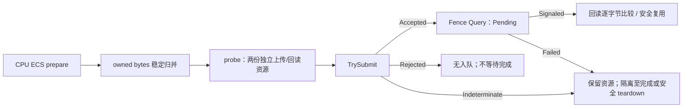

- 新增无字符串分配的 `QueueSubmitResult/GpuError/FenceQueryResult`，`Queue::TrySubmit` 区分 Accepted/Rejected/Indeterminate；`Fence::Query/TryReset` 提供非阻塞状态与显式 reset 错误。旧 void Submit 和 bool IsSignaled 保持兼容，未接新协议的后端默认 Unsupported。
- Vulkan 在所有本地校验/暂存分配结束后调用 vkQueueSubmit2；OOM 作为已知拒绝，device lost/无法证明无入队的失败保守为 Indeterminate，保留 native code。DX12 先构造全部 command list 数组、校验同步对象，再进行 native queue 操作；首次 Wait/Execute/Signal 之后的失败均视为可能部分入队。两者检查非空、后端类型与 device 归属；可执行状态、队列兼容、资源屏障和在途重用仍由调用方保证。
- fence 查询不把设备错误当 Pending 或成功。DX12 修正初始 signaled fence 的 pendingValue，使首次 reset 真正进入 Pending；GetCompletedValue 的 UINT64_MAX 作为 DeviceLost。旧 CreateFrameContext 测试原先空转 Begin/End 而没有 submit，本次修正为每轮匹配同步提交后再继续，不用错误的初始 fence 状态掩盖等待缺陷。
- 新测试位于 plugin adaptor 侧，消费 M1 的真实分块 prepare 产品。每后端两次提交先被 timeline gate 拦住，确认同时 Pending 后放行，逐字节 readback，再复用三轮。它只使用测试私有资源，不新增生产 renderer GPU ring。Vulkan probe 使用已核实 HOST_COHERENT 的 CPU_ONLY 内存与 native host-read barrier；没有将非一致性 staging 或新 RDG 编译器的正确性算入本批。

验证：VS 2022 Debug 的 Vulkan/DX12、GPU 测试与 RHITest 构建通过。RTX 3080 上新增 GPU 测试 10 项通过（双后端各 4 项行为 + Vulkan 2 项原生函数返回故障注入），相关 Device/Submit/Sync/Upload 回归 24 项通过。11 个 Renderer CTest 目标通过；GPU 测试清理的重复 timeline signal 已修复，最终 GPU 与 RHI 日志无 VUID/validation error。最终记录：`output/renderer-m2-submission-build-final.log`、`output/renderer-m2-submission-test-final.log`、`output/renderer-m2-rhi-regression-final.log`。故障注入替换该测试 device 的函数表并恢复，没有让物理设备真的丢失；未验证 DX12 原生故障注入或 Metal。

提交/完成语义依据：[vkQueueSubmit2](https://docs.vulkan.org/refpages/latest/refpages/source/vkQueueSubmit2.html)、[DX12 ExecuteCommandLists](https://learn.microsoft.com/en-us/windows/win32/api/d3d12/nf-d3d12-id3d12commandqueue-executecommandlists)、[DX12 GetCompletedValue](https://learn.microsoft.com/en-us/windows/win32/api/d3d12/nf-d3d12-id3d12fence-getcompletedvalue)。

下一批实施顺序：

1. **M2 slot lease**：完善现有后端 DeviceFrameContext 的唯一 ring，非阻塞 TryBeginSlot、generation/device epoch、Discard 与 Accepted/Indeterminate 的保活/退休；每 slot 独立 command/reset 域。空帧和明确拒绝不得形成 fence 等待，先用同一 headless 双提交场景验证。
2. **M3 最小后端图执行**：冻结 typed copy graph，Vulkan/DX12 各自构造完整 Compile 产物及串行 EncodeTaskGraph，由各自 FrameContext Dispatch/Submit；相同 readback 基线验证，不用公共 ExecutePasses 代替后端计划。Metal 在 Mac 上独立验证后接入。
3. **M4 最小出图**：prepared objects → 精确资源绑定/上传 → draw → readback，之后加同 Scene 双 View 和窗口/离屏输出。CPU Completion/取消与 consumer drain 必须在生产生命周期接入前补齐。

限制：当前仍是 M2 直接 RHI probe，未接生产 IRenderer、slot lease、FrameGraph、窗口 acquire/present 或 GPU upload 状态机。2.5 因 Metal/完整 scheduler 故障路径未完成保持未勾选，其它 M2/M3 任务也不提前勾选。ABI 增加虚方法，部署时须同步重编后端与宿主。未 commit 或 archive。

## M1 第七批：owned 输出归并与 deferred Apply 边界（2026-10-15）

本批完成 3.10 的剩余首版能力：任务私有输出、固定顺序 merge/reduce 输入，以及已注册渲染实体的延迟 create/update/destroy。实现位于 plugin core，仍只依赖 Core 与 Renderer.Interface；没有引入 RHI、GPU 分配器或协程。

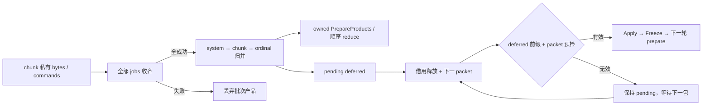

- `PrepareOutputConfig` 为每个 system 显式给出任务容量；私有 buffers 与最终 buffers 均在启动前预留，按实际 chunk 数检查 records/bytes/deferred 总上限及溢出。超出任务容量转为显式失败，完成后/跨线程不能追加。
- `Emit` 复制约定 channel 的无指针 byte payload。完整批次成功后才发布只读共享产品，顺序固定为已编译 system 顺序、chunk、局部 ordinal；消费者据此执行自己的 reduce。产品无 ECS 借用，可跨 store/pool 生命周期保存，不是最终 PreparedFrame。
- `Defer` 只接受已注册实体命令；更新/删除限制在当前绑定行并捕获输入 revision，创建使用调用方预分配的逻辑 ID。当前不提供任意组件类型动态增删、worker ID allocator 或 DAG 内读取通用输出的接口。
- deferred 与下包共同预检；拒绝包不修改状态或消耗 pending。前置 revision 对比边界入口，宿主合法新输入可覆盖 deferred 候选，外部 destroy 最终删除；旧 generation/revision 和退休未完成的 ID 被诊断跳过。来源 sequence 与最近成功 Apply 必须一致，消费后不能重放。
- coordinator 等 borrowers 释放后才应用下一包；shutdown 排空已接受包，最后一轮无后继包的命令通过 Stopped 的 discardedDeferredCommands 报告。任何 prepare 失败均不转交该批 deferred。

验证：VS 2022 Debug 全部相关目标构建通过，全部 10 个 Renderer CTest 目标通过。新增 ProductsTest 12 项覆盖受控乱序与串行 reduce 一致性、输入字节复制/独立保活、跨线程/完成后拒绝、整批失败丢弃、容量/溢出预检、chunk/Scene/revision/非有限值校验、deferred 与外部删除/创建更新、整包拒绝重试、generation/退休/重放、宿主更新优先、关闭报告及逃逸 read view 的 drain。构建与测试日志：`output/renderer-m1-products-build.log`、`output/renderer-m1-products-ctest.log`。

限制：任务与最终产品副本约占双份逻辑容量，另有行表和容器开销，尚非全局峰值内存预算。归并后的 reduce 在 owner/消费者执行，未增加通用 reducer callback；原有派生组件的成功 system 发布不会因其它独立 system 失败而回滚。真正 Apply 写入失败仍封闭 store，未做分配失败注入。公共 Completion/取消、完整 PreparedScene/View、资源快照、GPU 和非 Windows 验证仍未完成；provider 仍返回 NOT_READY。下一批推进 3.13/3.15 的完成通知、取消与 drain。本批未 commit 或 archive。

## M1 第六批：element-wise chunks 与完整 system 发布（2026-10-15）

本批完成 3.10 的分块执行、私有 scratch 和派生候选统一发布部分。`CpuPrepareProgram.partitions` 显式声明 system/Scene、rowsPerChunk 和 scratchBytes；未配置的 system 保持已有一次调用语义。实现仍只在 plugin core，未修改 Core 依赖编译器或后端 FrameContext。

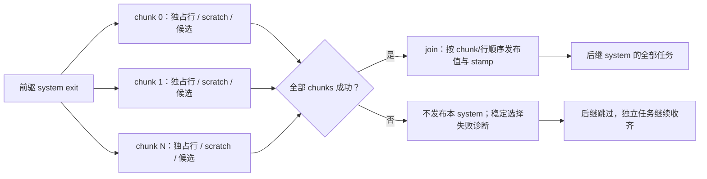

- chunk 上下文只绑定自己的实体段，重新取得 Read/Write 也无法越界；独立 scope 在 kernel 返回时关闭。输入视图仍可延长存储借用，scratch 仅在当前 kernel 线程开放，裸引用/span 不得逃逸。
- Begin 在前驱完成后复制候选。chunk 成功不立即写 live ECS；join 等待全部 chunks 后才决定发布或整组丢弃，避免成功片段在另一片段失败时留下半个 system。内部完成边与业务成功分开，失败不会让 join 提前跳过收尾。
- soft 并行预算计入 chunk 和 join；超限回退使用同一分块、scratch、失败与发布逻辑。hard 节点/scratch 限额启动前检查；空 Scene 形成一个空 chunk 再 join。重复配置、未知 system、零大小、跨 Scene 组件访问或共享 RESOURCE Write 均拒绝。
- 既有 PrepareRenderObjects 可直接作为分块 kernel，CpuRenderCoordinator 接入 partitions 并在 shutdown 时等待分块收齐。共享捕获仍需调用方保证并发安全。

验证：VS 2022 Debug 相关目标构建通过，全部 9 个 Renderer CTest 目标通过；新增 ChunkPrepareTest 9 项覆盖真实 chunk 重叠与 scratch 独占、完整 system 失败丢弃/稳定诊断、连续分块 writer/readers、串并行值/stamp/失败一致、拒绝路径、空/极大区间、计入 join 的队列边界、范围及借用、shutdown 排空。访问越界沿用既有检查并在 Invoke 转为显式失败；本批未新增主动 throw。

限制：当前分块只允许一个 Scene 的组件，稳定合并只覆盖 RenderObjectData 候选；通用 append/reduce 与 deferred 结构命令仍待补齐，因此 3.10 保持未完成。byte scratch 不是对齐对象 allocator，行数/任务/scratch 限额也尚非完整内存预算；转换期间行表副本可临时并存。公共 Completion/取消、GPU 和非 Windows 平台尚未验证，未做分配失败注入。下一批推进私有输出/结构命令的稳定归并及下一 Apply 边界应用。本批未 commit 或 archive。

## M1 第五批：system 并行 prepare、批次收齐与显式失败（2026-10-15）

本批完成任务 3.9。CPU coordinator 经 `ScenePrepareScheduler` 编译/绑定计划，在专用 ThreadPool 上并行执行无冲突 systems；原 DeviceFrameDispatcher 抽取为 Core TaskDispatcher，RHI 原头保留 alias，Renderer core 无需依赖 RHI.Static。根 AGENTS 同时新增禁止主动 throw 的规范；本批新增调度接口使用明确状态，既有访问检查异常在执行边界转换，未全量迁移历史异常路径。

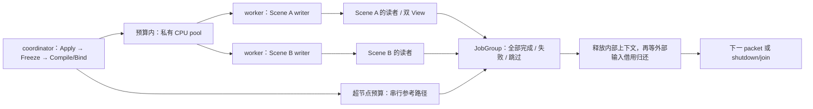

- 单 scheduler 一次只接纳一批；全计划绑定后才执行，绑定总行数独立限额。节点预算不超过 `workers × 256`，依赖独占 pool 和严格 round-robin；超预算走同语义串行 fallback。空图、单 worker、大扇出及重复复用均有验证。
- Create/Submit/依赖构建返回明确错误；node/batch futures 携带状态。kernel 可调用 `context.Fail(...)`，或由执行边界将既有异常转换为失败。失败不发布候选，传递消费者跳过，独立任务收齐后才完成 JobGroup。
- 清理图存储前等待批次完成；运行中 Clear 拒绝。Wait 释放内部 contexts/kernel，外部输入 ReadView 仍保活实际存储。coordinator 在 STOPPED 前排空并销毁 prepare pool。
- 当前只有 system 级并行。JobGroup 的 Poll/Wait 属于 coordinator 单一 owner，尚无公共 Completion 订阅、continuation 或取消；不把它标记为已完成 3.10/3.13/3.15。provider 仍返回 NOT_READY，未接 GPU FrameContext 调度。

验证：VS 2022 Debug 相关构建通过；全部 8 个 Renderer CTest 目标通过。新增 ParallelPrepareTest 7 项覆盖双 Scene 真正重叠、成功值/stamp 可见、失败丢弃与独立节点 drain、1/3 worker 队列边界与串行回退、预检拒绝、外部借用以及空图复用。Core 相关 56 项通过（含新增 TaskDispatcher 4 项、既有 ThreadPool/Task/ECS 回归），RHI 原 DeviceFrameDispatcherTest 8 项通过。ParallelPrepareTest 链接仅有 Renderer.Static、Core/sfmt/gtest/系统库。

限制：上述是 Windows CPU 验证，未验证 GPU、Metal、分配失败注入或旧 ThreadPool 部分启动失败。绑定行数限额尚非完整字节预算；chunk 独占范围/稳定 merge、取消及完整 Completion 协议仍待后续。下一批先完成 element-wise chunks 与完整 system 成功后的统一发布。本批未 commit 或 archive。

## M1 第四批：派生组件、受限写入与成功发布（2026-10-15）

本批完成任务 3.8，接通 `FrozenPrepareExecutor`、`FrozenWriteView` 和首个 `PrepareRenderObjects` CPU kernel。后续 View 可按声明读取已发布的对象数据；共享 Scene 仍只准备一次。实现位于 plugin core，公共 Renderer/RHI 接口及后端路径不变。

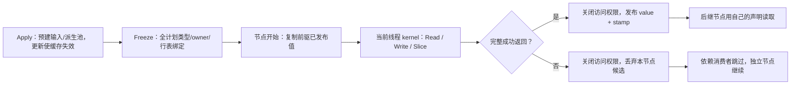

- 输入四池保持只读，`RenderObjectData` 派生池提前存在；Read/Write 不查可变 registry，不懒建池。访问声明按组件类型/tag、Scene generation 校验；Write 的输入 join 同样必须声明。
- Read 返回 const，Write 只暴露 Value 候选；稳定行序支持受限 Slice。空范围有效，嵌套切片不能扩大权限，越界和长度溢出拒绝。
- 派生访问仅在当前 kernel 及其线程有效；保存 context/view 后跨线程、跨节点或再次执行同一冻结帧均不能重新开放权限。视图仍保活存储；输入只读视图保留第三批的跨回调借用能力。C++ 裸引用不得逃逸 ForEach。
- 候选在节点开始时从前驱结果初始化，kernel 完整成功后才提交；单行回调或整个 kernel 异常都不会泄漏部分候选。输入 revision 与成功 sequence 同步发布，初始 revision 0、新输入失效、空包复用和 generation 重建有明确区分。
- CPU 对象值包含 world、逻辑 mesh/material binding、visibility mask。它尚未选择真实资源版本或执行 bounds/cull/LOD，也不代表 GPU 就绪。该 kernel 由 builder 显式配置，provider 仍返回 NOT_READY。

验证：新增 `Aurora.Renderer.WriteViewTest` 11 项全部通过，覆盖范围/权限、连续 writer 使用前驱结果、成功后 reader 可见、版本缓存、实体复用、异常不发布、失效视图以及专属 coordinator 的双 Scene/三 View 集成。全部 7 个 Renderer CTest 目标通过，相关 VS 2022 Debug 构建通过；WriteViewTest 链接项仅含 Renderer.Static、Core/sfmt/gtest/系统库，无 Framework、RHI.Static 或具体后端。

尚未交付并行 chunks、专用 prepare pool、JobGroup/Completion、取消或 GPU 渲染。当前每个 system 绑定自身行表/候选，Slice 仍在同步 kernel 内运行；下一批适配已有 DeviceFrameDispatcher 到专用 ThreadPool，加入节点/内存预算与失败收齐，再做每任务独占范围和完整 system 成功后的合并发布。Windows CPU 测试未覆盖分配失败注入、GPU 或其它平台。本批未 commit 或 archive。

## M1 第三批：CPU coordinator、结果回传与冻结借用（2026-10-15）

已实现 `CpuRenderCoordinator` 专属 CPU 线程，以及 `FrozenCpuFrame/FrozenPrepareContext/FrozenReadView`。core 依赖边界保持不变，provider 尚未创建完整 IRenderer。

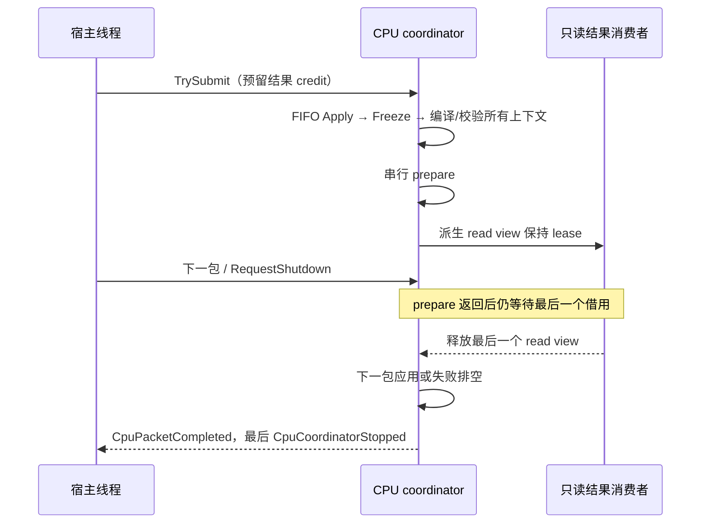

- 固定结果 ring 与输入 FIFO 各有预算；Accepted 预留 credit，PollEvents 才归还。结果和停止通知各交付一次，零容量 polling 不消费，宿主不读结果也不阻止已接收工作排空并停止。
- 冻结 lease 保活实际 ECS，阻挡 Apply/退休确认；上下文与派生 read view 共享保活。只读绑定校验四类输入组件、tag 和 Scene owner；未声明读取失败，Write 暂不开放。View 输出快照仅包含尺寸/格式/revision，不传 native window。
- 所有上下文预检完成后运行串行计划。错误包可报告后继续；prepare/绑定/写入期失败则停止整个 coordinator，独立节点收齐、依赖消费者跳过，后续 accepted 包逐一报告未执行。停止等待 borrow drain，不把 kernel 返回当作消费者已退出。
- 冻结序号来自最近成功 Apply；预检失败不冒充新状态。外层 store owner 析构后，仍存活的 read view 保持底层存储有效。

验证：新增 CoordinatorTest 11 项通过，含 kernel 故障注入、借用在 worker 释放、事件容量 1、未声明访问/错误写入预检、queued 失败收齐、空闲关闭、200 包结果 ring 复用。全部 6 个 Renderer CTest 目标和相关构建通过；CoordinatorTest 只链接 Renderer.Static、Core/sfmt/gtest/系统库，无 Framework、RHI.Static 或具体后端。

当前只读行表在调用 Read 时绑定，没有可写派生池、range chunks、并行 prepare pool、JobGroup/Completion 订阅或 GPU 路径。CPU 事件仅报告待退休记录，仍不能据此发公共 Destroyed/RendererStopped；后端退休控制与公共 IRenderer 集成未完成。计划/prepare 失败采用整个 CPU coordinator 停止，逐 Scene 恢复留待后续。下一批实现可写派生组件与受限 WriteView，再接已有 dispatcher 和专用 prepare pool。本批未做分配失败注入或非 Windows 平台验证。

## M1 第二批：FramePacket FIFO 与 CPU 场景存储（2026-10-15）

本批接续依赖编译/串行基线，实现 `engine/aurora/core/src/renderer/frame/FramePacketQueue` 与 `scene/CpuSceneStore`。新增实现留在 plugin core，公共接口仅补充 Update/Resize revision 语义。

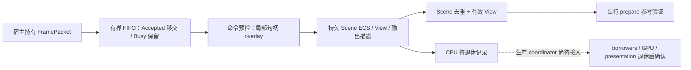

- 精确队列容量独立于 GPU inflight；序号仅在 Accepted 时推进。Close 唤醒空闲消费端并排空已接收包，队列不负责 join 或 GPU shutdown。
- 命令预检不克隆 registry；非法描述、未接入资源/extension 整包拒绝。迟到 generation/revision 按 commandIndex 诊断并跳过，不撤销同包有效命令。写入期异常封闭 store 并要求重建，尚未实现单 Scene 恢复。
- Scene 持久保存四类输入池和外部 entity 映射；View/Viewport 独立存活。Scene/输出删除后暂停相关 View，新 generation 不自动重绑；零尺寸暂停单个输出。CPU 删除与最终销毁确认分开，未确认前不能复用槽位。
- `Aurora.Renderer.Static` 通过 Renderer.Interface 消费公共数据；StateTest 生成链接项只有该静态库、Core/sfmt/gtest/系统库，没有 Framework、RHI.Static 或后端实现。

验证：新增 StateTest 的 13 项行为测试通过，包含容量 1、原包/bytes 地址保留、关闭唤醒/排空、2000 包跨线程 FIFO、序号/最大 generation、revision/迟到命令、整包预检失败，以及 `FIFO -> store -> 串行 prepare` 双 View 集成。Renderer 的 5 个 CTest 目标与对应构建通过，既有公共契约和动态/静态 provider 测试保持通过。

本批没有启动生产 render thread、公共事件队列、冻结访问或 GPU 工作；provider 仍返回 NOT_READY，Viewport 仅保存描述。3.1/3.2 保持部分完成；下一批接 coordinator/事件生命周期与冻结借用，再接并行 JobGroup。Windows CPU 测试不替代 GPU/presentation 退休或 Metal 平台验收。未进行内存分配失败注入测试。

## M1 首批：ECS 生命周期与 prepare 参考路径（2026-10-15）

本批依赖 M0 契约，完成 tasks 2.1、3.6、3.7。变更位于 Core ECS、provider plugin core 和对应测试；没有改动 GPU 后端或宿主入口，provider 仍返回 `NOT_READY`。

- EntityRegistry 删除所有组件池项并区分 alive/free/retired；8 bit generation 用尽后退休。迟到的 Add 拒绝死实体，重复 Add 更新单个 dense 项；组件移动异常时不回收仍存活的槽位。
- Core 的 `CompileDependencyPlan` 是无 Renderer/RHI/线程池依赖的纯编译函数，按 owner/generation/domain/type 或具名资源身份推导依赖，保留 tag 碰撞诊断。先解析 phase/Before/After，再推导 RAW/WAR/WAW；重复声明归并，注册顺序不影响计划。
- 新增 `Aurora.Renderer.Static` core target，仅链接 Core；adaptor 私有消费它。串行执行器在调用线程执行、捕获失败并跳过传递消费者，独立节点继续完成。
- 双 Scene/双 View 用例使用真实 EntityRegistry：共享 Scene 每轮准备一次，两 View 写独立结果，删除实体后复用同一计划也不出现旧实体。此项是 CPU 参考用例，不代表 Renderer 已接入相机裁剪、资源版本选择或真正并行调度。

验证记录：

- `CoreTest --gtest_filter=Ecs*`：31/31；包含 9 项依赖编译测试及 80 组生成访问集合的冲突可达性/乱序输入等价检查。
- `ctest -R '^Aurora\.Renderer\.'`：4/4 目标通过（新增 PrepareTest 内含 3 项行为测试，既有契约及动态/静态模块测试保持通过）。
- `Aurora.CoreTest` 的 SceneEntityLifecycle、SceneBoundsPoolDense：2/2；Windows Vulkan 初始化成功，测试直接验证 DestroyEntity 自动清池，移除了原测试中的手动补删。
- CoreTest、PrepareTest、ContractTest、ModuleTest、StaticModuleTest、Aurora.CoreTest 构建通过；因 EntityRegistry 布局变化，补编 Aurora.Render、SandboxModule、NetworkEcsTest，Network ECS 回归 11/11 通过。本批不涉及后端录制；Metal 仍未在本机编译或运行。

后续 M1 批次：有界 FramePacket/FIFO 与 Scene/View stores → 冻结访问与 preflight → 并行 prepare/chunks/merge → Completion/取消/drain。当前裸 registry API 不承诺线程安全；本批串行执行器不允许被描述为已完成并行 M1。

## M0 接口与 target 实施（2026-10-14）

本批已实现可编译的公共契约和可加载的 provider 注册边界，尚未启动新的渲染循环。`IRendererProvider::Create` 对合法配置明确返回 `NOT_READY`，不分配设备、窗口或线程；非法零容量/worker/budget 返回 `INVALID_ARGUMENT`。宿主配置尚未切换。

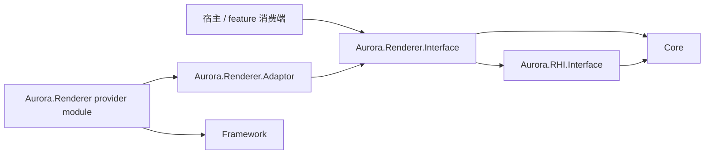

箭头表示链接依赖。宿主以后通过 Framework 的 `Interface<IRendererProvider>` 解析服务，不链接 provider 实现。adaptor 当前只依赖公共接口；实际消费 GPU 能力时再私有链接已有 RHI/Core/Pipeline 实现。

| Review 入口 | 已落地的契约 | 运行时仍待实现 |
| --- | --- | --- |
| [IRenderer.h](D:/Code/Engine/SkyEngine/engine/aurora/core/include/aurora/renderer/IRenderer.h) | 创建结果、包所有权、事件、shutdown、device epoch | M1 packet FIFO/stores/thread；M2 安全关闭 |
| [RenderCommands.h](D:/Code/Engine/SkyEngine/engine/aurora/core/include/aurora/renderer/RenderCommands.h) / [PreparedFrameTypes.h](D:/Code/Engine/SkyEngine/engine/aurora/core/include/aurora/renderer/PreparedFrameTypes.h) | generation IDs、owned bytes、CPU draw/view/frame 产物、logical build inputs | M1 prepare；M4 绑定冻结和资源 pin |
| [Completion.h](D:/Code/Engine/SkyEngine/engine/core/include/core/async/Completion.h) | Pending/Succeeded/Failed/Cancelled、独立 cancel 标志、指定 executor、一次通知及订阅预算 | M1 JobGroup/订阅竞态/consumer drain；没有协程 runtime |
| `IFrameGraphCompiler.h`（M2 已合入 DeviceFrameContext） | 每后端完整 Compile、opaque native/CPU task/GPU submission 产物 | M3 冻结 IR、图分析与各后端 native 编译 |
| `IDeviceFrameExecution.h`（M2 已合入 DeviceFrameContext） | TryBeginSlot → Compile → Dispatch → TryCollect → Submit/PollCompleted；Cancel/Discard、身份和所有权 | M2–M5 slot、分配、提交/呈现、串并行编码 |
| [RendererModule.cpp](D:/Code/Engine/SkyEngine/engine/aurora/runtime/RendererModule.cpp) | 跨 DLL service、重复 Init、拒绝覆盖已有 provider、只注销自身注册、tagged 静态入口 | M6 宿主依赖顺序和完整停机集成 |

`DeviceFrameContext` 已从 `RenderDeviceExclusive.h` 提取到独立头；旧头继续包含它，既有 Begin/End 实现未改变。新的能力查询默认返回 nullptr，因此编译通过不表示任何后端已经实现新协议。纯接口/数据不新增 engine → plugin 依赖。feature builder 目前是前置声明，不能据此认为 feature 注册/停用已实现。

验证：

- `Aurora.Renderer.ContractTest`：公共头独立消费和链接；生成项目确认仅链接 Core/sfmt/系统库，不带 Framework、RHI.Static 或 provider。
- `Aurora.Renderer.ModuleTest`：真实动态加载/卸载/重载后，host 能读到同一 provider；正常配置返回 NOT_READY、六种零配置被拒绝。动态测试仅链接公共接口 + Framework + gtest，不链接 adaptor/provider 实现。
- `Aurora.Renderer.StaticModuleTest`：编译相同 bootstrap 的 tagged 静态入口，验证上述行为以及重复注册、重复 Shutdown。此项验证静态注册接缝，不代表完整静态宿主打包已验收。
- CTest 三目标通过；Vulkan、DX12、RHI.Static 与旧 Aurora.Render 入口及其依赖编译通过。新增 capability 查询置于原有虚函数之后，原有方法顺序保留；仍应配套重建相关模块，不宣称任意历史二进制混用兼容。Metal 未在本机编译/运行；本批没有 GPU 新流程运行测试。
- OpenSpec strict validation 和 diff whitespace 检查通过。

可复现配置（保留原 cache 的三方路径；本批将测试从 OFF 开为 ON）：

```powershell
cmake -S . -B cmake-build-debug -D3RD_PATH=D:/Code/Engine/SkyEngine/build_3rd/Win32 -DSKY_BUILD_TEST=ON -DSKY_DEVELOP=OFF -DSKY_BUILD_SANDBOX=OFF
cmake --build cmake-build-debug --config Debug --parallel 2 --target Aurora.Renderer.ContractTest Aurora.Renderer.ModuleTest Aurora.Renderer.StaticModuleTest Aurora.Vulkan Aurora.DX12 -- /nodeReuse:false
cmake --build cmake-build-debug --config Debug --parallel 2 --target Aurora.Render -- /nodeReuse:false
ctest --test-dir cmake-build-debug -C Debug -R '^Aurora\.Renderer\.' --output-on-failure
```

构建前确认 SandboxEditor 未运行。VS 2022 实际目标平台为 x64；三方目录名沿用 Win32。沙箱内 MSBuild 两次停在启动阶段，终止后经授权改用沙箱外构建通过。

环境预检 `python python/third_party.py -p Win32 -o D:/Code/Engine/SkyEngine/build_3rd --check` **未通过**：miniaudio/enet/slang 的 metadata 与 pin 不同，vulkan_headers/nanosvg/openssl/cpython 缺 build_metadata 记录（0 output-missing）。这些是现有环境记录；本批没有重建/升级三方库，不能把本次相关目标编译通过等同于全工程依赖一致。

下面保留前期设计复审，描述中的源码现状以本节的实施增量为补充。

日期：2026-10-14。范围：当前 design/specs/tasks、Core ECS/ThreadPool、Aurora Queue/上传/viewport 接口、编辑器对接及 aurora-scene-bridge。

这是设计与源码接口的静态核对，不是运行时验证。以下 R1–R6 与图 1–3 保留初次复审快照。
2026-10-14 后续细化已将 R1–R5 的相关契约纳入 design D4b/D4c/D5a/D6a/D7、capability deltas 和 tasks；这仅表示设计采纳，不表示源码缺口或平台验证已解决。R6 scene-bridge 对齐仍待完成。
细化还确认 CopyBlit typed resolve/实际 emit、读取 producer/version 和 LOAD 内容依赖缺口，已列入 D5a 与 tasks 4.6–4.8。
FrameContext 接入继续收紧于 design D7a：复用既有后端 context 的唯一 GPU slot ring，scheduler 通过 lease 调度；CPU prepare/build arenas 独立，staging/dynamic/descriptor 不再自行轮换索引。
最新编译边界以 design D5b 为准：各后端完整 Compile，构建 native passes、EncodeTaskGraph 与 SubmissionPlan；本后端 FrameContext Dispatch/收齐后提交。原“公共串行 Execute”已退出目标设计；图 1–8 保留前次讨论快照，当前编译/编码流程见图 10–11，图 9 已同步。
总体阅读入口为 design D0 和 [图 12 主流程](review-images/12-renderer-main-flow.png)，涵盖宿主、ECS prepare、资源旁路、后端编译/编码、提交/呈现及退休。整合时已修正旧 D3 与 FramePacket spec 对“所有 GPU 操作留在 coordinator”的过宽表述；后端编码 workers 按 D5b/D7a 使用独占资源。

## 后端编译专项补充

- `RDGBackend.h` 目前只有 CompileBarriers/Execute，Vulkan/DX12/Metal 都转调公共 DeriveBarriers/ExecutePasses；尚未满足后端完整编译职责。
- GPU resource DAG 与 CPU EncodeTaskGraph 不能直接等同；实际 GPU 顺序、barriers 与任务结果组装由后端计划决定，不能按 worker 完成次序提交。
- FrameContext 现有固定 worker × slot buffer 不足以处理同 worker 多个待提交结果；需 recording ordinal/预算、独占资源以及 Metal parent/child 生命周期。
- DeviceFrameDispatcher 尚无 coordinator affinity 与失败收齐协议；DX12 EnsureFrameCopy 会修改共享 RG 的 mDirty/mCopiedFrame，开启并行编码前需冻结或同步该写入。
- 编译与 dispatch 均不等于 GPU 就绪：加载得到 CPU payload，上传形成图内 copy，Accepted 后 UploadSubmitted，真实完成后 Resident。实现与三后端验证仍未完成。

详见 [后端编译流程](D:/Code/Engine/SkyEngine/openspec/changes/aurora-renderer/design.md:438)、[后端与 FrameContext 配图](review-images/10-backend-compile.png)、[CPU/GPU 两张图](review-images/11-encode-task-graph.png)。

## 结论

主体方向可保留：Scene / View / Viewport 分离、renderer 统一设备与调度、CPU prepare DAG 与 GPU RDG 分开、组件访问依赖驱动并行、协程留作编排适配。

当前适合开展 CPU 计划编译和最小调度 prototype；开始完整 GPU/宿主接入前，应先关闭 R1–R4 四个契约缺口。R5–R6 是接入口和跨 change 一致性问题。

| 编号 | 优先级 | 结论 |
| --- | --- | --- |
| R1 | P1 | 提交失败的设计要求缺少可观察的 RHI 结果 |
| R2 | P1 | ResourceFinalize 到 GPU 首次使用的上传同步尚未闭合 |
| R3 | P1 | JobGroup 的逻辑结果与可回收条件需要分开定义 |
| R4 | P1 | 统一 coordinator 的等待策略没有保证关闭/控制流程进展 |
| R5 | P2 | UI/frame feature 的注册和逻辑纹理引用接口未固定 |
| R6 | P2 | aurora-scene-bridge 的直接 ECS 写入描述与新线程模型冲突 |

## R1 — 提交失败无法可靠反馈给 FrameScheduler

**证据。** [design D7](D:/Code/Engine/SkyEngine/openspec/changes/aurora-renderer/design.md:595) 要求提交失败后进入错误处理，不等待永远无法完成的 fence。
但 [Queue::Submit](D:/Code/Engine/SkyEngine/engine/aurora/rhi/interface/include/aurora/rhi/Queue.h:21) 返回 void；[VulkanQueue](D:/Code/Engine/SkyEngine/engine/aurora/rhi/vulkan/src/VulkanQueue.cpp:76) 仅记录 vkQueueSubmit2 错误，没有把结果反馈给 scheduler。

**触发与影响。** Reset fence 后底层提交失败，上层仍可能将 slot 记为 Submitted，下一次复用等待一个未被有效提交 signal 的 fence。现有接口不足以实现设计中的恢复要求。

**建议。** 将最小 RHI 状态协议纳入本 change：提交接受结果、设备丢失状态以及完成查询错误。Accepted 只表示接受提交，不代表 GPU 完成；未确认是否已提交的错误不能直接释放潜在在途资源。FrameScheduler 明确失败 slot 的退出路径。应补 aurora-rhi-core delta，不能只在 renderer 内捕获日志。

**验收。** 用故障注入覆盖立即拒绝、提交后 device lost、失败时仍有其它在途 slot；不发生无限 fence 等待或提前释放。

## R2 — 上传调用返回不等于 GPU 资源可绘制

**证据。** [D4a](D:/Code/Engine/SkyEngine/openspec/changes/aurora-renderer/design.md:196) 将创建/上传归于 ResourceFinalize，之后建图绘制；[D5](D:/Code/Engine/SkyEngine/openspec/changes/aurora-renderer/design.md:348) 约定首版单 graphics queue。
现有 [StaticBuffer::Upload](D:/Code/Engine/SkyEngine/engine/aurora/core/include/aurora/resource/Buffer.h:72) 优先选择 TRANSFER queue，返回异步 handle；[Queue 契约](D:/Code/Engine/SkyEngine/engine/aurora/rhi/interface/include/aurora/rhi/Queue.h:25) 明确调用方在消费前负责同步。现有设计提及资源就绪，但未规定本帧新上传从 Pending 变成可绘制的条件。

**触发与影响。** 新网格在 ResourceFinalize 调用 Upload 后立即被加入 graphics DrawItem，可能早于 copy 完成；若两队列属于不同 family，还需要相应 ownership 交接。CPU prepare 完成、buffer 对象非空均不能证明数据就绪。

**建议。** 最小闭环采用当帧 inline upload：ResourceFinalize 创建 backing 并产出 UploadPlan，RDG copy pass 声明 staging read / target write，draw pass 声明对应消费，由同一 graphics queue 保序和推导 barrier。可复用 [FrameStagingBuffer](D:/Code/Engine/SkyEngine/engine/aurora/core/include/aurora/resource/FrameStagingBuffer.h)，不直接把 StaticBuffer 的异步 Upload 当成同步创建。

既有异步资产上传可保留，但必须定义 ResourceReady = 上传完成 + 布局/必要 ownership 交接就绪，并携带资源 revision；未就绪继续跳过/占位。若保留 transfer 路径作为本 change 默认，则需要补跨队列 completion/资源状态协议及相关 capability delta。

**验收。** 延迟 copy 完成，证明 draw 不提前消费；覆盖首次上传、CPU 源数据释放、资源 revision 替换和提交失败。

## R3 — 取消结果与任务全部退出不是同一个条件

**证据。** 复审时 [D4b](D:/Code/Engine/SkyEngine/openspec/changes/aurora-renderer/design.md:281) 已指出取消不代表 jobs 已退休，但当时只定义 Pending/Succeeded/Failed/Cancelled 及一个完成令牌；后续设计已补独立请求标志和 drain/lease 条件。
[Prepare 完成 spec](D:/Code/Engine/SkyEngine/openspec/changes/aurora-renderer/specs/aurora-renderer/spec.md:75) 同时要求按该令牌恢复控制流并保活运行中 jobs，尚未给出独立的 drain/lease 完成条件。

**触发与影响。** 某个 chunk 仍写 Bounds 时，取消路径先发布 Cancelled；如果 coordinator 把令牌就绪当成可以应用下一 packet 或销毁 Scene，仍会出现写入重叠或悬垂引用。文字上的保活要求需要落实为不可误用的状态协议。

**建议。** 首版最小做法是将 CancelRequested 保持为请求标记，JobGroup 的最终结果只在全部 kernels 退出后发布；需要提前回执时使用独立 CancelAck。CPU lease 还需覆盖引用结果的 consumers/continuations。GPU slot 和 presentation retirement 继续单独管理，不复用同一布尔 completed。

**验收。** 人为阻塞一个 chunk，同时取消、关闭 Scene 并提交下一 packet；只有相关 CPU borrowers 退出后才可修改或释放 ECS/arena，且通知只交付一次。

## R4 — 队头等待可能阻断其它输出和关闭请求

**证据。** 复审时 [D7](D:/Code/Engine/SkyEngine/openspec/changes/aurora-renderer/design.md:595) 在 prepare 前获取 slot 和 outputs；后续设计已调整该顺序。现有 [ClientViewport::Acquire](D:/Code/Engine/SkyEngine/engine/aurora/rhi/interface/src/rdg/ClientViewport.cpp:78) 仍使用 UINT64_MAX。平台暂停、超时、关闭协议仍需 probe。

**触发与影响。** coordinator 在一个窗口 acquire 或 slot 等待上长期阻塞，另一个窗口、离屏结果以及排队的关闭命令均不能继续推进。这里要求的是控制流可退出，并非首版必须支持各窗口独立刷新率。

**建议。** 固定“等待期间继续处理控制状态”的协议：窗口 closing intent 可先阻止新 acquire，ECS destroy 仍等安全边界有序应用；帧 slot/设备完成查询使用可退出的等待策略。输出 preflight 先确定配置快照，CPU prepare 后再做有界 acquire；若 extent/generation 改变，重做受影响 View 或跳过该输出，不把旧 ViewContext 用到新图像。

若具体平台 API 无法满足有界等待，需要先确认它支持的调度/暂停方案，再宣称该平台的多 viewport 生命周期已通过。不能仅改变调用位置来声称解决了阻塞。

**验收。** 一个输出长期不就绪、另一个持续可用，同时请求关闭/shutdown；其余工作与控制流程按约定继续，关闭确认仍等待真实退休，不能用 timeout 冒充 GPU 完成。

## R5 — UI 扩展与逻辑输出引用应成为明确接口

**证据。** 复审时 [D9](D:/Code/Engine/SkyEngine/openspec/changes/aurora-renderer/design.md:705) 列出了 IScenePrepareFeature，而 GPU/frame extension 仅文字说明；[D10](D:/Code/Engine/SkyEngine/openspec/changes/aurora-renderer/design.md:741) 要求 UI snapshot 经扩展加入 FrameComposer。后续 D5a 已补 frame feature 和逻辑引用契约，具体 ABI 与实现仍待完成。
现有 [UIRenderer::RegisterImage](D:/Code/Engine/SkyEngine/engine/ui/render/include/ui/render/UIRenderer.h:87) 接收 Image*，不能直接作为跨主线程、跨 resize 的 UI 快照资源身份。

**建议。** 在消费方 engine 接口侧固定 frame feature 的注册、建图、停用/退休契约；UI 提供方 adaptor 实现它。主线程快照引用 logical texture/ViewOutput ID + generation/revision，渲染端解析为当前 RDG handle，并保留解析后的资源 lease。不要把裸 Image*、本帧 RDG handle 或 EditorShell 回调放进长期快照。

**验收。** 生成 UI 快照后立即 resize/关闭对应 View；过期引用有明确跳过/占位行为，图像与扩展代码不会提前释放，Renderer 不依赖 EditorShell。

## R6 — 同步 scene-bridge 的设计入口

**证据。** 新设计要求桥接只向 IRenderer 发命令；已有 [scene-bridge D1](D:/Code/Engine/SkyEngine/openspec/changes/aurora-scene-bridge/design.md:25) 与 [tasks 1.1](D:/Code/Engine/SkyEngine/openspec/changes/aurora-scene-bridge/tasks.md:3) 仍按旧 adaptor 直接创建/写 ECS 条目和依赖 aurora scene。

**建议。** 在开始 bridge 实现前，将依赖、同步点和执行位置改为主线程 proxy → FramePacket → render coordinator 应用；采用符合根 AGENTS 的 provider plugin 路径。只对齐设计，不把完整组件覆盖扩大到 renderer change。

**验收。** 从 bridge 依赖/头文件中看不到具体 RendererImpl 或可变 RenderScene；attach/detach 与资产迟到测试验证命令最终状态。

## 图 1 — 建议保留的主体关系

此图表示对象与数据关系，不表示 CPU/GPU 的时间顺序。一个 Scene 可以服务多个 View；输出按 View 请求组织，设备和资源缓存由 Renderer 统一管理。

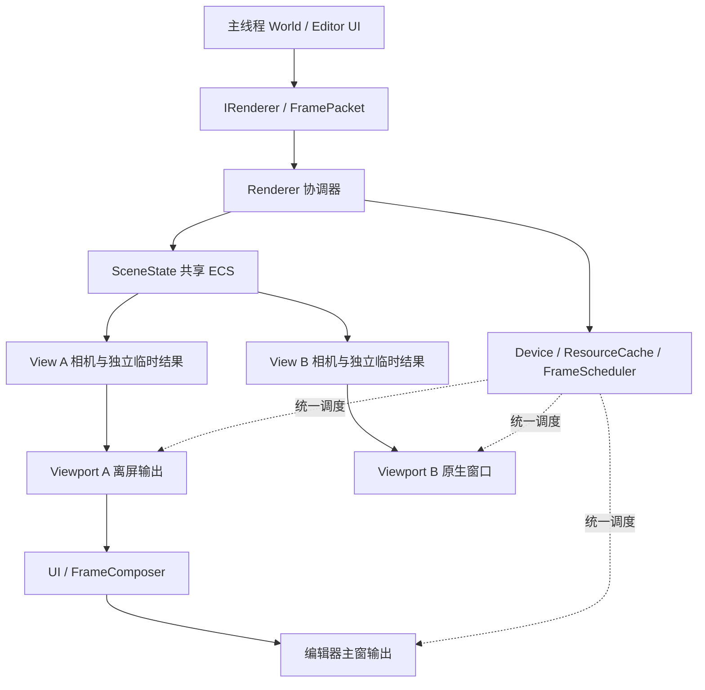

UI 数据仍经 FramePacket 进入渲染端；ScenePrepareFeature 与 FrameGraphFeature 接口分开。图中的扩展接口需按 R5 进一步固定。

## 图 2 — 建议的单帧阶段

包含 R2 的 inline upload 与 R4 的输出获取调整；该顺序在后续细化中已纳入 design D6a/D7，实施尚未完成。各 Scene 的 SceneReady 独立，单 Scene 的 View 等自己的 prepare 完成即可。

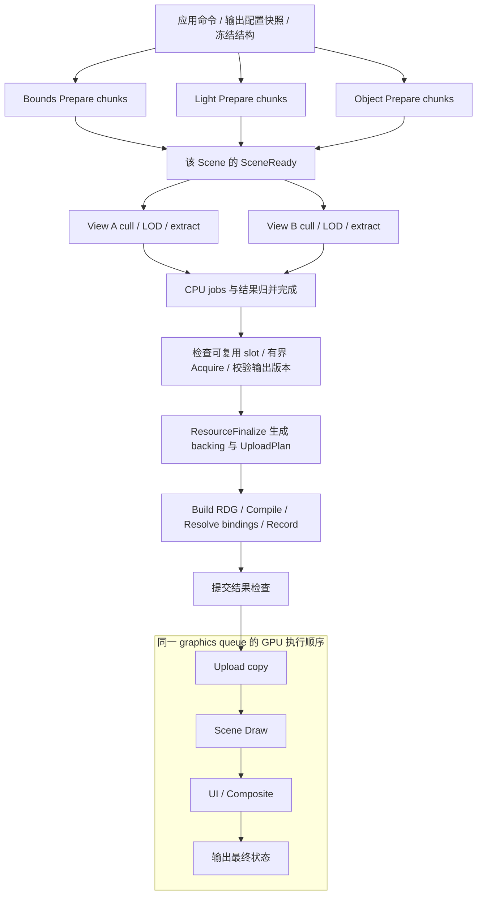

CPU private scratch 先用于 prepare；GPU FrameSlot 的 UBO、descriptor、staging 在 slot 可复用后分配。coordinator 在等待期间仍处理控制事件，但不越过冻结边界修改 ECS。
CPU deps DAG 与 GPU RDG 分别负责对应执行域；协程以后可包装阶段完成令牌，首版不进入 kernel。

## 图 3 — 取消、CPU 回收、GPU 回收与窗口退休

三个回收条件分别证明自己的执行域不再使用资源。取消请求不直接连接到任何内存回收节点；GPU fence 不作为 presentation completion 的替代证明。

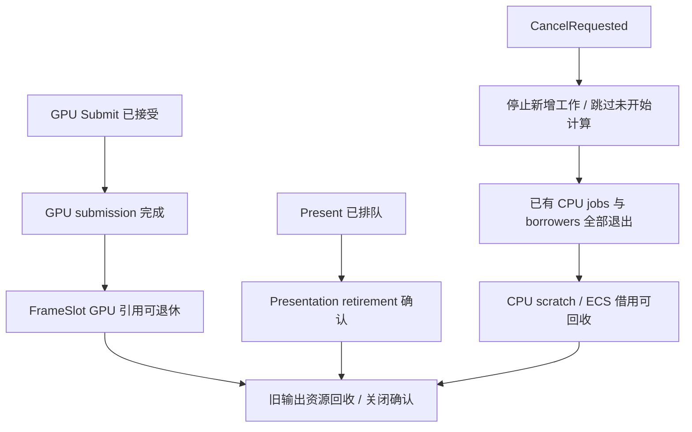

Window 节点还要求停止新 acquire、对应输出已脱离待录制图与快照；图不暗示每次回收 frame slot 都必须等待所有窗口的 presentation 完成。

## 实施顺序建议

1. 先补 R1–R4 的接口/状态机与验收场景，明确 R5 接口并对齐 R6。
2. 做不依赖 GPU 的 ECS deps/结构冻结/受限视图 prototype，用串行参考结果校验并行。
3. 做单窗口＋离屏的真实 indexed draw，先把 inline upload、bindings 和 slot lease 跑通。
4. 扩展同 Scene 双 View、第二 Scene、UI 合成及关闭/resize/失败注入。
5. 在观察到明确的异步编排需求后，再决定协程 runtime 的独立范围。

任务并行数、chunk 阈值、独立刷新率和 GPU 多队列属于后续性能决策。当前评审不提供没有 profiling 支持的性能数字。
