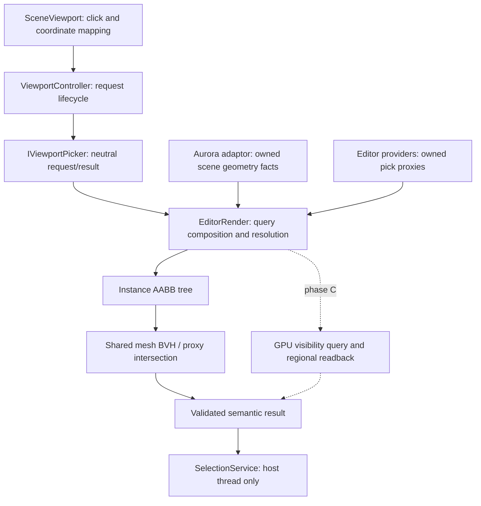

## Status and delivery boundary

2026-10-23 设计及实施。阶段 A/B 已实现并验证；阶段 C 仅为后续目标。实测数据、设计收敛与限制见 `verification.md`。

| 阶段 | 范围 | 状态 / 交付边界 |
| --- | --- | --- |
| A | 内置静态网格 CPU 点击单选、共享 BVH、主/浮动视口、异步准备与失效保护 | 15/15 已验证，未 commit/archive |
| B | 冷构建优化、实例空间索引、显式能力、自定义编辑代理、可取消屏幕请求 | 20/20 已实现并验证；未 commit/archive |
| C | GPU ID pass、复杂材质/变形可见性、区域异步回读 | 目标设计；达到下文启动条件后另行限定实施范围，不计入本 change 完成条件 |

## Context and evidence

已归档的 `sandbox-viewport-gizmo-controls` 提供 EditorCamera、图像内容矩形、手势捕获、IGizmoVisualProvider 和共享 SelectionService。阶段 A 已在 RenderSceneBridge 的既有提取流程提供 owned geometry snapshot，并在 EditorRender 实现 CPU 查询；不重复建立组件枚举或资产解码管线。

阶段 A 在 Develop / i7-12700KF 上，2 万三角形、200 共享实例的 BVH 构建约 358.975 ms，热查询平均 0.022949 ms。前者仍影响首次选择响应，后者不能外推到数万实例。阶段 A 的 Core BVH 在每个内部节点多轴排序，picker 逐实例求逆。阶段 B 已替换为分桶 SAH 和增量实例索引；当前实测及剩余 partition 热点见 verification。

当前 Aurora FramePacket.readbacks / ViewportReadback 面向整个 offscreen 输出；现有 RDG 拾取所需整数目标格式/区域回读还没有完整链路。现有射线请求也缺少像素、图像尺寸和帧身份。因此 GPU 后端需要扩展契约，不能只替换 IViewportPicker 的实现。

### Other engines as design references

| 参考 | 已核实机制 | 本设计采用的原则 |
| --- | --- | --- |
| [UE HHitProxy](https://dev.epicgames.com/documentation/unreal-engine/API/Runtime/Engine/HHitProxy)、[GetHitProxyMap](https://dev.epicgames.com/documentation/unreal-engine/API/Runtime/Engine/FViewport/GetHitProxyMap) | 元素代理、优先级；缓存缺失时生成拾取绘制 | 稳定目标身份、按需屏幕缓存与显式失效，不默认每帧生成 ID 图 |
| [Unity render picking](https://docs.unity3d.com/ScriptReference/HandleUtility.RegisterRenderPickingCallback.html) | 自定义几何写 selection ID，可使用 ScenePickingPass | 渲染生产者显式提供拾取语义；提供方可扩展，不猜 shader 行为 |
| [Godot 4.4 selection](https://github.com/godotengine/godot/blob/4.4/editor/plugins/node_3d_editor_plugin.cpp#L750)、[Gizmo API](https://docs.godotengine.org/en/stable/classes/class_editornode3dgizmo.html) | 场景 Gizmo BVH 后逐代理求交；三角形、线段及图标命中数据 | 两层加速，绘制与命中数据可分别声明，支持非网格编辑对象 |

这些是机制比较，没有跨引擎同场景跑分。阶段 B 的算法和预算选择以本仓库测试为准。

## Goals / Non-Goals

**Goals:** 保持已有点击/选择行为和输入优先级；降低冷准备延迟；查询随候选数而非总实例数增长；不变时不维护索引；让合法的自定义静态材质与编辑代理显式接入；区分表面与代理命中；保持可恢复错误、有界内存和跨 DLL 生命周期。

**Non-Goals for B:** 框选、多选、循环选择、组件/子元素独立选择、实际 GPU 拾取、蒙皮/alpha/程序变形实现、任意 authored shader 自动识别、地形/植被专用适配、自动文件监控、资产 schema 变更、全编辑器 dirty 调度重构、目标/模块/目录重组。非 Windows 宿主对接不由设计文字宣称完成。

## Architecture and ownership

| 归属 | 职责与禁止依赖 |
| --- | --- |
| 现有 EditorCore | IViewportPicker、IViewportPickProvider、请求/目标/代理数据及策略；无 Aurora/RHI/UI 类型 |
| 现有 EditorRender | Aurora 数据适配、provider 组合、实例索引、网格缓存、查询与结果仲裁；不枚举具体业务 plugin 组件 |
| SandboxModule / 已有业务 editor 模块 | 显式注入 provider；按 scope 注册/撤销。业务 runtime/core 不依赖 editor |
| Aurora adaptor | 在原提取分支发布稳定身份、资源/变换/可见性/能力修订和 owned 数据；不实现 Sandbox 接口，不写 SelectionService |
| Core | 复用通用 Bvh 数学/构建能力；实例维护策略先留在 EditorRender 私有实现 |
| 阶段 C 的 Aurora core / 既有 RHI 后端 | 中立 render entity ID、深度/ID pass 与区域回读；EditorRender 持有到编辑目标的映射 |

不新建 target、Aurora plugin 或进程全局拾取注册表。注册集合按宿主/文档显式持有；若后续确需进程共享才使用 Singleton，不能用 per-DLL static。实际改变模块归属、target 或装载入口前遵循 AGENTS.md 的确认规则。

## Decisions

### Geometry query extension (2026-10-23 follow-up)

沿用 `IViewportPickProvider` 注册与 owned snapshot，在 snapshot 末尾增加 `geometries`。每个 `ViewportPickGeometry` 绑定一个 owning Actor/组件/generation，提供可选保守世界 AABB、visibility/selectability/occluder/priority 和 `shared_ptr<const IViewportPickGeometry>`。缺失 bounds 表示未知覆盖域，不能直接跳过；非法 bounds 或空查询对象是显式错误。现有三角形/线段/图标 provider 保持兼容。

`Raycast` 接收归一化世界射线、裁剪距离、剩余 work/time 预算和 provider 自有游标；返回该 entry 区间内最近表面，或 Miss/Pending/Unsupported/Error。Hit 中 instance/part/subelement 是该 Actor 下的局部身份，Actor/组件/generation/provider 始终由宿主 entry 决定。提供方负责内部稳定决胜和自身 BVH、几何及游标内存预算，不在回调加载资产、构建树、等待线程或写 SelectionService。宿主无法抢占插件代码，work/time 是必须遵守的协作预算；Pending 下次 Poll 继续，游标销毁即取消且不得阻塞。

EditorRender 对有限 entry 做可续跑 AABB 粗筛，仅对可能影响胜者的 entry 调用 Raycast，再与现有网格/深度代理按相同距离容差和优先级仲裁。自定义几何返回 GeometrySurface，不参与 overlay 绘制，VisibleSurface 仍 Unsupported。该入口不复制提供方 BVH，也不引入第二套 provider registry、target 或业务实现。元数据与 proxy 合计最多 4096 retained slots；自定义查询对象的几何/索引/游标内存由提供方计费，不宣称受 picker 的 64 MiB mesh cache 约束。

快照不可变；同语义 readiness 更新可更换 owned snapshot 并重启游标，几何/身份/变换/资格变化必须推进 revision。注册 scope 注销、document 切换、请求替换/取消以及 snapshot 更换会使相应查询失效；游标与查询对象析构前必须仍持有真实 module lease。Prepare 先校验全部快照再发布，首次 null 和错误后恢复旧有效快照都需要显式处理。无实际异步 GPU 作业由该接口管理。

扩展入口不接入地形、植被或物理模块，不更换通用 BVH 算法。归档前补齐 Overlay 绘制和点击优先级一致性，覆盖 priority、同优先级稳定仲裁及注册顺序回归。

### 1. 请求、目标身份和命中语义

以下是阶段 B 的概念数据契约，字段名可在实施时匹配现有类型，不代表当前头文件已有这些字段。

| 数据 | 必须携带的信息 |
| --- | --- |
| ViewportPickRequest | 原有 document/scene/camera/layout/surface/request 世代；owned 视图快照；内容区逻辑坐标、对应图像像素/extent；归一化世界射线与 near/far；策略及过滤条件 |
| View snapshot | 相机投影/视图、内容矩形与实际 scene image extent、坐标/深度约定、视图修订；不含 Aurora/RHI 句柄。阶段 C 由适配层关联 renderer packet/device epoch |
| PickTarget | Actor UUID、可选组件稳定身份、实例 generation、part/subelement、provider registration generation；不使用裸指针或 GPU slot 直接作编辑身份 |
| PickHit | target、世界射线距离（若适用）、可选表面 position/normal、命中语义、深度/层级优先级和来源修订 |
| Pick semantics | GeometrySurface：已声明静态几何表面；EditorProxy：图标/线段/简化代理；VisibleSurface：阶段 C 的受支持可见性 pass 结果 |

内容坐标到图像像素只转换一次：按逻辑内容尺寸与实际 image extent 的比例映射，先判断半开区间，再取像素；高 DPI、浮动窗口、render scale 和 letterbox 都不能再乘第二次 DPI。射线和像素从同一不可变视图快照产生；像素中心和 Y/深度约定由适配层统一，不能由后端各自猜测。非法尺寸或越界请求有明确错误/取消，不 clamp 到边界选中其它物体。

阶段 B 只将命中映射到 owning Actor，保留 part/subelement 供诊断和扩展，不增加第二套选择模型。代理锚点不是表面交点；无表面数据时 position/normal 必须为空，不伪造供贴地/吸附使用。

### 2. 策略、遮挡与稳定排序

- `EditorDefault`：允许声明为 GeometrySurface 的网格和可见编辑代理；需要 GPU 的潜在最近候选在 B 返回 Unsupported。命中结果总是说明自身语义。
- `GeometryOnly`：只查询已声明的 CPU 几何，不包含图标；范围内未声明且可能遮挡的表面仍阻止声称完整结果。
- `VisibleSurface`：要求受支持的渲染可见性；B 明确返回 Unsupported，不能自动降级为 CPU 近似。C 也不等于最终后处理呈现像素。

可选择性与遮挡性分开：隐藏/不在当前 visibility mask 的对象不参与；锁定或被选择 filter 排除的可见网格默认仍遮挡。只有显式 ignore 规则可同时排除其遮挡。最近有效表面若不可选且遮挡，可返回带 Occluded 原因的完整 Miss；未知遮挡绝不能当空白。

默认代理受场景深度遮挡；提供方可为确实以覆盖方式绘制的编辑图标声明 Overlay，允许其优先于世界表面。不能只给 hit 数据 Overlay 而视觉仍被遮挡。阶段 B 的代理遮挡由受支持 CPU 表面检查；相关遮挡候选未就绪时仍 Pending/Unsupported。

仲裁顺序为显式 overlay 层及其 priority，然后受深度约束的候选。世界候选按世界射线距离；同一距离容差带内再按声明优先级、屏幕误差和稳定 target key 比较。容差由统一数值策略定义，不使用非传递的 epsilon 排序比较器；先求最近距离，再在相对该距离的容差带内稳定选择。未知/未就绪候选的保守 entry distance 若可能影响胜者，必须保留不完整状态。无 bounds 的候选进入显式 unknown 集合；不得因其没进空间树而消失。

Overlay 的点击与绘制共用排序键：priority 高者优先，同优先级使用稳定 target key；胜者最后绘制。Overlay 不以鼠标到中心的距离或世界深度打破平局，因为静态覆盖绘制无法随每个点击位置改变层次。世界表面及 depth-tested proxy 保留原来的距离/屏幕误差仲裁。

只有完整 Hit/Miss 更新 SelectionService；Pending/Unsupported/Error 保留选择并报告原因。多个失败原因按“错误、能力不支持、等待准备”的稳定优先级汇总，同时保留诊断计数，不依遍历顺序改变反馈。

### 3. 可扩展 provider 和材质能力

`IViewportPickProvider` 定义在消费方 EditorCore。提供方在 host 的准备阶段收集 owned proxy snapshot/delta，返回显式状态；不得在 pointer/Query 回调加载资产、执行无界遍历或直接改选择。EditorRender 将 Aurora snapshot 适配成同一中立输入，Aurora 本身不实现此 editor 接口。

首批 provider 代理类型限定为世界空间三角形、世界空间线段、面向视口的图标矩形；密集静态网格继续经 Aurora owned mesh snapshot 进入共享网格 BVH。每项提供 target、revision、保守 bounds 或屏幕布局、visibility、selectable/occluder、深度模式和类型数据。屏幕容差来自 UiTheme 经 shell 换算的中立数值；近裁剪面后的线段先裁剪，再测屏幕距离。矩形按声明的矩形命中，不声称对图标 alpha 精确测试。

世界网格进入实例索引；小型 editor provider 代理统一按不可变 view 建立二维 AABB 索引，最多缓存 8 个投影视图。三角形在投影后仍做世界空间精确相交；线段和图标使用同一投影布局。固定尺寸图标不能用一个随相机失效的世界 AABB 误剔除。屏幕布局与绘制共享拥有内存的布局产物；相机/DPI 改变只刷新此类代理的投影布局。未按预算刷新完时请求保持 Pending。

provider 通过 scope + stable ID 注册，返回带 generation 的撤销 token。重复身份、错误 owner、无效 bounds 或 revision 倒退显式报错。注销先禁止新采集并推进 provider 世代，再取消相关请求、释放快照/作业引用，最后释放模块 lease；不能在 worker 中调用 plugin 虚函数，也不能在 DLL 已卸载后执行其析构/deleter。已拥有纯数据仍可能涉及模块析构代码，不能仅凭 shared_ptr 就断言卸载安全。

现有 IGizmoVisualProvider/HitTestGizmo 保持绘制与拖动契约，transform handles 仍在场景 pick 前消费输入。新 provider 服务场景可选择对象，不将 W/E/R handle 重新映射成 Actor 点击，也不要求所有 Gizmo 使用 GPU ID。

`SceneResourcePart.geometricPicking` 演进为带修订的中立 surface facts：CPU positions 是否等于所声明几何、topology/layout、cull/front-face、coverage（opaque/alpha-test/blended/unknown）、depth 行为及是否存在 GPU picking 支持。能力由转换器/注册的 shader 或资源生产者提供，picker 不按材质 UUID、shader 名或字节码猜测。

已知内置材质映射到明确事实；自定义 source/program 可为 authored 静态不透明材质声明同等契约，未知值默认 Unsupported。B 不添加任意用户可勾选的“强制可信”开关，不扩张资产 schema。声明、shader 或材质修订变化都使能力缓存失效；CPU 拾取声明不保证主 renderer 已支持该材质，仍须通过实际资源转换和绘制能力门。

### 4. 两层空间结构与增量更新

网格层存局部三角形 BVH，以 CPU geometry identity/revision/layout 为 key，实例和材质共用。材质能力独立缓存，换材质不重建顶点树。当前 deviceEpoch 保守纳入 key；仅在 source 明确保证跨 device epoch 的 owned CPU bytes/layout 相同后才允许复用，不能无条件删去 epoch。

实例层在现有 EditorRender 内维护动态 AABB tree，叶子包含稳定实例 key、world bounds、缓存 inverse、指向网格 BVH 的引用和能力/可见性版本。变换只更新受影响叶子及祖先 bounds；新增/删除增量维护。查询 near-first，已找到可用最近距离后裁掉不可能更近的子树；大规模完全重叠场景仍可能退化，需预算控制，不能承诺所有场景 O(log N)。

RenderSceneBridge 复用既有提取和 TransformWatch，发布结构、几何、变换、能力及 readiness 的分别修订，并携带 base revision 的 delta。父变换包含受影响后代；材质遮挡变化也是语义变化。阶段 B 不要求重构整个 World traversal，但 picker 不再从完整快照逐帧重算所有矩阵/索引。

无变化时索引维护为零；单纯相机变化不更新世界实例树或网格树。源 delta 丢失、base 不匹配或文档切换时重新同步。初次资源就绪/BVH 发布属于 readiness，不改变世界语义；它可以唤醒仍有效的请求，不能令等待中的点击永远自我过期。

实施选择：实例树插入、删除和移动均做局部高度平衡旋转，不引入第二棵后台重建树及 overlay。4096 个随机 bounds、多轮移动/删除/重插与独立穷举 oracle 一致；10k 稀疏实例平均每次查询检查 2 个叶子，1% 变换批次低于 1 ms，因此目前没有引入后台重建的测量依据。更新超过 host 预算时保持 Pending，完成后才开放查询；中断或丢失连续 delta 时从新 owned snapshot 全量续跑同步。遍历 cursor 绑定索引世代，重同步或 readiness 发布后重新开始。未来只有空间质量实测需要时才增加不可变重建及版本化 overlay；首棵树尚未就绪不以“不存在叶子”返回 Miss。

### 5. 网格构建、内存与调度

优化优先测量：分别记录 payload 校验/解码、三角形 bounds/centroid、分桶、分区、分配、发布。候选实现为 16 桶 SAH，每个 primitive 预计算 bounds/centroid，复用 scratch，比较 leaf 成本并采用确定性平衡退化策略；以差分正确性和实测决定桶数，不把“换算法”当性能证据。保留平行射线边界、近远裁剪、非均匀/负缩放、退化几何和有界递归测试。

构建取消须覆盖数据扫描、桶扫描和递归边界；完成/取消/失败均收齐作业并释放预算，不发布部分树。预热只有在测量证明必要时才启用，且用有界后台预算；默认按需、点击优先，不一打开场景就为全部网格构建。

预算按唯一分配计费：网格 resident + preparing + retiring + scratch + worker 保活 payload 合计沿用 64 MiB / 128 entries；实例树、记录、引用和节点扩容余量合计初始 32 MiB，非网格代理/屏幕布局 16 MiB，查询 scratch 4 MiB。具体硬上限为 32 个 provider、总计 4096 个代理（按 retained vector capacity 计）、8 个投影缓存、单实例 256 parts / 512 payloads、每个 filter 1024 个 Actor。超出这些保守上限显式失败，不降级成漏选。共享引用不重复记字节，但只要仍有所有者就不能从实际驻留统计扣除。Source 现有 256 MiB 预算单列，记录共享引用保活后的进程峰值，不能把 source 淘汰等同于内存已释放。超预算显式返回 ResourceLimit 并保留选择，后续请求可淘汰重试。

请求 API 演进为非阻塞 Submit / Poll / Cancel；保留原 Query 数学路径作为内部实现/测试入口。每 viewport 一个可续跑 active 请求；新 latest 到来立即替换旧请求及其 cursor，不额外保留一个必将被拒绝的 CPU 请求。共享网格 worker 按 geometry key 保持独立生命周期。全宿主最多 8 个参与视口，超出返回显式容量状态。相同 request token 重提相同数据幂等，不重复排 GPU 或 BVH 工作；同 token 不同数据是错误。

host 每 tick 初始索引维护预算 1 ms、查询预算 1 ms，按批次检查并可续跑；这些是调度目标而非实时保证，记录超预算量。视口间轮转，网格准备仍先用单 worker，只有实测表明需要时才扩并发。共享 mesh 作业按 geometry key 合并；取消一个请求不取消仍有消费者的构建，无消费者的作业可取消。

跨 tick 的遍历游标绑定 index/readiness generation，不保留可被更新的裸节点指针。树替换、delta 应用或新 ready 候选进入后，旧游标必须重新开始，或继续持有完整不可变旧快照并在结束时拒绝其结果；不能跳过游标已经经过的位置。只有 readiness 变化时可保留请求 token 并重启遍历，语义变化则按原规则使请求过期。

Poll 的公开结果保持 Hit/Miss/Pending/Unsupported/Error，附稳定 reason code（如 ResourceLimit、UnsupportedCoverage）。取消/过期是生命周期终结，不向选择层伪造 Miss，也不刷出用户错误。新点击替换旧 token；文档/场景/相机/布局/策略/provider 世代变化使旧结果失效。只有 host 线程复核 target 后应用选择。

### 6. Dirty 和缓存失效矩阵

| 变化 | 网格 BVH | 实例/代理数据 | 请求与未来 GPU 屏幕缓存 |
| --- | --- | --- | --- |
| 无变化 | 复用 | 零维护 | 有匹配缓存才复用，无请求不做拾取绘制 |
| 相机、投影 | 复用 | 世界树不变；更新屏幕代理 | 取消旧请求；对应 view 屏幕结果失效 |
| DPI、layout、image extent、surface | 复用 | 重算屏幕映射/代理 | 取消旧请求；surface generation/extent 失效 |
| 实例/父变换 | 复用 | 受影响叶子 inverse/bounds 增量更新 | scene 语义推进，旧请求/缓存失效 |
| 网格 bytes/layout/revision | 按新 key 准备，旧版保活至退役 | 更新引用和 bounds | scene 语义推进；旧完成不能发布 |
| 材质能力、可见性、锁定/filter | 复用 | 更新能力/资格/遮挡，必要时改树 | 对应语义/策略世代推进 |
| 同语义的首次资源/BVH 就绪 | 发布可用项 | 更新 readiness，补充已知 bounds | 唤醒有效请求；不自增语义世代 |
| provider 注销/对象删除 | 无消费者后淘汰 | 撤销代理/叶子，generation 推进 | 取消受影响请求，拒绝旧 target |
| 文档关闭、设备重建 | 按所有权契约退休/取消 | 文档数据清理；设备数据重新核验 | 取消请求，失效 device/surface/ID 映射 |

dirty 决定什么数据失效，不代表每个 dirty 都立即重建全部缓存。本 change 只保证拾取自身的增量维护，不承诺主 renderer 停止连续绘帧。

### 7. 输入和选择保持不变

优先级为模态/菜单 → 已有 capture → Alt+LMB/RMB/MMB 导航 → transform Gizmo handle → 场景点击。LMB down/up 必须匹配 pointer/button、位于内容区且最大位移不超过主题阈值；移出阈值再返回仍取消。焦点、Esc、工具、布局、文档、Play 和竞争手势取消候选。Q/W/E/R 在 handle 外均可点击。

SelectionService 是唯一选择写入口；完整 Miss 清空，Hit 选 owning Actor；不发 World command、不标 dirty。Outliner/Inspector/Gizmo 通过现有共享通知刷新。诊断反馈复用现有状态栏；若以后增加策略/设置 UI，使用 EditorActionRegistry 或通用反射配置面板，不新写逐字段表单。

### 8. 阶段 C：GPU 可见性后端的确定边界

**启动条件：** 出现已接入主渲染的 alpha-test/蒙皮/顶点变形消费者，CPU 几何语义不能满足其选择需求；并已确认 Vulkan/DX12 的具体 pass、目标格式、区域回读与生命周期验收范围。实施前创建/限定实际变更并与现有 `aurora-renderer-extensions` 的扩展入口、`aurora-renderer-platform-parity` 的后端验收归属协调，不额外发明 renderer 管线或引用不存在的 change。B 不依赖这两个 change 先完成。

**帧一致性：** EditorRender 将中立 request/view snapshot 绑定到一个被接受的 frame packet 序号、场景/视图修订和 device/surface generation；投影、geometry、animation pose、材质参数及 ID table 来自同一快照。异步结果必须回传全部 token。目标是该受支持 pick pass 的可见表面，不是包含 TAA/透明混合/后处理的最终呈现像素；请求后相机等变化仍丢弃，不自动追逐新帧改选。

**ID 与遮挡：** 优先评估 R32_UINT + 明确深度格式；只有真实端到端支持后才能启用。RGBA8_UNORM 可作为受测备选，禁用 sRGB、混合、后处理和会混合 ID 的 MSAA resolve。0 为未命中，非零为该帧映射表的索引，表内保存 generation 和稳定 target。ID 溢出或不匹配报错；不得将 GPU 槽直接转换为 Actor 指针。

GPU pass 必须覆盖完整遮挡域，包括本来可由 CPU 选择的物体和不可选但遮挡的物体；不可选遮挡物写深度及保留的 blocker 身份。不能只绘制“需要 GPU 的对象”再把它与 CPU 距离直接合并。裁剪、cull/front-face、LOD、顶点变形、alpha-test、深度写/测试及受支持的深度偏移需匹配本次主场景快照；无法满足的相关候选仍 Unsupported。

默认混合路由：overlay 编辑代理独立按既有规则处理；若世界候选全集可由 CPU 几何契约解决，走 CPU；否则请求覆盖完整相关遮挡域的 GPU 查询，由其裁决世界命中。GPU pending 不暂时应用 CPU 后方结果；depth-tested proxy 也等同一上下文的表面深度。透明 blended 暂定不支持，后续必须明确 alpha threshold/穿透策略，不能把透明像素自动等同于空白。

**按需绘制/区域回读：** 无请求时不生成 pick pass。按 view/scene/pose/material/provider/policy/device/surface 修订缓存匹配结果或 ID target；可复用时不重复绘制。正常单点查询复制一个像素；点击容差可用有界小 tile，明确中心优先、距离和稳定 ID 决胜。所有 tile 像素必须由与主视图相同的投影生成，不能缩小 RT 后直接沿用错误投影；小区域 readback 不等于已减少全场景 draw 成本。

回读使用显式 row pitch、格式和区域范围校验，受限 staging ring，经 GPU 完成事件交付；满槽时 Pending，不覆写在途槽、不 WaitIdle、不同步 Map 等待。取消逻辑请求不提前释放 GPU 正在使用的资源，映射表/材质/几何/module lease 保活到完成或已确认的失败退休。只由现有 host 消费 RendererEvent，再分发请求完成，不增加第二个 PollEvents 消费者。

## Validation and performance targets

下面保留阶段 B 的验收目标；实测结果已记录在 verification.md。性能测试独立于普通 CI；正确性和结构计数是硬验收，墙钟目标须在相同机器/Develop、记录负载条件下重复测试，未达成如实记录并分析，不将异步化当作耗时降低。

| 工作负载 | 验收与拟定目标 |
| --- | --- |
| 原 20k 三角形 / 200 实例 | 至少 20 次冷构建，目标 p50 ≤ 50 ms；热查询 ≥ 1000 次，目标 p95 ≤ 0.1 ms；分别记录解析、构建和发布 |
| 10k 实例共享网格，空间稀疏 | 查询 p95 目标 ≤ 1 ms；固定 fixture 中 candidate leaf tests < 总实例数 5%，结果对齐穷举 |
| 100k 实例 / 完全重叠 / 共面退化 | 压力与退化报告，无统一低延迟承诺；到预算返回 Pending/ResourceLimit，不能漏选或卡 pointer dispatch |
| 10k 实例中每帧 1% 变换 | 网格 builds 不增加；inverse 重算仅覆盖受影响实例；索引维护 p95 目标 ≤ 2 ms，超 tick 预算可分批完成 |
| 连续相机运动与静止场景 | 世界索引 update/build 计数为零；无点击时不启动几何准备。屏幕代理按 view revision 独立计数 |
| 多视口、provider 卸载、缓存压力 | 公平调度、明确容量错误、内存高水位和取消延迟；不得悬空或重复应用结果 |

将 CPU preparation、active query、排队/等待和 click-to-selection 分开统计，报告 p50/p95/max、缓存命中、树节点访问、候选/三角形测试、delta/refit/rebuild 次数、各预算和进程峰值。200 实例基准不充当大场景证明。

正确性使用独立穷举 oracle 覆盖随机/病态网格及实例、平行射线、负/非均匀缩放、父变换、裁剪和不同剔除语义；覆盖未知 bounds、旧 delta、更新中重同步、过滤遮挡、代理 DPI、材质契约变化、同深度稳定性和模块卸载。阶段 A 所有原生 Vulkan dynamic/render-pass/DX12 用例必须保持通过，增加 authored capability 和非网格 provider 的真实 Shell 路由验收。

阶段 C 启动后的验收必须包含 alpha-test 洞、动画/变形、前方 CPU 物体遮挡 GPU 对象、锁定物体遮挡、tile 边缘、DPI/resize、ID generation 复用、pending 时新点击/删除/设备重建、ring 满载和销毁期完成；分别报告 GPU pass、copy、CPU 等待与端到端点击延迟。未执行的平台和材质组合保持 Unsupported/未验证。

## Migration and risks

按 tasks 5 → 6 → 7 → 8 → 9 推进：先建立可测试请求/语义契约，再优化 mesh，随后实例 delta/index，最后接入 provider 与材质能力并做原生回归。每步保留阶段 A fixture；尚未注册新能力的 source 继续保守处理。无持久化资产升级，无目录搬迁；新字段/接口迁移须更新全部现有调用方，不能悄悄扩大默认支持。

- 最大风险是“结果看似正确但遮挡域不完整”：用 unknown 集合、完整性判定和混合路由测试约束，不能以首个 hit 提前结束。
- 实例更新采用高度平衡和有界续跑；未来按空间退化指标评估后台重建，不能复制两份无版本场景状态。
- provider 能力声明是生产者契约：以真实渲染 fixture 验证，不从名称推断；未知语义保持显式状态。
- 细化 dirty 不等于增加选择完成率：快速变化的上下文会取消旧点击，这是安全行为；不得为降低 Pending 率放松上下文校验。
- 性能/预算初值可经记录调整；扩并发、cook-time BVH 或大范围任务系统重构须有测量理由，不作为本阶段默认前置。

## Resolved implementation checks

已确认 SceneMaterialCapabilitySource、稳定 Actor/组件/实例 generation、带 baseVersion 的 delta、Core BVH 调用方兼容性与现有 target 归属。原生验收覆盖显式 authored capability 和 provider。GPU 格式/区域回读、透明策略和跨平台结果仍在阶段 C 的显式能力门内。

## Implemented support and ownership (2026-10-23)

- SceneAssetSource 的现有转换产物是 `runtime-mesh`：MeshAssetData v5、单个 per-vertex stream、POSITION0 float3、U16/U32 indices、LOD0 的 indexed triangle-list sections。CPU picker 从这个 owned payload 读取位置和索引，不重复解析资产文件；校验 stride/offset/range、base vertex、有限位置和三角形整除关系。拒绝 instanced draw 和无有效位置布局。
- 当前 bridge 没有额外 Actor hidden 开关；导出的 visibility mask 与默认渲染实体一致。查询仍检查 mask，为零时不参与。父层级使用现有 TransformWatch 的 world matrix。
- SceneSurfaceFacts 替代 geometricPicking 布尔值。内置静态 Lit/Unlit 有明确事实；authored material 通过 SceneMaterialCapabilitySource 显式声明，并经实际渲染转换及深度/混合检查。未声明的 shader 保持 Unsupported。当前 SceneAssetSource 转换器只接受 CullMode NONE；独立 source 可声明带剔除的几何事实。
- SceneAssetSource 新增显式 Invalidate 和 OnAssetReload/OnAssetReset 订阅；刷新 owned source 缓存并推进资源 revision；每个 mesh 的内容修订单独维护，单纯材质失效不改变 mesh key。初次异步 Load 完成不推进语义修订。当前 AssetManager 没有自动文件监控/reload 入口，本 change 不增加文件监控；资产系统须在实际替换数据后发 reload/reset 事件，或宿主调用 Invalidate。外部 source 须保证同一 resource key 对应不可变内容和布局。
- RenderSceneBridge 的快照默认关闭，仅编辑器 opt-in。在既有 StaticMeshComponent 提取分支记录实例，保留 pending/error 及已知 bounds；ready 数据共享整个 SceneMeshResources 的不可变所有权。结构/transform 事件、mesh/material 身份和资源修订均使 scene generation 变化，初次 pending -> ready 不使点击过期。
- 点击回调只建立/提交请求；SandboxModule 在 EditorRenderer 本帧提取之后才应用查询，PreparationSerial 禁止查询旧帧快照。EditorCore 根据 document/camera/layout/surface/request 和 scene generation 取消或丢弃；命中再次解析 Actor UUID。SelectionService 是唯一选择写入口。
- BVH 按 product/revision/usageVariant/deviceEpoch/layout 缓存。默认 64 MiB / 128 entries，单个 worker、单个有界准备请求；只准备射线可能命中的几何。预算包括 BVH、构建临时空间和 worker 保活的 payload bytes；达到工作集上限返回 Error/ResourceLimit，新的点击允许 LRU 淘汰并重试。缓存条目不持有资产 payload，实例移动不重建几何。
- Core BVH 修复平行轴零厚度边界漏命中，限制病态 SAH 递归深度，并接受取消 token。worker 在文档切换/几何淘汰时取消；EditorRenderer shutdown 显式取消并 join，再释放模块 lease。冷准备时间不在输入回调内承担。
- 主题新增 viewportClickDistance，使用 down 后最大位移；已捕获的另一个 button down 只通知 click candidate 取消，保留既有 Gizmo/navigation 捕获规则。浮动 GetPanelView 查找现有 surface view，避免新建空视图导致坐标与生命周期错配。状态栏显示 Pending/Unsupported/Error。

验证结果和复现命令见 `verification.md`。Windows Vulkan/DX12 与其他平台的验证状态分别记录。
