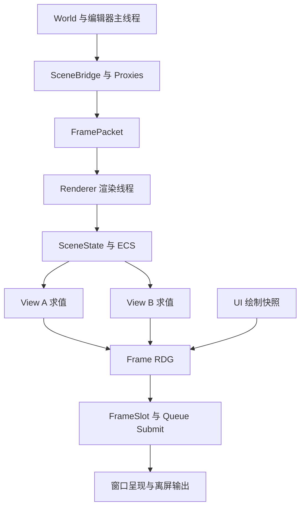
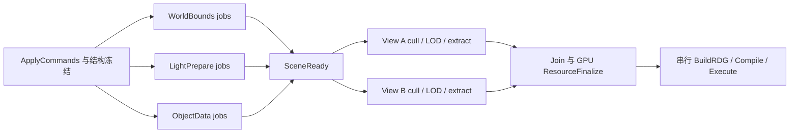

## Context

设计目标是 ECS + RDG + 多 viewport 的 Renderer 主体。现有 `aurora-renderer` 继续承载这项基础实现，
不另建同义 change；架构决策集中在本文件，外部可观察行为放 specs，实现顺序放 tasks。

当前源码的主要接缝：

| 现有位置 | 状态及本 change 的处理 |
| --- | --- |
| `engine/aurora/core/include/aurora/Renderer.h` | 空入口，替换为命令接口与 provider 实现 |
| `engine/aurora/adaptor/src/AuroraModule.cpp` | 内联 clear/submit/present，迁移为宿主转发 |
| `engine/sandbox/render/src/EditorRenderer.cpp` | 自持设备、窗口和 UI GPU 帧；拆成主线程宿主与渲染端扩展 |
| `engine/aurora/pipeline/src/SceneRasterPassTemplate.cpp` | Collect 只做 Bounds 遍历，需最小实体到 DrawItem 的提取 |
| `engine/aurora/rhi/interface/src/rdg/Compile.cpp` | Compile 内部 acquire；改为消费调度器已获取的输出 |
| `engine/aurora/rhi/interface/src/rdg/Execute.cpp` | RG 在 PSO 前绑定；修正顺序，补 view bindings 和几何描述 |
| `engine/aurora/pipeline/src/GlobalRenderResources.cpp` | 单 UBO，相机部分字段占位；隔离 view/slot 并填真实矩阵 |
| `engine/aurora/rhi/interface/src/rdg/RenderDeviceExclusive.cpp` | BeginFrame 提前 Reset fence；重构为显式提交状态 |
| `engine/core/include/core/ecs/EntityRegistry.h` | DestroyEntity 未清组件池；修复既有 core-ecs 契约 |
| `engine/core/include/core/ecs/EntityRegistry.h` / `View.h` | Pool 懒创建、View 仅可写；增加结构冻结与受限读写访问后才能并行 prepare |
| `engine/core/include/core/async/ThreadPool.h` | 已有 CreateTask/DependsOn/Parallel；复用执行器，补上层访问依赖编译 |

## Goals / Non-Goals

**Goals:**

- 单设备下多 Scene、多 View、窗口和离屏输出，生命周期与线程归属明确。
- 一张 Frame RDG 表达场景输出、合成和呈现之间的依赖。
- CPU prepare 使用组件/资源访问 DAG：跨 system 并行与单 system 分块并行都从首版主体考虑。
- 不依赖完整资产产品链路即可用真实 DrawItem 验证主体；预留 Framework 数据桥接。
- 后端自行完成编译、native pass 与编码任务构建，由对应 FrameContext dispatch；串行路径作为同一协议的参考模式。

**Non-Goals:**

- 本次不将 World 改为 ECS，不引入新 ECS 框架。
- 不在主体 change 内实现完整材质编辑预览、复杂光照或各 feature 的绘制。
- 不把每个辅助类拆成独立 change，也不将所有渲染迁移合成一个长期无法验收的大 change。

## Decisions

### D0 Aurora 渲染主流程总览

Aurora 的主流程统一为：**主线程提交场景与输出意图，Renderer 协调 ECS 准备和逻辑建图，各后端编译自己的执行计划，由对应 DeviceFrameContext 编码、提交并管理 GPU 退休。** 本节整合当前目标设计；具体契约以 D1–D10 和 capability deltas 展开，尚未表示实现完成。

总图：[Aurora 渲染主流程](review-images/12-renderer-main-flow.png)。编译与编码展开见 D5b/图 10–11，FrameContext 资源归属见 D7a/图 9。

**主体结构与所有权。**

```text
宿主主线程 World / Editor UI / SceneBridge
  IRenderer / FramePacket writer                  命令与不可变快照
                │ 有界 FIFO / 状态事件
RendererImpl（provider，专用 render coordinator）
  FrameScheduler                                 帧事务、等待、输出、提交及关闭编排
  SceneStore / ViewStore / ViewportStore          持久状态与 generation
  ScenePrepareScheduler + CPU prepare pool       组件访问依赖、场景/视图任务
  ResourceCache / Tickets / PipelineCache         精确资源版本、上传预算与 PSO
  ScenePipeline / FrameComposer                  共享上传 + 各 View + UI/输出逻辑图
  Device + 一个活动的 DeviceFrameContext
    本后端 RDG compiler                          native pass / 同步 / 编码任务计划
    EncodingSession + dispatcher + encode pool  本后端编码与结果组装
    GPU slot ring / allocators / completion      唯一 slot 状态、资源保活与退休
```

Scene 保存共享 ECS；View 保存相机、可见集合、LOD/history；Viewport 保存窗口或离屏输出状态。一个 Scene 可服务多个 View，一个原生窗口可合成多个离屏 View。每个 GPU 帧使用一个 slot lease，View 在其内取得独立常量/descriptor 切片。FrameScheduler 不再复制一套 GPU ring。

**执行域。**

| 执行域 | 负责的工作 | 交付物 |
| --- | --- | --- |
| 宿主主线程 | World/UI 更新、窗口事件、资源完成归并、提交命令；消费 renderer 状态 | owned FramePacket |
| 资产 executor | IO、解压、CPU 解码/编译；不直接改渲染 ECS | immutable CpuReady payload，先回主线程 |
| render coordinator | 应用命令、freeze/join、预算/GPU cache、声明图、调用后端 Compile/Dispatch/Submit、输出和回收 | 帧状态与提交记录 |
| CPU prepare workers | 按受限读写执行 Scene systems/chunks 和各 View 的 cull/LOD/extract | PreparedScene/PreparedViews |
| 后端 encode workers | 按后端任务计划使用独占 native 编码资源；不访问 live ECS | 稳定编号的编码结果 |
| GPU / presentation | 按提交同步执行 copy/draw/compute；按输出协议消费图像 | GPU completion 与独立 presentation retirement |

**初始化一次。** 宿主解析 IRenderer provider，创建 render coordinator；在受控初始化阶段选择 Device/后端，创建对应 FrameContext、编码资源和 prepare pool，注册 features，返回 Init 成功/错误。Scene/View/Viewport 的创建和销毁仍经有序命令；窗口本体属于主线程。

**每个 CPU 帧事务按下列主线推进。** 完成查询与控制事件在整个循环持续处理，不是只在“帧末”运行一次。

| 步骤 | 所有者与动作 | 进入下一步的条件 |
| --- | --- | --- |
| 1 接收与应用 | 主线程封包；coordinator 在安全边界按 FIFO 应用 create/update/destroy 与资源完成，取得输出配置/资源版本快照 | 句柄与版本有效，组件池预建，结构冻结 |
| 2 Scene/View prepare | Core 访问依赖计划驱动专用 CPU pool；每 Scene 准备一次，各 View 在 SceneReady 后分别求值 | jobs 与必要归并完成，产出 owned PreparedFrame；尚未占 GPU slot |
| 3 取得帧资源与输出 | scheduler 通过 TryBeginSlot 取得 lease，再有界 acquire/复核 outputs | slot 安全且输出 generation/extent 一致；变化则重做受影响 View 或跳过 |
| 4 资源落实与逻辑建图 | coordinator 按预算创建资源/PSO、准备 staging/UploadBatch；FrameComposer 声明 upload、逐 View、UI/composite 和输出 roots，Freeze | 精确版本固定，范围/访问/输出明确；资源未就绪只影响相关 draw |
| 5 后端 Compile | 当前后端完整分析/剔除/排序，构建 native passes、backing/bindings、同步、EncodeTaskGraph 与 SubmissionPlan | 成功生成绑定本 context/slot 的 BackendCompiledFrame；无 GPU 提交 |
| 6 FrameContext Dispatch | 本 context 执行 coordinator 步骤与 worker 批次，收齐并按稳定顺序组装 | TryCollect 返回 RecordedFrame；失败/取消须先 drain，无部分帧提交 |
| 7 Submit 与输出排队 | scheduler 请求 context 显式提交；Accepted 后登记业务 SubmissionRecord、上传状态及候选最终状态，按平台协议排队 Present | 接受结果可观察；Present 使用对应 render-done 同步，不将排队视为已完成 |
| 8 完成与回收 | completion pump 检查 GPU，发布资源 Resident/释放可退休引用；输出单独确认 presentation retirement | slot 只在真实 GPU 完成且 CPU 编码借用退出后复用；关闭等待全部相关责任结束 |

首版按单个 CPU 帧事务推进；本帧 CPU 借用与提交/放弃收尾结束后，再应用下一 packet。GPU 可仍在执行先前提交，因此 CPU 帧 N+1 的 prepare 可与 GPU 帧 N 重叠。CPU packet sequence、GPU submission serial、slot index 和 swapchain image index 分开管理；不通过独立 Tick 计数推进各 allocator。

**数据交接只沿拥有数据或受控 lease 的边界。**

```text
FramePacket
  -> 持久 Scene/View/资源目录增量 + CpuPrepareFrame
  -> PreparedFrame
  -> FrameBuildContext（prepared + slot lease + outputs + CPU arena）
  -> FrozenFrameGraph
  -> BackendCompiledFrame
  -> EncodingSession / RecordedFrame
  -> GPU slot + renderer SubmissionRecord
```

后端 plan 不跨 context/slot 重放；同一 plan/recorded 结果只消费一次。CPU 图和 prepare 内存在 jobs、录制及结果 borrowers 退出后回收，GPU 引用已移交 slot。无需让所有 CPU 临时内存都等待 GPU fence；也不能让 arena reset 代替非平凡对象析构。

**三种依赖计划各有职责。** ECS Prepare DAG 解决组件/CPU 数据读写冲突；GPU FrameGraph 解决资源 producer/consumer、内容有效性和 GPU 同步；后端 EncodeTaskGraph 解决 CPU 录制的输入发布、独占 native 资源和组装依赖。后两者由各后端 Compile 生成/落实。它们可以复用执行基础，但不能机械地共用同一组边。协程可在以后包装完成令牌，当前主流程不依赖协程 runtime。

**资源加载是旁路生产，上传接入主图。** `Requested -> CpuPreparing -> CpuReady` 在资产侧完成，经主线程 payload 进入 Renderer；`UploadQueued` 在步骤 4 接纳为本图 copy，步骤 5–6 编译/编码。步骤 7 Accepted 后为 UploadSubmitted；步骤 8 成功完成才为 Resident。同图消费者可用 InGraph 依赖 copy，无需 CPU 先等待上传；未接纳的新版本跳过或使用冻结前已选定的兼容旧版本。首版尚未 Resident 的跨图新资源仍不可直接消费。

**暂停、失败和退出也是同一循环的分支。** 无窗口但有获准上传可以产生 upload-only 图；无任何 GPU 工作则释放未提交 lease，不 reset fence。单个输出失败剔除其分支；已成功 acquire 的输出仍需收尾。CPU 准备/编码失败先 drain，再放弃候选；提交接受状态未知则隔离资源。Shutdown 停止接收新包，按约定排空/取消 CPU 工作并处理输出责任，等待 GPU 与 presentation 退休或进入明确的设备错误协议，最后销毁 caches/context/device、join 并通知宿主；宿主等待期间继续处理平台事件。

**阅读顺序。** 先看本节/图 12 掌握主线，再按问题查 D4a–D4c（ECS/并行）、D5a–D5b（图与后端编译）、D6a（异步资源）、D7–D8（FrameContext/提交/退休）、D9–D10（模块与接入）。实施依赖与验收仍以 tasks.md 为准，不另建第二份设计总纲。

### D1 保留 OpenSpec 并按可验收能力划界

`proposal.md` 定义范围；`design.md` 承担架构 RFC 和决策记录；`specs/` 定义契约；`tasks.md` 定义实施顺序。
暂不另建 ADR 系统或第二份架构总纲，避免重复维护。若后续出现可复用的独立决策，再从本设计提炼 ADR。

| 工作 | 归属 | 交付边界 |
| --- | --- | --- |
| Renderer 主体及最小出图 | 当前 `aurora-renderer` | 程序化网格、两相机、窗口与离屏输出、生命周期验证 |
| 通用 ECS 访问依赖基础 | 当前 change 的 `core-ecs` delta | 访问数据、纯依赖编译、受限视图；不新增完整 ECS system/runtime 框架 |
| World/Actor/组件提取 | 已有 `aurora-scene-bridge` | 监听 lifecycle/transform/asset-ready，生成 Renderer 命令 |
| 完整材质 GPU 准备和资产版本更新 | 后续范围，尚未建 change | schema/program/variant 到 GPU cache；复用本次最小 pipeline 的接缝 |
| 地形、植被、导航可视化 | 各自已有 change | 通过 feature/pass 接口接入 |
| 更复杂的编辑器预览体验 | 后续范围，尚未建 change | 工具交互与产品行为；基础 UI 合成入口属于本 change |

本次只补设计产物，不把任何实施任务标为完成。代码与该 change 的 spec 最终一起提交；commit/archive 遵循根 AGENTS 的用户确认规则。
2026-10-14 细化：D4c、D5a、D6a 分别固定 ECS 增量构建、FrameGraph 构建和资源异步协议，并将复审 R1–R5 的相关契约纳入设计；源码修复、平台验证以及 R6 bridge 文档对齐仍未完成。

### D2 Scene、View 与 Viewport 是三个独立对象

| 对象 | 数据 | 所有者与关系 |
| --- | --- | --- |
| `RendererImpl` | device、注册表、GPU caches、调度器 | provider 持有；每个进程的活动宿主使用一个实例 |
| `SceneState` | `RenderScene` ECS、dirty 数据、scene feature 状态 | Renderer 持有；首版一个 World 对应一个 Scene |
| `ViewState` | SceneId、相机、过滤、可见集合、LOD、history、pass state | Renderer 持有；多个 View 可以引用同一 Scene |
| `ViewportState` | window/offscreen 描述、尺寸、格式、输出 generation | Renderer 持有；与 Scene 生命周期分离 |
| `FrameSlot` | command/descriptor/upload/UBO、graph backing leases、完成状态 | DeviceFrameContext 持有唯一 GPU slot ring；scheduler 经 lease 调度，GPU 完成后复用 |

首版每个 scene View 绑定一个输出；同一相机渲染到两个不同尺寸的输出时建两个 ViewState。
一个编辑器原生窗口可合成多个离屏 View；无需把所有 UI 窗口强制绑定到一个 Scene。
同场景多 View 共享不可变 mesh/material GPU 资源，但不共享可变 camera/visibility/LOD/history。



备选的“每 viewport 独立 Renderer/Scene/Device”会重复资源并割裂合成依赖，因此不采用。

### D3 主线程提交拥有数据的 FramePacket

主线程独占 World、Actor、UI；渲染线程持有 Scene ECS、Device 和 GPU caches，并作为 prepare coordinator。
CPU prepare worker 仅在调度器授予的访问范围内借用 ECS/快照；结构变更、GPU 对象/cache 修改、逻辑建图与队列提交由 render coordinator 控制。GPU 命令编码由各后端 FrameContext 按计划在 coordinator/独立 encode workers 执行，使用独占编码资源和不可变绑定，不访问 live ECS。
平台窗口的创建、事件和销毁仍走宿主线程；平台需要的 surface 操作通过显式宿主协议完成。

`IRenderer` 只暴露配置、句柄、命令包、提交结果与完成事件，不暴露 World/Actor 指针或可变 RenderScene。
句柄包括 SceneId、RenderEntityId、ViewId、ViewportId，包含 index + generation；render entity 在各 Scene 内映射到现有 ECS EntityId。
句柄槽位回收需经过销毁确认；generation 耗尽时退休槽位，不能回绕后误认迟到命令。

`FramePacket` 由主线程持有的 writer 收集，含顺序号、时间、create/update/destroy 命令和只读 CPU 数据。
数据按值复制或通过明确定义的不可变所有权转移；CPU 资产载荷保活到所有读取结束/完整 staging 拷贝完成，staging 保活到 GPU 上传完成，不能只保存裸地址。
资产 worker 的结果先回到主线程归并，保持单生产者；渲染线程向主线程返回状态事件。

初版有界队列按 FIFO 消费，满时 `TrySubmit` 返回 Busy，调用方保留原包并继续处理窗口事件；不得静默丢弃 lifecycle 命令。
空闲渲染线程等待事件，不自行忙循环。CPU 待处理 packet 数与 GPU inflight slot 数是两个独立限制。
后续优化可合并 update，但不得越过 create/destroy、资产 revision 和帧事务边界。

Init 必须返回成功/错误；DestroyViewport 必须在 renderer 不再使用表面后发确认；Shutdown 停止接受包、排空工作、等待 GPU/呈现退休并 join。
宿主等待完成时不得阻塞平台消息处理，渲染线程也不得同步调用可能等待自己的主线程回调。

### D4 场景更新一次，视图分别求值

Scene 更新分成串行命令应用、CPU prepare DAG 与结果发布；world bounds、light 数据等按访问依赖并行准备。
所有 Scene prepare jobs 完成后冻结本帧 scene revision，再执行各 View 的裁剪、LOD 与 CPU 绘制数据提取；不同 View 可以并行。
沿用现有 sparse-set ECS。首个可绘制实体组合为 WorldInfo、Bounds、MeshBinding、MaterialBinding、RenderFlags；binding 使用渲染资源句柄。
DrawItem 是当帧提取结果，不作为长期 ECS 组件保存。GPU 对象仍由 renderer cache 和 frame 引用管理。

DestroyEntity 必须移除所有池成员；延迟资产完成只在 entity generation 与 asset revision 都匹配时生效。
Scene 销毁使依赖它的 View 停止场景绘制并报告状态，但不会隐式销毁宿主窗口。

### D4a 通用组件读写依赖与 CPU Prepare DAG

需要通用机制，但首版复用现有 ThreadPool，不另造 JobSystem。分成三层：

| 层 | 职责与归属 |
| --- | --- |
| `AccessDesc / SystemDesc / DependencyPlan` | Core ECS 的通用数据及纯编译函数；不引用 Scene、RHI、FrameSlot 或 ThreadPool |
| `ScenePrepareScheduler` | Aurora provider 的 adaptor 实现；注册 system、绑定 Scene/View 实例、冻结结构、切块和提交任务 |
| `ThreadPool / TaskNode` | 已有执行机制；只执行依赖，不理解组件、场景或 RDG |

CPU DAG 描述组件/CPU 资源的先后关系；RDG 描述 GPU 资源访问及 barrier。二者通过 PreparedScene/PreparedViewData、UploadPlan 衔接，首版不合并成一种图。

**访问声明与身份。** 每个 system 声明 `Read<T>`、`Write<T>`、非组件资源访问，以及可选 Before/After。Write 包括读改写，与所有重叠 Read/Write 冲突；Read/Read 可并行。
组件访问键为 `(domain, owner instance+generation, TypeId<T>)`，owner 在绑定时对应具体 Scene；View 临时数据使用 View owner；共享 CPU 资源使用同一真实资源 owner。
同一 Bounds 类型在 Scene A/B 中不冲突；多个 View 读取同一 Scene Bounds 可并行；它们分别写 View 自有 visibility/LOD/draw buffers。
frame sequence 不能让同一份 live ECS 存储被当成两份资源：首版上一 CPU 帧全部 jobs 完成后才应用下一 packet，不做同 Scene CPU 跨帧重叠。
已有 TypeId 使用显式 SKY_TYPE_TAG 哈希，可跨 DLL 复用；计划编译保留 tag 碰撞检查。
通过组件句柄间接访问的共享状态也必须声明资源依赖，不能认为两个不同组件天然没有别名。

概念声明示例（表示所需语义，不冻结 C++ ABI）：

```cpp
prepare.System("WorldBounds")
    .Read<WorldInfo, MeshBinding>()
    .ReadResource<MeshMetadataSnapshot>()
    .Write<Bounds>();

prepare.System("LightPrepare")
    .Read<WorldInfo, Light>()
    .WriteResource<PreparedLights>();

views.System("CullAndSelectLod")
    .ReadScene<Bounds, MeshBinding, RenderFlags>()
    .ReadResource<ViewCamera>()
    .WriteResource<ViewVisibility, ViewLod>();
```

**依赖推导。** 读写集合只能发现冲突，不能自行判断哪个结果应先产生。先用 phase 和显式 Before/After 建语义顺序，再按稳定 system order/id 做确定性的拓扑排序；未显式排序的冲突使用这个稳定顺序，不使用 DLL 加载顺序。
沿逻辑顺序逐 key 维护 lastWriter 与 outstandingReaders：Read 等待 lastWriter；Write 等待 lastWriter 和此前所有 readers，然后替换 writer、清 readers。由此覆盖 RAW/WAR/WAW。
消费者若必须读到另一个 system 的本帧结果，应显式 After producer 或落在后续 phase；排在 writer 前的 reader 读取输入版本，不能靠 Write 声明自动反转业务顺序。
显式依赖成环、跨 phase 逆序或未知节点在提交前报错；诊断输出 system 名、冲突 key 与边来源。相同输入描述生成相同计划。
首版以“同 Scene 的整个组件池”作为 system 间冲突粒度；dirty/tag 查询不证明互斥，不以此消除依赖。无冲突节点可同时就绪。
稳定的 system/access 拓扑可缓存，按 system 集合、访问声明、显式顺序和资源别名版本失效；实体增删只要求重新绑定 query/chunks，不必无条件重编整张依赖图。

**结构冻结与受限访问。** ApplyCommands/Preflight 串行创建实体与所需组件池，预建本帧将写入的组件并解析 view；随后冻结池结构。
worker 不得使用可能懒创建的 Pool/Get/现有可写 View，不得 Add/Remove/Create/Destroy、reserve 或触发 swap-remove。
提供预绑定的 const ReadView 和受限 WriteView，只允许声明的类型/资源及有效区间；Read<T> 返回 const，debug 检查未声明访问。已有裸 registry API 不宣称自动线程安全。
结构变更由各 job 的私有 deferred command buffer 记录，按稳定 system/chunk 顺序归并，默认在下一帧 ApplyCommands 生效；首版不在 prepare 中途改变本帧查询集合。

**两层并行。** system 间按 DAG 并行；单 system 的 dense driver 可拆成确定的 entity ranges。只有声明 element-wise 且每个 entity 至多写一次的 kernel 才允许切块。
跨池 sparse 查询按 entity 做一一映射，禁止 chunk 写入任意其它 entity；所有 chunks 共同占用该 system 声明的完整访问范围，下游等待全部 chunks 完成。
邻域/层级遍历、共享累加、全局 vector append 不能直接套 element-wise。使用 chunk 私有输出、确定顺序 merge/reduce，或作为未拆块 system 执行；Reduction 暂不引入新的通用访问模式。
FrameAllocator 不能由多个 worker 共用可变游标；使用任务私有 scratch/输出段，按 system/chunk 顺序归并，draw 排序增加 EntityId/submesh 等稳定 tie-break。

**阶段与完成边界。** 首版按以下顺序执行，阶段内由依赖释放并行度：



独立的 bounds/light/object 准备可并行，各 Scene 分别有 SceneReady；首版所有选中 View 的结果齐备后由 coordinator 建单张 RDG。
worker 产出 CPU upload plans 和含资源句柄的 draw packets；GPU 创建/上传、PSO/cache 解析以及最终 DrawItem 组装在 ResourceFinalize/BuildRDG 完成。
每帧保留 JobGroup 完成令牌，渲染线程只等待自身计划，不用 WaitIdle 代替本帧完成条件。worker 不嵌套阻塞等待同池子任务；所有依赖在首次 Submit 前建完。
执行适配层要覆盖空计划、单 worker、chunk 数为零和大任务数的进展性；当前 Parallel(0) 不完成 future，且有界队列 Schedule 会等待空间，不能把任意大 ready fan-out 直接塞入 worker 完成回调。
首版由 Renderer 持有一个独立的 CPU prepare ThreadPool 实例（所有 Scene/View 共用，不为每个 Scene 建池），限制整个计划的活动 TaskNode 数到经验证的队列预算；溢出的 logical chunks 在已有任务内批处理。
结合现有 FrameContext 后，批次执行优先复用 DeviceFrameDispatcher，提交到上述专用 CPU pool；这里的节点预算同时适用于 dispatcher node，不能在 TaskNode 与 dispatcher 之外再造一套 ready-queue executor。dispatcher 需要补异常收齐/最终结果与受控 fan-out，详见 D7a；Core 依赖编译不依赖这个 Aurora 执行适配。
若 system DAG 本身已超出预算，回退到同一计划的串行参考执行器，保持正确完成而不阻塞队列；后续再用性能证据决定是否支持分批并行提交。
逻辑 chunk 划分与 merge 顺序不随 worker 完成顺序变化。若改用与资产任务共享的池，必须先解决其它生产者占满队列时的 worker fan-out 进展问题，不能只靠 Renderer 自身预算声称安全。
job 捕获失败/异常并记录帧状态，正常完成依赖释放；失败的下游跳过计算，coordinator 收齐全部完成后停止发布部分结果，暂停受影响 scene 并报告，恢复需完整重建或重新初始化。
销毁 Scene、reset CPU arena、卸载 feature module 前必须等待引用它们的 jobs 退出；GPU lease 则仍遵循 FrameSlot 退休，二者不可混为一种完成状态。

**首版交付边界。** 访问描述、纯编译、system 并行和 element-wise 分块、只读多 View、结构冻结/延迟命令、串行参考执行器一起验收。
ECS prepare 范围不做查询集合精确别名分析、任意邻域写入并行、跨 CPU 帧 ECS 多版本或通用实时 system 热插拔；GPU command 并行录制由 D5b 的后端计划和 D7a FrameContext 承担。

### D4b 协程作为异步编排接入方式

**决策：现在定义完成与恢复契约，首版不引入协程 runtime，也不把协程作为 prepare 并行的前置条件。**
仓库已配置 C++20，但现有 Task/TaskNode 是回调执行到返回即完成的模型，尚未提供 coroutine task/awaiter。后续若引入，优先考虑 C++20 无栈协程；本次不增加 fiber 系统或第三方协程库。

| 工作 | 首版表达 | 协程适用性 |
| --- | --- | --- |
| Bounds、Light、cull/LOD、实体分块 | 访问 DAG + 普通 kernel | 计算过程中没有必要的异步等待，保持一次执行至完成 |
| SceneReady / ViewReady / 空闲 FrameSlot 的编排 | 有状态 coordinator + JobGroup 完成令牌 | 后续可 await 完成事件，释放 coordinator 执行其它可用工作 |
| 资产 IO、解码、shader 编译、上传完成 | 现有异步请求 + 拥有数据的完成结果 | 多阶段等待链是协程优先应用点；结果仍通过主线程归并到 FramePacket |

协程负责保存异步控制流；worker 并行由执行器安排，组件安全由访问 DAG 保证，GPU hazard 仍由 RDG 处理。
`co_await` 的挂起/恢复依赖 awaiter 与 coroutine handle 协议，不会自动把工作提交到 ThreadPool；参见 [C++ draft: await](https://eel.is/c++draft/expr.await)。

**先稳定与语法无关的 CompletionToken/JobGroup 语义。** 具体命名/ABI 在实现时确定，约束如下：

- 区分 Pending、Succeeded、Failed、Cancelled；CancelRequested 是独立请求标志，最终状态只在全部已启动 kernels 退出、未启动节点被收齐后发布一次。提前响应取消需要独立 CancelAck，不提前完成 JobGroup。结果 consumers/continuations 的借用另由 CPU lease 跟踪；JobGroup 完成不代表这些借用或 GPU 工作已退休。
- 完成状态不依赖调用方的 `future.get()`；coordinator 可检查状态或注册 continuation。订阅与完成并发时不得丢通知/重复执行，已完成对象也必须按约定交付结果。
- continuation 显式指定恢复 executor；涉及 SceneStore、GPU cache、RDG 的后续步骤回到 render coordinator，平台/UI 步骤回到主线程。完成发生在哪个 worker，不能隐式决定后续线程；排队交付避免在完成回调栈上意外重入。
- JobGroup、订阅者与捕获数据有明确所有权；shutdown 先拒绝新工作、处理取消并收齐 jobs/continuations，再释放相关对象与模块。不能通过丢弃 token 或 coroutine handle 假定底层工作结束。

后续 CoroTask/awaiter 只适配这一完成协议，不改变访问声明或 IRenderer 的 FramePacket 接口。共享的 coroutine runtime/executor 适配若开始实施，单独确定异步基础 change 的范围；本 change 不提前创建该 change。

**prepare kernel 不挂起。** 首版 kernel 不持有 ECS Read/WriteView、池元素引用、线程 scratch、锁或 encoder 跨 `co_await`。TaskNode 现有实现会在函数返回后标记完成并释放后继，而协程调用可能在首次挂起时返回，因此禁止将尚未完成的 coroutine 作为普通 kernel 的成功结果。
若未来某 system 真有异步等待，应拆为“提取拥有数据的输入 -> 异步工作 -> 新任务重新申请访问并校验 generation/revision -> 应用结果”，不能在 await 时自动释放组件依赖后又继续使用旧引用。
协调层等待 SceneReady 时仍保留本帧结构冻结和 JobGroup 所有权；恢复前不能应用同 Scene 下一 packet，CPU arena 不得提前 reset。

**外部等待不进入本帧组件计算临界路径。** 资源未就绪使用明确的跳过/占位策略，让异步工作独立推进；不要让一个 mesh 的 IO/编译阻塞整个 SceneReady。
GPU awaiter 必须由后端完成事件或 coordinator 的有界状态检查驱动，不能在 worker/await_suspend 内同步 Wait Fence。GPU submission 完成与 presentation retirement 仍是两种完成条件。
协程 frame 的存储与析构、异常传播、取消和恢复 executor 的竞态需要独立验收；当前不声称协程会提升 CPU prepare 吞吐，也不为每个 entity 创建协程。

### D4c ECS 的初建、增量更新与帧数据提取

配图：[ECS 构建与提取](review-images/06-ecs-build.png)。

**持久 ECS，不逐帧重建。** Scene 初建时注册所需池和 prepare systems；主线程 bridge 维护 `(World instance, Actor id, component id, renderable part)` 到渲染句柄的映射。
一个 Actor 可以有多个渲染实体，不能用 Actor 地址作唯一键；submesh 首版作为同一实体提取出的多个 draw packets，不强制每个 submesh 一个 entity。
外部只看带 generation 的 RenderEntityId；SceneStore 在渲染线程维护它到内部 EntityId 的映射。首版不跨帧克隆整个 registry，也不把 FrameGraph pass 建成 ECS entity。

| 数据层 | 首版内容 | 更新/使用规则 |
| --- | --- | --- |
| 输入组件 | WorldInfo、MeshBinding、MaterialBinding、RenderFlags、Light | ApplyCommands 串行写；binding 只存逻辑资源键、期望 revision 与 bindingRevision |
| 派生组件 | Bounds、派生数据的输入版本 stamp | 冻结前已存在；prepare worker 只改获授权元素，不增删组件 |
| 资源目录快照 | mesh metadata、已解码数据描述、资源版本状态 | device cache 生成不可变 CPU 视图；不把 native GPU 对象/cache 可变引用交给 worker |
| Scene 帧结果 | PreparedLights、PreparedObjects、上传意图 | 每个 Scene 一份；chunk 私有输出后稳定归并 |
| View 帧结果 | visibility、LOD、排序键、CpuDrawPacket | 每个 View 一份；不能写共享 Scene 的 visible/LOD 标记 |
| GPU 帧结果 | DrawItem、UBO/descriptor 切片、resource leases | coordinator 在 slot 可复用后解析；不长期存进 ECS |

**边界处理顺序。** 每轮 CPU 帧按以下顺序推进：

1. 等上一轮引用同一 Scene 的 jobs 与 CPU borrowers 结束。检查包序号、句柄、revision、payload 格式和资源预算；预检失败报告拒绝，不发布半份 PreparedScene。
2. 应用上一轮归并的 deferred structural commands，再按本包顺序应用外部 create/update/destroy。两类命令都校验 generation；外部新输入最终覆盖旧的派生请求，destroy 后的迟到命令不能复活对象。
3. 完成池预建、reserve、缺失派生组件补齐和 query/chunk 绑定；更新本轮不可变 ResourceCatalogSnapshot。载荷完成只是更新候选资源，不由 asset worker 直接写 ECS。
4. 关闭结构修改入口，生成访问计划并执行 Scene prepare；发布 SceneReady 后运行各 View prepare。对单个 Scene，不能因 View A 完成就允许下一包修改仍被 View B 读取的 ECS。
5. 稳定归并，发布 PreparedFrame；coordinator 消费它生成 GPU 数据。已拥有独立值的输出可与 GPU 跨帧重叠，仍借用 ECS 的输出必须先解除借用才允许下一轮写。

这里只保证成功边界可见，不承诺任意内存分配异常下完整事务回滚；Apply/prepare 途中失败按 D4a 暂停 Scene，并通过完整重建恢复。删除必须清理所有组件池和索引，再回收实体 generation；持有的 GPU 资源由独立 lease 退休。

**Dirty 的用途是少算，不是免同步。** WorldInfo、mesh metadata、binding、light 输入携带版本；Bounds 的 stamp 记录 `(transformRevision, resolvedMeshRevision)`。
任何输入版本变化都重新计算；stamp 仅在该结果成功生成后推进。首版可以全量 prepare 作为参考实现，再逐项加 dirty 跳过。
资源新版本的 bounds 必须和本帧实际选用的 mesh 版本一致；使用旧 resident 版本作热更新回退时，也使用旧 metadata。metadata 缺失时跳过该实体或使用明确的保守占位，不读取未初始化 Bounds。
旧版本回退在冻结前选定并固定到 ResolvedBindingSnapshot。若选择 CpuReady 的新版本参与 prepare、但之后上传未被预算接纳，本帧跳过它或对替代版本重新 prepare；ResourceFinalize 不得悄悄换回另一版本 mesh 后沿用旧的裁剪结果。

**提取边界。** CpuDrawPacket 至少含 EntityId、bindingRevision、mesh/material 精确版本键、submesh/draw range、world/object 数据、sort key。
它不含 RHI 指针、descriptor 或 RDG handle。Scene prepare 可以使用 CpuReady 的 metadata 提前算 bounds，即使对应 GPU backing 尚未上传；资源是否可被本帧绘制由 D6a 的 ResourceResolution 决定。
资源完成通知只在下一次边界更新快照；prepare 途中不把新版本塞进当前不可变输入。

### D5 一帧一张 RDG，pipeline 模板与可变状态分离

Renderer 汇总所有有效输出，创建一张 Frame RDG。ScenePipeline 组织场景 feature 的准备和建图；
每个 View 持有自己的可变 pass state/history。相同 pipeline 定义可以共享，不能通过轮流修改共享 mView/extent 来切换视口。

概念接口如下；具体 C++ ABI 在实现前细化，语义由 specs 固定：

```cpp
RegisterScenePrepare(PreparePlanBuilder&); // 注册访问、依赖、kernel；每个 Scene 每帧实例化一次
RegisterViewPrepare(PreparePlanBuilder&);  // SceneReady 后，分别求值各 View
BuildView(RenderGraph&, const ViewRenderContext&, const PreparedViewData&); // coordinator 串行建图
```

ViewRenderContext 携带 Scene/View 的只读数据、frame slot、实际 extent、attachment formats、output handle 和 bindings。
并行提取阶段只写任务私有 CPU 结果，不并发修改 RenderGraph、builder、共享 DrawItem vector 或 GPU cache。
RDG handle 仅属于当前 graph。单独的 FrameComposer 加入 UI/composite/present pass；它不让 Renderer 依赖 EditorShell。

选择单图是为了显式表达“场景离屏图像 -> UI 采样 -> 主窗”的依赖。按 viewport 分图可作为后续优化，但需要额外的跨图资源状态协议。
首版一条 graphics queue、一个主要 submission batch；后端自行决定 command buffer/list 数量、pass scope 和 CPU 编码任务划分。parallelNum=1 是同一后端计划的串行模式，parallelNum>1 的编码任务构建/dispatch 纳入本 change。
公共层不规定单 command buffer executor，也不把 CPU 并行编码解释为 GPU 多队列执行。

### D5a FrameGraph 的输入、构建与编译产物

配图：[双 View FrameGraph 构建](review-images/07-framegraph-build.png)。

**FrameGraph 是本帧组合层，保留现有 RenderGraph/RDG 声明模型；完整 Compile 与编码计划移交后端，见 D5b。**
FrameGraphBuilder/FrameComposer 实现在 provider adaptor；稳定的 pipeline 定义、feature 注册和 PSO cache 可复用，本帧逻辑节点、资源 handle、bindings 和输出租约重新实例化。
最小数据流为：`FramePacket -> ECS/ResourceCatalogSnapshot -> PreparedFrame -> FrameBuildInputs -> FrozenFrameGraph -> BackendCompiledFrame -> RecordedFrame -> SubmissionRecord`。

| 产物（概念名，非已存在 API） | 固定内容 | 生命周期 |
| --- | --- | --- |
| PreparedFrame | 每 Scene 的 revision、每 View 的 CPU packets、UI snapshot、资源意图 | 本轮 CPU lease；不持 native GPU 资源 |
| FrameBuildInputs | PreparedFrame + 成功 acquire 的 outputs + UploadBatch + ResourceResolution | 一个 GraphId；extent/generation 已复核 |
| BindingIntent | set/binding、逻辑 graph handle、range/view、所需 access/stage | Compile 前只声明，Compile 后才写 descriptor |
| BackendCompiledFrame | 后端 pass/scope、resolved bindings、同步计划、EncodeTaskGraph、SubmissionPlan、候选 upload receipts | 绑定 context/lease；CPU 数据保留至 dispatch drain，GPU 引用转交 slot |
| RecordedFrame | 已收齐的 native 编码结果、实际 copy receipts、候选最终状态和 GPU leases | 仅同一 context 可单次提交；失败不产出可提交结果 |
| SubmissionRecord | submission serial、结果、completion token、资源状态增量、上传 ticket 清单 | 提交完成或错误退休之前保留 |

**构建顺序固定在 coordinator。**

1. 用 actual output leases 复核 View extent/format/generation；选择所需有效 View 和 UI 输出。一个输出失败不抹掉另一个输出仍需要的共享生产者。
2. ResourceFinalize 在可复用 slot 上分配 staging/UBO/descriptor，按预算创建 backing 并确定 upload batch。固定本图 ResourceResolution：Resident、InGraph、Unavailable；不能在后续 pass setup 中随机改变资源选择。
3. ImportTable 按真实物理对象身份去重。持久资源从状态账本导入；swapchain 只借用 lease；CreateTexture/CreateBuffer 创建 transient 逻辑资源。名字用于诊断，不作为跨帧身份；resource identity 是 renderer/graph 内部概念，不要求暴露后端 descriptor cache ID。
4. 先声明共享 upload passes 和 scene 数据，再按稳定 ViewId 顺序调用 BuildView。每个 View 创建自己的 depth/color 与 pass-local bindings，返回 `ViewOutputs`（本 GraphId 内的 color/depth handles 等）。
5. FrameComposer 将 UI 快照中的 logical texture/ViewOutput ID + generation/revision 解析为本图 handle，声明采样读；添加原生窗口输出的最终 PRESENT 状态。Present pass 仅描述 GPU 状态，实际 present 调用仍归 scheduler。
6. 显式标记根：有效窗口输出、需要保留的离屏/history/export、被接纳的持久资源上传以及明确副作用。普通 Import 本身不是“必须执行”的根；不再无条件保留所有 imported resource 的最后 writer。
7. 冻结声明图，交给当前 DeviceFrameContext 的后端 Compile。后端完成 pass lowering、backing/binding resolve、同步和编码任务计划；同一 context Dispatch，收齐后得到 RecordedFrame 再提交。任一步失败，不提交普通帧、不发布上传完成或资源最终状态；已 acquire 输出走 D7 收尾。

例：同 Scene 的 View A 供编辑器主窗采样，View B 直接输出第二窗口：

```text
Upload(mesh/material/scene data) --+--> ScenePass(ViewA, colorA, depthA) --> UI(main) --> Present(main)
                                 +--> ScenePass(ViewB, colorB, depthB) --> Composite(windowB) --> Present(windowB)
```

两条 View 分支只读共享数据，具有各自 camera/object bindings；首版同一 graphics queue 录制，不把图上并列箭头解释为已实现 GPU 多队列并行。
本帧 ViewOutput 没有 consumer 时可被裁剪；需要跨帧留存则显式 export 到持久版本。历史读/写采用不同 backing（例如 ping-pong），带 ViewId/extent generation 和 last-use serial，不能仅靠改名字复用仍在途的纹理。

**编译器区分内容依赖与执行 hazard。** 现有 Compile.cpp 将相邻访问串起来，CullPasses 又沿 `ResourceNode::lastWriterPass` 回溯；对于 `A 写 R -> B 读 R -> C 覆写 R`，B 的来源必须是 A，不能被全局最后 writer C 替代。
补充内部 AccessRecord 的 Read / WriteDiscard / ReadWrite 语义及资源范围；外部 handle 仍可保持当前形式，每次写在内部产生内容版本。
Read 绑定在它之前的生产版本；ReadWrite、attachment LOAD、混合/部分覆盖等需要保留旧内容的写保留前一版本的必要生产者。只有证明完整覆盖时才允许 WriteDiscard 去掉旧内容依赖。
STORE_DONT_CARE 后内容不能被后续消费者当成已定义；部分 mip/layer/region 上传的定义范围也要检查，不能因为创建了 image 就允许读取未上传区域。
首版 hazard 可保守按整资源串行化，不要求精确子范围并行；内容有效范围与 copy region 仍须正确。

各后端 Compile 必须满足以下语义顺序；可复用纯分析函数，具体阶段组织、native pass 和任务构建由后端控制，详见 D5b：

```text
校验 handles/范围/usage/已定义内容
 -> 绑定每次读取的 producer/content version
 -> 从显式 roots 沿内容依赖反向剔除
 -> 对存活 pass 推导 RAW/WAR/WAW + 显式先后关系并稳定拓扑排序
 -> 后端选择 GPU 顺序与 native pass scopes
 -> 按实际执行顺序计算生命周期 / 分配 frame leases
 -> resolve bindings / 推导后端同步 / 构造 native pass plans
 -> 构建 CPU EncodeTaskGraph 与 GPU SubmissionPlan / 冻结编译产物
 -> 对应 FrameContext.Dispatch / drain / RecordedFrame / Submit
```

内容依赖不能用所有 WAW/WAR hazard 边替代，否则已被完整覆写的无用 pass 永远无法剔除；剔除后仍须重建存活访问间 hazard。
诊断返回 pass、resource、producer/version、冲突/缺失原因；cycle、读未初始化 transient、缺失输出和布局不兼容不能只静默跳过后继续提交。
同图只读共享避免不必要的 RAR 顺序边；单队列并不免除写读之间的内存依赖和 layout 转换，见 [Vulkan 同步示例](https://docs.vulkan.org/guide/latest/synchronization_examples.html)。

**CopyBlit 要形成实际闭环。** 当前 CompiledGraph.h 有 BUFFER/IMAGE/BUFFER_TO_IMAGE/IMAGE_TO_BUFFER 枚举，但 Compile.cpp 对非 BUFFER 两端都取 image，Execute.cpp 仅调用 executeFn，现有 builder 没有完整 copy region 表达。
首版至少实现 buffer copy 与 buffer-to-image upload 的 typed source/destination、owned regions、offset/row pitch/mip/layer/extent 和真实 encoder emit；使用已有 RHI BufferImageCopy 表达，并验证各后端对齐/格式块约束。其余已暴露 kind 必须实现对应 emit 或显式 Unsupported，不能记录了 pass 却无 copy。
FrameStagingBuffer 可复用其分配思路，但要暴露分配/拷贝计划、对齐和 slot 安全 reset；不能只调用隐藏 pending 的 Flush 而漏掉 RDG 的 staging read/target write。

**扩展入口。** 消费方 engine 接口分别定义 IScenePrepareFeature 与 IFrameGraphFeature（概念名）。后者有注册/停用、BuildView/BuildFrame 和 retire 契约；UI 提供方 adaptor 实现 frame feature。
构图上下文只给受控 builder、ViewContext、冻结结果和逻辑资源解析器，不给可变 SceneRegistry、宿主对象或 Queue::Submit。
停用阻止未来建图；卸载 feature module 等待 jobs、录制回调、continuations 和相关 GPU/presentation leases 退出。UI 过期逻辑纹理引用按显式占位/跳过处理，不解引用裸 Image*。

### D5b 后端完整 Compile、编码任务构建与 FrameContext Dispatch

**2026-10-14 调整：完整编译流程归各后端。** 公共 RenderGraph 提供声明、冻结后的 IR 和诊断数据；Vulkan/DX12/Metal 各自实现 Compile，负责 native pass 构建、资源计划、同步、parallel encode task 构建和提交布局。对应 DeviceFrameContext 执行该计划。此前“公共 Compile + 后端只编 barrier + 公共串行 Execute”不再是目标架构；串行只是每个后端的参考策略。

配图：[后端编译与 FrameContext dispatch](review-images/10-backend-compile.png)、[GPU 顺序与 CPU 编码任务分离](review-images/11-encode-task-graph.png)。以下类型/API 均为设计名，尚未实现。

**边界与两种 pass。** FrameComposer/feature 声明 SceneRaster/Fullscreen/Compute/Copy/Present/Custom 等 logical pass：表达“做什么、读写什么”。后端把它们降为 native pass/scope 和编码单元：决定 attachment 描述、load/store/resolve、render area、合法合并/拆分、command boundaries 与 encoder 类型。logical pass 与 native scope、encode task 均不要求一一对应。Present logical pass 仍只是最终状态/输出意图，Compile/Dispatch 不调用窗口 present。

公共层可提供纯函数 `BuildContentVersions / CullFromRoots / BuildHazards / StableTopo / AnalyzeLifetimes`。它们供后端组合调用，统一正确性契约；不再由公共 RenderGraph::Compile 固定所有阶段、构造所有 native pass 或排出所有编码任务。所有后端都必须满足相同的内容有效性、剔除与访问依赖测试，后端优化不能改变这些语义。

**调用关系。** Renderer 只持 DeviceFrameContext 基类；context 内部持与设备匹配的 RDGBackend/compiler。可沿用 Device::CreateRDGBackend 工厂，但其调用和生命周期归 context，不再每个 graph 创建一份并控制后端。

```cpp
// coordinator 上的概念流程；Result/所有权细节在实现时固定。
auto graph = composer.Build(inputs).Freeze();
auto plan = frameContext.Compile(lease, graph, options); // 虚调用/委托该后端完整 Compile
auto encoding = frameContext.Dispatch(lease, std::move(plan));
// coordinator 在等待期间继续处理控制流与完成事件，不在 worker 内阻塞等待子任务。
auto recorded = frameContext.TryCollect(encoding);      // Pending / Ready / Failed / Cancelled
auto submitted = frameContext.Submit(lease, std::move(recorded), outputSync);
```

Dispatch 的含义是执行 CPU 编码计划；不等于 shader Dispatch，也不等于 Queue::Submit。它包含必要的 coordinator 编码步骤、worker 批次以及最终组装。TryCollect 仅在全部编码任务/continuations drain 且组装成功后返回 Ready。Submit 由 scheduler 发起，只接受同一 context/slot 的 RecordedFrame；GPU 完成继续通过 PollCompleted 查询。

**每个后端自己的编译流水线。** 顺序是约束，不是必须继承的模板方法框架：

| 阶段 | 输入与处理 | 产物 |
| --- | --- | --- |
| 1 Validate / Analyze | FrozenFrameGraph、有效输出、资源状态快照；检查 handle/range/usage、读取 producer、LOAD/部分写与定义范围 | 内容版本、诊断、内容依赖 |
| 2 Cull / Order | 从显式 roots 保留内容；重建存活 RAW/WAR/WAW 与显式先后；选择稳定 GPU 执行顺序 | live logical passes、GpuDependencyGraph |
| 3 Lower Passes | 按后端能力与预算选 native scope、attachment 操作、合法合并/拆分、draw chunk 和 command 划分 | NativePassPlan、逻辑到 native 映射 |
| 4 Place / Resolve | 按候选实际 GPU 顺序计算 lifetime；申请 slot/backing leases；resolve views/bindings、校验 PSO/layout | PhysicalResourcePlan、BindingSnapshots |
| 5 Synchronize | 按真实物理身份、初始状态、alias 关系和 native scope 边界推导同步 | Barrier/encoder-boundary plan、候选最终状态 |
| 6 Build Encode Tasks | 依据 native 录制规则、CPU 数据和独占资源依赖构建任务及 executor 类型；建立稳定结果槽 | EncodeTaskGraph、recording resource budget |
| 7 Seal / Validate | 检查 task DAG 无环、native scope 合法、资源保活和完整覆盖；确定命令组装/队列顺序 | BackendCompiledFrame + SubmissionPlan |

第 3/5 阶段可能因同步限制需要重新拆 scope；一旦 GPU 顺序/资源使用边界改变，必须重新验证 lifetime/alias/barriers，不能沿用旧逻辑 topo 下的分配结论。首版单 graphics queue；以后多队列必须用真实 happens-before 分析 alias 安全性，不能把 topo 数字区间当作并发执行证明。

Compile 可以在该 slot 预算内申请后端对象与内存，但不能启动编码 jobs、重置提交 fence、Acquire/Present/Submit 或发布资源全局状态。失败释放候选分配；重复 Compile 生成独立 plan identity，旧计划必须显式销毁/释放候选预算，不能覆写正在 Dispatch 的 plan。

**后端编译产物不强制共用 native variant。** 原 CompiledGraph 的 logical typed payload 可作为中间数据/调试摘要；公共 `ICompiledFrame` 只暴露身份、诊断与受控所有权接口，具体 `VulkanCompiledFrame / D3D12CompiledFrame / MetalCompiledFrame` 保存自己的 native plans。宿主不能 switch API 再 downcast。后端销毁器和 plan 引用还需保活其模块。

```text
BackendCompiledFrame
  Identity: backend + device epoch + context id + slot generation + GraphId + PlanId
  NativePassPlans / PhysicalResourcePlan / immutable BindingSnapshots
  EncodeTaskGraph: 节点、CPU edges、Worker/Coordinator executor、稳定 result index
  SubmissionPlan: native command 组装顺序、GPU 同步、输出与候选 final states
  ResourceLeases / 候选 upload receipts / diagnostics
```

plan 与 lease 绑定且只能 Dispatch 一次，不能把编译结果缓存后换 slot 直接重放；可缓存的是经兼容性验证的纯拓扑/模板。Dispatch 消费 plan 并保活直到 drain，输出 RecordedFrame；后者在提交时交出 GPU refs 和实际 copy receipts。未实际编码的 copy 不得被标记上传成功。

**GPU 依赖与 CPU 编码依赖必须分开。** 例如 GPU 必须 `Upload -> SceneA/SceneB -> UI`；只要 backing、bindings、draw packets 均已冻结，CPU 可以同时录制 Upload、SceneA、SceneB 和 UI。UI 编码不需要等 GPU 产生 SceneA 的像素。GPU 顺序由 SubmissionPlan + barriers/必要同步保证，不能依赖 CPU worker 完成顺序。

EncodeTaskGraph 只添加真实 CPU/后端依赖：bindings 发布、parent encoder 创建、独占 recording context、secondary 结果供 primary 组装、所有 child 结束供 parent End 等。若回调会产生被另一任务读取的 CPU 数据，必须显式建边；默认 Custom/不透明 callback 走 coordinator 串行，只有明确可并行且访问受限的回调才放 worker。透明物体等顺序敏感 draw 允许按连续段并行编码，但必须按原 queue/draw 序号组装，不能按完成次序重排。

**各后端的建议首轮实现。** 以下是策略建议，不把三种 API 强行抽成同一种 command buffer 模型：

| 后端 | Compile 形成的 native pass 与任务 | 本后端 FrameContext dispatch / 组装 |
| --- | --- | --- |
| Vulkan | dynamic rendering scope、attachment/inheritance 描述；按 pass 或连续 draw chunk 构建 secondary encode tasks；primary 负责合法位置的同步与 scope | worker 用自己的 slot pool 分配 secondary；join 后按计划在 primary 中执行；inheritance 与 format/samples/viewMask 一致，不能在 secondary 中假定任意 barrier 合法 |
| DX12 | native render-pass 描述或显式 OM/clear 方案；完整 pass/list 或合法拆分的 DIRECT list tasks、预定 resource states | 独占 allocator/list 录制；Close 收齐后按计划组织列表与 barriers，再由 context 提交；不要模拟 Vulkan primary 执行 secondary；拆 pass 必须保持 LOAD/STORE/resolve，不能每段重复 clear |
| Metal | render/blit/compute scopes；大 raster pass 可生成 parent parallel encoder + 有序 child encoder tasks | coordinator 按稳定顺序创建 child，worker 分别编码并 End；全部 child 结束后 coordinator End parent；其它 scope 使用安全串行或独立 command buffer 策略，不并发写同一普通 encoder |

Vulkan inheritance 约束见 [官方接口](https://docs.vulkan.org/refpages/latest/refpages/source/VkCommandBufferInheritanceRenderingInfo.html)，线程资源隔离见 [Vulkan threading](https://docs.vulkan.org/guide/latest/threading.html)。DX12 多线程录制参考 [官方 sample](https://learn.microsoft.com/en-us/samples/microsoft/directx-graphics-samples/d3d12-multithreading-sample-win32/)。Metal child 创建次序决定命令次序，parent 的 load/store 包围整个 rendering pass，见 [Apple parallel rendering](https://developer.apple.com/library/archive/documentation/Miscellaneous/Conceptual/MetalProgrammingGuide/Render-Ctx/Render-Ctx.html)。这些仅是设计依据，不代表当前后端已经支持。

**FrameContext 内部 dispatch 资源。** 每个在编译/编码中的 slot 持 EncodingSession/plan、dispatcher 批次、result slots 和独立 command 资源；context 持自己的后端 ThreadPool/ThreadContexts。复用 DeviceFrameDispatcher 执行 ready 的 worker 子图，coordinator 亲自执行带 Coordinator 标记的节点/continuations。现有 dispatcher 不支持 executor affinity，不能直接把所有节点丢给它；需后端 dispatch adapter 分阶段衔接 coordinator，不能在 worker 等待 coordinator 或反向 future.get 形成死锁。parallelNum=1 内联执行同一逻辑计划；空图、失败、取消同样必须 drain。

任务没有固定 worker 亲和性时，必须在运行时从传入的实际 ThreadContext 取得自己的 slot recording arena；不能编译时假定 task 7 总在 worker 1。一个 worker/slot 可处理多个任务，因此资源索引是 `(slot, actual worker, recording ordinal)`，并保留每个已录完但尚未退休的 buffer/list。现有 `parallelNum × inflightNum` 预分配只是起始容量，不可 reset 上一任务的 buffer 录下一任务；若容量不足则分配受同样退休约束的新资源、合并任务或返回预算错误。Metal parallel child 由 parent 分配，不要求伪造一份 secondary buffer。

编译/serial setup 可用单线程 GraphBuildArena；worker 使用预分配互不重叠的结果槽和私有 scratch，不能并发 Allocate 到同一 FrameAllocator。descriptor/cache 更新必须提前发布不可变快照或走显式受控前置任务，不能在 Bind 时偷偷修改共享无锁计数/heap；尤其需审计当前 DX12 EnsureFrameCopy 路径。

取消/异常先阻止新依赖任务、收齐已启动任务并结束或放弃 native 编码对象，然后才允许 slot Discard；失败的 EncodingSession 不返回可提交 RecordedFrame。Submit 接受前不释放被 native 命令引用的资源；接受后统一 GPU 退休。单次 session 的完成不代表 presentation 已退休。

**源码缺口与迁移。** 当前 `RenderGraph::Compile` 固定 BuildDependencies/Topo/Lifetime/Cull/Bind/Produce，`RDGBackend` 仅 CompileBarriers/Execute；三个后端都调用公共 DeriveBarriers/ExecutePasses。应依次抽出 FrozenFrameGraph/纯分析 helpers，扩展完整后端 Compile，加入 opaque plan 与 Context Dispatch/TryCollect，替换宿主单 cmd Execute；最后移除旧中央 executor 对新路径的控制。串行和并行都必须走同一个后端编译/dispatch 协议，不能只保留接口而仍把所有后端转回公共 ExecutePasses。

### D6 bindings 必须按 view 和 frame slot 隔离

保留 set 0/1/2 语义：set 0 为 frame/view 数据，set 1 为 pass 数据，set 2 为 batch/material/object 数据。
set 0 从整图唯一绑定改为逐 pass 的有效绑定；graph default 只作为显式 fallback。
每个 View 在当前 FrameSlot 获得独立常量区域和 descriptor 快照，未完成 slot 的区域不得覆写。
SceneView 提供完整 view/projection/viewProjection/camera position，替换当前占位值。

setup 声明资源访问和 binding 意图；后端 Compile 解析 transient backing 后完成 binding resolve，或将不可提前完成的写入声明为 EncodeTaskGraph 的前置任务。相关 descriptor 快照发布后，消费它的编码任务才能执行。
经 RG 隐藏引用的资源同样必须声明 RDG Read/Write，不能靠 opaque descriptor 让图猜依赖。
PSO 必须先于 RG 绑定；换布局时重绑所需 sets，兼容性由 reflection/layout fingerprint 验证。

PSO cache 属于 device，key 覆盖 program stages/variant/layout、vertex layout/topology、材质 state、attachment formats/sample count。
ViewId 和窗口 ID 不进入 PSO key。GPU resource cache 与 scene/view 的生命周期分开，由引用与退休记录连接。

### D6a 资源异步加载、GPU 创建、上传与发布

配图：[资源异步状态与发布](review-images/08-resource-async.png)。

资源流程分为宿主资产服务和 renderer GPU 资源服务。这里按“资源异步加载/创建/上传”细化；异步窗口获取/呈现沿用 D7，二者不共享完成状态。

**归属。** 资产读取、解压、CPU 解码、CPU shader 编译属于资产 executor/provider bridge，完成结果回主线程归并；只有主线程向 Renderer 提交 FramePacket。
现有 AssetManager 已有 LOADING/LOADED/FAILED 和 AssetExecutor，但 LoadAsset 在调度 handler 前仍有开文件、读 header、解压和递归依赖处理；不能直接称它是完整非阻塞入口。
完整资产 adapter 需要请求去重、耗时工作的调度与事件线程归属验证，留在 scene-bridge/资源产品链范围；Renderer 本 change 用拥有 CPU bytes 的程序化载荷验证同一接缝，不在 Renderer 内 include Framework AssetManager。
GPU backing、shader object、PSO、descriptor 创建由 render coordinator 按预算执行。所谓异步创建首先是“请求排队、稍后交付”，不承诺原生 Device::Create* 调用本身不阻塞，也不把它们随意放入 prepare worker 池。

**身份与订阅分开。**

| 标识 | 组成与作用 |
| --- | --- |
| ResourceKey | asset/product 身份 + content revision + usage/format/variant + device epoch；程序化资源用 renderer 分配的 ID |
| ResourceTicket | 一次候选构建的 ID/generation、状态、载荷、错误、upload receipts；同 key 去重 |
| ResourceSubscriber | Scene/Entity generation、binding slot、bindingRevision、request sequence；决定结果还适不适用 |
| ResourceVersionLease | 精确版本的 backing/metadata/bindings 及使用 serial；不受新请求覆盖 |

一个 ticket 可服务多个 entity/View/Scene。删除一个 subscriber 不取消其它订阅；所有订阅失效才考虑取消未提交工作。完成事件先按 ResourceKey/revision/device epoch 校验缓存，再逐 subscriber 校验 entity/binding，不能把共享请求绑死在某个实体生命周期上。
宿主交付不可变 RenderResourcePayload（布局、metadata、owned bytes/明确的只读 owner）；不能交付正在热更新的 Asset 对象引用。

**状态与“可使用性”分开。**

```text
Requested -> CpuPreparing -> CpuReady -> UploadQueued -> UploadSubmitted -> Resident
                    \-> Failed          \-> Failed             \-> Failed / device lost
任何阶段可请求取消；已提交部分只停止发布，仍按真实完成/错误协议退休。
旧版本：Superseded -> Retiring -> Released（等待所有 CPU/GPU consumer leases）。
```

其中 Requested/CpuPreparing 主要位于资产侧；Renderer 从 CpuReady payload 开始。无需数据上传的资源走 GPU create/依赖就绪分支，不伪造 upload submission。
Graph 内的可用性是每次 resolve 的结果，不是一个全局 Ready 布尔：

| Resolve 结果 | 条件 | 本帧策略 |
| --- | --- | --- |
| Resident(version lease) | 上传已完成、所需状态/必要 ownership 交接已知且已初始化消费范围，依赖版本匹配 | 导入并声明实际访问，仍需要图内 barrier |
| InGraph(GraphId, handle, producer) | 该精确版本的全部必要 upload 已被当前图接纳，消费者显式依赖它 | 同图 copy 后 draw；不做 CPU 上传等待，不对其它图宣称 Resident |
| Unavailable(reason) | IO/编译/预算/上传仍未满足，或版本失效/失败 | 仅使用已按 D4c 准备的回退/占位；否则跳过该 draw，SceneReady 照常完成 |

InGraph 令牌随图重建/丢弃失效。资源已在更早 submission 上传但尚未完成，首版对其它图仍按 Unavailable 处理；未来可以增加带 submission dependency 的使用模式，不能拿 InGraph 令牌跨图复用。
GpuReady 不等于 Drawable：mesh、material/纹理集合、shader reflection/layout 与 PSO 都满足兼容版本后才能生成 DrawItem。首版 PSO 同步创建但有数量预算；未完成则使用匹配的 fallback 或跳过，不能在 Execute 中临时编译。

**首版上传路径。** CPU bytes -> slot-owned staging -> RDG copy -> draw 的同一 graphics queue 路径为默认。CPU 不等待 copy 完成；GPU 通过 RDG 依赖/barrier 保证先上传后消费。
本 change 覆盖程序化 vertex/index 与小纹理的 buffer-to-image 路径；完整材质依赖加载、细粒度 streaming 和专用 transfer queue 优化不扩大到本次实现。
现有 StaticBuffer/Texture 默认优先 TRANSFER 的 Upload 不作为 renderer 的无条件快捷路径；若通过兼容接缝导入，必须有上传完成、准确初始状态和必要 ownership 交接证明，否则保持不可用。
跨队列接入以后单独提供 wait/signal 和 ownership 协议，不能用 HasComplete 一个 bool 推导所有 GPU 状态。

**UploadBatch 有界。** 按优先级和稳定 ticket 顺序，控制 pending CPU payload bytes、每帧 staging bytes、GPU create/PSO 数量和在途上传量；内存限制不能仅统计请求个数。
超预算请求延后且保留 ticket/CPU owner，不让 render coordinator 等待外部 IO；大资源若需拆分，每个 receipt 记录范围及完成 serial，全部必需范围就绪前不发布 Resident，也不允许不完整版本 InGraph 绘制。
被接纳的持久上传显式作为图 root，即使当帧 View 都被裁剪，也可以完成预加载；没有窗口输出但有 upload 工作时，可提交不含 Present 的图。
没有输出也没有获准上传/其它 GPU 工作才是空帧，不能 reset 未提交的 fence。记录 defer/failure 原因与等待时间，避免长期低优先级资源无声饥饿。

**提交是发布边界，但不是完成边界。** Compile/Record 只生成 tentative upload receipts 与资源状态增量；只将实际存活且录制的 copy 计入 receipts。
Submit Accepted 后将它们绑定 submission serial，ticket 进入 UploadSubmitted，slot 保活 staging/backing；query 确认成功完成后才能发布 Resident。
已知未入队的 Rejected 可回滚本次候选，保留可重试 CPU 数据，并单独处理 acquire 收尾；DeviceLost/提交是否入队未知则隔离相关状态与资源，停止正常复用，走后端错误退休/重建设备 epoch，不假装 fence 将来会正常 signal。

资源状态账本分开记录“队列中最后已接受提交预计的最终状态”和“已完成 serial”。后续同队列图可以从已接受的顺序状态推导 barrier，不必把未知 GPU 当前时刻布局猜成 UNDEFINED；提交未接受不推进账本，device lost 使该 epoch 的账本失效。
这项状态跟踪不改变首版对尚未 Resident 的跨图资产使用限制。

**热更新、取消、内存。** 新旧 backing 同时存在，desired revision 与当前绑定版本分别保存。本帧 pins 精确 ResourceVersionLease；新候选不会原地改写在途 descriptor、mesh buffer 或被引用的 metadata。
同一逻辑资产热更新可配置继续使用旧有效版本；切换到另一资产或不兼容布局时不能随意显示旧资产，按占位/跳过处理。版本切换在下一次冻结/资源解析边界发生，mesh metadata 与 GPU backing 同步选定。
CPU 源数据若已完整复制到 staging，且不存在其它读取任务，可以释放源 owner；staging 持有到该 copy 提交完成，GPU 资源持有到所有消费提交完成。
取消不释放仍在读源数据的 CPU worker，也不提前回收已提交的 staging/backing；失败 ticket 不无限自动重试，重试需新 request sequence 或明确策略。

### D7 Acquire、Submit 和 Present 由 FrameScheduler 统筹

帧步骤：消费 packet/结构变更 -> 输出 preflight 与资源目录快照 -> Scene prepare DAG -> View prepare DAG -> CPU join -> 取得可复用 slot -> 有界 acquire 并复核输出版本 -> ResourceFinalize -> Build/Freeze RDG -> 后端 Compile -> context Dispatch/收齐 RecordedFrame -> Submit -> Present。
CPU prepare 先使用私有 scratch，GPU staging/descriptor/UBO 只能在对应 slot 可复用后分配。等待 jobs/slot/acquire 时继续处理 closing intent 和完成事件，但不越过 ECS 冻结边界应用下一 packet；输出 extent/generation 改变则重做受影响 View 或跳过该输出。
Compile 不再调用 Acquire，也不调用 Present；调度器将一次 acquire 的结果作为有 generation 的 borrowed output lease 交给图。
swapchain image 仍由 swapchain 持有，不包装成会删除 image 的 CounterPtr。

失败的单个输出不进入当帧 graph；其他窗口、离屏任务和生命周期命令继续执行。所有输出不可用但有获准上传时可以提交 upload-only 图；没有任何 GPU 工作时仍处理命令，不 Reset 未提交的 fence。
成功 acquire 后若构图失败，进入显式恢复：有效设备/图像下可提交最小 transition/clear/present；surface/device lost 走后端退休路径。
不得调用 Present 去等待从未被 signal 的 render-done semaphore。

FrameSlot 状态为 Available -> Recording -> Submitted -> Retired；正常空帧回到 Available。
提交 fence 在确定提交时 Reset；提交失败进入错误处理并报告，不继续等待一个永远不会完成的 fence。
RHI 必须提供可观察的提交结果 Accepted / Rejected（已知未入队）/ DeviceLost 或不确定错误，以及 Pending / Complete / Error 的完成查询；概念名称不冻结 ABI。当前 void Submit 和 bool 查询不足以区分这些情况，纳入 aurora-rhi-core delta。只有 Accepted 的成功完成能走普通 slot 退休；未知错误不视为未提交或已完成。
frame packet sequence、GPU submission serial、slot index、swapchain image index 分别管理。

acquire semaphore 复用必须等待其消费提交完成；Vulkan present-wait semaphore 按 acquired image 管理，或使用有证明的 presentation completion 协议。
graphics fence 不能替代 presentation completion。resize/close 使旧输出 generation 失效；CPU 窗口销毁等待对应 presentation 资源退休。
参考：[Vulkan swapchain semaphore reuse](https://docs.vulkan.org/guide/latest/swapchain_semaphore_reuse.html)。

多窗口失败隔离不等于慢窗口时延完全隔离。当前 ClientViewport 使用无限 acquire，Metal 后端还忽略 timeout 参数，
DX12 Present 有 CPU wait；平台验证必须明确各自的有界等待/暂停策略。首版不承诺独立刷新率或无阻塞的多窗口调度。

### D7a 复用 DeviceFrameContext，统一 slot 与后端帧资源

**决策：保留并完善现有 DeviceFrameContext。FrameScheduler 使用它，不另持一套 GPU ring、fence 或 command buffers。**
此前“FrameScheduler 持有 FrameSlots”收紧为逻辑调度关系：FrameSlot 是 DeviceFrameContext 的一个 GPU 资源槽位及其状态；scheduler 取得带 generation 的 lease，并持有 renderer 业务层的 SubmissionRecord。
Renderer 通过现有 `Device::CreateFrameContext(info)` 创建后端实现；DeviceFrameContext 的公开接口从 RenderDeviceExclusive.h 独立到领域头文件，旧 RenderDeviceExclusive 宿主编排可删除，FrameContext 本身不删除。

配图：[FrameContext 的职责和帧内接入](review-images/09-framecontext.png)。

| 对象 | 唯一负责的状态/资源 | 不承担的工作 |
| --- | --- | --- |
| FrameScheduler（renderer adaptor） | packet/output 选择、等待策略、业务 SubmissionRecord、上传/资源状态发布、present/关闭协议 | 不另建 native slot/fence ring，不自增其它 allocator 的索引 |
| DeviceFrameContext（RHI 后端实现） | GPU slot ring、后端 compiler、EncodingSession/dispatch、slot 状态/generation、completion、command resources、分配区及提交保活机制 | 不访问 Scene ECS、AssetManager、World/UI；业务 pass/上传优先级来自声明，native pass/编码策略由其后端决定 |
| DeviceFrameLease | 一次 Recording 使用的 slot index + generation + device epoch，以及受限 GPU 分配/编码入口 | 不是 CPU packet sequence，也不是 swapchain image index；提交或放弃后失效 |
| CpuPrepareFrame（renderer） | JobGroup、task/chunk scratch、PreparedScene/Views、CPU 输入/结果借用 | 不等待 GPU slot 才能创建，不使用后端编码 ThreadContext |
| FrameBuildContext（renderer 临时组合） | PreparedFrame、DeviceFrameLease、OutputLeases、GraphBuildArena 和资源解析服务的有效引用 | 不拥有另一个 GPU ring，不向异步回调泄露短生命周期引用 |
| ViewportState / PresentationLease | acquire image、输出 generation、呈现同步和关闭退休记录 | 不驱动全局 slot，不用其 image index 选择 UBO/command buffer |

物理 descriptor heap 或 transient pool 可以继续由 Device 服务拥有；DeviceFrameContext 负责给每个 slot 绑定唯一可安全复用的分区，而不是复制设备级 cache。
首版每个活动 Device 只有一个 DeviceFrameContext，且同时只有一个供 coordinator 建图/编译/dispatch 的 Recording lease；多个编码 worker 借用同一个 lease。直到 EncodingSession drain 前，不切换设备侧当前 descriptor 分区。
context 只使用 RHI/rdg 侧 allocator 与接口，不向上 include Aurora Core 的 FrameStagingBuffer、资源 ticket 或 renderer 实现；高层 wrapper 改为消费 lease 指定的 RHI 分配结果。
ResourceTicket、资源语义版本和业务完成事件留在 renderer SubmissionRecord；RHI slot 只保留类型无关的 GPU refs/leases。多层引用保活可以并存，但不得有两个互不知情的槽位计数器判断同一片内存何时可覆写。

**当前代码的真实接缝。**

- RenderDeviceExclusive.cpp 的 DeviceFrameContext::BeginFrame 先无界 Wait，再 Reset fence；EndFrame 无条件 reset 单个 FrameAllocator 并自增 mFrameIndex。正常有提交路径之外，空帧/失败没有对等的完成协议。
- 各后端已有 `mBuffers[inflightNum]`，但还没有后端 plan/dispatch 协议；AuroraModule/EditorRenderer 又自己创建 command pool/buffer。新宿主提交声明图，由 context 管理所有编码资源，消除两套来源。
- FrameAllocator 明确是单线程分配器；统计量 atomic 不代表 Allocate 可并发。不能直接拿当前 GetFrameAllocator 给所有 ECS chunks 使用。
- StagingBufferAllocator::Reset 与 DynamicBuffer::AdvanceFrame 独立自增；DX12 DescriptorAllocator::BeginFrame 又按自己的 ringSize 取模（Device 初始化目前使用默认 3）。这些不能继续依赖“每次恰好调用一次”来同步。
- 当前 FrameContext 基类未完整持有 batch UBO/staging/DescriptorBatch。已有 allocator 可以复用，统一 slot lease 接入和退休才是本 change 的实现工作，不能因旧文档写过分帧就视为已完成。

**一个 slot 的低层状态是单一事实来源。** DeviceFrameContext 维护 Available -> Recording -> Submitted -> Retired -> Available，以及明确的 Error/Quarantined 分支；scheduler 查询和驱动这些状态，不复制第二份可独立改变的状态机。
未提交 Recording 可 Discard 回可用，generation 改变使旧 lease 失效。已接受提交只能在完成/错误退休后释放；未知是否入队时隔离该 slot，不能 Discard。
输出的 acquire 收尾/presentation retirement 由 scheduler 单独处理，丢弃 GPU recording lease 不等于释放成功 acquire 的输出。

概念 API 如下（用于固定边界，不声称这些接口已存在）：

```cpp
TryBeginSlot(slotIndex) -> Ready(DeviceFrameLease) | Busy | Error;
GetGpuAllocations(lease) -> Descriptor / Staging / Constant allocation views;
Compile(lease, FrozenFrameGraph, options) -> Result<BackendCompiledFrame>;
Dispatch(lease, owned BackendCompiledFrame) -> EncodingTicket;
TryCollect(EncodingTicket) -> Pending | RecordedFrame | Failed | Cancelled;
Submit(lease, owned RecordedFrame, OutputSync) -> SubmitResult + SubmissionToken;
DiscardUnsubmitted(lease);  // 只适用于可证明未入队的 recording
PollCompleted() -> completed/error submission records;
```

TryBeginSlot 核验真实 completion、recording borrowers 与 generation；只重置已安全的该 slot 分区，不 Reset 提交 fence，不无界等待，也不推进隐式 frame index。RDG 路径不向宿主交出 command buffer 逐 pass 录制；后端内部通过 lease 获取资源，直接 RHI 工具路径需与 RDG EncodingSession 互斥。
Submit 是 scheduler 请求下的薄 RHI 提交机制：校验并接管 GPU refs 后，在实际 Queue::Submit 前 Reset fence，紧接着记录接受/拒绝/未知错误结果。slot 状态更新必须与提交结果闭合，不留下 Reset 后无人收尾的路径；Rejected 后需恢复可用协议或替换 fence，不能伪造 GPU 成功。
PollCompleted 交付可识别且只处理一次的 SubmissionToken；scheduler 据此发布 Resident、推进 completed serial、释放业务 version leases。过期 device epoch/generation 的 lease 不得操作新设备或新一轮 slot。

**各类 allocator 使用同一个 lease。**

| 资源 | 显式定位 | 可重置条件 |
| --- | --- | --- |
| graphics command buffer / allocator / pool | slot × worker/coordinator × recording ordinal；Metal child 随 parent 管理 | 相关 GPU 使用完成，且无 CPU 正在录制；不得复写同 slot 已录完待提交的其它任务 |
| shader-visible descriptors / RTV/DSV / descriptor batch | 同一个 slot 的分区 | 该分区全部 GPU 使用退休；descriptor batch CPU 累积数据还需 flush/record 消费结束 |
| staging / dynamic UBO / BatchAllocator | lease.slot 对应 arena 或 buffer 段；View 再分 slice | GPU 读取已完成，不按“经过 N 次 Tick”推断 |
| transient backing lease | Device pool 分配给本 slot/submission | 该 backing 的所有提交引用退休 |
| GraphBuildArena | 本次 CPU 建图/录制 scope | graph/compiled 容器及回调已析构、record borrowers 结束，GPU refs 已交给 slot |
| prepare scratch / outputs | CpuPrepareFrame 的 task/chunk arena | 相应 jobs 和结果 consumers 退出；无需固定等待 GPU fence |

StagingBufferAllocator/DynamicBuffer 增加显式 slot 选择或改为单 slot allocator，由 context 组合；renderer 路径禁止再调用隐式 AdvanceFrame/Reset 轮换。底层 ring 容量按 inflightNum 配置并验证一致映射，descriptor allocator 的扩容/重配不得破坏在途分区。
GraphBuildArena reset 前必须先析构含 std::function、引用计数/容器等非平凡对象；arena Reset 不能替代析构。被后端或异步录制保留的 CPU 数据必须转为相应 slot/record lease，不能按 Execute 返回就无条件释放。

**command pool 的 reset 范围必须与退休范围一致。** Vulkan 当前一个 pool 分配多个 inflight buffers；不能因为 slot 0 完成就 reset 整个 pool，slot 1 可能仍 pending。
首版每个 slot/worker 使用安全 reset 域，或在后端证明安全后仅 reset 独立 command buffer。禁止 reset 包含其它 slot 在途命令的 pool。DX12 同样不能批量 reset 仍在执行的 allocator。
依据：[Vulkan command pool reset](https://docs.vulkan.org/refpages/latest/refpages/source/vkResetCommandPool.html)、[D3D12 command allocator reset](https://learn.microsoft.com/en-us/windows/win32/api/d3d12/nf-d3d12-id3d12commandallocator-reset)。

**CPU prepare 与 GPU record 两类 executor 不混同。**
DeviceFrameContext::parallelNum/GetParallelContext 的既有含义是后端编码 worker 与 ThreadContext；parallelNum=1 为串行参考模式，大于 1 时由各后端计划启用并行编码。CPU prepare 并行度由独立配置和专用 ThreadPool 决定，不因为 prepare 有多个 worker 就分配 secondary command buffers。
ScenePrepareScheduler 可以把 Core DependencyPlan 翻译成现有 DeviceFrameDispatcher 的批次节点，提交给 CPU prepare pool；dispatcher 不拥有或自动推动 DeviceFrameContext。
现有 dispatcher 会在 worker 回调返回后释放依赖，且 fan-out 直接 Schedule；使用前需验证节点预算/队列进展，捕获失败并收齐下游，完成前后续读者生命周期仍由 JobGroup/CPU leases 管理。它不能自动识别组件冲突，也不能把返回后仍挂起的协程当作完成。
后端 EncodingSession 使用自己的 dispatcher 批次/ThreadContext，与 CPU prepare 的 dispatcher/pool 独立；每个 worker 借用本次 slot 的编码资源，drain/组装完成后才能 Submit，所有命令引用由同一提交退休，不改变主线程接口。

**整帧接法。** CPU prepare（不占 GPU slot）-> scheduler 请求 DeviceFrameLease -> 输出 acquire/复核 -> ResourceFinalize 与逻辑 RDG 构建 -> context 委托后端 Compile -> context Dispatch -> drain/组装为 RecordedFrame -> context Submit -> 释放安全的 CPU scopes -> PollCompleted 回收 slot/发布资源 -> presentation 独立退休。
所有 View/viewport 和本帧 uploads 共用这一个 lease；每个 View 只取得不重叠 slice。空帧不产生提交，upload-only 帧同样走 context。恢复/收尾提交也必须登记在对应完成协议中，不能私下使用宿主 command buffer 绕过 context。

### D8 CPU 图生命周期和 GPU 资源生命周期分离

FrameSlot 保留 command buffer、上传数据、UBO、descriptor 和所有当帧 GPU 引用直到提交完成。
编译后的裸指针只在这些引用保活期间使用。CPU graph/arena 只有在 prepare jobs、执行录制和捕获对象全部结束后才可清理，不能留下指向已 reset arena 的对象。

Transient pool 由 device 服务持有，使用 frame leases 隔离未完成提交。首版可采用按 slot 分区的池；同帧物理复用必须推导跨逻辑 handle 的真实 barrier。
为每个物理导入资源使用统一身份和状态记录；跨帧 history/离屏持久图像不能每次假定 UNDEFINED。
同帧消费的离屏输出可以 transient；跨帧保留的输出必须持久化并由 consumer lease 保活。

### D9 实现落在提供方 plugin，宿主只消费接口

旧 proposal 将新 Renderer 实现继续放入 `engine/aurora/renderer`，与根 AGENTS 的新增接口/实现分层冲突。
新结构建议如下；历史 Aurora Core/RHI/Pipeline 暂按现有 target 作为依赖，不扩大为全目录搬迁：

```text
engine/aurora/renderer/                 Aurora.Renderer.Interface
  include/aurora/renderer/
    IRenderer.h                        主线程命令与状态接口
    RendererTypes.h                    IDs、描述、结果等签名所需数据
    RenderCommands.h                   packet 与命令数据
    RenderResourceTypes.h              CPU payload、版本键与资源状态事件
    PreparedFrameTypes.h               feature 签名所需的 CPU 阶段产物
    IRenderFeature.h                   scene prepare / frame build 扩展接口
engine/aurora/rhi/interface/           Aurora.RHI.Interface（头文件与 Core 依赖）
  include/aurora/rdg/
    DeviceFrameContext.h               独立领域头；保留 legacy 兼容入口
    FrameExecutionTypes.h              lease、opaque plan、ticket、结果
    IFrameGraphCompiler.h              后端完整编译契约
    IDeviceFrameExecution.h            匹配 FrameContext 的执行协议
engine/core/include/core/async/
  Completion.h                        完成/取消/指定 executor 通知契约
engine/core/include/core/ecs/
  AccessTypes.h / DependencyPlan.h     通用访问数据、纯计划编译与受限视图契约
plugins/aurora/adaptor/renderer/        Aurora.Renderer.Adaptor
  RendererImpl / RenderThread
  FrameScheduler / SubmissionRecord（使用 RHI DeviceFrameContext 的 slot leases）
  CpuPrepareFrame / FrameBuildContext
  SceneStore / ViewStore / ViewportStore
  ScenePrepareScheduler / PrepareJobGroup / PreparedScene
  ScenePipeline / ViewRenderState / FrameComposer
  ResourceCache / PipelineCache
plugins/aurora/runtime/                 Aurora.Renderer（provider module）
  注册 IRendererProvider 服务并控制实现生命周期
```

接口 target 只依赖 Core/必要的 engine 接口；实现 target 依赖 Core 与现有 Aurora RHI/Core/Pipeline，不能依赖 Framework 的 World、EditorShell 或 cook。
provider module 可以依赖 Framework 模块机制。GPU 编排属于 adaptor，不伪装成只依赖 Core 的业务 core。
DeviceFrameContext/DeviceFrameLease 的公开 RHI 接口与数据留在 engine 领域头文件，后端实现沿现有 Vulkan/DX12/Metal 层组织；不因 renderer 新增一套插件 FrameContext。FrameBuildContext/CpuPrepareFrame 属于 provider 实现数据，不放入公共 engine 接口。
通用依赖编译只处理抽象 owner/key、访问集合与顺序，属于 Core 数据的纯函数；运行中的注册、线程池适配、任务生命周期仍放 provider plugin。
scene/frame feature 的消费方是 Renderer/FrameComposer，扩展接口放在 Aurora.Renderer.Interface；其签名引用的 PreparedViewData 等逻辑数据也留在 engine。native build-context、版本 pin 容器和运行中 JobGroup 留在 provider。terrain/vegetation 等提供方实现 feature，Renderer 不 include 这些 plugin。具体 builder/图操作随 M1/M3/M4 定义，不向公共头暴露旧可变 RenderGraph/ECS。

现有 AuroraModule 与 EditorRender 通过显式注入/注册取得 IRenderer，不能 include/link provider 具体实现。
运行时模块依赖确保 provider 先就绪、消费者先退出；新增 provider 同时支持现有静态模块注册机制。
跨 DLL 发布槽/注册表使用 sky::Singleton，共享注册幂等使用 sky::Once；实例启停由宿主控制，不靠每 DLL 的普通 static 造线程。

M0 具体接口约定：宿主 writer 分配 Scene/View/Viewport IDs 与 Scene 内 entity ID；ID 仅在对应 Renderer 内有效，销毁确认后才能以新 generation 复用，generation 耗尽则退休。Create 成功返回非空且初始化完成的 IRenderer；GetInfo 提供已解析 backend 与非零 deviceEpoch。首版 device loss 进入失败/安全关闭，再创建 Renderer 时换 epoch，不进行隐式设备重建。TrySubmit 的 Accepted 消费并清空包，Busy/Rejected 保留原包；PacketApplied 仅确认 CPU 命令阶段，不证明 GPU 或 presentation 完成。

M0 的编译和执行协议通过 context-owned GetFrameExecution 与 RDGBackend::GetFrameGraphCompiler 查询接入。尚未迁移的后端返回 nullptr；新 Renderer 必须报告不支持，不能暗中回落到旧 CompileBarriers/Execute。legacy BeginFrame/EndFrame 与显式协议禁止在同一 context 混用；既有 fence 行为仍由 M2 修复。Compiled/Recorded 产物保持 opaque，Dispatch 单次消费 plan；Submit 的 Accepted/Indeterminate 消费 recording，Rejected 保留；Indeterminate 隔离 slot，不能当作安全拒绝而立即复用。

### D10 最小出图与宿主迁移属于主体验收

最小 pipeline 使用拥有 CPU 数据的程序化 indexed mesh、明确的 VS/FS entries、简单 unlit 参数和已有 ShaderCompiler/Resolver 能力。
CPU prepare workers 生成资源准备计划与逐 View draw packets；render 线程 ResourceFinalize 创建/上传资源并组装带 vertex streams、index type、submesh draw args 的 DrawItem。
它验证真实 PSO、set 0/1/2、深度与两相机输出，不以只 clear 或只验证图结构作为通过标准。
完整 MaterialAsset/MaterialInstance 的 shader schema 和版本迁移另行确定范围；不创建虚假的 prerequisite。

AuroraModule 负责宿主参数与转发；RenderSceneProxy 负责 World 生命周期到 renderer scene handle 的映射。
已有 aurora-scene-bridge 的“直接写 ECS”描述在实施该 change 时改为发命令；它不能跨线程访问 SceneStore。

编辑器主线程产生拥有数据的 UI draw snapshot；渲染端 UI 扩展负责 GPU upload/draw，FrameComposer 声明离屏纹理采样依赖。
原生窗口/DPI/输入留在宿主线程。不能把现有捕获 EditorShell 的 GuiPaintFn 原封不动移到 render 线程。

## Risks / Trade-offs

- [单图依赖声明不完整] -> 给导入资源统一身份，测试双 view、离屏到 UI、同资源多次写读与失效输出剔除。
- [CPU 访问声明遗漏或结构失效] -> 预绑定读写视图、结构冻结、资源别名声明，串行/并行对照并检查延迟命令边界。
- [任务扇出或生命周期导致停滞] -> 有界任务预算、非阻塞 worker、逐帧 JobGroup 完成与销毁 join；验证空计划和单 worker。
- [跨帧资源提前释放] -> slot lease 与 presentation retirement 分开验证，覆盖两帧以上 GPU 在途、resize 和 close。
- [平台窗口线程限制] -> Vulkan/DX12 先验收，Metal 在独立平台 probe 通过前保留原可用入口并报告未迁移状态，不在同一进程开启两个设备宿主。
- [一张图串行处理多个窗口] -> 先做失败隔离和有界等待，独立刷新率与多队列留到有性能证据后。
- [change 变大] -> 只带主体闭环必需修复及最小 pipeline；组件覆盖与产品 feature 保持各自 change。

## Migration Plan

1. 固定接口、对象关系、模块边界和状态机；校准实际构建配置。
2. 先修复既有 ECS 删除、executor 顺序、空帧同步；测试证明行为。
3. 实现 provider、packet/registry、FrameSlot 与 borrowed output；先用串行参考执行器验证访问计划，再开启 Scene/View jobs 与分块。
4. 用程序化网格验证串行/并行结果一致、ViewContext、PSO、DrawItem、两相机和多 Scene，再接宿主 façade 与 UI snapshot。
5. 按平台切换宿主入口并执行生命周期验收；记录未通过的平台。之后再实施 aurora-scene-bridge。

迁移开关必须在启动前选择整套帧宿主；回退时停机并退回旧入口，不允许两套 loop 同时拥有同一 Device/swapchain。
主 specs 只在确认 archive 时合并；当前所有修改留在 change 目录。

## Open Questions

主体关系和首版帧节拍已有建议默认值，以下问题在对应任务实现前通过 prototype 收敛：

- Metal surface 操作的宿主线程分工，以及各后端 secondary window 的等待上限。
- Vulkan presentation retirement 扩展可用性与无扩展回退策略；不能只用 graphics fence 给出错误完成通知。
- UI snapshot 中字体/图标上传的所有权与数据复制成本；Renderer 不接收编辑器回调。
- 最小 shader program 的 VS/FS 组合如何与后续材质 companion schema 衔接；不在本 change 冻结完整资产格式。
- prepare 的分块阈值、每帧活动任务预算与共享池争用，通过代表性 scene profiling 决定；依赖和结构安全语义不依赖这些阈值。
