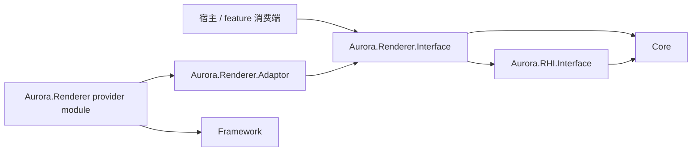
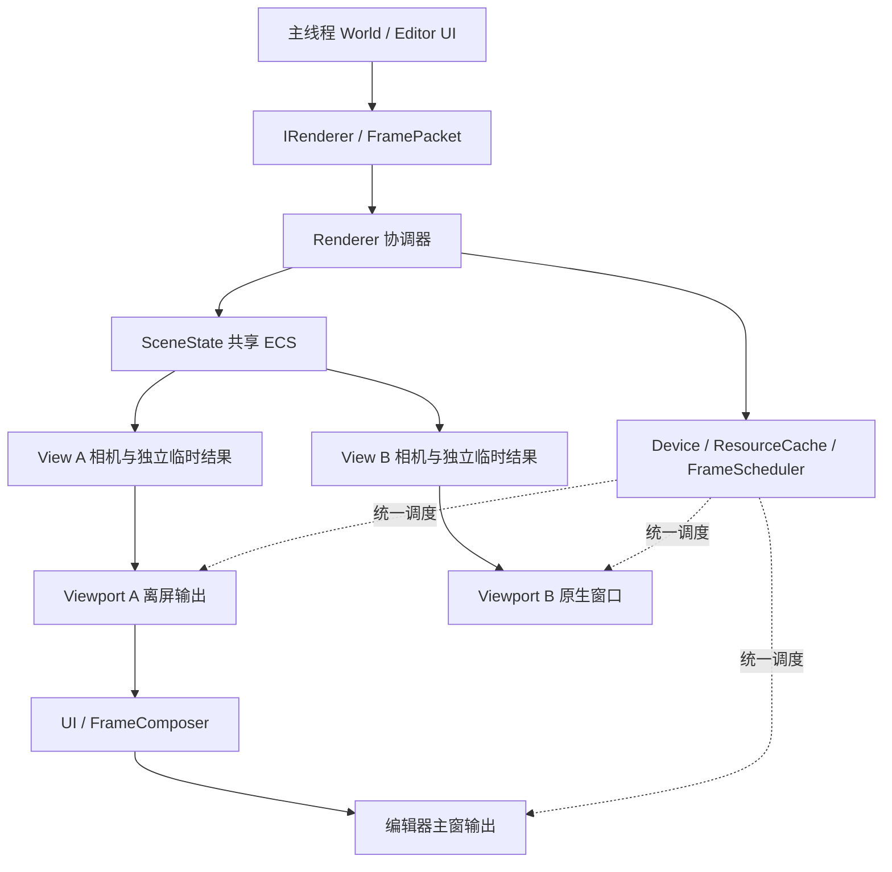
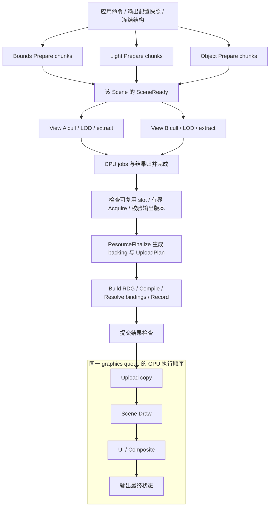
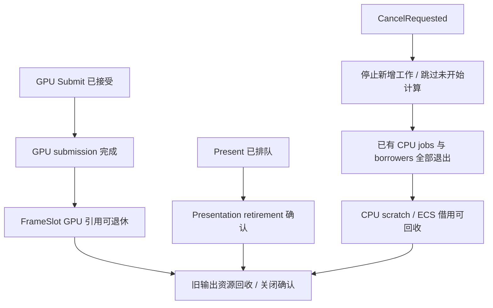

# Aurora Renderer 总体设计复审

## M0 接口与 target 实施（2026-10-14）

本批已实现可编译的公共契约和可加载的 provider 注册边界，尚未启动新的渲染循环。`IRendererProvider::Create` 对合法配置明确返回 `NOT_READY`，不分配设备、窗口或线程；非法零容量/worker/budget 返回 `INVALID_ARGUMENT`。宿主配置尚未切换。



箭头表示链接依赖。宿主以后通过 Framework 的 `Interface<IRendererProvider>` 解析服务，不链接 provider 实现。adaptor 当前只依赖公共接口；实际消费 GPU 能力时再私有链接已有 RHI/Core/Pipeline 实现。

| Review 入口 | 已落地的契约 | 运行时仍待实现 |
| --- | --- | --- |
| [IRenderer.h](D:/Code/Engine/SkyEngine/engine/aurora/renderer/include/aurora/renderer/IRenderer.h) | 创建结果、包所有权、事件、shutdown、device epoch | M1 packet FIFO/stores/thread；M2 安全关闭 |
| [RenderCommands.h](D:/Code/Engine/SkyEngine/engine/aurora/renderer/include/aurora/renderer/RenderCommands.h) / [PreparedFrameTypes.h](D:/Code/Engine/SkyEngine/engine/aurora/renderer/include/aurora/renderer/PreparedFrameTypes.h) | generation IDs、owned bytes、CPU draw/view/frame 产物、logical build inputs | M1 prepare；M4 绑定冻结和资源 pin |
| [Completion.h](D:/Code/Engine/SkyEngine/engine/core/include/core/async/Completion.h) | Pending/Succeeded/Failed/Cancelled、独立 cancel 标志、指定 executor、一次通知及订阅预算 | M1 JobGroup/订阅竞态/consumer drain；没有协程 runtime |
| [IFrameGraphCompiler.h](D:/Code/Engine/SkyEngine/engine/aurora/rhi/interface/include/aurora/rdg/IFrameGraphCompiler.h) | 每后端完整 Compile、opaque native/CPU task/GPU submission 产物 | M3 冻结 IR、图分析与各后端 native 编译 |
| [IDeviceFrameExecution.h](D:/Code/Engine/SkyEngine/engine/aurora/rhi/interface/include/aurora/rdg/IDeviceFrameExecution.h) | TryBeginSlot → Compile → Dispatch → TryCollect → Submit/PollCompleted；Cancel/Discard、身份和所有权 | M2–M5 slot、分配、提交/呈现、串并行编码 |
| [RendererModule.cpp](D:/Code/Engine/SkyEngine/plugins/aurora/runtime/RendererModule.cpp) | 跨 DLL service、重复 Init、拒绝覆盖已有 provider、只注销自身注册、tagged 静态入口 | M6 宿主依赖顺序和完整停机集成 |

`DeviceFrameContext` 已从 `RenderDeviceExclusive.h` 提取到独立头；旧头继续包含它，既有 Begin/End 实现未改变。新的能力查询默认返回 nullptr，因此编译通过不表示任何后端已经实现新协议。纯接口/数据不新增 engine → plugin 依赖。feature builder 目前是前置声明，不能据此认为 feature 注册/停用已实现。

验证：

- `Aurora.Renderer.ContractTest`：公共头独立消费和链接；生成项目确认仅链接 Core/sfmt/系统库，不带 Framework、RHI.Static 或 provider。
- `Aurora.Renderer.ModuleTest`：真实动态加载/卸载/重载后，host 能读到同一 provider；正常配置返回 NOT_READY、六种零配置被拒绝。动态测试仅链接公共接口 + Framework + gtest，不链接 adaptor/provider 实现。
- `Aurora.Renderer.StaticModuleTest`：编译相同 bootstrap 的 tagged 静态入口，验证上述行为以及重复注册、重复 Shutdown。此项验证静态注册接缝，不代表完整静态宿主打包已验收。
- CTest 三目标通过；Vulkan、DX12、RHI.Static 与旧 Aurora.Render 入口及其依赖编译通过。新增 capability 查询置于原有虚函数之后，原有方法顺序保留；仍应配套重建相关模块，不宣称任意历史二进制混用兼容。Metal 未在本机编译/运行；本批没有 GPU 新流程运行测试。
- OpenSpec strict validation 和 diff whitespace 检查通过。

可复现配置（保留原 cache 的三方路径；本批将测试从 OFF 开为 ON）：

```powershell
cmake -S . -B cmake-build-debug -D3RD_PATH=D:/Code/Engine/SkyEngine/build_3rd/Win32 -DSKY_BUILD_TEST=ON -DSKY_DEVELOP=OFF -DSKY_BUILD_SANDBOX=OFF
cmake --build cmake-build-debug --config Debug --parallel 2 --target Aurora.Renderer.ContractTest Aurora.Renderer.ModuleTest Aurora.Renderer.StaticModuleTest Aurora.Vulkan Aurora.DX12 -- /nodeReuse:false
cmake --build cmake-build-debug --config Debug --parallel 2 --target Aurora.Render -- /nodeReuse:false
ctest --test-dir cmake-build-debug -C Debug -R '^Aurora\.Renderer\.' --output-on-failure
```

构建前确认 SandboxEditor 未运行。VS 2022 实际目标平台为 x64；三方目录名沿用 Win32。沙箱内 MSBuild 两次停在启动阶段，终止后经授权改用沙箱外构建通过。

环境预检 `python python/third_party.py -p Win32 -o D:/Code/Engine/SkyEngine/build_3rd --check` **未通过**：miniaudio/enet/slang 的 metadata 与 pin 不同，vulkan_headers/nanosvg/openssl/cpython 缺 build_metadata 记录（0 output-missing）。这些是现有环境记录；本批没有重建/升级三方库，不能把本次相关目标编译通过等同于全工程依赖一致。

下面保留前期设计复审，描述中的源码现状以本节的实施增量为补充。

日期：2026-10-14。范围：当前 design/specs/tasks、Core ECS/ThreadPool、Aurora Queue/上传/viewport 接口、编辑器对接及 aurora-scene-bridge。

这是设计与源码接口的静态核对，不是运行时验证。以下 R1–R6 与图 1–3 保留初次复审快照。
2026-10-14 后续细化已将 R1–R5 的相关契约纳入 design D4b/D4c/D5a/D6a/D7、capability deltas 和 tasks；这仅表示设计采纳，不表示源码缺口或平台验证已解决。R6 scene-bridge 对齐仍待完成。
细化还确认 CopyBlit typed resolve/实际 emit、读取 producer/version 和 LOAD 内容依赖缺口，已列入 D5a 与 tasks 4.6–4.8。
FrameContext 接入继续收紧于 design D7a：复用既有后端 context 的唯一 GPU slot ring，scheduler 通过 lease 调度；CPU prepare/build arenas 独立，staging/dynamic/descriptor 不再自行轮换索引。
最新编译边界以 design D5b 为准：各后端完整 Compile，构建 native passes、EncodeTaskGraph 与 SubmissionPlan；本后端 FrameContext Dispatch/收齐后提交。原“公共串行 Execute”已退出目标设计；图 1–8 保留前次讨论快照，当前编译/编码流程见图 10–11，图 9 已同步。
总体阅读入口为 design D0 和 [图 12 主流程](review-images/12-renderer-main-flow.png)，涵盖宿主、ECS prepare、资源旁路、后端编译/编码、提交/呈现及退休。整合时已修正旧 D3 与 FramePacket spec 对“所有 GPU 操作留在 coordinator”的过宽表述；后端编码 workers 按 D5b/D7a 使用独占资源。

## 后端编译专项补充

- `RDGBackend.h` 目前只有 CompileBarriers/Execute，Vulkan/DX12/Metal 都转调公共 DeriveBarriers/ExecutePasses；尚未满足后端完整编译职责。
- GPU resource DAG 与 CPU EncodeTaskGraph 不能直接等同；实际 GPU 顺序、barriers 与任务结果组装由后端计划决定，不能按 worker 完成次序提交。
- FrameContext 现有固定 worker × slot buffer 不足以处理同 worker 多个待提交结果；需 recording ordinal/预算、独占资源以及 Metal parent/child 生命周期。
- DeviceFrameDispatcher 尚无 coordinator affinity 与失败收齐协议；DX12 EnsureFrameCopy 会修改共享 RG 的 mDirty/mCopiedFrame，开启并行编码前需冻结或同步该写入。
- 编译与 dispatch 均不等于 GPU 就绪：加载得到 CPU payload，上传形成图内 copy，Accepted 后 UploadSubmitted，真实完成后 Resident。实现与三后端验证仍未完成。

详见 [后端编译流程](D:/Code/Engine/SkyEngine/openspec/changes/aurora-renderer/design.md:438)、[后端与 FrameContext 配图](review-images/10-backend-compile.png)、[CPU/GPU 两张图](review-images/11-encode-task-graph.png)。

## 结论

主体方向可保留：Scene / View / Viewport 分离、renderer 统一设备与调度、CPU prepare DAG 与 GPU RDG 分开、组件访问依赖驱动并行、协程留作编排适配。

当前适合开展 CPU 计划编译和最小调度 prototype；开始完整 GPU/宿主接入前，应先关闭 R1–R4 四个契约缺口。R5–R6 是接入口和跨 change 一致性问题。

| 编号 | 优先级 | 结论 |
| --- | --- | --- |
| R1 | P1 | 提交失败的设计要求缺少可观察的 RHI 结果 |
| R2 | P1 | ResourceFinalize 到 GPU 首次使用的上传同步尚未闭合 |
| R3 | P1 | JobGroup 的逻辑结果与可回收条件需要分开定义 |
| R4 | P1 | 统一 coordinator 的等待策略没有保证关闭/控制流程进展 |
| R5 | P2 | UI/frame feature 的注册和逻辑纹理引用接口未固定 |
| R6 | P2 | aurora-scene-bridge 的直接 ECS 写入描述与新线程模型冲突 |

## R1 — 提交失败无法可靠反馈给 FrameScheduler

**证据。** [design D7](D:/Code/Engine/SkyEngine/openspec/changes/aurora-renderer/design.md:595) 要求提交失败后进入错误处理，不等待永远无法完成的 fence。
但 [Queue::Submit](D:/Code/Engine/SkyEngine/engine/aurora/rhi/interface/include/aurora/rhi/Queue.h:21) 返回 void；[VulkanQueue](D:/Code/Engine/SkyEngine/engine/aurora/rhi/vulkan/src/VulkanQueue.cpp:76) 仅记录 vkQueueSubmit2 错误，没有把结果反馈给 scheduler。

**触发与影响。** Reset fence 后底层提交失败，上层仍可能将 slot 记为 Submitted，下一次复用等待一个未被有效提交 signal 的 fence。现有接口不足以实现设计中的恢复要求。

**建议。** 将最小 RHI 状态协议纳入本 change：提交接受结果、设备丢失状态以及完成查询错误。Accepted 只表示接受提交，不代表 GPU 完成；未确认是否已提交的错误不能直接释放潜在在途资源。FrameScheduler 明确失败 slot 的退出路径。应补 aurora-rhi-core delta，不能只在 renderer 内捕获日志。

**验收。** 用故障注入覆盖立即拒绝、提交后 device lost、失败时仍有其它在途 slot；不发生无限 fence 等待或提前释放。

## R2 — 上传调用返回不等于 GPU 资源可绘制

**证据。** [D4a](D:/Code/Engine/SkyEngine/openspec/changes/aurora-renderer/design.md:196) 将创建/上传归于 ResourceFinalize，之后建图绘制；[D5](D:/Code/Engine/SkyEngine/openspec/changes/aurora-renderer/design.md:348) 约定首版单 graphics queue。
现有 [StaticBuffer::Upload](D:/Code/Engine/SkyEngine/engine/aurora/core/include/aurora/resource/Buffer.h:72) 优先选择 TRANSFER queue，返回异步 handle；[Queue 契约](D:/Code/Engine/SkyEngine/engine/aurora/rhi/interface/include/aurora/rhi/Queue.h:25) 明确调用方在消费前负责同步。现有设计提及资源就绪，但未规定本帧新上传从 Pending 变成可绘制的条件。

**触发与影响。** 新网格在 ResourceFinalize 调用 Upload 后立即被加入 graphics DrawItem，可能早于 copy 完成；若两队列属于不同 family，还需要相应 ownership 交接。CPU prepare 完成、buffer 对象非空均不能证明数据就绪。

**建议。** 最小闭环采用当帧 inline upload：ResourceFinalize 创建 backing 并产出 UploadPlan，RDG copy pass 声明 staging read / target write，draw pass 声明对应消费，由同一 graphics queue 保序和推导 barrier。可复用 [FrameStagingBuffer](D:/Code/Engine/SkyEngine/engine/aurora/core/include/aurora/resource/FrameStagingBuffer.h)，不直接把 StaticBuffer 的异步 Upload 当成同步创建。

既有异步资产上传可保留，但必须定义 ResourceReady = 上传完成 + 布局/必要 ownership 交接就绪，并携带资源 revision；未就绪继续跳过/占位。若保留 transfer 路径作为本 change 默认，则需要补跨队列 completion/资源状态协议及相关 capability delta。

**验收。** 延迟 copy 完成，证明 draw 不提前消费；覆盖首次上传、CPU 源数据释放、资源 revision 替换和提交失败。

## R3 — 取消结果与任务全部退出不是同一个条件

**证据。** 复审时 [D4b](D:/Code/Engine/SkyEngine/openspec/changes/aurora-renderer/design.md:281) 已指出取消不代表 jobs 已退休，但当时只定义 Pending/Succeeded/Failed/Cancelled 及一个完成令牌；后续设计已补独立请求标志和 drain/lease 条件。
[Prepare 完成 spec](D:/Code/Engine/SkyEngine/openspec/changes/aurora-renderer/specs/aurora-renderer/spec.md:75) 同时要求按该令牌恢复控制流并保活运行中 jobs，尚未给出独立的 drain/lease 完成条件。

**触发与影响。** 某个 chunk 仍写 Bounds 时，取消路径先发布 Cancelled；如果 coordinator 把令牌就绪当成可以应用下一 packet 或销毁 Scene，仍会出现写入重叠或悬垂引用。文字上的保活要求需要落实为不可误用的状态协议。

**建议。** 首版最小做法是将 CancelRequested 保持为请求标记，JobGroup 的最终结果只在全部 kernels 退出后发布；需要提前回执时使用独立 CancelAck。CPU lease 还需覆盖引用结果的 consumers/continuations。GPU slot 和 presentation retirement 继续单独管理，不复用同一布尔 completed。

**验收。** 人为阻塞一个 chunk，同时取消、关闭 Scene 并提交下一 packet；只有相关 CPU borrowers 退出后才可修改或释放 ECS/arena，且通知只交付一次。

## R4 — 队头等待可能阻断其它输出和关闭请求

**证据。** 复审时 [D7](D:/Code/Engine/SkyEngine/openspec/changes/aurora-renderer/design.md:595) 在 prepare 前获取 slot 和 outputs；后续设计已调整该顺序。现有 [ClientViewport::Acquire](D:/Code/Engine/SkyEngine/engine/aurora/rhi/interface/src/rdg/ClientViewport.cpp:78) 仍使用 UINT64_MAX。平台暂停、超时、关闭协议仍需 probe。

**触发与影响。** coordinator 在一个窗口 acquire 或 slot 等待上长期阻塞，另一个窗口、离屏结果以及排队的关闭命令均不能继续推进。这里要求的是控制流可退出，并非首版必须支持各窗口独立刷新率。

**建议。** 固定“等待期间继续处理控制状态”的协议：窗口 closing intent 可先阻止新 acquire，ECS destroy 仍等安全边界有序应用；帧 slot/设备完成查询使用可退出的等待策略。输出 preflight 先确定配置快照，CPU prepare 后再做有界 acquire；若 extent/generation 改变，重做受影响 View 或跳过该输出，不把旧 ViewContext 用到新图像。

若具体平台 API 无法满足有界等待，需要先确认它支持的调度/暂停方案，再宣称该平台的多 viewport 生命周期已通过。不能仅改变调用位置来声称解决了阻塞。

**验收。** 一个输出长期不就绪、另一个持续可用，同时请求关闭/shutdown；其余工作与控制流程按约定继续，关闭确认仍等待真实退休，不能用 timeout 冒充 GPU 完成。

## R5 — UI 扩展与逻辑输出引用应成为明确接口

**证据。** 复审时 [D9](D:/Code/Engine/SkyEngine/openspec/changes/aurora-renderer/design.md:705) 列出了 IScenePrepareFeature，而 GPU/frame extension 仅文字说明；[D10](D:/Code/Engine/SkyEngine/openspec/changes/aurora-renderer/design.md:741) 要求 UI snapshot 经扩展加入 FrameComposer。后续 D5a 已补 frame feature 和逻辑引用契约，具体 ABI 与实现仍待完成。
现有 [UIRenderer::RegisterImage](D:/Code/Engine/SkyEngine/engine/ui/render/include/ui/render/UIRenderer.h:87) 接收 Image*，不能直接作为跨主线程、跨 resize 的 UI 快照资源身份。

**建议。** 在消费方 engine 接口侧固定 frame feature 的注册、建图、停用/退休契约；UI 提供方 adaptor 实现它。主线程快照引用 logical texture/ViewOutput ID + generation/revision，渲染端解析为当前 RDG handle，并保留解析后的资源 lease。不要把裸 Image*、本帧 RDG handle 或 EditorShell 回调放进长期快照。

**验收。** 生成 UI 快照后立即 resize/关闭对应 View；过期引用有明确跳过/占位行为，图像与扩展代码不会提前释放，Renderer 不依赖 EditorShell。

## R6 — 同步 scene-bridge 的设计入口

**证据。** 新设计要求桥接只向 IRenderer 发命令；已有 [scene-bridge D1](D:/Code/Engine/SkyEngine/openspec/changes/aurora-scene-bridge/design.md:25) 与 [tasks 1.1](D:/Code/Engine/SkyEngine/openspec/changes/aurora-scene-bridge/tasks.md:3) 仍按旧 adaptor 直接创建/写 ECS 条目和依赖 aurora scene。

**建议。** 在开始 bridge 实现前，将依赖、同步点和执行位置改为主线程 proxy → FramePacket → render coordinator 应用；采用符合根 AGENTS 的 provider plugin 路径。只对齐设计，不把完整组件覆盖扩大到 renderer change。

**验收。** 从 bridge 依赖/头文件中看不到具体 RendererImpl 或可变 RenderScene；attach/detach 与资产迟到测试验证命令最终状态。

## 图 1 — 建议保留的主体关系

此图表示对象与数据关系，不表示 CPU/GPU 的时间顺序。一个 Scene 可以服务多个 View；输出按 View 请求组织，设备和资源缓存由 Renderer 统一管理。



UI 数据仍经 FramePacket 进入渲染端；ScenePrepareFeature 与 FrameGraphFeature 接口分开。图中的扩展接口需按 R5 进一步固定。

## 图 2 — 建议的单帧阶段

包含 R2 的 inline upload 与 R4 的输出获取调整；该顺序在后续细化中已纳入 design D6a/D7，实施尚未完成。各 Scene 的 SceneReady 独立，单 Scene 的 View 等自己的 prepare 完成即可。



CPU private scratch 先用于 prepare；GPU FrameSlot 的 UBO、descriptor、staging 在 slot 可复用后分配。coordinator 在等待期间仍处理控制事件，但不越过冻结边界修改 ECS。
CPU deps DAG 与 GPU RDG 分别负责对应执行域；协程以后可包装阶段完成令牌，首版不进入 kernel。

## 图 3 — 取消、CPU 回收、GPU 回收与窗口退休

三个回收条件分别证明自己的执行域不再使用资源。取消请求不直接连接到任何内存回收节点；GPU fence 不作为 presentation completion 的替代证明。



Window 节点还要求停止新 acquire、对应输出已脱离待录制图与快照；图不暗示每次回收 frame slot 都必须等待所有窗口的 presentation 完成。

## 实施顺序建议

1. 先补 R1–R4 的接口/状态机与验收场景，明确 R5 接口并对齐 R6。
2. 做不依赖 GPU 的 ECS deps/结构冻结/受限视图 prototype，用串行参考结果校验并行。
3. 做单窗口＋离屏的真实 indexed draw，先把 inline upload、bindings 和 slot lease 跑通。
4. 扩展同 Scene 双 View、第二 Scene、UI 合成及关闭/resize/失败注入。
5. 在观察到明确的异步编排需求后，再决定协程 runtime 的独立范围。

任务并行数、chunk 阈值、独立刷新率和 GPU 多队列属于后续性能决策。当前评审不提供没有 profiling 支持的性能数字。
