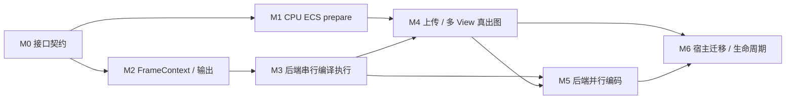

## 执行顺序与交付里程碑

本 change 按 7 个可验收里程碑推进；下方 1–8 节保留稳定任务编号，作为实施 checklist。里程碑表示集成顺序，不要求一个里程碑对应一次大提交，也不代表已经实施。跨阶段任务只有全部内容及对应验收完成后才勾选。

主流程入口是 design D0；所有后端从第一次接入就实现完整 Compile -> FrameContext Dispatch -> Submit。串行模式用于建立正确性基线，并行编码仍是本 change 的交付内容。

| 里程碑 | 具体交付 | 依赖 | 对应任务 | 通过条件 |
| --- | --- | --- | --- | --- |
| M0 接口与数据契约 | IRenderer/IDs/FramePacket、阶段产物、FrameContext lease/Compile/Dispatch/结果、ResourcePayload；engine 接口与 provider targets | 无 | 1.1–1.4；3.13/3.16、4.8/4.9/4.12、8.1 的接口部分 | 数据所有权、线程归属、失败结果和后端扩展点可编译且一致；实现 target 不反向进入 engine 接口 |
| M1 CPU 场景到 PreparedFrame | packet FIFO、Scene/View stores、增量 ECS、通用读写依赖、受限视图、prepare/chunk/merge、取消与 drain | M0 | 2.1；3.1/3.2、3.6–3.15、3.19 的 CPU 部分；7.1、7.7–7.10 | 不依赖真实 GPU，证明同 Scene 两 View 结果正确、串并行一致；删除/迟到/队列满/失败不产生悬空借用 |
| M2 FrameContext 与输出生命周期 | 唯一 slot ring、显式 allocator 分区、提交/完成错误协议、borrowed output、acquire/present/close 责任 | M0 | 2.3–2.5；3.3–3.5、3.16–3.19 的基础实现；7.4/7.12/7.15 的基础场景 | 两个以上 GPU 在途槽位安全；空帧、输出失败、拒绝提交与关闭不误复用、不无限等不存在的提交；直接 RHI probe 只用于本阶段验证 |
| M3 后端编译与串行参考路径 | FrozenFrameGraph/纯语义 helpers；每个后端自行构建 native passes、资源/同步/任务计划；FrameContext 串行 Dispatch | M0、M2；纯分析可提前开发 | 2.2；4.3–4.8、4.10–4.12；4.13–4.16 的串行路径；7.2/7.13 的语义部分 | synthetic graph 完成实际 copy/draw/readback；中间读取、UI LOAD、剔除、alias 与最终状态正确；不转回公共 ExecutePasses 控制后端 |
| M4 资源上传与多 View 真出图 | ticket/版本/预算、staging/typed copy、InGraph/Resident；ScenePipeline/FrameComposer、真实 PSO/DrawItem、两相机与输出 | M1、M2、M3；资源请求逻辑可从 M0 后并行开发 | 4.1/4.2/4.9；5.1–5.4；8.1–8.6；7.3/7.11/7.12 | 在最小测试宿主中完成程序化网格首次上传后绘制、双 View/不同尺寸、离屏合成、无窗口 upload-only、热更新与预算延后 |
| M5 各后端并行编码 | Vulkan secondary/primary；DX12 DIRECT lists；Metal parallel parent/children；worker recording ordinal、coordinator 续接与失败收齐 | 开发依赖对应后端 M3，集成验收使用 M4 基线 | 3.18/3.19；4.3 的共享写入审计、4.12–4.16；7.13–7.15 | 至少两个编码 worker 的真实并发与 readback 等价；任务多于 worker、乱序完成、两帧在途和部分失败均安全；单 worker 同协议可运行 |
| M6 宿主迁移与完整生命周期验收 | 游戏 façade、编辑器 UI snapshot/feature、模块生命周期、resize/close/shutdown、平台记录、旧入口清理 | M4；平台切换/旧入口删除还需该平台 M5 及生命周期验收 | 6.1–6.5；7.4–7.6；其余集成验收收口 | 游戏/编辑器分别仅一个活动 Renderer/Device；无 shell 跨线程回调；关闭与资源退休正确；未通过平台明确保持未迁移，不宣称完成 |

图表示验收依赖。具体后端分别推进 `M2 -> M3 -> M5`，不用等待其它后端全部完成才验证自己；同一场景/图用例和预期结果共享。本机先完成 Vulkan/DX12 验证；Metal 的编译、并行编码和 drawable 生命周期需要 Mac 验证记录，不能把 Windows 上无法运行的任务勾选完成。

## 工作线与协作边界

接口契约固定后，可并行开展下列工作线；这是代码责任划分，不表示已启动额外 agent 或 chat。

| 工作线 | 可以独立推进的内容 | 与其它工作线的交接 |
| --- | --- | --- |
| CPU scene / ECS | M1；冻结输入、通用依赖与 prepare | 输出 PreparedFrame/资源意图，不持 native GPU 对象 |
| RHI frame / output | M2；后端 slot、allocator、Submit/完成、输出退休 | 提供 lease、错误/完成与输出协议；不复制 Renderer 场景状态 |
| Graph / backend | 公共 IR/纯分析由单一负责人维护，Vulkan/DX12/Metal 分别实现 native Compile/Dispatch | 公共层交付 FrozenFrameGraph；后端交付 opaque plan/RecordedFrame，不能同时改出多套公共 ABI |
| Resources / pipeline | M4 的请求、预算、版本与 logical passes，可先用模拟 completion 验证状态机 | 交付 UploadBatch/binding intents，消费实际 receipts/completion；不直接 Queue Submit |
| Host integration | M0 后准备游戏 façade/UI owned snapshot，M4 后集成 | 只经 IRenderer/feature 接口；旧入口切换由 M6 统一收口 |

公共头文件、Core dispatcher 完成协议和图 IR 采用一次契约变更、同步更新所有消费者的方式协调；各后端实现目录可独立推进。M1 的 prepare executor 与 M5 的 encode executor 复用同一已验证的批次机制，但分别持 pool、dispatcher instance 和生命周期。

## 单个实施批次的粒度

每个批次完成一个可验证的行为及其错误路径，包含对应接口/实现、必要测试和当前 change 的 spec/tasks 更新。避免只有类声明的连续空壳批次，也避免将三个完整后端压进一次不可审阅的大改动。

建议第一批实现 M0 的核心类型/target 边界，再并行推进以下小批次：

1. CPU 线：实体删除/generation -> 有界 packet 与 stores -> 纯访问依赖/串行结果 -> 冻结视图与并行 chunks -> 取消/drain。
2. Frame 线：提交结果与完成错误 -> slot lease/安全 reset -> staging/UBO/descriptor 显式分区 -> 输出 acquire/呈现退休。
3. RDG 线：冻结 IR/版本化读写 -> roots/剔除/hazard helpers -> 某一后端 native pass/同步 -> 同后端串行 Dispatch 与真实 copy/readback；其余后端按同契约接入。
4. 真出图线：资源 ticket/预算/精确版本 -> 单 View 上传绘制 -> 双 View/离屏到 UI -> 各后端并行 encode 等价验证 -> 宿主切换。

每批次的说明必须列出依赖、触及模块、验收场景和未支持平台；验收就在相应里程碑完成，不统一推迟到第 7 节最后执行。commit 前仍需按根 AGENTS 展示 message 与文件清单并取得用户明确确认；不自动提交或 archive，不将同一 change 的 spec 单独拆成 docs 提交。

## Change 范围

以上仍由一个 `aurora-renderer` change 承载。完整 World/Actor 提取归已有 `aurora-scene-bridge`；完整材质产品链、feature 渲染、细粒度 streaming、async compute/专用 transfer queue 和协程 runtime 保持既有后续范围，不为当前每个类或阶段创建新 change。若后续需要独立交付某项基础设施，应先给出可独立验收的边界与 spec 归属，再调整 change 划分。

## 1. 接口与模块边界

- [x] 1.1 定义 IRenderer、Scene/Entity/View/Viewport IDs、描述与完成事件；明确 generation 和回收策略
- [x] 1.2 定义 FramePacket 的所有权、FIFO、Busy/backpressure、Init/Destroy/Shutdown 结果协议
- [x] 1.3 建立 engine 接口 target、plugin adaptor 实现与 provider module；检查无 engine -> plugin 链接及静态模块注册兼容
- [x] 1.4 校准本机 3RD_PATH、SKY_DEVELOP、SKY_BUILD_TEST、SKY_BUILD_SANDBOX；记录可复现配置

M0（2026-10-14）已落地上述契约及阶段/后端执行/Completion 接缝，验证记录见 review 的「M0 接口与 target 实施」。3.13、3.16、4.8、4.9、4.12、8.1 仅接口部分完成，完整任务仍保持未勾选。provider 当前明确返回 NOT_READY；没有已运行的 Renderer、prepare scheduler 或新 GPU 帧协议。FrozenFrameGraph IR、PreparePlanBuilder/FrameGraphBuildContext 操作、slot allocator 分区和 feature 注册/退休实现仍按对应 M1–M4 任务交付。

## 2. 既有正确性前置项

- [ ] 2.1 修复 EntityRegistry 删除清池；覆盖 View 不再访问旧 entity、generation 复用和迟到更新
- [ ] 2.2 修正 RDG executor 的 PSO/RG 顺序与布局切换重绑；覆盖 DX12 和 Vulkan 真正的 descriptor 使用
- [ ] 2.3 重构 frame fence 状态；覆盖零输出、全部 acquire 失败、恢复和提交失败
- [ ] 2.4 分离 acquire/present 同步资源复用规则，定义 resize/close 的 presentation retirement
- [ ] 2.5 为 RHI Submit/完成查询补可观察的 Accepted/Rejected/Error 协议；故障注入验证 reset 后拒绝与 device lost 不无限等 fence

## 3. Renderer 主体

- [ ] 3.1 实现主线程 writer、有界 packet 通道、渲染线程、错误事件和有序 shutdown
- [ ] 3.2 实现 SceneStore/ViewStore/ViewportStore 与 generation 校验；保证每帧 scene 更新一次
- [ ] 3.3 FrameScheduler 接入现有 DeviceFrameContext 的唯一 GPU slot ring；显式 lease 统一 command/UBO/descriptor/staging 与 GPU 引用退休，不另建宿主 command ring
- [ ] 3.4 将 acquire 移到调度器；RDG 导入 borrowed output，重复 Compile 不获取第二张图像
- [ ] 3.5 实现窗口/离屏输出、单输出失败隔离、已 acquire 后失败收尾和窗口销毁确认
- [ ] 3.6 定义 Core 通用 AccessDesc/SystemDesc/DependencyPlan；覆盖 owner/type/resource identity、Read/Write 和 phase/Before/After
- [ ] 3.7 实现纯依赖编译与串行参考执行器，验证 RAW/WAR/WAW、稳定顺序、重复声明、环和诊断
- [ ] 3.8 增加冻结前 preflight、预绑定 const/受限 write views；禁止 worker 触发池懒创建或结构变更
- [ ] 3.9 实现 provider ScenePrepareScheduler/JobGroup，优先适配现有 DeviceFrameDispatcher 到专用 ThreadPool；补异常收齐并验证节点预算与空图/单 worker/大 fan-out 进展性
- [ ] 3.10 实现 element-wise 分块、任务私有 scratch、稳定 merge 与 deferred structural commands；下游等待完整 system
- [ ] 3.11 注册 Bounds/Light/Object 等 CPU prepare 及只读 View cull/LOD/extract；join 后在 coordinator 完成 GPU ResourceFinalize 与建图
- [ ] 3.12 覆盖失败捕获、下游跳过、Scene 暂停/重建，以及下一 packet、销毁、arena reset、模块卸载前的 job join
- [ ] 3.13 固定 CompletionToken/JobGroup 状态、结果发布、订阅竞态和指定 executor 的 continuation；保持 kernel 不挂起，不实现协程 runtime
- [ ] 3.14 实现持久 ECS 增量构建、输入/派生版本 stamp、冻结资源绑定快照与只含 CPU 数据的 draw packets；验证旧 mesh 回退与 bounds 一致
- [ ] 3.15 分离 CancelRequested、kernels drain 与结果 consumer leases，覆盖取消后下一 packet、Scene destroy 和 arena reset
- [ ] 3.16 独立 DeviceFrameContext 领域头文件，提供 TryBeginSlot/分配/Compile/Dispatch/TryCollect/Submit/Discard/PollCompleted；校验 backend/context/slot generation/device epoch，宿主不直接驱动 RDG command buffers
- [ ] 3.17 统一 staging/DynamicBuffer/descriptor ring 的显式 slot 分区与容量检查；消除 renderer 路径 AdvanceFrame/Reset 自增，验证任意空帧/输出跳帧/upload-only
- [ ] 3.18 按 slot × worker × recording ordinal 建立安全 command 资源与预算；验证任务多于 worker 时不覆盖待提交结果，两帧在途不互相 reset；Metal child 按 parent 管理
- [ ] 3.19 分离 CpuPrepareFrame/GraphBuildArena 与 GPU slot 资源；验证非平凡对象析构、record borrowers 及 GPU 引用移交后再 reset

## 4. RDG 与 Pipeline

- [ ] 4.1 实现显式 ViewRenderContext，迁移 Scene/Opaque/Fullscreen pass；逐 View 保存可变状态
- [ ] 4.2 实现逐 pass set 0、逐 view/slot 常量；填完整 projection/camera position
- [ ] 4.3 实现后端 Compile 的 descriptor resolve 或显式前置任务，发布不可变 bindings；审计 DX12 EnsureFrameCopy 等 bind 时共享写入，确保 RG 引用资源有显式 Read/Write
- [ ] 4.4 实现 transient pool frame leases 与导入资源状态；覆盖跨帧保活、同帧物理复用及重复导入
- [ ] 4.5 验证多 writer/read 的图依赖、失效输出剔除、真实输出 extent 与错误上报
- [ ] 4.6 实现 content version/producer、ReadWrite/WriteDiscard 与明确 roots；先内容剔除再推导存活 hazard/lifetime，覆盖中间读与 UI LOAD
- [ ] 4.7 闭合 CopyBlit 的 typed source/destination、owned regions、buffer copy/buffer-to-image emit 和对齐检查；其它 kind 不得静默无操作
- [ ] 4.8 实现 PreparedFrame/FrameBuildInputs/FrozenFrameGraph/BackendCompiledFrame/RecordedFrame/SubmissionRecord 接缝；资源账本仅在 Accepted 推进，失败编译/录制不发布成功
- [ ] 4.9 定义并实现消费方 frame feature 注册/建图/停用/退休接口及 UI 逻辑纹理解析；覆盖过期 generation 和 module unload
- [ ] 4.10 将 RDGBackend 的 barrier/Execute hook 升级为完整 Compile；公共图仅保留声明/Freeze 与可复用纯分析，context 持匹配 compiler，移除新路径对公共 Compile/ExecutePasses 流程的依赖
- [ ] 4.11 定义 native pass/scope 与 logical pass 映射；后端分别决定合并/拆分、GPU 顺序、lifetime/backing/同步，顺序变化后重新验证 alias
- [ ] 4.12 分离 EncodeTaskGraph 和 SubmissionPlan，稳定 result index、CPU edges、Worker/Coordinator executor 约束与 opaque plan 单次消费；Custom 默认串行
- [ ] 4.13 实现 Vulkan 编译/dispatch：dynamic rendering inheritance、secondary chunk 录制、primary 同步与稳定组装；parallelNum=1 走同协议参考路径
- [ ] 4.14 实现 DX12 编译/dispatch：独占 DIRECT list/allocator、pass 操作与资源状态、收齐后的列表顺序；验证拆分不重复 clear、不丢 LOAD/resolve
- [ ] 4.15 实现 Metal 编译/dispatch：native scope 描述、parallel parent/有序 children 生命周期、autorelease/强持有；不支持并行的 scope 明确安全回退，需 Mac 平台验证
- [ ] 4.16 在各后端 FrameContext 适配 DeviceFrameDispatcher worker 子批次与 coordinator continuations；覆盖空图、单 worker、有界 fan-out、异常/取消 drain 和无 worker 阻塞等待

## 5. 最小出图

- [ ] 5.1 实现程序化 indexed mesh 和简单 Slang VS/FS，通过 owned packet 提交与上传
- [ ] 5.2 接入最小 ShaderResolver/PSO cache，key 覆盖 program/layout/vertex/state/attachment
- [ ] 5.3 实现 worker 的 CPU draw packets 提取与 coordinator 的 DrawItem 组装；覆盖裁剪、tag、排序和实际 vertex streams/index type
- [ ] 5.4 验证同 Scene 两相机、不同尺寸窗口/离屏输出、第二 Scene 和连续变换/删除

## 6. 宿主对接

- [ ] 6.1 AuroraModule 通过 IRenderer 转发，新增 RenderSceneProxy 生命周期 seam；不提前实现全部组件桥接
- [ ] 6.2 编辑器生成拥有数据的 UI snapshot，通过渲染端扩展合成离屏图像；移除直接调用 shell 的渲染线程路径
- [ ] 6.3 更新模块加载/卸载依赖，验证游戏和编辑器分别只创建一个 Renderer/Device
- [ ] 6.4 在平台 probe 中确定 Metal 线程和 drawable 协议；未通过时明确保持未迁移状态
- [ ] 6.5 迁移后删除空 Renderer/RenderDeviceExclusive 编排入口，同步 Aurora AGENTS 的旧生命周期说明

## 7. 验收

- [ ] 7.1 CPU 测试覆盖 packet 顺序、generation、队列满、Scene/View 删除与异常退出
- [ ] 7.2 RDG 测试覆盖双 view 常量、PSO/RG 顺序、资源保活、离屏到合成依赖；不能只检查 Compile 结构
- [ ] 7.3 Vulkan/DX12 真出图 smoke/readback 覆盖两个相机、两个以上 inflight slot、不同 attachment format
- [ ] 7.4 生命周期测试覆盖最小化单窗/全部窗口、恢复、resize、close、资产迟到和 device/surface 错误
- [ ] 7.5 按根 AGENTS 关闭编辑器后配置并构建相关 targets；运行相关测试和有界宿主验收，记录各平台结果
- [ ] 7.6 更新设计中的未决平台结论并执行 openspec validate aurora-renderer --strict --no-interactive
- [ ] 7.7 CPU 依赖测试覆盖同类型不同 Scene、跨 View 只读、共享资源别名、保守 query 冲突、结构冻结和声明越权
- [ ] 7.8 对照串行与并行 prepare 的 bounds/lights/visibility/LOD/draw 输出；打乱 job 完成顺序并记录浮点容差与稳定排序策略
- [ ] 7.9 用至少两个 worker 和受控同步验证无依赖 system/chunks 可并发；通过代表性 scene profiling 确定分块阈值和任务预算，记录 prepare/同步开销
- [ ] 7.10 验证完成前后订阅、取消/完成竞争、coordinator 恢复线程与 shutdown 期间保活；确认资源未就绪不阻塞整个 SceneReady
- [ ] 7.11 验证同图首次上传后真实 draw/readback、无窗口 upload-only、预算延后、取消共享 ticket、热更新与过期 device epoch
- [ ] 7.12 验证慢/不可用输出期间控制流继续，prepare 后 resize 不沿用旧 ViewContext；记录后端可退出等待与呈现退休限制
- [ ] 7.13 对三个后端执行相同内容/剔除语义用例，并对串行/并行 dispatch 做实际 readback 对照；记录未验证的平台，不以公共 fallback 代替后端实现
- [ ] 7.14 打乱编码任务完成顺序，验证 GPU copy→draw→UI 同步、透明片段稳定组装、task 数大于 worker、同 slot 多结果和两帧在途
- [ ] 7.15 故障注入 Compile/dispatch 部分失败、错误 context/epoch/slot、重复 Dispatch/Submit 与取消；确保 drain 前不 reset、失败不发布上传、coordinator-only 节点线程正确

## 8. 资源请求、上传与退休

- [ ] 8.1 定义 owned RenderResourcePayload、ResourceKey/Ticket/Subscriber/VersionLease；以程序化数据验证，不引入 Renderer 对 AssetManager 的依赖
- [ ] 8.2 实现共享请求去重、generation/bindingRevision/device epoch 校验、取消订阅与错误/重试结果
- [ ] 8.3 实现 CpuReady/UploadQueued/UploadSubmitted/Resident 状态与 graph-local InGraph resolve；不把 create 成功或 Submit Accepted 当成 Resident
- [ ] 8.4 实现 slot-owned staging、UploadBatch 的字节/创建数量/在途预算及显式持久上传 roots，支持 upload-only submission
- [ ] 8.5 实现实际录制 receipts、提交接受后的状态登记、完成后的 Resident 发布和源 bytes/staging/GPU leases 分阶段释放
- [ ] 8.6 实现精确版本 pins、冻结前旧版本选择与延迟释放；验证新版本失败不覆写旧在途 descriptor/mesh，未匹配状态的 legacy transfer 资源不得直接使用
