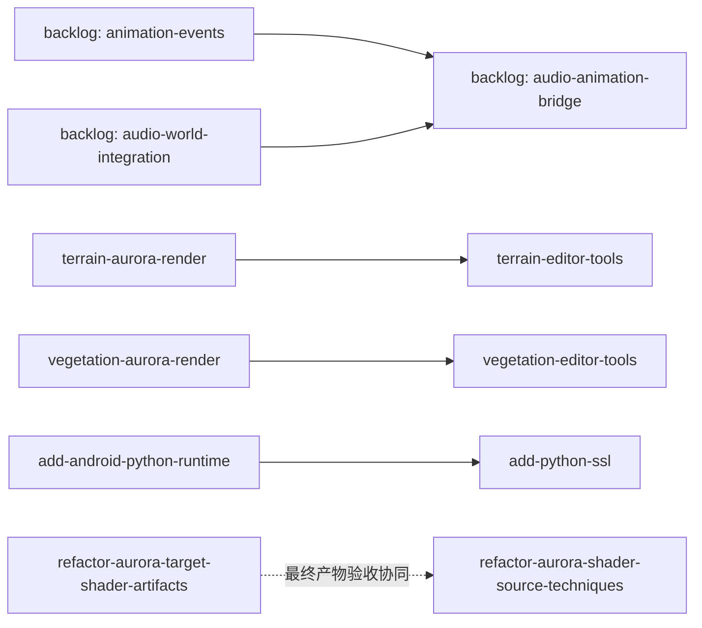

# 当前整合快照 — 2026-11-01

本轮以最新 `52fbcb3a` 为基线，176 份主 spec 先保留全部 1,327 条需求并合并为 32 个领域。经用户明确确认，24 项已交付/已替代 change 已按选择性同步计划归档，4 份未展开草案移入 backlog。归档整理结束时为 **27 个活跃目录、4 份 backlog 草案、32 个领域、1,390 条主需求**。原 1,183 个历史归档文件不改写。

## 当前逐项状态

`active` 表示仍有明确工作，`blocked-on-prereq` 指向真实前置，`planned` 为待设计/实施；冻结与债务不进入执行清单。`ready-to-archive` 只表示 review readiness，不授权归档。下表保留整理后的归属；2026-11-02 新增 Apple 适配修复后当前目录数为 28。

| Change | 状态 | 已勾/总任务 | 当前 owner | 实际剩余/边界 |
| --- | --- | ---: | --- | --- |
| [fix-apple-platform-parity](../fix-apple-platform-parity/tasks.md) | active | 21/23 | fix-apple-platform-parity | Apple 架构/导出、Cocoa 与 UIKit 原生输入、签名资源布局修复；最终模拟器与 Windows 共享构建回归待补，实测逐项在该 change 记录。 |
| [add-android-python-runtime](../add-android-python-runtime/tasks.md) | active | 14/20 | add-android-python-runtime | 修复 CPython frozen/getpath 生成头；完成 Gradle 模块/stdlib 打包及设备 import/反射验证。 |
| [add-common-async-io](../add-common-async-io/tasks.md) | active | 4/43 | add-common-async-io | 详细方案待 review；通用 IO 调度、chunk product 和发布实现尚未开始。 |
| [add-harmonyos-platform](../add-harmonyos-platform/tasks.md) | active | 43/64 | add-harmonyos-platform | 保留 HAP 依赖闭包、真实 GPU/输入/长期稳定性矩阵、CPython 构建缺口；3.10 同时承接 UIKit input/scene-host 专项。 |
| [add-network-prediction](../add-network-prediction/tasks.md) | planned | 0/15 | add-network-prediction | 复制基础已交付；输入序列、预测、重放/平滑及端到端矩阵尚未实施。 |
| [add-physics-collider-authoring](../add-physics-collider-authoring/tasks.md) | active | 28/50 | add-physics-collider-authoring | 制作配方/fingerprint、离线拟合、独立文档与预览、空间需求及 Terrain 碰撞矩阵仍待完成。 |
| [add-python-ssl](../add-python-ssl/tasks.md) | active | 15/18 | add-python-ssl | Android runtime/SSL/hashlib 打包与 import、真实 HTTPS/CA 链及 builtins 注册确认。 |
| [add-skeletal-animation-workflow](../add-skeletal-animation-workflow/tasks.md) | active | 49/74 | add-skeletal-animation-workflow | fixture/CPU oracle、GPU palette/readback/bounds、World/Graph/Preview 接线与资源退休等验收仍开放；已有 target/入口不重复列为待实现。 |
| [aurora-metal-bindless-descriptor-heap](../aurora-metal-bindless-descriptor-heap/tasks.md) | debt-record | 0/8 | aurora-metal-bindless-descriptor-heap | 未排期；须先明确 tier2 residency 模型与用例，再设计后端并做真实验证。 |
| [aurora-renderer-extensions](../aurora-renderer-extensions/tasks.md) | debt-record | 0/5 | aurora-renderer-extensions | 五项候选/债务未排期；不将提议中的 prepare/lighting/storage/GPU Scene 能力当作已交付。 |
| [aurora-renderer-platform-parity](../aurora-renderer-platform-parity/tasks.md) | active | 12/18 | aurora-renderer-platform-parity | 剩余六项 P02-IOS/ANDROID/NATIVE/COMPUTE/LIGHTING/EDITOR；原 36 项为历史映射，移交验收保持未勾。 |
| [aurora-scene-bridge](../aurora-scene-bridge/tasks.md) | active | 15/16 | aurora-scene-bridge | 5.3 的 scoped clang-tidy 警告清理仍未完成；构建与工具退出成功不等于警告已清理。 |
| [aurora-scene-lighting](../aurora-scene-lighting/tasks.md) | active | 16/17 | aurora-renderer-platform-parity | 完整 Metal/mobile L01–L04 图像与光照验收仍由 P02-LIGHTING 跟踪。 |
| [consolidate-active-changes](../consolidate-active-changes/tasks.md) | ready-to-archive | 23/23 | consolidate-active-changes | 本轮目录整理与执行证明完成后交用户 review；本 change 未纳入此次 24 项归档，不自动提交。 |
| [lazy-transform-update](../lazy-transform-update/tasks.md) | frozen | 0/18 | lazy-transform-update | 冻结；保持 eager transform，仅在 profiling 证明热点后重开。 |
| [linux-platform-support](../linux-platform-support/tasks.md) | active | 40/52 | linux-platform-support | XCB WSI 实现及实机/xvfb、headless/cook/Python/CI 仍待闭环；Wayland 明确失败边界。 |
| [navigation-terrain-build-tests](../navigation-terrain-build-tests/tasks.md) | active | 0/9 | navigation-terrain-build-tests | 继续验证真实 terrain+collision→Recast 矩阵，不能用普通碰撞 demo 替代。 |
| [refactor-asset-tool-module-config](../refactor-asset-tool-module-config/tasks.md) | frozen | 3/19 | refactor-asset-tool-module-config | 冻结；共享 parser、cook/audit manifests、静态选择与真实工具打包验收待排期。 |
| [refactor-aurora-framegraph-contracts](../refactor-aurora-framegraph-contracts/tasks.md) | active | 21/23 | refactor-aurora-framegraph-contracts | 4.5 Windows Vulkan/DX12 原生回归；5.4 Android 阴影条纹与 vendor warning 视觉质量复核。 |
| [refactor-aurora-shader-source-techniques](../refactor-aurora-shader-source-techniques/tasks.md) | active | 22/23 | refactor-aurora-shader-source-techniques（关联 target artifacts 验收） | 6.4 最终源的 macOS Metal typed V/P/S 执行与 stripped-products 验收仍缺。 |
| [refactor-aurora-slang-usage](../refactor-aurora-slang-usage/tasks.md) | active | 8/58 | refactor-aurora-slang-usage | worker-local context/cache 与独立 compile pool 尚未实现；当前仍有全局编译互斥及逐请求 session。 |
| [refactor-aurora-target-shader-artifacts](../refactor-aurora-target-shader-artifacts/tasks.md) | active | 44/50 | refactor-aurora-target-shader-artifacts | 完整 iOS/Android 目标读回、无编译器产物及增量依赖等剩余六项验收；iPad demo 仅覆盖其中一部分。 |
| [remove-module-code-leases](../remove-module-code-leases/tasks.md) | active | 13/14 | remove-module-code-leases | 实现已落地；仍缺三个 backend 的 production picking 原生用例。SDK lifetime delta 已补齐两个 native-image 场景。 |
| [sync-editor-surface-textures](../sync-editor-surface-textures/tasks.md) | active | 10/11 | aurora-renderer-platform-parity / ui-text | 3.5 原生 floating icons/color-wheel late update、移除、关闭重开 GPU 矩阵未验收；有效 CPU catalog 条款继续保留。 |
| [terrain-aurora-render](../terrain-aurora-render/tasks.md) | planned | 0/18 | terrain-aurora-render | planned；atlas/clipmap/seam/culling/CPU fallback 尚未实现。 |
| [terrain-editor-tools](../terrain-editor-tools/tasks.md) | blocked-on-prereq | 0/7 | terrain-editor-tools | 等待 terrain render 的可用预览/绘制闭环。 |
| [vegetation-aurora-render](../vegetation-aurora-render/tasks.md) | planned | 0/12 | vegetation-aurora-render | planned；运行时渲染/LOD/风场/culling 尚未实现。 |
| [vegetation-editor-tools](../vegetation-editor-tools/tasks.md) | blocked-on-prereq | 0/5 | vegetation-editor-tools | 等待 vegetation render 的可用预览/绘制闭环。 |

## 已收尾与未展开规划

24 项归档的任务状态、同步/仅历史保留方式及逐条操作保留在 [执行清单](archive-review.md)。未完成验收没有标为完成：compute/pass/editor/iOS 对应 P02 矩阵仍在上表 owner 下；UIKit input/scene-host 专项在 HarmonyOS 3.10。

四份草案完整保留于 [backlog 索引](../../backlog/README.md)：`animation-events`、`audio-world-integration`、`audio-animation-bridge`、`aurora-cook-schema-layering`。它们不是当前实施 change，重开前须按最新代码补齐设计与 delta。

## 领域整合与契约边界

- 主 spec 与所有活跃 delta 同步使用 `openspec/capability-map.json` 的 canonical 领域。历史叶子名通过映射查找；代码模块和 target 名称不随文档迁移更名。
- 保留每条主需求和 delta 的正文；同名的两条 console history navigation 用来源前缀区分，避免合成一个不明确的契约。
- 最新模块代码进程常驻契约优先。真实 compiler、backend、World、asset/buffer、CPU/GPU 与预算 owner 继续保活；Shutdown 和 continuation drain 不能省略。
- shader 的业务类型选择、目标 ABI 和 Vulkan device 决策以最新已提交契约为准。旧宏分类、root constants、context/AUTO 二次决策和编辑器旧 BeginFrame 协议不回写主规范。
- 阶段收尾不等于全平台验收。P02 的 IOS、ANDROID、NATIVE、COMPUTE、LIGHTING、EDITOR 六项是唯一当前矩阵，旧逐项记录用于追溯。

## 真实前置关系

已归档的实现前置不再作为当前阻塞。平台/设备可用性属于验收条件；已有 Mac/iPad 证据不能替代 UIKit 专项、Linux WSI 或完整动画 GPU 矩阵。

## 清理清单与确认边界

| 对象 | 处理 | 状态 |
| --- | --- | --- |
| 原 176 份主 spec 与 55 个活跃 change | 合并领域、迁移路径/引用、核对正文、修复状态 | 已执行 |
| 24 项已交付/已替代候选 | 按逐 block 计划同步后使用 skip-specs 归档 | 用户已确认，已执行 |
| 四份无 delta 草案 | 整体移入 backlog，保留全部 11 个文件和未完成状态 | 用户已确认，已执行 |
| 其余冻结与债务 | 保留不排期原因与重开条件 | 无额外归档 |
| 提交与推送 | 与归档分开，先展示 message 与文件清单 | 按 AGENTS 独立确认流程执行 |

当前入口统一为 `openspec/README.md` 及本表；具体验证见 [verification.md](verification.md)。历史清理快照可在 Git 及原任务记录中追溯，不继续维护平行的过期当前清单。
