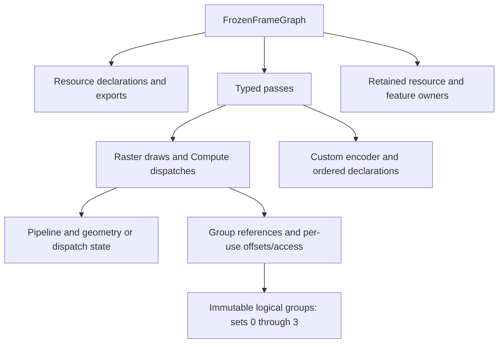
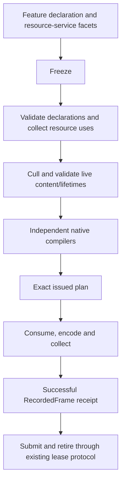

## Context

The user approved the 2026-10-27 diagrams and implementation order. The clean working tree starts at ba105c59. Production uses FrameComposer, FrozenFrameGraph and explicit DeviceFrameLease; the legacy RenderGraph has already been removed. Existing native plans, transient pools, shared shader declarations and typed parameter transactions remain the baseline.

## Goals / Non-Goals

**Goals:** one authoritative resource-use traversal; immutable reusable logical binding groups; explicit parameter and frame protocols; native synchronization, resolve, ownership and failure parity.

**Non-Goals:** no directory moves, new targets, module ownership/entry changes, universal native executor, async compute, expanded descriptor-array support, shader ABI redesign, commit or archive.

## Decisions

### Compile-local resource uses

Extend the existing analyzer's typed collection points with effective buffer byte ranges, normalized image subresource ranges, usage roles and access modes. The analysis result retains these facts only during Compile; FrozenFrameGraph does not store a second normalized IR. Exact content spans and reads/writes/defines remain distinct. All pass declarations receive structural/reflection validation before culling; only surviving work and exports require initialized contents and native allocation.

Vulkan and DX12 consume these uses for raster synchronization, including storage reads. Same physical-buffer read roles are combined before native lowering. Native barriers, scope organization, DX12 footprint/metadata work and Vulkan's two compilers remain backend-owned. A generic cross-backend barrier/executor abstraction would erase required distinctions and is rejected.

### Binding groups and materialization

The immutable logical group is scoped by shader-derived layout contract and logical set. It owns binding values and exact graph resource identities; it is not a native ResourceGroup or a global descriptor cache. Draws and compute declarations reference groups; per-use access and dynamic offsets remain explicit. Sparse sets remain legal and Custom preserves declared resource order.

Parameter assembly separates semantic completion, target ABI encoding/upload and native materialization. Repeated immutable Global/Pass/Material input is encoded/uploaded once for compatible shader layout and the active graph/lease. Draw-specific Batch values get independent snapshots; dynamic offsets do not force unrelated sets to be rebuilt. Native descriptor reuse keys include complete resource versions, normalized views, base ranges and native layout compatibility. All backing/pins follow existing lease retirement. Cross-frame mutable caching is excluded.

### Native correctness and errors

Metal freezes resolve targets with the original raster attachment and selects resolve-only versus store-and-resolve in that render pass. It never discards before a later resolve LOAD. Dispatch validates the exact issued object and public identity before downcasting, then consumes the plan once encoding starts. Native command/encoder failures propagate explicit results and cannot produce a successful receipt.

### Public protocol boundaries

Named/typed immutable parameter updates receive a separate interface and explicit ResourceGroup factory. Numeric DescriptorEncoder remains the native writer. DescriptorBatch has no production callers; remove the redundant public protocol and migrate its tests to native per-group writers instead of inventing a second transaction.

DeviceFrameContext exposes the explicit lease protocol. DirectFrameContext is a separate explicitly-created compatibility interface; querying its fence is pure and frame begin/reset checks explicit native results. No new target or runtime entry is introduced.

Feature graph declarations expose supported transient buffer/image creation, copy, raster/fullscreen, compute, Custom and exports. Resource/draw resolution and upload/factory services remain separate facets of the borrowed feature context. Callers cannot submit or retain borrowed services.

## Risks / Trade-offs

- Public source migration touches tests and consumers -> remove obsolete entry points and build all affected libraries/consumers.
- Incorrect layout/group cache equivalence -> conservative shader/native-layout identity first, full resource/range/view keys, lease-local lifetime and negative tests.
- Dynamic offsets accidentally included in descriptors or omitted from access ranges -> separate per-draw offsets; test both descriptor reuse and differing effective contents.
- Backend parity -> build/run native Metal and available Vulkan on this macOS host, record DX12/Windows checks as unavailable rather than counting old binaries.

## Migration Plan

1. Fix native correctness and add focused regressions.
2. Introduce shared resource-use facts and consistent declaration validation.
3. Migrate binding organization, target upload reuse and native group reuse together with consumers.
4. Separate parameter/direct protocols and complete feature graph declaration facets.
5. Reconfigure the existing build, run applicable checks, inspect scoped formatting/rules, and update verification evidence and task status.

No commit or archive occurs without the separate user confirmation required by AGENTS.md.

## Implemented organization

`FrozenFrameGraph.h` owns the immutable `FrameBindingGroup` value model. `FrameBindings.h/.cpp` provides temporary Raster/Compute drafts, checked publication, group-use validation, compilation-local resolution and a shared complete-value comparator. RasterDraw and FrameComputePass contain only group references and per-use overrides; Custom keeps its original ordered arrays.

`FrameGraphServices::MaterializeParameters` validates the borrowed transaction state and actual external graph resources before any uniform upload. The common RHI validator is also used by ShaderParameterTransaction; no second typed-data validator is maintained. FrameComposer caches exact-shader/set, typed field values and complete external group values. Its upload cache uses encoded bytes and a borrowed lookup span, so exhausted budgets can still reuse earlier uploads without allocating a new key first. Both caches are composition-local and bounded to 1024 entries; overflow falls back to uncached work rather than changing semantics. Cache hits replace external per-use overrides, including a return from a nonzero dynamic offset to zero.

Vulkan/DX12 synchronization consumes `FrameGraphAnalysis::passResourceUses`, including copy, raster, compute and Custom. Descriptor materialization is separate from synchronization; a cache hit never skips a resource dependency. Native group caches are compile-local and use exact shader identity plus canonical binding values, excluding dynamic offsets/access. Equivalent view spellings that are normalized only during materialization can conservatively miss the cache; they cannot alias incompatible bindings. Metal also refreshes its depth-array compatibility copy for each consuming pass, even when native group materialization is reused.

The unused EditorFrameSubmission helper and its exclusive tests were removed after confirming no production consumers. Remaining direct compatibility hosts use the separately-created DirectFrameContext. No target, module entry or directory was added or moved.

## Physical Vulkan device compatibility follow-up

The physical Android probe reports Vulkan 1.1 with real timeline/synchronization2 KHR support and no dynamic-rendering extension. Loader support for a newer API cannot substitute for the selected physical device's capabilities. The existing native RenderPass compiler remains the compatible rendering path; no replacement renderer or synchronization bypass is introduced.

Public mode values preserve DYNAMIC_RENDERING=0 and RENDER_PASS=1, append AUTO=2 and default to AUTO. Renderer configuration maps all three values explicitly and rejects unknown values before acquiring the backend. AUTO resolves inside the Vulkan context to enabled dynamic rendering when available or the existing RenderPass compiler otherwise, then remains fixed for that context. Explicit Dynamic Rendering still fails when unsupported; the existing render-pass CLI override remains explicit. Default AUTO is also accepted by non-Vulkan contexts without assigning Vulkan-specific behavior to them.

The native implementation queries/enables version-appropriate core or KHR features and loads the matching commands, retaining mandatory timeline/synchronization2 and actual RenderPass2/shader/resolve requirements. Direct rendering cannot call dynamic commands or create a dynamic pipeline without enabled support. Android shader products use the Vulkan 1.1-compatible SPIR-V 1.3 baseline. The canonical target environment, including profile/minimumVersion, participates in request/cache/artifact identity, so prior higher-version products are recooked. Producer configuration independently retains its compiler/build and source-finalization policy, including the existing `spirv-source-omitted-v1` salt; no producer bump is required for this environment change. These changes stay in the existing targets and entry points. Verification records the native regressions, fresh APK audit and scoped physical-device physics/package acceptance; Windows native execution and full visual-quality acceptance remain open.
