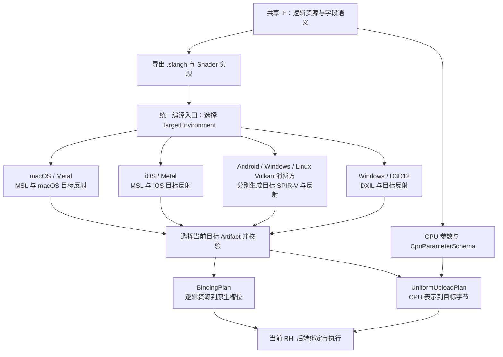

## Context

2026-10-22 的设计 review 接受“每个平台生成 shader 时直接产出自己的反射”。本 change 将其落实为：共享接口描述值的含义，目标反射描述 GPU ABI，运行时通过经验证的计划连接二者。

| 现有实现 | 问题 | 本次责任 |
|---|---|---|
| `ShaderCompilerSlang.cpp` 为 MSL 增加第二个 SPIR-V target，再按短名字关联 | 逻辑身份依赖另一目标的布局 | 同源接口键与单目标反射 |
| `MetalMSLSlots.h` 以 nativeBindings 是否为空推导模式，缺少 stage 记录时跳过 | 无法区分零资源、不活跃与反射缺失 | 显式协议、活跃集合、完整性验证 |
| `SharedShader.h` 用 sizeof/offsetof；`PassResourceBindings` 要求目标完全相等 | CPU 表达与 GPU ABI 耦合 | 语义接口、CPU schema、UniformUploadPlan |
| block member 无 matrix major/stride；MAT4 直接 memcpy | 大小相等不能证明矩阵语义相等 | 归一化矩阵布局与受检转换 |
| `ShaderTechnique`/`ShaderCookTool` 传 toolchainFp=0 | 编译器/规则改变可能复用旧产物 | 真实生产者身份与缓存失效 |
| structured/raw buffer 丢失 READ/READ_WRITE，DX12 从 STORAGE_BUFFER 推导 UAV | 只读 t-register 与目标 layout 不匹配 | 访问语义和原生 register class 全链路保留 |
| blob 同存 code/reflection，RHI 又分别接收函数和反射 | 产物绑定与加载校验不充分 | 不可变 stage artifact 与链接验证 |
| Material 已有 Name 属性，但 SceneAssetSource 只传 uniforms，ResourceGroup 仍仅按 binding 写 descriptor | 增加 Name 重载也不能保证材质入口及贴图闭环 | 共享命名参数事务、显式 alias 与版本化材质贴图传递 |

### Existing change ownership

| 已存在 change | 保留的职责 | 本 change 的接续点 |
|---|---|---|
| `refactor-aurora-pipeline-resource-ownership` | 持久 `.slangh`、owner/inventory、technique、资源注册、cook/package、逐 stage logical/native 分离 | 接替 design 的 Metal physical binding correction 中辅助 SPIR-V/name 桥；保留已完成任务及历史证据 |
| `refactor-aurora-shared-pass-headers` | 权威 `.h`、类型化槽位、C++ 无 shader 编译前置 | 解除 CPU sizeof/offsetof 必须等于所有目标的 ABI 约束 |
| `fix-aurora-pass-resource-contract` | Global/Pass/Batch、可选 View、原子装配、PreparedRaster 职责和帧隔离 | 将布局一致改为语义兼容且上传结果符合目标 ABI |
| `aurora-renderer-platform-parity` | 宿主、窗口/surface、平台生命周期和整体验收 | 消费本 change 的 shader 结果；本次新增 shader 读回仍由本 change 负责记录 |
| `aurora-metal-bindless-descriptor-heap` | 尚未实施的 bindless/heap 方向 | 本次保持 DirectArguments，不抢占其设计 seam |

实施基线包含 resource-ownership 已落地的工作树；不要求先 archive 或 commit。最终同步主 spec 时先应用 shared-header/resource-ownership 的实际基线，再应用本 change；不得用本方案改写已完成的旧验收记录。三个 delta capability 均已存在于主 spec。本 change 不重复 ADDED `Logical bindings remain independent of native argument slots`，而以新的完整性要求强化它。用户在 2026-10-23 补充 Name-first ResourceGroup/材质统一入口要求，新增的材质参数与普通 2D 贴图闭环归本 change；旧 change 曾明确未完成的自动材质贴图传递不作为已交付基线。

## Goals / Non-Goals

**Goals:**

- 一个共享语义接口服务多个目标；各目标的活跃集合、物理槽位和字节布局允许不同。
- 每次编译只生成请求目标的代码与反射；开发编译、cook 与 shipping 共享同一产物契约。
- 原生绑定和 uniform 字节由经验证的不可变计划驱动，错误发生在发布/执行前。
- 材质默认值、实例覆盖、常量和纹理/采样器均以 Name 表达，统一进入与 ResourceGroup 共用的 RHI 参数事务前端及同一组布局计划。
- 已支持的 structured/raw buffer 正确保留只读/可写语义，包括 DXIL SRV/UAV 与图访问。
- 缓存可追溯、工具链变化可失效、产品可脱离作者源码和编译器运行。

**Non-Goals:**

- 不改 Global=0 / Pass=1 / Batch=2、View 归属、动态绑定的显式策略或 frame/module/GPU lease。
- 不增加 Aurora target、模块入口、注册表、插件 loader、独立 PipelineLayout API 或目录体系；实现继续归现有 core、shader、adaptor 与 rhi 后端。
- 不在本期启用 descriptor arrays、argument buffers、bindless、嵌套 uniform、BOOL/FLOAT3/half 等新字段；不会删除其他路径已经验证的能力。
- 不扩展 typed/counter/append/consume buffer；不能表达的形态显式 Unsupported。
- 不建设通用热重载或另一套 GPU 上传/提交系统；UniformUploadPlan 专指 CPU uniform 编码，与既有 GPU 资源 UploadPlan 区分。
- 不强制将 Metal MSL 文本改为离线 metallib；保留显式 code format，后者可在原有能力内消费。

## Decisions

### 1. 三类数据独立描述

以下为概念职责，最终类型名在现有接口内收敛，不要求为每类新增模块。



图中各分支复用接口和产物协议，代码/反射内容按目标独立；运行时只选择当前目标，不合并不同平台反射。Linux 列为已有 preset 对应的公共层/Vulkan 消费方；本 change 不承诺补齐 Linux 的其他宿主或窗口基础。

| 消费平台/后端 | 必须迁移的公共部分 | 主要后端适配 |
|---|---|---|
| macOS / Metal | artifact、反射协议、缓存/产品、CPU 参数编码 | 移除辅助 SPIR-V 桥与顺序槽位约定，消费完整的逐 stage 地址 |
| iOS / Metal | 同上，平台/API 下限独立进入产品身份 | 共享 Metal 实现适配，分别验证 iOS 产物、能力与真机执行 |
| Android / Vulkan | 同上，APK shader 产品重新 cook | 接入目标 set/binding 与字节布局计划，保留既有部署链路 |
| Windows / D3D12 | 同上 | 补齐 SRV/UAV、register class 与 raw/structured buffer 编码 |
| Windows / Vulkan | 同上 | 保留既有 descriptor/数组及两条 raster 路径并回归 |
| Linux / Vulkan 消费方 | 同上，核查已有 preset 与产品消费路径 | 复用 Vulkan 适配，按可用基础执行 offscreen 验收；未具备的宿主能力单独记录 |

| 数据 | 责任 | 不承载的内容 |
|---|---|---|
| ShaderInterface | 接口身份/版本、ResourceKey、资源语义、字段路径与类型 | 物理槽位、GPU offset |
| CpuParameterSchema | 同源 C++ 字段 offset、可读字节范围、数组与矩阵的 CPU 表示、schema fingerprint | 某目标的布局假设 |
| TargetReflection | target/stage、活跃资源集合、原生地址、block/member 布局与计算线程组 | 材质/Feature 的值提供方推断 |

ResourceKey 保留现有逻辑 `(set,binding)`，在一个组合后的 shader 接口内唯一；接口另有 owner/声明域身份，便于校验和诊断。两个 owner 的局部同名参数不因短名字相同而被合并；组合时实际占用相同逻辑键的冲突仍必须拒绝。字段身份为接口内明确的字段路径，展示名字不是跨目标关联规则。

权威 `.h` 同时产生语义接口与 CPU schema，导出的持久 `.slangh` 携带同一逻辑键与接口版本信息。CPP 布局变化只影响 CPU schema 与上传计划；不改变逻辑接口时，无需因 CPU padding 变化重编 GPU 代码。

### 2. 从同一声明取得身份，目标只读取自己的 layout

Slang adapter 在源码声明层取得逻辑键，再从请求目标的 layout/metadata 取得原生地址、实际字节布局和使用情况。遍历应以 global/entry scope 的 variable layout 为起点，正确处理容器及累计 offset；超出本期语法的容器显式拒绝，不能静默忽略。

优先验证共享导出中的用户属性能否通过当前固定 Slang SDK 的 VariableReflection 可靠读回。用户属性是实验接口，因此 M1 必须先完成小型验证：多个 owner/命名作用域、资源类别、VS/FS/CS、优化/宏变体、三种目标均可读到唯一逻辑键。不得仅因 API 存在便假定 lowering 后仍保留身份。

如果该注解通道不能满足契约，采用同源导出的声明清单，在编译 adapter 内按完整声明路径严格解析关联，验证一对一、类型与接口身份；无唯一匹配即失败。M1 记录所选通道和证据，后续只保留一个正式通道。两种通道都不得引入第二个目标 layout、依赖反射顺序、短名字 first-match 或解析生成 MSL 文本。

2026-10-23 M1.2 已选定唯一正式通道：Slang 2026.9.2 的 `AuroraResource(set,binding,owner)` 与字段 `AuroraField(path)` 用户属性。独立 gate 覆盖三目标、VS/FS/CS、两种宏和 O0/O3，共 36 组声明布局检查；SPIR-V/MSL 的 24 组同时完成代码生成，DXIL 的 12 组声明布局通过，但 macOS 缺少 downstream DXC，未完成 DXIL 代码生成。三目标均要求显式属性，原始 register/binding 不再自动充当稳定逻辑身份。

MAT4/FLOAT4 数组 gate 取得 size/alignment/offset/array stride。矩阵 stride 从 matrix element type layout 取得，不能使用返回零的 matrix element stride 查询。非对称 MAT4 在真实 Metal compute 中按 row/column 各自存储得到 `(104,314,568,858)`；交换 major 的负例得到 `(306,362,414,478)`。SPIR-V 装饰的 RowMajor/ColMajor 名称不能直接替代归一化语义。SPIR-V 实际 entry 为 `main`，由 OpEntryPoint 读取，不能信任保留源 entry 的 layout override。

原生 Metal 反射中的 buffer offset alignment 与 block 结构体 alignment 分别核对；gate 中前者为 32、后者为 16，成员 offset 与 size 一致。上传分配须满足 native binding alignment，字段 packing 使用目标 TypeLayout。 最终 graphics gate 另以两宏×O0/O3的四组实际VS/FS创建原生pipeline，活跃category/index与目标metadata一致，block size192、成员offset0/8/16/80/144及矩阵/数组stride16通过；标准array在原生反射中可能包在struct内，校验其元素布局而不依赖降低后的名字。

MSL 编译 session 最终仅有 MSL target。SPIR-V/DXIL 同样只读取自己的 layout；公共语义归一化代码可以复用，不要求维护三套互不相干的遍历实现。不同目标可以优化掉不同资源；CPU 只需提供当前链接结果要求的活跃资源。

### 3. Stage artifact 是代码与反射的发布单位

每个成功编译结果形成一个不可变 stage artifact，至少包含：

- envelope/反射协议/运行时 ABI 版本、后端与 binding model；
- canonical ShaderRef、源码及依赖摘要、source entry、native entry、stage、强变体和 schema 身份；
- 规范化 TargetEnvironment 与完整生产者身份；
- 逻辑接口、该 stage 活跃资源及目标反射；
- 明确的 code format、精确有效字节数、代码和反射的内容校验信息。

代码改用字节语义，SPIR-V 在相应消费入口额外验证 word 对齐；MSL 文本与 DXIL 不通过补零后的 uint32_t 数量推断有效长度。支持何种 code format 由后端明确检查，不凭“不是 metallib magic”推测为文本。

artifact 先在临时对象内完成编译、反射与验证，再一次发布；失败不返回可消费的部分 code/layout。ArtifactID 绑定规范化 envelope（不含自身摘要）、TargetEnvironment、producer/runtime ABI、source/entry/stage/variant/interface 身份、精确代码字节及完整目标反射。序列化顺序确定，不纳入机器路径、时间戳或诊断文本；改变代码或反射任一内容都会得到不同身份。

缓存复用现有 index/blob 体系升级格式，不增加另一种分发包。构建缓存将 CompileKey 映射到 ArtifactID，发布 index 将逻辑请求映射到 ArtifactID；加载必须同时核对 envelope、所请求的身份、内容校验和反射结构，不能只信任文件名。

ShaderFunction 保留对应 artifact 或其不可变所有权与身份。Shader 链接阶段从匹配的 stage artifacts 组装逻辑并集及 BindingPlan，禁止任意函数配一份无关反射。低层手写 shader 通过显式 artifact 构造入口提供相同信息；测试 fixture 也迁移，不保留生产顺序编号模式。

### 4. 编译身份与运行时兼容身份分开

| 身份 | 内容 | 用途 |
|---|---|---|
| TargetEnvironment | backend/code format、平台与 API/语言下限、profile、所需能力、布局模式、影响代码/布局的选项 | cook 目标、构建缓存、设备兼容检查 |
| ProducerIdentity | 实际 Slang/DXC 等参与工具版本/构建标识、编译 adapter/反射转换规则版本 | 构建失效与追溯 |
| RuntimeAbiVersion | runtime 所理解的 artifact/原生定位/编码协议 | 无编译器产品加载 |

开发/cook 的 CompileKey 由源码依赖、entry/stage、变体、接口与目标环境、ProducerIdentity 的规范化输入计算；不允许生产路径传零占位。路径只保留 canonical 逻辑路径，不含机器绝对路径或临时目录。反射是编译输出，其内容摘要用于完整性与计划缓存，不能循环填回编译输入键。

Shipping 按发布 index 中的请求与目标环境选择 artifact，验证已发布的身份、协议、逻辑接口及设备能力。生产者身份作为产物内部元数据保留，加载器不通过本机当前编译器重算它；安装了另一个编译器或完全没有 Slang/DXC，均不影响兼容产品的读取。ABI/设备不兼容或缺失产品时给出明确错误，不隐式转源码编译。

macOS 与 iOS 的平台/目标下限独立进入 TargetEnvironment；不是仅凭 `ShaderTarget::MSL` 共用产品。也不以具体设备序列号分裂缓存，采用规范化能力要求。只要选择合法的目标工具链，cook 可在支持交叉编译的宿主运行，不要求每个平台只能本机 cook。

### 5. 目标反射必须完整并保留原生类别

每个 stage 反射有明确的协议、binding model 和活跃 ResourceKey 集合。对于集合中的每个资源，目标地址必须存在、唯一、类型兼容且在能力范围内；孤立记录、错误 stage、重复映射、同一原生命名空间的冲突均拒绝。零资源 shader 提供“完整且活跃集合为空”的合法产物。

生成器查询 metadata 或原生地址失败时，不把 unknown 解释为 inactive。使用分析需区分 exact/conservative；允许编译器明确声明的保守使用集合，但该集合必须覆盖原生实际活跃参数，每项仍有完整地址；不能把查询失败伪装为成功的使用分析。数组未支持时不能把 count=0 变成 1。

| 后端 | 目标 ABI 保留内容 | BindingPlan 派生 |
|---|---|---|
| Vulkan | descriptor set/binding、descriptor 类型/count、stage、block ABI | 既有 Shader 内的 set layouts / pipeline layout |
| DX12 | CBV/SRV/UAV/sampler class、space/register、count、stage、buffer raw/structured 形态、element stride 与访问 | root/table 参数与 descriptor 写入位置 |
| Metal DirectArguments | stage、buffer/texture/sampler category、index、block ABI、compute group size | 各 stage 原生 encoder 地址及 vertex input 槽位避让校验 |

后端专用地址使用有 tag、有版本的数据记录，不引入 Metal/Vulkan/D3D 原生头到公共接口。公共语义保留 READ/READ_WRITE；DX12 对 structured/raw 只读资源使用 SRV，对 RW 使用 UAV，贯穿 root signature、descriptor 创建/写入与图访问校验。一般 `b0/t0/u0/s0` 的不同原生类别不能压成同一逻辑身份；必须映射到各自明确的 ResourceKey，缺少该映射时拒绝。

argument buffer/descriptor array 等未实现的目标 binding model 在创建 artifact/Shader 时明确 Unsupported，不用 DirectArguments 的单 index 模拟。本 change 不降低 Vulkan/DX12 其他既有、已验证入口的数组能力；新通用 Pass 路径仅声明实际可执行的支持集合。

### 6. BindingPlan 由既有 Shader 链接拥有

合并阶段先验证各 artifact 的 target environment、stage/entry、接口、资源类型与访问方式，再生成逻辑资源并集和各 stage 原生地址表。原生记录保持 stage 所有权，不以合并后的资源顺序重新编号。

BindingPlan 继续由后端 Shader/ResourceGroup 消费，Vulkan layout、DX12 root signature 不暴露为新的可独立传入对象。CPU 调用方仍按 typed logical slot 写资源；Metal 同一资源在 VS buffer(2)、FS buffer(5) 时分别编码到对应地址。动态 offset 的逻辑顺序、范围、device 对齐及实际物理消费全部受检，不能由 set 推导动态类型。

同一个 logical UBO 在同一 pipeline 的多个 stage 必须具有相同的规范化 ABI，包括 block size/alignment、字段身份/类型、offset/size、数组 count/stride、matrix major/stride；不满足时本期一个 range 对应一个 logical binding 的路径返回 Unsupported，不保留第一份 block 继续执行。验收用两份各自合法但布局不同的 stage 证明其在首次提交前被拒绝。按 stage 分配独立 payload 属于新增能力，须先补齐其数据与绑定契约。不同平台采用不同 UBO 布局则由各平台自己的 UniformUploadPlan 正常支持。

### 7. UniformUploadPlan 连接 CPU 值与目标 ABI

计划由 `(artifact/链接布局身份, CpuParameterSchema fingerprint, packing 协议版本)` 构建与缓存。计划不持每次 draw 的值，不依赖全局可变单例，不在每次 draw 重新遍历反射。目标或 CPU schema 改变时生成新计划；旧计划与旧 shader/帧引用保持有效至既有退休边界。

| 字段/资源 | 本期支持边界 |
|---|---|
| FLOAT / INT / UINT / FLOAT2 / FLOAT4 | 按同源字段语义编码到目标 offset；检查目标存储大小与源可读范围 |
| MAT4 | CPU 保持现有列向量表示；目标 adapter 将 compiler 的 matrix convention 归一化，计划处理 major/stride 转换 |
| 固定 FLOAT4 uniform 数组 | 检查 count，按 CPU/目标各自 stride 编码；uniform 数组不等于 descriptor 数组 |
| BOOL / FLOAT3 / half / 嵌套结构 / 其他矩阵与数组 | 明确 Unsupported，导出/反射/pack 不允许遗漏；增加类型前须完整打通 schema、导出、codec、pack 和原生读回 |
| StructuredBuffer / ByteAddressBuffer 及 RW 变体 | 在既有 compute/RHI 通路修复 access 与 native class；本期不扩展共享 Pass 声明语法 |

目标 block/member 需要记录足够的 size、alignment、offset、数组 count/stride、矩阵 major/stride、标量存储与类型信息。不能直接把 Slang 的 row/column 名称当作 Vulkan decoration，adapter 必须统一到引擎约定再序列化。

通用执行先校验全部字段、范围、重叠和算术溢出，生成清零的目标 block，再按计划写入；不读取 C++ padding，不改变源对象。不活跃资源无须提供值；活跃 block 中当前协议要求的字段必须完整。不能映射的字段给出包含 ResourceKey/字段/目标的信息。

仅当逐字段布局、标量存储、矩阵表示、数组 stride 与完整复制范围均被证明兼容，且整段源/目标均由声明的值字节覆盖、没有 padding 时，才选择 memcpy 快路。总 size 相同或源 padding 已初始化均不足以启用；其余情况使用分段复制并清零目标 padding。通用路径与快路对同一语义值必须产生相同目标字节。

现有 `PackShaderUniform` 与 Pass 的 typed 参数写入收敛到同一计划规则。材质 property map 到逻辑字段的映射仍由材质/显式 assembler 提供；不能用 property map 的 CPU offset 当 GPU offset，也不让反射推断 Material/Feature 的值归属。

### 8. 原子性和生命周期沿用当前 Renderer

Pass 参数先保存 owned CPU 值/snapshot，再按实际 shader 选择计划、编码并申请目标大小的 uniform range；不能先按 sizeof(T) 上传后再判断其 ABI。逻辑 range 使用实际目标 block 范围；后端原生 view 所需额外对齐/padding（例如 DX12 CBV）由分配和编码层确保实际 backing 足够，不用该 padding 掩盖缺失字段或不足的语义范围。全部资源与字段验证通过后一次替换 draw 的绑定，失败保持原 draw 和已发布产品不变。失败的临时分配按原帧分配器处理，不发布部分 descriptor。

计划、artifact、目标字节与 module/provider 依赖复用当前不可变版本、frame lease 和 GPU 退休协议。多 View、多 draw、连续在途帧分别使用对应值；本 change 不额外建设一般 shader hot reload，只验证新旧显式版本可以并存退休。可恢复失败走显式错误返回，不添加 throw、try/catch、RTTI 下转型或断言式业务失败。

### 9. ResourceGroup 以 Name 统一参数更新

ResourceGroup 保留由 Shader/interface 与 logical set 创建的边界，向消费方提供同一个 Name-first 更新事务。下面是拟定调用形态，实施时在现有 DescriptorEncoder 上收敛，不另建第二个参数系统；具体 Result/上下文类型沿用或补齐 RHI 中性契约：

```cpp
auto update = group->CreateEncoder(updateContext);
update->WriteData(Name("material.baseColor"), baseColor);
update->WriteData(Name("material.roughness"), roughness);
update->WriteImage(Name("albedoTexture"), albedoView);
update->WriteSampler(Name("albedoSampler"), linearSampler);
auto result = update->End();
```

字段数据用 WriteData，整个 CPU 参数结构用单独的 WriteBlock(Name, CpuSchema, value)，外部 buffer range 用 WriteBuffer；纹理和 sampler 不编码成伪 uniform 字节。数据入口保留语义类型/shape，不以裸指针长度或 sizeof 相等推断类型。整 block 与同字段重叠写入、别名解析后重复写入均在同一事务内报冲突；后续成功事务可以只覆盖一部分字段并继承上一版本其它值。

Shader 链接时建立不可变的 ParameterTable：`Name -> logical ResourceKey / FieldId / type / ownership scope`。Name 在当前 interface + ResourceGroup set 内解析，字段采用明确的 `block.field` 路径，资源采用声明的逻辑名；短别名必须显式声明且唯一。未知名字、歧义名字、错误类型或越权 provider 明确失败，不跨 block/set 搜索同名项。同一个 logical resource 的多个 stage 地址共用一个名称入口。

该逻辑名字表来自权威声明并进入 shipping artifact，不依赖编译器生成名字或 debug symbols；其 canonical 名称、声明别名与目标逻辑身份纳入接口 fingerprint 及 ArtifactID。序列化保存 canonical 字符串与稳定逻辑身份，加载后重建 sky::Name；不得持久化进程内 Name::GetHandle。可缓存带 interface/schema generation 的 ParameterHandle，但仍由同一名字表产生并验证；旧句柄不能用于新接口。各后端只接已经解析的操作与计划，不各自查名字、猜字段或重复做字符串反射。

已声明但当前 variant 不活跃的参数与未知名字有不同状态：前者可保留 CPU 值并返回显式 Inactive，不产生原生绑定，也不要求运行时提供；后者是错误。首次提交必须由显式默认值或写入补齐全部活跃必需字段/资源，不能从未初始化的 block 补值。

RHI 可以依赖 Core 的 sky::Name，但不能 include adaptor 的 MaterialPropertyValue 或 Aurora.Core 的 Material/RgFieldType/图类型。RHI 更新契约只使用中性的 scalar/vector/matrix/array value view、CPU schema view、Buffer/Image/Sampler 及受检 view/range。模板便利方法转换为这些描述；AssetManager、UUID、GraphImageHandle 留在各自上层。

updateContext 由现有 Core 帧上下文显式提供 RHI 中性的 uniform allocation/encoding sink，消费既有 frame lease 并报告 BufferRange/保活结果。Write 操作暂存 owned 值/资源引用；任一写入失败都会使事务失效，即使调用方忽略单项结果，End 也必须失败，不能只发布后续合法子集。End 收齐错误、校验、编码并原子发布不可变版本，未 End 的事务销毁即取消。缺少必需上下文或其 lease/device epoch 已失效时明确失败；End 不创建 queue、WaitIdle、等待 fence 或 Submit。帧录制冻结已提交版本，后续 Name 更新不得改写在途 uniform/descriptor。

ResourceGroup 的命名 encoder 与 Core 图绑定桥直接委托同一个 RHI `ShaderParameterTransaction`。该前端统一 Name/alias/handle 解析、类型与 count 校验、重复/整块重叠、inactive、必需集合、失败锁存和目标编码，冻结不可变 `ShaderParameterPacket`。资源只使用 adapter 持有的中性 token，RHI 不认识 GraphImageHandle、资产 UUID 或 Core。

两个 materializer 保留真实生命周期边界：ResourceGroup 根据 token 取原生资源并经注入上下文分配 uniform，成功后发布新 group；Core 根据 token 取图 image/view 和 sampler，声明读取并调用既有 WriteUniform，全部成功后替换 draw。图 transient image 在 Build 时尚未创建原生对象，因此不能为了复用事务而在 Feature 提前创建原生 group。每个 block 只在共享前端编码一次、在选定 materializer 上传一次，三后端录制继续消费受检 BindingPlan；没有第二套 Name 规则或 packing 路径。显式预编码 range 由同一事务按整块资源处理，仅允许已证明匹配目标 ABI 的 assembler。

### 10. 材质与贴图只走同一参数通路

MaterialPropertyMap 继续表达 CPU 属性，MaterialInstance 继续持默认值加实例覆盖；其类型校验按语义类型而非仅 sizeof，失败有明确结果。材质的 `baseColor -> material.baseColor`、`albedo -> albedoTexture` 等是按 technique/interface 校验的显式 alias，不能成为第二套 shader 字段声明或另一个 packer。shader 实现、Pass、材质不依赖平台 slot/offset。

MaterialAsset 的字段/资源映射改以 logical Name 作为目的地，统一传递数据、纹理和 sampler；需要时递增资产 schema 并要求迁移/recook。SceneAssetSource/RenderMaterialTechnique/PreparedDraw 不再提前固化目标 uniform 字节或仅携带数字 binding，而是冻结 typed named 值、显式 alias 和资源依赖。最终装配使用与 ResourceGroup 共用的 RHI 更新事务前端、UniformUploadPlan 与 BindingPlan；Feature 的 set-2 参数仍由其原 provider 贡献，联合 block 仍由一个显式 assembler 拥有。

普通 2D 材质贴图的资产 UUID 与加载留在 adaptor，沿既有 AssetManager/cook、ResourceCatalog/uploader 与资源图发布图片 payload。材质快照携带完整的 RenderResourceKey/所选依赖版本和 typed sampler/view 信息；协调器取得已完成 Resident 或已有受检 InGraph 资格后解析 GraphImageHandle，声明读依赖并保活精确版本。不能在编码时查询“最新纹理”、在主线程创建 GPU 图片，或直接复用旧 MaterialAsset 的 GPU 直连路径冒充新闭环。

本期普通 2D sampled 材质贴图必须区分 sRGB 颜色与线性数据，保留 mip/view 与 sampler 契约并校验能力。不把仅适用于非负线性环境辐射的 ConvertSceneImage 原样套给所有材质；图像格式/元数据、转换、codec 与 native view 必须贯通。需要的新 sRGB 表达在现有 image 数据/上传路径内补齐。材质 cube/压缩/storage/descriptor-array 等更广资产传递不在本次扩展范围；已有其它通路能力不降低。

未就绪、加载失败、缺失或 device epoch 不匹配的纹理依赖进入现有显式资源状态/错误流程，不以 null descriptor 成功或偷偷绑定默认纹理。实例更新材质值或替换贴图只影响新快照；旧帧继续读取旧值/图片直至退休。cook/package 收集真实材质图片依赖，shipping 命名参数表保留，验收从真实材质资产的 Name 属性开始完成常量与纹理同时生效的 GPU 读回。

### 11. 备选方案取舍

- 继续借 SPIR-V 获取逻辑键：迁移小，但保留跨目标耦合，作为最终实现不采纳。
- 强制所有平台等于 C++ ABI：直接上传快，但限制字段/编译模式且无法利用独立目标布局，只保留为被证明成立的快路。
- 每后端一套完全独立的反射框架：重复语义遍历和缓存机制，不采纳；公共语义与校验共用，原生 ABI 有明确目标数据。
- shipping 加载时从 native API 重新恢复全部反射：缺少逻辑声明身份且与离线工具分离，不作为事实源。Metal 原生验收必须用实际 pipeline reflection 核对可观测的 stage/category/index、活跃参数和 block ABI，再用读回验证值语义；shipping 不要求重复取得 native reflection。
- MSL 文本解析或按资源顺序猜位置：不具备可靠契约，删除相关兼容分支。

## Risks / Trade-offs

- [Slang 注解通道处于实验状态] → M1 在固定版本做证据验证；选择一个通过唯一性验证的声明身份通道，不把失败转为 SPIR-V 回退。
- [artifact 与 RHI 入参是破坏性迁移] → codec/producer/consumer 同批升级，旧产品明确 recook；不做旧格式猜测转换。
- [CPU 编码增加开销] → 按 schema/布局缓存不可变计划，避免逐 draw 反射扫描；只在严格兼容时使用复制快路。
- [DX12 类型推断分散] → 从 Slang access 到 root/table/descriptor/RDG 全链路验收，使用只读输入与 RW 输出共同存在的原生 compute 用例。
- [矩阵约定容易被 identity 用例掩盖] → 使用非对称矩阵、平移/剪切和真实 shader 运算验证归一化与转换。
- [移动设备环境不可用] → 构建、反射与真机执行分开记录，真机任务保留未完成，不以交叉编译代替。

## Migration Plan

| 阶段 | 可 review 的交付 | 完成门槛 |
|---|---|---|
| M1 产物身份与严格校验 | 固定身份通道与矩阵/数组反射能力验证、TargetEnvironment/producer/runtime ABI、artifact codec/cache、metadata 失败规则 | 唯一声明关联和 MAT4/FLOAT4 数组布局信息可恢复；工具链变化失效；零资源合法；缺失/错配产物明确失败；shipping 不依赖编译器 |
| M2 单目标反射 | 同源逻辑键、目标 ABI 描述、MSL 仅一个 target、scope 遍历 | 不请求其他目标 layout；命名/变体/unused/各 stage fixture 均唯一且完整 |
| M3 原生 BindingPlan | 三后端消费、只读/RW buffer access、手写 fixture 显式映射 | native category/stage/index 正确；DX12 SRV/UAV 原生读回；冲突与越界被拒绝 |
| M4 UniformUploadPlan 与命名材质 | CPU schema/目标 ABI 转换、Name-first ResourceGroup、材质值/贴图/实例与复制快路 | 相同 Name 驱动常量及纹理；不同 offset/stride、非对称矩阵、padding、事务原子失败与在途版本读回 |
| M5 迁移与验收 | 全量 recook、source-free 产品、文档与 superseded 分支清理 | 各平台按下表完成并记录；没有旧顺序槽位/SPIR-V 桥/固定 CPU=GPU fallback |

每阶段保持必要构建与相关回归可运行，不混入目录搬迁。M1 的严格模式切换与所有现有合法 producer/fixture 同批迁移；中间阶段不允许把旧数据伪装成完整新协议。旧实现可以在迁移过程中局部存在，但最终不保留隐式双轨兼容。

回退必须恢复匹配的一组 runtime/codec/exporter 与其产品分发，再重新 cook；不得混用新旧 code、反射、index 或上传计划。用户的未提交修改保留，未获确认不 commit/archive。

### Validation matrix

| 环境 | 必需证据 |
|---|---|
| CPU/工具 | 三目标编译与反射、格式往返/损坏/错目标/错 stage、真实工具链指纹失效、合成不同 ABI、快路等价与失败原子性 |
| macOS Metal | scene/compute/fullscreen 原生读回；分 stage 稀疏槽位、动态 offset、矩阵/数组；删除作者源码和 Slang 后产品运行 |
| iOS arm64 | 交叉构建与专属 TargetEnvironment；真机完成 uniform/native binding/compute 和产品消费 |
| Android arm64-v8a Vulkan | 交叉构建；真机只读/RW compute 与参数读回；APK 产品路径且无作者源码/运行时编译器依赖 |
| Windows D3D12/Vulkan | DXIL/SPIR-V 实编译；D3D12 debug layer 下 SRV/UAV 与绑定读回；Vulkan 两条既有 raster 路径回归及 source-free 产品 |
| Linux / Vulkan 消费方 | 基于已有 Linux preset 核查公共 shader/Vulkan 构建与产品消费；有可用 Vulkan 运行环境时执行 offscreen compute/参数读回；缺失的现有宿主基础或未执行项明确记录，不扩展为 Linux 平台移植 |

所有原生用例检查 GPU 实际结果。非 macOS 的 MSL 生成不等于 Metal 验收；移动构建成功不等于真机验收。方案阶段只运行 OpenSpec 与文档一致性检查，以上测试作为实施任务保持未勾选。

## Open Questions

无待用户补充的架构范围问题。M1 的固定 SDK 身份通道验证和各目标矩阵反射归一化是有明确验收条件的实现 gate，结果须回填；若两种身份通道均不能满足唯一性，应保留该 gate 未完成并修订方案，不能带回隐式跨目标桥。
